# এবিসি বাজার: statechart

The game was rewritten on 2026-11-05 (design: `ai_docs/game-dev/rewrites/abc-bazar.md`). The model now has two parts, so each chart stays readable:

| Spec | What it covers | Mirrors | TLC |
|---|---|---|---|
| `AbcBazar.tla` / `.cfg`, view `view.ts` | the screens (stall, level list, the round, the basket), the ➜ that moves the round on, stars saved at the last right tap, the player's pause, a blur before the menu, a key held through the last item, the daily limit and the rest screen | `tools/abc-bazar/lib/session.ts`, `components/game.tsx` (`begin`, `pick`, `goNext`, `useGamePlayer`), `shared/kids-kit.tsx` (`useKidsSession`) | 402 states, 2,100 steps |
| `AbcBazarGates.tla` / `.cfg`, view `view-gates.ts` | who has the phone, the share gate on the stall, the rest screen's gate | `components/game.tsx` (`<ParentGate key={gateKey}>`, the outside-tap listener), `shared/kids-kit.tsx` 96 states, 536 steps |

- `before-fix/` holds the run on the old code and the old spec (`before-fix/AbcBazar.tla`, `.cfg`, `view.ts`).
- `after-fix/` and `after-fix-gates/` are runs on the rewritten code. **Every rule holds.** The chart is `after-fix/chart.mmd`.
- **Model check (mutations, in a scratch copy):** putting back the old behaviour breaks the rule at once. Dropping `atBreak()` from `begin()` breaks **NoNewRoundPastLimit** in 2 steps. Letting a tap count under the menu breaks **NothingMovesUnderTheMenu** in 3. Letting the waking tap count breaks **WakeTapIsNotAMove** in 3. Recording the stars only when the ➜ is pressed breaks **EveryFinishCounts** in 4.

## Rules after the fix (plain words)
**AbcBazar.tla:** RestOnlyAtBreak, NoNewRoundPastLimit, EveryFinishCounts, ResultMatchesPlay, StarsNeverDrop, NothingMovesUnderTheMenu, WakeTapIsNotAMove, ChoiceFreezesPlay, ResultNeedsFreshPress.
**AbcBazarGates.tla:** GateNeedsAnAdult, GateShutOutsideTheTitle, RestGateOnlyOnTheRestScreen, OnlyParentsGiveMoreTime, RestOnlyAtBreak.

**Rules replaced.** As in kar-chinho, GateClosesBehindParent and NoShareForKids talk about the moment the phone changes hands, which no code can see. They become what the code guarantees: the child can't open a gate, and an open gate shuts at its one action, the next touch outside it, a round's start, 20 s, or the tab hiding. **NoReadingNeeded** is checked by node tests (every end button carries a picture and is ≥ 96 px). **MuteMeansSilent** is gone: there is no voice at all. **NoNetwork** and **NoChildData** are asserted by `tests/abc-bazar.test.ts`.

## The bugs, and how each was fixed
| # | Bug (the reader's sentence) | Fix | Node test | Live check after the fix (Orca, Pixel 9) |
|---|---|---|---|---|
| 1 | **The gate stays open after the phone goes back** | Kit: the sum, one action, 20 s, hide. Game: the share gate shuts on the next touch outside it (`gateKey` bump) and unmounts when a round starts. | `session.test.ts` › bugs 1–2, the parent gate | Gate model: `after-fix-gates`. |
| 2 | **Ways out without the gate** (the print link below the game, site links) | `GamePage kids`: the kids' header, rails and footer only. The print link is only inside `ParentGate`, on the stall and in `more`. | › bugs 1–2 (every print link sits after a `<ParentGate` and before its close; none in a child screen) | SSR HTML of `/abc-bazar` holds no `?print` link. |
| 3 | **Words-only end buttons** | আবার খেলো (circular arrow) and শেষ (a house) are 112 px picture buttons; the ➜ is a 104 px picture. | › bug 3, NoReadingNeeded | End screen shot `.shots/abc-bazar-end.png`. |
| 4 | **The prompt is text only** | The sign, a bobbing arrow, a ghost finger (on unfinished levels, back after 7 s quiet). The Bangla line is small, for the parent. | › a wrong tap teaches with a picture | `.shots/abc-bazar-play.png` |
| 5 | **A wrong tap's "why" is a text line** | A badge on the tapped tile: its own letter, its partner, its picture, or the b d p q reading order. | `levels.test.ts` › a wrong tap shows a picture-led why | `.shots/abc-bazar-wrong.png` |
| 6 | **44 px controls, a drawer in the child's view** | Tiles ≥ 96 px, ➜ 104 px, level list as a choice screen only from the title or end. No sound or slow pill (the player's menu has them). | › bug 3; › ChoiceFreezesPlay | Tiles measured 104 px, ➜ 104 × 104. |
| — | **EveryFinishCounts** (shared) | `pick()` records the stars and calls `atBreak()` in the tap that solves the last item. | › EveryFinishCounts | Level ১, last right tap: `localStorage` held `{"1":3}` before the ➜ was pressed. |
| — | **NoNewRoundPastLimit** (shared) | `begin()` asks `kids.atBreak()` first. | › NoNewRoundPastLimit; › RestOnlyAtBreak | Time set past the limit: the page opened on the rest screen, round counter 0. |
| — | **Pause on blur** (shared) | The game has no timer; the player's menu freezes it, and the finger nudge stops. | › pause freezes play | `blur` → menu open, a tile tapped under it did nothing (tries 0); চালিয়ে যাও → the next tap solved the item. |
| — | **The first tap back is not a move** | `session.blur` arms a swallow; the next tile or ➜ tap only wakes the game, unless the player's menu took it. | › the tap that brings focus back is not a move | — |
| — | **Result keys need a fresh press; Enter goes to the game** | Keys at `window` with `preventDefault`; buttons blur after a click. | › result keys; › Enter and Space | — |
| — | **SilentWhenMuted** | No voice anywhere. | › bug 5 | — |

## Regenerate
```sh
scripts/statechart.sh ai_docs/statecharts/abc-bazar/AbcBazar.tla --view ai_docs/statecharts/abc-bazar/view.ts --out ai_docs/statecharts/abc-bazar/after-fix
scripts/statechart.sh ai_docs/statecharts/abc-bazar/AbcBazarGates.tla --view ai_docs/statecharts/abc-bazar/view-gates.ts --out ai_docs/statecharts/abc-bazar/after-fix-gates
rm -f ai_docs/statecharts/abc-bazar/after-fix*/tlc*.out
```

## The chart (after the fix)

```mermaid
---
title: "এবfl°°2495¶ßসfl°°2495¶ß বfl°°2494¶ßজfl°°2494¶ßর: screens, the fl°°10140¶ß, pause, the daily limit and keys"
---
stateDiagram-v2
  direction LR
  state "Legend" as legend {
    lg0: play
    lg1: held
    lg2: done
  }
  class lg0 teal
  class lg1 yellow
  class lg2 blue
  state "At the same time" as all {
    state "Round" as r0 {
      s0: The stall (খ#2503;ল#2507;)
      s1: The level list
      s2: First item
      s3: Right tile, waiting for #10140;
      s4: Last item
      s5: Last tile right, stars saved, waiting for #10140;
      s6: The basket (আব#2494;র খ#2503;ল#2507; / শ#2503;ষ)
      [*] --> s0
      s0 --> s1: the child opens the level list [when Menu is Playing and Today is not Rest screen]
      s0 --> s2: the child taps the stall or আব#2494;র খ#2503;ল#2507; [when Menu is Playing and Today is Time left today]
      s1 --> s0: the page opens again
      s1 --> s0: the child goes back from the list [when Menu is Playing]
      s1 --> s2: the child picks a level [when Menu is Playing and Today is Time left today]
      s2 --> s0: the page opens again
      s2 --> s3: the child taps the right tile [when Menu is Playing]
      s3 --> s0: the page opens again
      s3 --> s4: the child presses #10140; [when Menu is Playing]
      s1 --> s0: the child picks a level [when Menu is Playing and Today is Today's time is up]
      s1 --> s0: নত#2497;ন কর#2503; শ#2497;র#2497;, or শ#2503;ষ [when Menu is Pause menu open, nothing moves]
      s2 --> s0: নত#2497;ন কর#2503; শ#2497;র#2497;, or শ#2503;ষ [when Menu is Pause menu open, nothing moves]
      s4 --> s0: the page opens again
      s4 --> s5: the child taps the right tile [when Menu is Playing]
      s3 --> s0: নত#2497;ন কর#2503; শ#2497;র#2497;, or শ#2503;ষ [when Menu is Pause menu open, nothing moves]
      s5 --> s0: the page opens again
      s5 --> s6: the child presses #10140; [when Menu is Playing]
      s4 --> s0: নত#2497;ন কর#2503; শ#2497;র#2497;, or শ#2503;ষ [when Menu is Pause menu open, nothing moves]
      s6 --> s0: the page opens again
      s6 --> s2: the child taps the stall or আব#2494;র খ#2503;ল#2507; [when Menu is Playing and Today is Time left today]
      s6 --> s1: the child opens the level list [when Menu is Playing and Today is not Rest screen]
      s6 --> s0: নত#2497;ন কর#2503; শ#2497;র#2497;, or শ#2503;ষ [when Menu is Pause menu open, nothing moves or Today is one of Time left today, Today's time is up]
      s5 --> s0: নত#2497;ন কর#2503; শ#2497;র#2497;, or শ#2503;ষ [when Menu is Pause menu open, nothing moves]
    }
    --
    state "Menu" as r1 {
      s7: Playing
      s8: Pause menu open, nothing moves
      s9: Back from away, the next tap only wakes
      [*] --> s7
      s7 --> s8: the window blurs, or #9208; / P / Esc
      s7 --> s9: the window blurs before the menu opens [when Round is none of The basket (আব#2494;র খ#2503;ল#2507; / শ#2503;ষ), The level list, The stall (খ#2503;ল#2507;) and Today is not Rest screen]
      s8 --> s7: the page opens again or নত#2497;ন কর#2503; শ#2497;র#2497;, or শ#2503;ষ or চ#2494;ল#2495;য#2492;#2503; য#2494;ও
      s9 --> s7: the page opens again
      s9 --> s7: the child taps a wrong tile or the child taps the right tile [when Round is one of First item, Last item and Today is not Time's up, the rest waits for the basket]
      s9 --> s8: the window blurs, or #9208; / P / Esc
      s9 --> s7: the child presses #10140; [when Round is one of Last tile right, stars saved, waiting for #10140;, Right tile, waiting for #10140;]
    }
    --
    state "Today" as r2 {
      s10: Time left today
      s11: Rest screen
      s12: Today's time is up
      s13: Time's up, the rest waits for the basket
      [*] --> s10
      [*] --> s11
      s10 --> s12: today's play time runs out
      s11 --> s10: a grown-up gives আজ আরও ১০ ম#2495;ন#2495;ট
      s12 --> s11: the page opens again
      s12 --> s11: the child taps the stall or আব#2494;র খ#2503;ল#2507; [when Round is one of The basket (আব#2494;র খ#2503;ল#2507; / শ#2503;ষ), The stall (খ#2503;ল#2507;) and Menu is Playing]
      s12 --> s11: the child picks a level [when Round is The level list and Menu is Playing]
      s12 --> s13: the child taps the right tile [when Round is Last item and Menu is Playing]
      s13 --> s11: the page opens again
      s13 --> s11: the child presses #10140; [when Menu is Playing]
      s13 --> s11: নত#2497;ন কর#2503; শ#2497;র#2497;, or শ#2503;ষ [when Menu is Pause menu open, nothing moves]
    }
  }
  class s1 blue
  class s2 teal
  class s3 teal
  class s4 teal
  class s5 teal
  class s9 teal
  class s11 yellow
  class s13 teal
```

