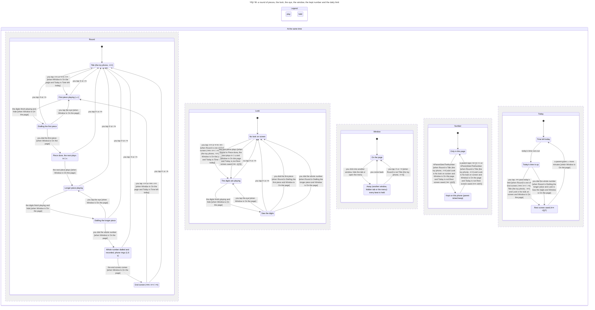

# আম্মুর নম্বর statechart

Kids' game (ছোটদের জন্য, ৪–৮). Spec: `AmmurNumber.tla` / `AmmurNumber.cfg` / `view.ts`, mirrored from the rewrite on `games-to-the-bar`: `tools/ammur-number/lib/session.ts` (the page around a round), `lib/play.ts` (a round), `lib/saved.ts` (the kept number), the beat effect in `components/game.tsx`, and `shared/kids-kit.tsx` (daily limit, rest screen).

Output: `before-fix/` is the run on the old code (23fd7c1): 430 states, five rules broke. `after-fix/` is the run on the rewrite: **TLC reached 100 states, 316 steps; every rule holds** (`after-fix/report.md`, `after-fix/chart.mmd`).

Three shared kids' rules are modelled once, in `ai_docs/statecharts/prithibi-ghuri/`, and hold the same way here: the gate under the game (GateNeedsAnAdult, GateClosesBehindTheParent), the related cards (NoOutboundForKids), and NoNewRoundPastLimit (also pinned by `session.test.ts`).

## Systems modelled
- **The round (the hidden worlds, where every piece opens with the look):** title (the toy phone is the start button) → the look: the digits play and light → the child dials a piece → a 1 s rest → the longer piece, with its look → the whole number rings (the round is recorded at the last digit) → a 1.6 s wait → the end screen (আবার খেলো / শেষ). Two pieces stand for four, and a piece is dialled in one step. Misses are left out, because they only change the stars.
- **The eye key:** one look, only while dialling. A tap or a held key while the digits already play is ignored.
- **The window and the menu:** blur, hide, ⏸, P and Escape are one "away" step. Every beat that runs on a timer (the look, the rest, the ring) is cleared when it happens and starts again from its first digit when the player is back.
- **The parent's number:** the form behind the gate puts the number in page memory; a tick (off by default) keeps it in this phone's storage under one key; নম্বর মুছে দাও clears both.
- **The daily limit:** time runs out; `atBreak()` at the start of a round and at the last digit; the rest screen is shown from the end screen on, never over a round.

## Rules in plain words
| Rule | Says | Result |
|---|---|---|
| NoProgressWhileAway | Dialling starts only after a look the child saw. | holds (before: **broke**) |
| AwayFreezes | While away, no beat moves: the phase, the piece and the look stay. | holds (new, stronger) |
| OneLookOneHelp | A look already playing is never charged again (double tap, held Enter). | holds (before: **broke**) |
| EveryFinishCounts | A number dialled to the end is recorded and checked against the daily limit at its last digit. | holds (before: **broke**) |
| StoredOnlyWhenKept | The number is in storage only when a parent ticked keep. | holds (new) |
| NoReadingNeeded | A child who missed the look gets it back by a picture: the eye key is an eye, the ghost finger points to it. | holds (before: **broke**) |
| RestOnlyAtBreak | The rest screen comes only between rounds. | holds |
| NoChildData | The number never leaves the phone. Before, `speak()` could send it to a speech server. Now there is no voice and no network call at all, so the model has no action for it; `tests/ammur-number.test.ts` ("privacy") pins the source. | holds (before: **broke**) |

I checked the rules bite: removing the `win = "here"` guard from `TheLookEnds` breaks NoProgressWhileAway and AwayFreezes; letting the eye charge while the digits play breaks OneLookOneHelp; recording at the end screen instead of the last digit breaks EveryFinishCounts.

## Bugs found on the old code, and the fix
Replays on the old code ran in Orca on 2026-11-04 (details in `before-fix/report.md`). Each fix is replayed as a node test (`tools/ammur-number/tests/session.test.ts`) and again live on the rewrite, in Orca on 2026-11-05 (localhost:3100, its own storage).

### 1. NoProgressWhileAway
- **The player's version:** "The phone buzzed, I looked away for a second, and when I looked back all the boxes were empty. I never saw the number."
- **Old cause:** `listen()` was a chain of `setTimeout`s, and the piece/end effect used timers too. Nothing listened for `blur` or `visibilitychange`.
- **Fix:** the beat effect (`components/game.tsx`) starts a timer only while `!S.held(s)` and clears it on pause or blur; coming back re-runs it, so the look plays again from its first digit, free. `lookDone`, `restDone` and `ringDone` refuse while held.
- **Test:** `bug 1, NoProgressWhileAway`.
- **Live replay:** level ৫ (look, then hide). `blur` 450 ms in: after 3.5 s away, phase `look`, 0 lights, 0 hidden boxes, `data-held` off after `focus`; 2.75 s later phase `dial`, 3 hidden boxes, 0 looks charged. The ⏸ button the same way: 0 oscillator starts for 2.5 s paused, the look replays after চালিয়ে যাও.

### 2. OneLookOneHelp
- **The player's version:** "He tapped আবার দেখাও twice because nothing happened fast enough, and lost a star for one look."
- **Old cause:** `peek()` charged whenever anything was hidden, even while a look played.
- **Fix:** `askLook()` answers only while dialling; a second tap or a held Enter finds the phase `look` and is ignored, and `look()` only charges what `askLook` lets through. Eyes are now a pictured, limited resource in the last world (3, 2, 1).
- **Test:** `bug 2, OneLookOneHelp`.
- **Live replay:** two taps 150 ms apart on the eye: `looks` 1, phase `look`.

### 3. EveryFinishCounts
- **The player's version:** "She dialled the whole number, the phone rang, she tapped ধাপ ১ right away, and the stars never came."
- **Old cause:** the record lived in a 1.7 s timer effect that a new round cleared.
- **Fix:** `dialled(s, "end", over)` records the round and runs `atBreak()` at the last digit; the ring and the wait are for show. Switching person or level mid-round no longer exists (who is chosen on the title; the level list leaves the round).
- **Test:** `bug 3, EveryFinishCounts`.
- **Live replay:** level ৩ (the whole number, all visible), 11 digits dialled, ⟳ 300 ms into the ring: screen `title`, `recorded` = `serial` = 3, stars for id 6 = 3.

### 4. NoChildData
- **Old cause:** the 🔈 button spoke the number's words with the first Bangla voice, which can be a network voice.
- **Fix:** no voice anywhere (`speak()` and `SpeakButton` are not used; a test bans them in the tool's source). No `fetch`, no `/api`, no share-client, no history writes. The number goes to storage only when a parent ticks keep, only through `lib/saved.ts`, under `ektukhani-ammur-number-saved`, and only a valid number is read back. The card never receives it.
- **Test:** `privacy: no network, no link, no log…` and `saved numbers…`.
- **Live check:** typed a fake number behind the gate with the tick on: storage held `{"abbu":"…"}` under that one key, no new request except the page's own assets, the address unchanged; the radios did not close the gate; নম্বর মুছে দাও emptied the key and the title went back to the demo number.

### 5. NoReadingNeeded
- **Fix:** the eye key is a drawn eye (shut when the round has no looks left), and after a quiet 6.5 s with something hidden the ghost finger points to it, not to a digit. Two misses on a digit still make the right key glow, with a dashed ring.
- **Test:** `pictures only: the eye key has a picture and the ghost finger points to it`.
- **Live replay:** level ৫, no taps for 7.2 s: the ghost sat on the eye key.

### Rules that already held
- **RestOnlyAtBreak:** `restShows` is `resting && screen !== "play"`; the limit is checked at the start of a round and at the last digit, and the rest screen waits for the end screen.

## Quality-bar gaps closed
1. **First screen:** the toy phone is the start button (the biggest thing), with খেলো across its foot. It starts with the saved number, or the demo number when there is none, so a child can start alone. The parent's gate is small and below.
2. **Pause:** the game is in the shared player: ⏸, P, Escape, blur and hide stop every beat; সব লেভেল is in the menu.
3. **A tap during the look** no longer cuts it short: the keys dim, the tap is ignored, the digits finish.
4. **HUD in the corners, the middle clear,** a pictured cue on the screen (eye, finger, tick), no words needed.
5. **Desktop:** the stage is the player's 480–560 px column, with the rails.
6. **Choices:** the level list is a choice screen; each card draws what it asks (hollow dots hide, eyes are the looks).

## The chart (after the fix)


## Regenerate
```sh
scripts/statechart.sh ai_docs/statecharts/ammur-number/AmmurNumber.tla --view ai_docs/statecharts/ammur-number/view.ts --out ai_docs/statecharts/ammur-number/<new-folder>
rm ai_docs/statecharts/ammur-number/<new-folder>/tlc*.out
```
