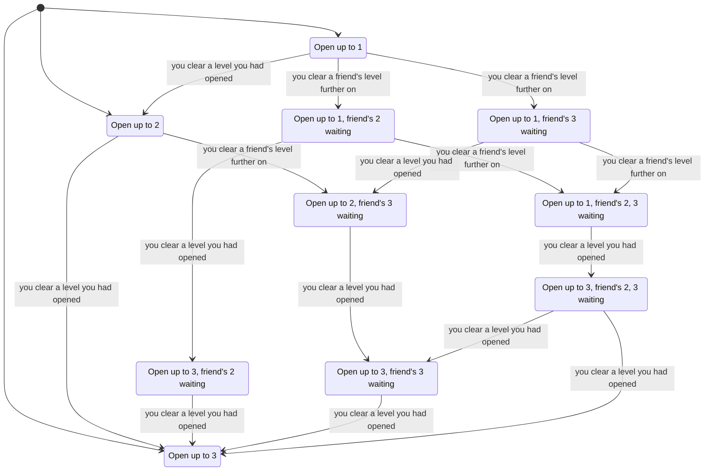

# অ্যান্টেনা ঠিক করো: statechart (the worked example)

This is the first model the repo made, and the one every other game copies. It has two halves:
- **before-fix/**: the model of the shipped game, which found two real bugs;
- **after-fix/**: the model of the rewrite (Nov 2026), where every rule holds, plus a small second model for the level unlock.

## Files
| File | What |
|---|---|
| `Antenna.tla`, `Antenna.cfg`, `view.ts` | The model of the rewritten game: screens, the shared player's menu, window focus, the hand on the dial, the static loop, the card's chimes. |
| `unlock/Unlock.tla`, `Unlock.cfg`, `view.ts` | Which levels open, with a friend's link in the mix (3 levels stand in for 12). It's a separate spec only so each chart stays under the tool's 500-state budget. |
| `before-fix/report.md`, `chart.mmd` | The old model's run. The old spec is in git history (`Antenna.tla` at 6775639). |
| `after-fix/report.md`, `chart.mmd` | The run of today's `Antenna.tla`: 43 states, 192 steps, all 12 rules hold. |
| `after-fix/unlock/` | The run of `Unlock.tla`: 22 states, all 4 rules hold. |

**What the model mirrors:**
- `tools/antenna-thik-koro/components/antenna.tsx`: `begin`, `finish`, the blur/focus/visibility effect, the sound effect, and `useGamePlayer`'s `onPause`, `onResume` and `onRestart`;
- `lib/session.ts`, the pure session the component forwards every event to: `ticking`, `canTurn`, `wantHiss`, `syncLoops`, `blur`, `hide`, `pause`, `resume`, `press`, `release`, `freshResultKey`;
- `lib/levels.ts`: `openLevel` and `nextAhead`;
- `shared/game-player-client.tsx`:
  - blur and hide open the menu once you've touched the game;
  - চালিয়ে যাও and নতুন করে শুরু send a focus first;
  - pausing cuts scheduled tones.

## Before → after

| | Before (the shipped game) | After (the rewrite) |
|---|---|---|
| Page | Its own hero, a `#tool` section and its own pause overlay | `<GamePage>`. The game reads `useGamePlayer()` for pause, resume, restart and the stage size. |
| Who decides input and loops | Ad hoc flags in the component | `lib/session.ts`. `syncLoops` runs after every event and every step, so a loop is on exactly when `wantHiss` says. |
| Window blur | Nothing. A held ← kept turning: the keyup never came. | `session.blur` lets go of every key and finger, the player opens its menu, and `useGameLoop` stops. |
| Sound back on | Started nothing. The static stayed silent. | The sound effect runs `syncLoops` at once, and so does every step. |
| Card chimes | `setTimeout`s, cleared on reset | Scheduled `tone()`s, which the player's pause and `begin()` cut (`silenceScheduled`). Sound off cuts them too. |
| Friend's far level | Its stars went into the levels key, and `unlockedLevel` opened every level below it. | Its stars are kept, and the level sits in `ektukhani-ahead-…`. `openLevel` ignores it until your own play reaches it. |
| Result keys | Space or Enter on the card started the next level | Only a fresh, non-repeating keydown after the card appeared (`freshResultKey`). Game keys are handled at `window` with `preventDefault`, and buttons blur after a click. |

## Rules (plain words)
The first five are the old model's rules, word for word. The first two are the ones that broke.

| Rule | The reader's sentence | Before | After |
|---|---|---|---|
| **DialStillWhileAway** | The dial never turns on its own while you're in another window. | **broke** | holds |
| **StaticWhileSearching** | While you search with sound on, you hear the static. | **broke** | holds |
| StaticOnlyWhileListening | Static while searching only with the tab showing, the game running and sound on. | held | holds |
| HiddenMeansPaused | A hidden tab during a round is a paused round. | held | holds |
| NoStaticOnTheCard | The card is quiet. | held | holds |
| PausedWhenBlurred | Clicking into another window during a round pauses it. | (not in model) | holds |
| NoProgressWhileAway | The clock, the wind and the gusts move only while you're on the page with the menu shut. | (not in model) | holds |
| InputReleasedWhenAway | After a blur, a hidden tab or the menu, no key or finger counts as held. | (not in model) | holds |
| LoopComesBack | When the game runs a search with sound on, the static is playing, so turning sound on or resuming brings it back. | (not in model) | holds |
| StaticOnlyWhenMeaningful | The static plays only while there's snow to hear: never paused, away, muted, locked or on the card. | (not in model) | holds |
| CelebrationOnItsOwnCard | The ident and star chimes play only on their own card, with the menu shut and sound on. | (not in model) | holds |
| UnlockNeverShrinks (unlock) | What you could pick never shrinks, from the old rule on. | (not in model) | holds |
| FriendOpensNoGap (unlock) | Every level below the highest you may pick was cleared by you, or was already open under the old rule. | would break (see below) | holds |
| FriendStarsKept (unlock) | A friend's level you cleared keeps its stars. | — | holds |

**Mutation check:**
- With blur not letting go of the hand and sound-on not syncing (the old behaviour), TLC breaks DialStillWhileAway, StaticWhileSearching, PausedWhenBlurred, InputReleasedWhenAway and LoopComesBack.
- With `Open == Unlocked(cleared)` (the old rule), it breaks FriendOpensNoGap in one step: cleared {} → clear a friend's 2 → levels 1–2 open with 1 never played.

So the rules are not vacuous.

## Bugs (found before, fixed now)

### 1. DialStillWhileAway: "I held → and clicked into another window, and the dial kept spinning."
- **Path:** ready → you hold ← or → → you click into another window.
- **Replay before (Orca):** dial 34° → 186° → 368° after the blur, with no key down.
- **Replay after (Orca, Pixel 9 emulation, 4 Nov 2026):** held → for 0.9 s (dial 51°) → `blur` → menu open, `session.hold = 0` → 2.5 s later the dial is still 51°, and the clock is still 0.92 s.
- **Fix:** `session.blur` releases the hold and the drag. The player's menu pauses. `step()` does nothing unless `ticking`.
- **Tests:**
  - `statechart DialStillWhileAway: hold →, click into another window, and the dial stays where you left it`;
  - `…even without the menu (before you've touched the page), a blur lets go and freezes the game`.

### 2. StaticWhileSearching: "I turned the sound off, started, turned it back on, and the TV stayed silent."
- **Path:** sound off → you hold ← or → → you turn sound on.
- **Replay before:** no loop restarted.
- **Replay after (Orca):**
  1. With `AudioBufferSourceNode.start` and `stop` counted for loops, sound goes off in the menu, then চালিয়ে যাও and a turn: phase search, 0 live loops.
  2. Sound on in the menu: still 0 while paused.
  3. চালিয়ে যাও: 1 live loop, and `session.hiss` is true.
- **Fix:** `syncLoops` runs after the sound effect and every step. The loop is started whenever `wantHiss` holds and none is playing.
- **Tests:**
  - `statechart StaticWhileSearching: sound off, start, sound on, and the static comes back`;
  - `statechart LoopComesBack: …`.

### 3. FriendOpensNoGap: "My friend sent level 9. I cleared it, and suddenly levels 3–8 were open without playing them."
- **Path (unlock model, old rule):** cleared {1, 2} → you clear a friend's level further on (9) → `unlockedLevel` opens up to 10.
- **Fix:** `openLevel` and `nextAhead` in `lib/levels.ts`. `unlockedLevel` itself is unchanged, so old saved progress opens exactly what it opened.
- **Tests:**
  - `statechart FriendOpensNoGap: clearing a friend's level 9 from level 2 doesn't open 3–8`;
  - `own unlock rule: …` in `levels.test.ts`.

### Also fixed in the rewrite (shared patterns)
- **Result keys need a fresh press:** a held or repeating key never skips the card (`result keys need a fresh press…`). Live: a repeating Enter on the card leaves it on the card.
- **The card's chimes:** they're scheduled tones now, so the pause, the next run and sound-off cut them (CelebrationOnItsOwnCard).

## The chart (after-fix)

```mermaid
stateDiagram-v2
  direction LR
  state "Legend" as legend {
    lg0: start
    lg1: play
    lg2: held
    lg3: done
  }
  class lg0 blue
  class lg1 teal
  class lg2 yellow
  class lg3 blue
  state "At the same time" as all {
    state "Game" as r0 {
      s0: Title: the set says খ#2503;ল#2507;
      s1: Waiting for your first turn
      s2: Searching for the signal
      s3: Picture locked
      s4: Card shows
      [*] --> s0
      s0 --> s1: you tap the set [when Window is You're on the page]
      s1 --> s2: you hold #8592; or #8594; [when Menu is Menu shut and Window is You're on the page]
      s2 --> s3: the picture locks [when Menu is Menu shut and Window is You're on the page]
      s3 --> s2: the next channel starts [when Menu is Menu shut and Window is You're on the page]
      s3 --> s4: the last channel locks and the card shows [when Menu is Menu shut and Window is You're on the page]
      s2 --> s1: you press নত#2497;ন কর#2503; শ#2497;র#2497; [when Menu is Menu open, game paused and Window is not Tab hidden and Hand is Hands off and Static is Static off]
      s3 --> s1: you press নত#2497;ন কর#2503; শ#2497;র#2497; [when Menu is Menu open, game paused and Window is not Tab hidden and Hand is Hands off]
      s4 --> s1: you press ১, ২ or ৩ on the card [when Menu is Menu shut and Window is You're on the page]
      s4 --> s1: you press নত#2497;ন কর#2503; শ#2497;র#2497; [when Menu is Menu open, game paused and Window is not Tab hidden and Chimes is Quiet]
    }
    --
    state "Menu" as r1 {
      s5: Menu shut
      s6: Menu open, game paused
      [*] --> s5
      s5 --> s6: you hide the tab or you click into another window or you press #9208; or Esc [when Game is not Title: the set says খ#2503;ল#2507; and Window is You're on the page]
      s6 --> s5: you press নত#2497;ন কর#2503; শ#2497;র#2497; or you press চ#2494;ল#2495;য#2492;#2503; য#2494;ও [when Window is not Tab hidden]
    }
    --
    state "Window" as r2 {
      s7: You're on the page
      s8: Tab hidden
      s9: Another window has focus
      [*] --> s7
      s7 --> s8: you hide the tab
      s7 --> s9: you click into another window
      s7 --> s9: you press #9208; or Esc [when Game is not Title: the set says খ#2503;ল#2507; and Menu is Menu shut]
      s8 --> s7: the tab shows again
      s9 --> s7: you come back to the window
      s9 --> s8: you hide the tab
      s9 --> s7: you press নত#2497;ন কর#2503; শ#2497;র#2497; or you press চ#2494;ল#2495;য#2492;#2503; য#2494;ও [when Game is not Title: the set says খ#2503;ল#2507; and Menu is Menu open, game paused]
    }
    --
    state "Hand" as r3 {
      s10: Hands off
      s11: Holding #8592; or #8594;
      [*] --> s10
      s10 --> s11: you hold #8592; or #8594; [when Game is none of Card shows, Title: the set says খ#2503;ল#2507; and Menu is Menu shut and Window is You're on the page and Chimes is Quiet]
      s11 --> s10: you let go or you hide the tab or you click into another window or you press #9208; or Esc
      s11 --> s10: the last channel locks and the card shows [when Game is Picture locked and Static is Static off]
    }
    --
    state "Static" as r4 {
      s12: Static off
      s13: Static on
      [*] --> s12
      s12 --> s13: you tap the set [when Game is Title: the set says খ#2503;ল#2507; and Menu is Menu shut and Window is You're on the page and Hand is Hands off and Sound is Sound on and Chimes is Quiet]
      s12 --> s13: you turn sound on [when Game is one of Searching for the signal, Waiting for your first turn and Menu is Menu shut and Window is You're on the page and Sound is Sound off and Chimes is Quiet]
      s13 --> s12: you turn sound off or you hide the tab or you click into another window or you press #9208; or Esc
      s12 --> s13: you press নত#2497;ন কর#2503; শ#2497;র#2497; [when Game is not Title: the set says খ#2503;ল#2507; and Menu is Menu open, game paused and Window is not Tab hidden and Hand is Hands off and Sound is Sound on and Chimes is Quiet]
      s12 --> s13: you press চ#2494;ল#2495;য#2492;#2503; য#2494;ও [when Game is one of Searching for the signal, Waiting for your first turn and Menu is Menu open, game paused and Window is not Tab hidden and Hand is Hands off and Sound is Sound on and Chimes is Quiet]
      s13 --> s12: the picture locks [when Game is Searching for the signal]
      s12 --> s13: the next channel starts [when Game is Picture locked and Menu is Menu shut and Window is You're on the page and Sound is Sound on and Chimes is Quiet]
      s12 --> s13: you press ১, ২ or ৩ on the card [when Game is Card shows and Menu is Menu shut and Window is You're on the page and Hand is Hands off and Sound is Sound on]
    }
    --
    state "Sound" as r5 {
      s14: Sound off
      s15: Sound on
      [*] --> s14
      [*] --> s15
      s14 --> s15: you turn sound on
      s15 --> s14: you turn sound off
    }
    --
    state "Chimes" as r6 {
      s16: Quiet
      s17: Card chimes playing
      [*] --> s16
      s16 --> s17: the last channel locks and the card shows [when Game is Picture locked and Menu is Menu shut and Window is You're on the page and Static is Static off and Sound is Sound on]
      s17 --> s16: you press ১, ২ or ৩ on the card or you turn sound off or the chimes end or you hide the tab or you click into another window or you press #9208; or Esc
    }
  }
  class s0 blue
  class s6 yellow
  class s11 teal
  class s13 teal
  class s17 blue
```


## The unlock chart (after-fix/unlock)


## What the model leaves out
- **The rules of the evening:** the signal, the ghosts, wind, gusts, the loose pole and the finale's meter. These are pure and seeded, and covered by `tests/antenna.test.ts` and `tests/levels.test.ts` with headless bots.
- **The first-run story:** a screen before "ready" with one cleared hold timer and no loops.
- **The wind loop:** `wantWind` follows the same `ticking` and sound rules as the static; see `statechart HiddenMeansPaused…` in `tests/session.test.ts`.
- **The player's 0.6 s grace after entering full screen:** during it a blur doesn't open the menu. The game still freezes then, because `ticking` needs focus and `useGameLoop` stops, so NoProgressWhileAway and InputReleasedWhenAway hold either way. It is a player detail, noted for the orchestrator.
- **Orca pins `document.hidden` to false**, so the hide path was replayed in node tests, not live.

## Regenerate
```sh
scripts/statechart.sh ai_docs/statecharts/antenna-thik-koro/Antenna.tla --view ai_docs/statecharts/antenna-thik-koro/view.ts --out ai_docs/statecharts/antenna-thik-koro/<new-folder>
scripts/statechart.sh ai_docs/statecharts/antenna-thik-koro/unlock/Unlock.tla --view ai_docs/statecharts/antenna-thik-koro/unlock/view.ts --out ai_docs/statecharts/antenna-thik-koro/<new-folder>/unlock
```
Delete `tlc.out` from the new folders afterwards.
