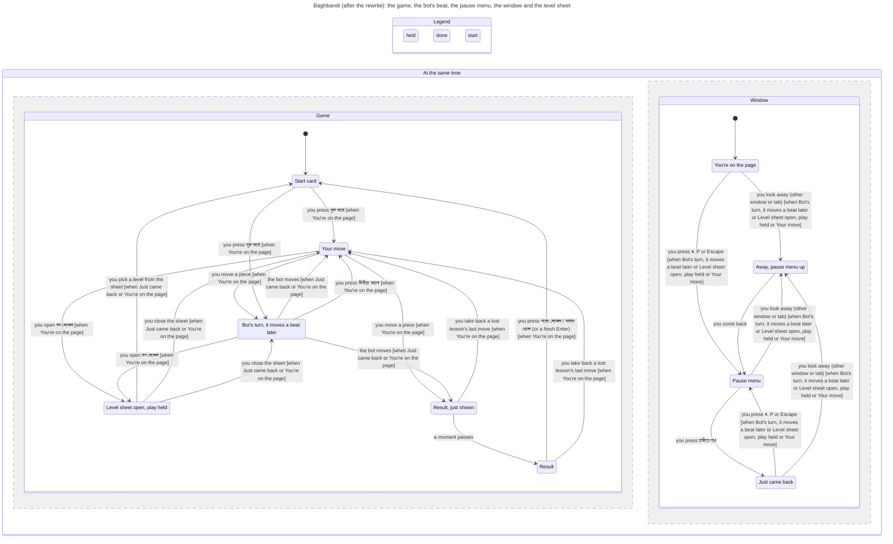

# বাঘবন্দি statechart

## After the rewrite (2026-11-04)
Model: `Baghbandi.tla` with `Baghbandi.cfg` (the drawn chart, `Full = FALSE`) and `BaghbandiFull.cfg` (the full check, `Full = TRUE`), plus `view.ts`. It mirrors:
- `tools/baghbandi/lib/flow.ts`: `running`, `held`, `start`, `finish`, `reopen`, `menu`, `away`, `sheet`, `awake`, `takesTap`, `takesResultKey`;
- `lib/save.ts` (`openAfter`) and `lib/game.ts` (`isBotTurn`, `canUndo`);
- `components/bagh-game.tsx`:
  - `load` and `pickMode`;
  - the bot effect, armed only on `running && botTurn`;
  - `apply` and `finishGame`, which record stars at the moment of the win;
  - the blur, focus and visibility effect, and `useGamePlayer` `onPause` / `onResume` / `onRestart`;
  - the window key handler, `guarded` on every start-card and result button, and `openFriend`;
- the player's menu, which opens on blur and hide once the game has been touched.

Run:
- `after-fix/report.md` and `after-fix/chart.mmd`: 224 states, 10 chart states, 23 arrows;
- `after-fix/report-full.md`: 6,680 states, all three sides, three levels and a friend's far-ahead link.

**Every rule holds in both runs:** TypeOK, BotWaitsWhileHidden, BotWaitsWhileBlurred, NoProgressWhileAway, PausedWhenAway, ChoiceFreezesPlay, ComeBackIsNotAMove, ResultNeedsFreshPress, NoDoubleResult, BotOnlyAgainstYou, ReplayIsExact, OpenLevelsAreEarned, NoDeadlock.

**Mutant check:** let blur not hold play, let a board press skip the come-back guard, and unlock by the highest star (as `unlockedLevel` does). Then NoProgressWhileAway, PausedWhenAway, both BotWaits rules, ComeBackIsNotAMove and OpenLevelsAreEarned break at once.

### What changed in the model
- **Presence is its own hold.** `away` (blur or a hidden tab) holds play, whether or not the player's menu is up. The bot's timer exists only while nothing holds: not the menu, not away, not the sheet. Before, only `paused` and the friend's card stopped it, and a hidden tab paused only after the first move.
- **The menu is the player's.** Blur and hide open it once the game has been touched; ⏸, P and Escape open it any time. চালিয়ে যাও (and নতুন করে শুরু, which loads the same level's start card) start a 350 ms come-back guard. Within it no board press moves and no start-card or result button acts.
- **The level sheet holds play and the clock.** Picking from it loads that level's start card.
- **The result appears in the same step as the last move.** Stars and your open level are recorded there, and a 0.4 s guard starts. Only a fresh Enter, or a click, after it goes on. A lost lesson can reopen play from the move before.
- **Your open level is your own.** Clearing it opens the next one. A friend's far-ahead level records its stars and opens nothing in between.

| Rule | In plain words | Result |
|---|---|---|
| BotWaitsWhileHidden | While the tab is hidden, the bot doesn't move. | holds (broke before) |
| BotWaitsWhileBlurred | While you're in another window, the bot doesn't move. | holds (broke before) |
| NoProgressWhileAway | The clock and the bot run only while you're on the page. | holds |
| PausedWhenAway | Mid-game and away, the pause menu is up. | holds (PausedWhenHidden broke before) |
| ChoiceFreezesPlay | While সব লেভেল is open, nothing moves and the clock stops. | holds |
| ComeBackIsNotAMove | The press that brings you back never moves a piece or picks a side. | holds |
| ResultNeedsFreshPress | A key held through the last move never skips the result. | holds |
| NoDoubleResult | A result is recorded once, only while it shows. | holds |
| BotOnlyAgainstYou | In দুজনে, no turn belongs to a bot. | holds |
| ReplayIsExact | On a friend's level, you play from their seed and their bot. | holds |
| OpenLevelsAreEarned | Every open level above 1 was opened by clearing the one before. | holds |

| Bug | Fix | Node test | Live replay (Orca, after the fix) |
|---|---|---|---|
| 1. BotWaitsWhileHidden + PausedWhenHidden | The bot's timer is armed only while `running` (no menu, not away, no sheet). A tab that loads hidden starts away. Blur and hide open the player's menu. | `bug 1 · BotWaitsWhileHidden: …` | Level 6 as the tiger (the bot opens), blur dispatched 100 ms after শুরু করো. After 2.5 s: চাল ০/১২০, the menu up. Focus alone kept it held. After চালিয়ে যাও, the bot moved 671 ms later (চাল ১/১২০). Orca pins `document.hidden`, so the hide path is the same `away()` as blur here. |
| 2. BotWaitsWhileBlurred | The same hold, plus the come-back guard. | `bug 2 · BotWaitsWhileBlurred: …` | Level 5 as the goats, 11→12 (চাল ১), then blur. After 2.1 s: still চাল ১/১২০ (before the fix: ২ and "সাবধান!…"). Resume, and the bot replied (চাল ২). Then blur, focus and resume: a tap 30 ms later lit 0 targets, and a tap after the guard lit 3. |

Also checked live:
- Escape and ⏸ open the menu.
- নতুন করে শুরু goes back to the same level's start card.
- Back closes immersive mode and stays on `/baghbandi`.
- A repeat Enter on the result is ignored; a fresh one goes on to লেভেল ৬.
- The launch card's খেলায় ফেরো returns to the open menu, so a start tap underneath is ignored.



### Regenerate
```sh
D=ai_docs/statecharts/baghbandi
scripts/statechart.sh $D/Baghbandi.tla --view $D/view.ts --out $D/after-fix                                # the chart (Full = FALSE)
scripts/statechart.sh $D/Baghbandi.tla --config $D/BaghbandiFull.cfg --view $D/view.ts --out <new folder>  # the full check; copy its report.md to after-fix/report-full.md
rm $D/after-fix/tlc*.out
```
The chart hides the come-back guard running out, and নতুন করে শুরু everywhere. It draws looking away and ⏸ only from play, and the friend's link and level steps only from the start card. The model and the reports keep all of them.

## Before the rewrite (kept for the record)

Model: `before-fix-model/Baghbandi.tla` / `.cfg` / `view.ts`. Report and chart: `before-fix/report.md`, `before-fix/chart.mmd`.
Code mirrored: `tools/baghbandi/components/baghbandi-game.tsx`, `tools/baghbandi/lib/game.ts` (`isBotTurn`, `canUndo`, `undo`).

TLC: 201 states, 944 steps. **3 rules hold, 3 break**, all from one root cause: the bot's timer ignores whether you are there.

### Systems modelled
- **Who plays:** ছাগল হবো (you're the goats, the bot is the tiger), বাঘ হবো (you're the tiger; the goats move first, so the bot opens), দুজনে (no bot).
- **Play phase:** first move → mid-game → over (a move either keeps the game going or ends it). There is also the friend's card (`viewing`).
- **Bot:** the effect runs a 650 ms `setTimeout` (1200 in ধীরে খেলো). Only `paused`, `viewing` or a new game clears it. Nothing about the window does.
- **Pause and focus:** `visibilitychange` pauses only if `moves.length > 0` and the game isn't over. There is no blur or focus listener, and no pause button, P or Esc.
- **Take-back:** ফিরিয়ে আনো undoes your move and the bot's reply, and also unpauses.
- **Result:** the effect is guarded by `finished.current === game` and records the best, stars and sound once.
- **Friend's link:** `hashchange` → their card. The challenge buttons and the mode buttons with no level keep their seed. A level that isn't theirs gets a fresh seed.
- **Sound:** one-shots only (click, growl, sfx), no loops.
- **Not modelled:** board geometry, selection, the keyboard cursor, the pointer press and release pair (none of them advance play), and the per-level star ladder (`recordLevel` keeps the max, which shared tests cover).

### Rules (plain words)
| Rule | In plain words | Result |
|---|---|---|
| BotWaitsWhileHidden | While the tab is hidden, the bot doesn't move. | **breaks** |
| BotWaitsWhileBlurred | While you're in another window, the bot doesn't move. | **breaks** |
| PausedWhenHidden | Mid-game with the tab hidden, the game is paused. | **breaks** (after the bot's opening move while hidden) |
| BotOnlyAgainstYou | In দুজনে, nobody's turn belongs to a bot. | holds |
| NoDoubleResult | A game's result (stars, best, sound) is recorded once, and only when it's over. | holds |
| ReplayIsExact | When you take a friend's challenge, you play from their start. | holds |

### Bugs
#### 1. BotWaitsWhileHidden + PausedWhenHidden (game-specific)
- **Player's sentence:** "I picked বাঘ হবো and switched tabs. When I came back, the goats had already moved, the game wasn't paused, and I never saw their move."
- **Path:** 0 your first move (goats) → 1 you pick বাঘ হবো (the bot opens) → 2 you hide the tab (not paused, because no move has been played yet) → 3 the bot moves (now mid-game, hidden, not paused).
- **Live replay:** partly possible. Orca pins `document.hidden` to a native getter that always returns `false`, and it can't be redefined (`configurable: false`), so no hidden tab can be produced in Orca. The parts I could check: I clicked বাঘ হবো, then dispatched `visibilitychange` and `blur` in the same tick. The board read `data-bot="true"`, status "ছাগল ভাবছে…" and clock ০. About 2 s later the clock read ১, the status read "তোমার পালা…", and there was no `.bb-overlay`. From the code, `hide()` returns early when `moves.length === 0`, and the bot's `setTimeout` keeps firing in a hidden tab (throttled to about 1 s), so the hidden case follows. Replay it with a real tab switch once the fix lands.
- **Fix:** make the bot wait for presence, not only for `paused`. Either pause on hide whenever a bot turn is pending (drop the `moves.length` condition for bot turns), or gate the bot effect on `!document.hidden && document.hasFocus()` and re-arm it on `visibilitychange`/`focus`.

#### 2. BotWaitsWhileBlurred (shared cause: no blur handling)
- **Player's sentence:** "I moved a goat and glanced at another window. The tiger jumped while I wasn't looking."
- **Path:** 0 your first move → 1 you move a piece (the bot is thinking) → 2 you click into another window (the bot is still thinking, unpaused).
- **Live replay (Orca, ছাগল হবো):** I tapped the pile at (1,2), tapped (1,3), then dispatched `blur`, with `document.hasFocus()` false throughout. 2.1 s later the clock read ২ (your move plus the bot's reply), the status read "সাবধান! লাল দাগের ছাগলের পেছনটা ফাঁকা…", and there was no overlay.
- **Fix:** the shared away handling (blur → pause) from the game player, or at least hold the bot's timer while `!document.hasFocus()` and fire it about 650 ms after focus returns, so the reply is always seen.

### Quality-bar gaps (played one game as the tiger at level 1: a random-greedy tiger won ★★★ in 36 moves)
1. **No real pause:** there is no button, P or Esc. A hidden tab pauses only after the first move, and blur never does.
2. **The first screen has no single big start action:** three mode buttons of equal weight. On a phone (412 px), the status line that teaches the first move ("একটা গাদায় চাপো") is below the fold (`.shots/baghbandi-first-screen-phone.png`).
3. **Difficulty isn't explained:** there are 8 levels per side, labelled only "লেভেল ১". The bot's change is never said in the player's words, and the picker hides in a collapsed সব লেভেল.
4. **The first win is far off:** even level 1 takes 30–60 moves (1–3 minutes), not 10 seconds.
5. **Pacing:** every level is the same board, and only the bot gets sharper. No new element per level, and no named boss at the end of a ladder.
6. **No edge danger cue** when the tiger is one capture from 8, or the goats are close to a trap. Danger shows only as red marks on the board.
7. **Sound:** a click per side, a growl, and the shared sfx. There is no signature sound or music. On mute, every meaning is still visible (good).
8. **What's good:** threat and leap hints teach well, undo exists, the end screen shows real stats and stars, the card is personal, and a link replays and re-checks the moves.

Screenshots: `.shots/baghbandi-first-screen-phone.png`, `.shots/baghbandi-over.png`.

### Regenerate (before)
```sh
scripts/statechart.sh ai_docs/statecharts/baghbandi/before-fix-model/Baghbandi.tla --view ai_docs/statecharts/baghbandi/before-fix-model/view.ts --out <new folder>
```
The chart hides the celebration step and the resets that every state has. Mode, link and another game are drawn only from the calm first screen and from the result.
