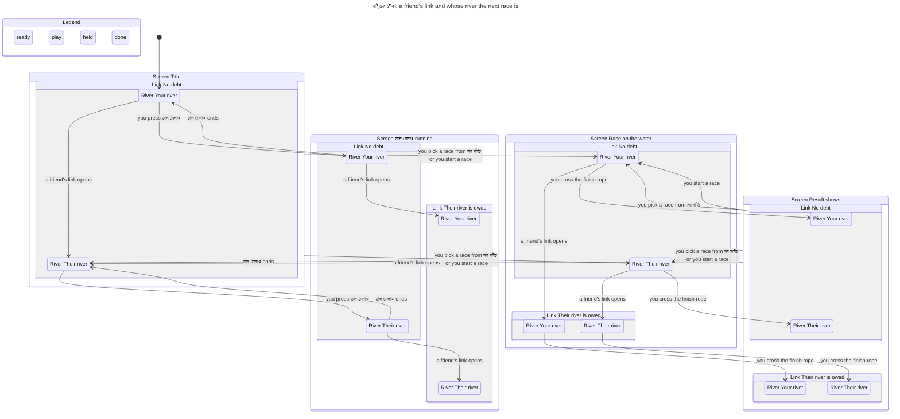

# বাইচের নৌকা: statechart

Before the rewrite — model: `before-fix/BaicherNouka.before.tla`, `before-fix/BaicherNouka.before.cfg`, `before-fix/view.before.ts`. Report and chart: `before-fix/report.md`, `before-fix/chart.mmd`. The rewrite's model and its run are in **After the rewrite** at the bottom.

(The sections below describe the old code and its five bugs; the live replays are the old page's.)
Code mirrored: `tools/baicher-nouka/components/baich-game.tsx`, `shared/game-kit.ts` (`useGameLoop`), `shared/game-sound.ts` (`loop`, `setSoundOn`), `shared/game-ui.tsx` (`SoundToggle`).

TLC: 464 states, 1,900 steps. **3 rules hold, 5 break.**

## Systems modelled
- **Race phase:** ready → racing → paused → result, plus তাল মেলাও (calibration).
- **Pause and focus:** P, Esc and থামাও pause, and so do a hidden tab and the river scrolling out of view (`useInView`, threshold 15%). There is no blur or focus listener. `useGameLoop` stops only while the tab is hidden.
- **Resume:** the overlay's চালিয়ে যাও or Space (both need the river in view), or the bar's চালিয়ে যাও (doesn't).
- **Start:** শুরু করো, Space or the arrows (need the river in view), or the drum and side pads below the river (don't).
- **Rush loop:** `loop("wind")` starts in `start`/`resume`, stops on any phase other than racing, and `setSoundOn(false)` stops it too. The SoundToggle `onChange` restarts it only while racing.
- **Result:** `settled()` blocks restarts for 450 ms. After that, Space/Enter (the handler, or the আরেকবার button focused at 600 ms) starts the next race. Drum beats are 1.6–2.2 s apart.
- **Friend's link:** `readFriend` during a race or তাল মেলাও only remembers the friend. Otherwise their river waits on the ready screen. `start()` reuses the waiting race when its `t` is 0 and the race number matches. `seedFor()` gives their river only when the race number is theirs.
- **Not modelled:** the 0.8 s resume grace, the 2.6 s settle of the other boats, lag values and stars (no rule needs them; `recordLevel` keeps the max).

## Rules (plain words)
| Rule | In plain words | Result |
|---|---|---|
| PausedWhenHidden | If the tab hides mid-race, the race is paused. | holds |
| PausedWhenBlurred | If you click into another window mid-race, the race is paused. | **breaks** |
| PausedWhenScrolledAway | The race never runs while the river is scrolled out of view. | **breaks** |
| CalibWaitsWhileAway | তাল মেলাও never runs while you're in another window or the river is out of view. | **breaks** |
| LoopOnlyWhenMeaningful | The river rush plays only during a race with sound on. | holds |
| LoopComesBack | During a race with sound on, the rush is playing (also after sound comes back on, and after resume). | holds |
| ResultStaysABeat | One more drum tap right after the finish never skips your result. | **breaks** |
| ReplayIsExact | After you open a friend's link, the next race you start is their river. | **breaks** |

## Bugs
### 1. PausedWhenBlurred (shared cause: no blur handling)
- **Player's sentence:** "I clicked another window for a second and my boat kept rowing. The others passed me while I wasn't there."
- **Path:** 0 ready → 1 you tap শুরু করো → 2 you click into another window (still racing, rush on).
- **Live replay (Orca):** started with a trusted click: `t = 0.25 s`, `y = 16`. I dispatched `blur` (`document.hasFocus()` was already false). 3 s later: phase `playing`, `t = 0.65`, `y = 71`. 6 s later: `t = 1.35`, `y = 184`. My background tab ran at about 2 fps, so time was slow, but it never stopped.
- **Fix:** shared away handling: blur pauses a real-time game. Here, `pause()` on `window` blur, the same as hide (the phase effect already stops the rush).

### 2. PausedWhenScrolledAway (game-specific)
- **Player's sentence:** "I scrolled down to look at সব বাইচ and pressed চালিয়ে যাও on the bar. The race ran off-screen." Or: "I tapped the drum pad with the river scrolled up, and the race started where I couldn't see it."
- **Path (report):** 0 ready → 1 you scroll the river away → 2 you tap the drum (racing, river off-screen). The other path: racing → scroll away (pauses, which holds) → the bar's চালিয়ে যাও.
- **Live replay (Orca):** at 55 of 623 px of river visible, scrolling mid-race paused at `t = 22.02` (correct). A trusted click on the bar's চালিয়ে যাও gave `playing`. Real time: `t 22.02 → 22.28`; stepping the real `step()` for 3 s: `t → 29.70`, `y 3516 → 4678`, river still off-screen. Pad start: on the ready screen with 55 px visible, I clicked the drum pad (`ঢোলের তালে চাপো`) → `playing`, and after 4 s of steps `t = 4.23`, `y = 660`.
- **Fix:** in `start()` and `resume()`, refuse (or scroll the river into view first) when `!stageInView`. Or re-run the in-view check after the phase becomes `playing`. The pads and the bar button go through those two functions.

### 3. CalibWaitsWhileAway (game-specific)
- **Player's sentence:** "I started তাল মেলাও and scrolled a little. The beats played on their own, my taps didn't count, and it said 'ঠিকমতো ধরা গেল না'."
- **Path:** 0 ready → 1 you press তাল মেলাও → 2 you scroll the river away (still calibrating).
- **Live replay (Orca):** I started তাল মেলাও and scrolled to 55 px visible. A trusted Space was ignored (the keyboard needs the river in view). After 3 s, calibration was at `t = 3.72`, `taps = 0`. After 6 more seconds it ended by itself: phase `ready`, note "ঠিকমতো ধরা গেল না। আরেকবার চেষ্টা করো…". A blur behaves the same, because nothing listens for it.
- **Fix:** while calibrating, a blur, a hide or scrolling away should cancel (`endCalib(true)`) or restart the eight pulses, and say so.

### 4. ResultStaysABeat (game-specific)
- **Player's sentence:** "I crossed the line still drumming on Space. My next tap started the next race, and my time and stars vanished before I saw them."
- **Path:** 0 ready → 1 start → 2 you cross the finish rope → 3 time passes on the result (past 450 ms, inside one beat) → 4 you tap Space for one more beat (racing again; the result and card are gone).
- **Live replay (Orca):** finished race 1 in ৫৫.৯ সেকেন্ড, ১ম, ★★★, "এই ফোনে নতুন রেকর্ড!". At 1.85 s after the finish (focus already on পরের বাইচ), a trusted Space gave `playing`, race 2, `t = 0.38`. The result panel and card were gone.
- **Fix:** keep the restart guard for at least one beat plus a little (for example, 2.5 s for keys). Move focus to পরের বাইচ only after that guard. Ignore repeat and drum keys (ArrowUp, W) on the result. Pointer taps are already safe, because the pad is unmounted.

### 5. ReplayIsExact (game-specific)
- **Player's sentence:** "I opened Mim's link while তাল মেলাও was running. The banner said 'একই নদী', but the race I rowed wasn't Mim's river."
- **Path:** 0 ready → 1 you press তাল মেলাও → 2 a friend's link opens (only remembered) → 3 তাল মেলাও ends → 4 you tap শুরু করো (your old river). The same thing happens after a link opens mid-race: পরের বাইচ goes to a race number that isn't theirs.
- **Live replay (Orca):** the ready screen had seed 617558211, race 2. I started তাল মেলাও and set the hash to `s=424242&t=500&r=2&l=2&n=Mim`. The banner read "Mim ৫০.০ সেকেন্ডে ২য় হয়েছে। একই নদী, এবার তোমার পালা।" and the pill read "Mim ৫০.০". After বাদ দাও, the ready seed was still 617558211. After শুরু করো, the race seed was 617558211 (not 424242). See `.shots/baicher-nouka-racing.png`.
- **Fix:** when a link arrives mid-race or mid-তাল মেলাও, set a `pendingFriend` flag. On `endCalib` or after the finish, call `ready(friend.level)` with their seed. In `start()`, compare seeds as well as race numbers before reusing the waiting race.

## Quality-bar gaps (two races played in Orca: race 1 with no taps, race 2 with every beat)
1. **Race 1 needs no skill:** a boat that never tapped (0 of 28 beats, 3 patches hit) finished ১ম in 55.9 s for ★★★. Race 2 with every beat took 42.6 s. The first win takes about 45 s, not 10.
2. **Pause isn't a menu:** থামাও/P/Esc and a hidden tab work, but blur doesn't. The cover has only চালিয়ে যাও (no নতুন করে শুরু, কীভাবে খেলবে, শব্দ, সব বাইচ).
3. **Labels cover the play area:** "এখন চাপো!" sits on your boat, and the chant line sits over the top-centre of the river.
4. **Pacing:** 12 races change only the rivals' speed. No new element per race (current, narrower lanes, a boss boat), no named final race, and no music beyond the drum.
5. **No edge danger cue** for a patch ahead or a rival closing in. You see it only on the water.
6. **Phone layout:** on 412 px the stars, stats and পরের বাইচ sit below the river, at the fold (`.shots/baicher-nouka-result-phone.png`). The start button is a plain button on a dark card, not the drum art (`.shots/baicher-nouka-ready-phone.png`).
7. **The result can be skipped by accident** (bug 4), and the friend banner can claim the wrong river (bug 5).
8. **What's good:** 6 synthesized sounds plus the rush loop, which comes back after sound on and after resume. Real end stats (beats caught, patches), lag calibration, and a seeded, replayable river.


## After the rewrite

The model, `BaicherNouka.tla` (138 states, 632 steps), mirrors `tools/baicher-nouka/components/river.tsx` and `tools/baicher-nouka/lib/session.ts`. A friend's link is a second small spec, `link/BaicherLink.tla` (21 states), so each chart stays under 500 states. Reports and charts: `after-fix/report.md`, `after-fix/chart.mmd`, `link/after-fix/chart.mmd`.

What changed in the code, and why each old rule now holds:
- **The page has no "river scrolled away" any more.** The game fills the shared player's stage, which pauses a desktop page whose stage scrolls off. The pads exist only on the play screen and count only while `session.canTap`. (PausedWhenScrolledAway is gone as a rule; `NoProgressWhileAway` and `ChoiceFreezesPlay` replace it.)
- **Blur, hide and the player's menu all stop the race** through `session.ticking`, and the page also listens for blur itself, so even before the player has seen a touch the loop stops. After চালিয়ে যাও there is a 0.8 s breath: the water waits and taps don't count, so the click that closes the menu is never a move.
- **তাল মেলাও:** leaving the window, hiding the tab, the menu or the race list before the eighth pulse sets `calibLost`; the page reads it once (`takeCalibLost`), drops the pulses and goes back to the title saying so. (CalibVoidedWhenAway.)
- **The result's key guard:** result keys count only from a fresh press at least 2 s after the screen appears, longer than any beat of the new races (1.2 to 1.5 s). A rower still drumming never starts the next race. Buttons answer at once. (ResultStaysABeat.)
- **A friend's link mid-race or mid-তাল মেলাও** sets `owed`. The next start (title খেলো, আবার খেলো, পরের বাইচ, নতুন করে শুরু) takes their river; at the title after তাল মেলাও their race shows at once. A race picked on purpose from সব বাইচ settles the debt. (ReplayIsExact, in `link/`.)
- **The rush loop** starts and stops in one place, `syncLoops`, after every handler and every step, from `wantRush`: a race on the water, ticking, sound on. Turning sound on starts a fresh loop (never a stub made while muted).

| Rule | In plain words | Result |
|---|---|---|
| NoProgressWhileAway | The race moves only on the play screen, with the menu and list shut, the tab showing, the window focused and the breath over. | holds |
| PausedWhenHidden | If the tab hides mid-race, the race is paused. | holds |
| PausedWhenBlurred | If you click into another window mid-race, the race is paused. | holds |
| ChoiceFreezesPlay | While the race list is open, nothing moves behind it. | holds |
| CalibVoidedWhenAway | তাল মেলাও never runs while you are in another window, or behind the menu or the list. | holds |
| LoopOnlyWhenMeaningful | The river rush plays only during a race, on a showing page, with sound on. | holds |
| LoopComesBack | During such a race the rush is playing, also after sound comes back and after resume. | holds |
| ResultStaysABeat | A key pressed right after the finish never skips your result. | holds |
| NoDoubleResult | A race ends once; the rush is off on the result. | holds |
| ReplayIsExact (link/) | After you open a friend's link, the next race you start is their river. | holds |

Each old bug is a node test in `tools/baicher-nouka/tests/session.test.ts`: `PausedWhenBlurred (bug 1)`, `PausedWhenScrolledAway (bug 2)`, `CalibWaitsWhileAway (bug 3)`, `ResultStaysABeat (bug 4)`, `ReplayIsExact (bug 5)`, plus `LoopOnlyWhenMeaningful and LoopComesBack`.

Live checks in Orca (Pixel 9): blur mid-race opened the player's menu, `t` stayed at 1.20 through 2 s of steps and the rush loop's three sources stopped; চালিয়ে যাও started a 0.8 s breath in which a Space and an arrow did nothing, and a Space after it counted. Sound-node counts: the rush started once at the race start, stopped on blur (3 stops), and came back on resume (3 starts).

### Chart (the page)

```mermaid
---
title: "বfl°°2494¶ßইচfl°°2503¶ßর নfl°°2508¶ßকfl°°2494¶ß: screen, window, menu, river rush, sound and friend's river"
---
stateDiagram-v2
  direction LR
  state "Legend" as legend {
    lg0: ready
    lg1: play
    lg2: done
  }
  class lg0 blue
  class lg1 teal
  class lg2 purple
  state "At the same time" as all {
    state "Screen" as r0 {
      s0: Title
      s1: ত#2494;ল ম#2503;ল#2494;ও running
      s2: Race on the water
      s3: Result, keys guarded
      s4: Result shows
      s5: Race (a breath after resuming)
      [*] --> s0
      s0 --> s1: you press ত#2494;ল ম#2503;ল#2494;ও [when Window is You're on the page and Menu is No menu and List is Race list shut]
      s0 --> s2: you tap খ#2503;ল#2507; [when Window is You're on the page and Menu is No menu and List is Race list shut]
      s1 --> s0: ত#2494;ল ম#2503;ল#2494;ও ends or you press ব#2494;দ দ#2494;ও or you open সব ব#2494;ইচ or you click into another window (the pulses are void) or you hide the tab or you press the pause button, P or Esc
      s2 --> s3: you cross the finish rope [when Window is You're on the page and Menu is No menu and List is Race list shut]
      s0 --> s2: you pick a race from সব ব#2494;ইচ [when Window is You're on the page and Menu is No menu and List is Race list open]
      s3 --> s2: you press আব#2494;র খ#2503;ল#2507; or পর#2503;র ব#2494;ইচ [when Window is You're on the page and Menu is No menu and List is Race list shut]
      s3 --> s4: the key guard ends
      s2 --> s5: you close the list [when List is Race list open and Rush is River rush off]
      s2 --> s5: you press চ#2494;ল#2495;য#2492;#2503; য#2494;ও [when Window is You're on the page and Menu is Player's menu open and Rush is River rush off]
      s4 --> s2: you press a fresh key on the result or you press আব#2494;র খ#2503;ল#2507; or পর#2503;র ব#2494;ইচ [when Window is You're on the page and Menu is No menu and List is Race list shut]
      s3 --> s2: you pick a race from সব ব#2494;ইচ [when Window is You're on the page and Menu is No menu and List is Race list open]
      s5 --> s2: the breath ends [when Window is You're on the page and Menu is No menu and List is Race list shut]
      s3 --> s2: you press নত#2497;ন কর#2503; শ#2497;র#2497; [when Window is You're on the page and Menu is Player's menu open]
      s4 --> s2: you pick a race from সব ব#2494;ইচ [when Window is You're on the page and Menu is No menu and List is Race list open]
      s5 --> s2: you pick a race from সব ব#2494;ইচ [when Window is You're on the page and Menu is No menu and List is Race list open and Rush is River rush off]
      s4 --> s2: you press নত#2497;ন কর#2503; শ#2497;র#2497; [when Window is You're on the page and Menu is Player's menu open]
      s5 --> s2: you press নত#2497;ন কর#2503; শ#2497;র#2497; [when Window is You're on the page and Menu is Player's menu open and Rush is River rush off]
    }
    --
    state "Window" as r1 {
      s6: You're on the page
      s7: Another window has focus
      s8: Tab hidden
      [*] --> s6
      s6 --> s7: you click into another window [when Screen is not ত#2494;ল ম#2503;ল#2494;ও running]
      s6 --> s8: you hide the tab
      s7 --> s6: you come back to the window
      s7 --> s8: you hide the tab
      s8 --> s6: the tab shows again
      s6 --> s7: you click into another window (the pulses are void) [when Screen is ত#2494;ল ম#2503;ল#2494;ও running and Menu is No menu and List is Race list shut and Rush is River rush off]
    }
    --
    state "Menu" as r2 {
      s9: No menu
      s10: Player's menu open
      [*] --> s9
      s9 --> s10: you click into another window (the pulses are void) [when Screen is ত#2494;ল ম#2503;ল#2494;ও running and Window is You're on the page and List is Race list shut and Rush is River rush off]
      s9 --> s10: you hide the tab or you press the pause button, P or Esc [when Screen is not Title and Window is You're on the page]
      s9 --> s10: you click into another window [when Screen is none of Title, ত#2494;ল ম#2503;ল#2494;ও running and Window is You're on the page]
      s10 --> s9: you press নত#2497;ন কর#2503; শ#2497;র#2497; [when Screen is not Title and Window is You're on the page]
      s10 --> s9: you press চ#2494;ল#2495;য#2492;#2503; য#2494;ও [when Window is You're on the page]
    }
    --
    state "List" as r3 {
      s11: Race list shut
      s12: Race list open
      [*] --> s11
      s11 --> s12: you open সব ব#2494;ইচ [when Window is You're on the page and Menu is No menu]
      s12 --> s11: you pick a race from সব ব#2494;ইচ [when Window is You're on the page and Menu is No menu]
      s12 --> s11: you close the list
      s12 --> s11: you press নত#2497;ন কর#2503; শ#2497;র#2497; [when Screen is not Title and Window is You're on the page and Menu is Player's menu open]
    }
    --
    state "Rush" as r4 {
      s13: River rush off
      s14: River rush on
      [*] --> s13
      s13 --> s14: you tap খ#2503;ল#2507; [when Screen is Title and Window is You're on the page and Menu is No menu and List is Race list shut and Sound is Sound on]
      s13 --> s14: you turn sound on [when Screen is one of Race (a breath after resuming), Race on the water and Window is You're on the page and Menu is No menu and List is Race list shut and Sound is Sound off]
      s13 --> s14: you pick a race from সব ব#2494;ইচ [when Screen is not ত#2494;ল ম#2503;ল#2494;ও running and Window is You're on the page and Menu is No menu and List is Race list open and Sound is Sound on]
      s14 --> s13: you turn sound off or you open সব ব#2494;ইচ or you click into another window or you hide the tab or you press the pause button, P or Esc
      s14 --> s13: you cross the finish rope [when Screen is Race on the water]
      s13 --> s14: you press আব#2494;র খ#2503;ল#2507; or পর#2503;র ব#2494;ইচ [when Screen is one of Result shows, Result, keys guarded and Window is You're on the page and Menu is No menu and List is Race list shut and Sound is Sound on]
      s13 --> s14: you close the list [when Screen is one of Race (a breath after resuming), Race on the water and Window is You're on the page and Menu is No menu and List is Race list open and Sound is Sound on]
      s13 --> s14: you press নত#2497;ন কর#2503; শ#2497;র#2497; [when Screen is none of Title, ত#2494;ল ম#2503;ল#2494;ও running and Window is You're on the page and Menu is Player's menu open and Sound is Sound on]
      s13 --> s14: you press চ#2494;ল#2495;য#2492;#2503; য#2494;ও [when Screen is one of Race (a breath after resuming), Race on the water and Window is You're on the page and Menu is Player's menu open and List is Race list shut and Sound is Sound on]
      s13 --> s14: you press a fresh key on the result [when Screen is Result shows and Window is You're on the page and Menu is No menu and List is Race list shut and Sound is Sound on]
    }
    --
    state "Sound" as r5 {
      s15: Sound off
      s16: Sound on
      [*] --> s15
      [*] --> s16
      s15 --> s16: you turn sound on
      s16 --> s15: you turn sound off
    }
  }
  class s1 blue
  class s3 purple
  class s4 purple
  class s14 teal
```


### Chart (a friend's link)


## Regenerate
```sh
scripts/statechart.sh ai_docs/statecharts/baicher-nouka/BaicherNouka.tla --view ai_docs/statecharts/baicher-nouka/view.ts --out ai_docs/statecharts/baicher-nouka/after-fix
scripts/statechart.sh ai_docs/statecharts/baicher-nouka/link/BaicherLink.tla --view ai_docs/statecharts/baicher-nouka/link/view.ts --out ai_docs/statecharts/baicher-nouka/link/after-fix
```
