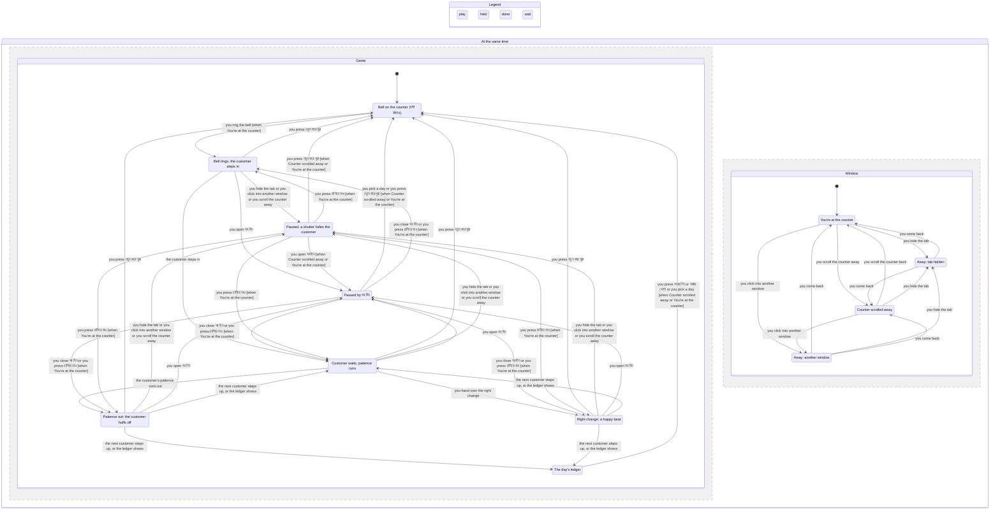

# ভাংতি নাই! statechart

## After the rewrite (`after-fix/`)
The spec now mirrors `tools/bhangti-nai/lib/session.ts` (one pausable phase clock: ready → opening → serve → right or late → … → over, with `why` = away or sheet) and `components/shop-game.tsx` (the blur, hide and in-view listeners, `resumeFrom`'s on-screen check, `finalize` at the decision, the chit pointer handlers, the key handler). TLC reaches 428 states; the chart draws 12 states and 43 arrows. A held chit and a held Enter are checked by the rules but hidden from the drawing. The সময় নিয়ে switch only removes "the patience runs out", and stars are a max over saved results (tested in game-core), so neither is modelled.

| Rule | Says | Result |
|---|---|---|
| PausedWhenHidden | Hiding the tab freezes the customer's patience, the right beat and the walk-off. | holds |
| PausedWhenBlurred | Clicking into another window freezes them too. | holds |
| NoProgressWhileAway | The clock runs only on a focused page with the counter on screen. | holds |
| OffScreenMeansPaused | Scrolling the counter away pauses, and resuming needs the counter back in view. | holds |
| NothingPendingWhilePaused | Paused, nothing is waiting to happen on its own. | holds |
| DayEndsOnlyWhilePlaying (property) | The day closes only from a running beat you can see. | holds |
| LevelPickerFreezesPlay | While সব দিন is open nothing counts down. | holds |
| NoDoubleResult / MemoMeansSaved / DecidedMeansSaved | A day is saved once, at the decision, before the ledger shows. | hold |
| InputReleasedWhenAway | No chit stays held after blur or hide. | holds |
| ResultNeedsFreshPress | A held Enter never skips the ledger. | holds |
| ReplayIsExact | A friend's link gives the same ten customers on the same clock; a forged score is refused. | tested (`links`, `old links …`), live below |

### The five bugs, fixed
1. **PausedWhenBlurred:** the game listens to `blur` and the player's `onPause`; both run `pauseFor("away")`. Test `bug 1 · PausedWhenBlurred`. Live (Orca, Pixel 9 size): serve at 2.2 s → blur → the player's menu up, the cover down, `spent` 2221 ms; 5 s later still 2221 ms, customer 1. চালিয়ে যাও → 0.6 s breath, then it counts on.
2. **NoProgressWhileAway:** `pause` banks the clock only while it runs and a second hide changes nothing. Test `bug 2 · NoProgressWhileAway` (hide → show → hide → resume costs the same ms as answering straight away).
3. **OffScreenMeansPaused:** the keys and the bell need the stage in view, the frame loop pauses a running clock that is off screen, and `resumeFrom` refuses while the counter is off screen. Test `bug 3 · OffScreenMeansPaused`. Live (desktop): scroll the counter away (top −2005 px), Enter → still `ready`; scroll back, Enter → `serve`. TLC also found the resume-while-scrolled-away variant of this bug in my first draft of the fix, which is why `resumeFrom` checks.
4. **NothingPendingWhilePaused:** the beat after a right answer, and the walk-off, are phases on the pausable clock (no `setTimeout` at all). Test `bug 4 · NothingPendingWhilePaused`.
5. **DayEndsOnlyWhilePlaying:** the same clock holds the last beat, and the stars are saved at the decision. Test `bug 5 · DayEndsOnlyWhilePlaying`. Live: the tenth customer got the right change, the HUD pause 30 ms later: phase `right`, `why: away`, result already saved; 3 s later still `right`, no ledger; চালিয়ে যাও → the ledger, stars saved once.

Quality-bar gaps closed: the slip is a scrolling ledger inside the stage (no cut-off), the brass bell is the start, the player's menu has নতুন করে শুরু and সব লেভেল (`onLevels`), an amber then red edge and the customer's face show the patience (static in ধীরে খেলো), সব দিন pauses play, each day names what is new (with a tag on the first new customer), and the sound has no loops and no fanfare timer.



## Regenerate
```sh
scripts/statechart.sh ai_docs/statecharts/bhangti-nai/Bhangti.tla --view ai_docs/statecharts/bhangti-nai/view.ts --out ai_docs/statecharts/bhangti-nai/<new-folder>
```

## Before the rewrite (`before-fix/`)

Model (then): `before-fix/Bhangti-before.tla`, `.cfg`, `view-before.ts`. Report and chart: `before-fix/report.md`, `before-fix/chart.mmd`.

Model: `before-fix/Bhangti-before.tla` / `.cfg` / `view-before.ts` (N = 2 customers). Report and chart: `before-fix/report.md`, `before-fix/chart.mmd`.
Code mirrored (then): the old `shop-game.tsx`, `lib/game.ts` and `shared/game-kit.ts` (useGameLoop).

TLC: 336 states. 5 rules break and 6 hold (counting NoDeadlock).

## Systems modelled
- **Play phase:** ready → playing → paused → over, with a queue of customers (`served`, cut from 10 to 2).
- **The customer's clock:** the bar runs in useGameLoop while playing with the clock on. It skips while `live.lock` is set, and it stops when the tab hides.
- **The hand-off timer:** `later()` → `advance` (850 ms after right change, 2000 ms after a missed one). When it fires, the next customer steps up, or, after the last one, `finish()` runs. Modelled as `linger`.
- **Pause and focus:** the tab is visible or hidden, the window is focused or blurred, and the counter is on screen or not (`shopInView`).
- **Settings:** সময় নিয়ে (no clock).
- **Choices:** আবার খেলো, পরের দিন and playFromCard (all call `startGame`), and the day grid. The day grid works in every phase. A friend's link (hashchange) runs `pickDay`-like code.
- **Results:** results per day, saved stars, and the fanfare timer.

## Rules
| Rule | In plain words | Result |
|---|---|---|
| PausedWhenHidden | Hiding the tab pauses the shop. | holds |
| PausedWhenBlurred | Clicking into another window pauses the shop. | **breaks** |
| NoProgressWhileAway | The customer's clock runs only while you can see the counter on a focused page. | **breaks** |
| OffScreenMeansPaused | The game's own rule ("scrolling the counter away pauses it, so no clock runs off-screen") holds however play starts or resumes. | **breaks** |
| NothingPendingWhilePaused | While the shop is paused, nothing is waiting to happen on its own. | **breaks** |
| DayEndsOnlyWhilePlaying (property) | The day ends only from play you can see, never behind the pause screen or a hidden tab. | **breaks** |
| NoDoubleResult | A day ends once. | holds |
| NoFanfareAfterMovingOn | The fanfare never plays after you start another day. | holds |
| StarsNeverDrop (property) | Saved stars only go up. | holds |
| ReplayIsExact | A friend's link gives the same ten customers on the same day. A forged score is refused. | checked live, not modelled |

## Bugs

### 1. PausedWhenBlurred / NoProgressWhileAway: "I clicked into another window and my customer walked off without his change."
- **Path:** 0 shop not open → 1 you tap শুরু করো → 2 you click into another window. The customer is still waiting and the clock is still running.
- **Code:** shop-game.tsx has no `blur` listener at all. Only `visibilitychange` pauses.
- **Live replay (Orca, tab 17bdac93):** start day 1, then `window.dispatchEvent(new Event("blur"))`. The clock went 0.48 s → 4.48 → 9.48 → 13.0 s (limit 13), and the reply was "থাক, ভাংতিটা পরে নেব!", results `miss`, customer 2 of 10. You lose a customer and the fast bonus while you're away.
- **Fix:** pause on window `blur`, as on hide. **Shared:** vo-katta has the same gap, and jam-chharao keeps a drag on blur.

### 2. NothingPendingWhilePaused / DayEndsOnlyWhilePlaying: "I paused right after giving the last change, and the shop closed behind the pause screen. The stars and the fanfare played while I was paused."
- **Path (NothingPendingWhilePaused):** 0 → 1 you tap শুরু করো → 2 the customer's time runs out (leaving) → 3 you press pause. The pause holds a running hand-off timer.
- **Path (DayEndsOnlyWhilePlaying):** 0 → 1 start → 2 right change → 3 the next customer steps up → 4 right change (the last one) → 5 you press pause → 6 the shop closes and the card shows, while paused.
- **Code:** `pause()` only calls `go("paused")`. It doesn't clear or hold `advance.current`, so `later()`'s timeout still runs `meet()` or `finish()`. A hidden tab takes the same `pause()`, so the timer fires there too (browsers still run timeouts in hidden tabs, at most once a second).
- **Live replay:**
  - Last customer: serve customers 1–10 right, click দাও on the 10th, and press the HUD pause 30 ms later. State: phase `paused`, `lock: true`, reply "বাহ, ঝটপট! +১৫০". 1.5 s later: phase `over` and the slip "দিন ১ শেষ, দোকান বন্ধ! ★★★ … ১৫০০ পয়েন্ট" is up, all without a resume.
  - Mid-day: serve customer 1 and pause 30 ms later (`index 1`, `lock: true`, elapsed 0.47). 1.5 s later the pause overlay is still up, but `lock` is false and elapsed is 0, and customer 2 ("রিকশাওয়ালা মামা: ৫০ টাকা দিলাম, জিনিস ২৫ টাকার") stepped up behind it.
  - Not replayed: the hidden-tab variant. Orca pins `document.hidden` to a native `false` getter, so `visibilitychange` can't be faked. That variant goes through the same `pause()`.
- **Fix:** keep the hand-off timer's remaining time. On pause and hide, clear `advance.current` and store the ms left. On resume, re-arm `later(left)`. Better still, run the linger off the game loop's clock (`live.lingerLeft -= dt` in the stepped loop), so pause freezes it for free. **Game-specific**, but the same pattern ("timeouts outside the loop ignore pause") is worth checking in every game with a `setTimeout` that changes the state.

### 3. OffScreenMeansPaused: "I pressed Enter while reading the FAQ and the shop opened off screen. The first customer's clock ran where I couldn't see it."
- **Path:** 0 → 1 you scroll the counter away → 2 you tap শুরু করো (Enter). Playing, with the counter scrolled away.
- **Code:** the keys handler opens the shop on Enter in `ready`, and resumes on Enter/P/Esc in `paused`, without checking `shopInView`. `startGame()` scrolls the counter into view only when it sits below the fold (`bottom > innerHeight`), never when it's above. The `shopInView` effect fires only on a change.
- **Live replay:** ready screen, `scrollTo(bottom)` (the counter shows at 0%), Enter on `body` → phase `playing` and elapsed 0.18 → 5.18 s after 5 s, with the counter still at 0%.
- **Fix:** in `startGame` and `resume`, always `scrollIntoView` the counter (or ignore Enter/P while `!shopInView`). Pause whenever `!shopInView`, not only on the change. **Shared** with vo-katta.

### ReplayIsExact, live
- `#s=4242&t=1500&r=10&d=1&c=10&n=রাফি`: banner "দিন ১ · রাফি ১৫০০ করেছে…", seed 4242, day 1, first customers 50−20, 50−30, 50−20. The same with no name.
- `#s=4242&t=1505&r=10&d=1&c=10` (a score that can't happen): refused, with a fresh seed.

## Quality-bar gaps (a full day played end to end in Orca on a 412×915 phone)
1. **The result slip is cut off on a phone:** at 412 px the slip runs to y=342, but the overlay ends at 288 and `.bt-counter-block` has `overflow: hidden`. "কার্ড বানাও, বন্ধুকে পাঠাও ↓" (y 276–325) sits under the cash box (`elementFromPoint` returns `.bt-box`), so you can't tap the way to the card. Screenshot: `.shots/bhangti-nai-over.png`.
2. **First screen:** the solved example is clear, but শুরু করো is a plain button below the cash box (y≈720 on a 915-px screen). Tapping a chit also starts the day, and nothing says so. The start action should be the biggest thing: the shop's shutter going up, or the first customer stepping in.
3. **Pause:** a plain overlay with only চালিয়ে যাও. It doesn't pause on blur (bug 1) or freeze the hand-off (bug 2), and P/Enter resume off screen (bug 3). There is no নতুন করে শুরু and no সব দিন.
4. **Danger at the edges:** the only "about to lose" sign is the thin clock bar turning `data-low` inside the shop, plus three ticks. Add an edge glow on the counter in the last 30%, and a static border in ধীরে খেলো.
5. **Choices:** the সব দিন grid keeps the clock running when you open it, and picking a day throws the customer away without asking. পরের দিন starts at once and never says what the next day changes (a shorter clock, which customer kinds).
6. **Pacing:** each day mixes the PLAN rows ("round", "two", "out") by a formula, so a new idea (run-out chits, coins for round change) can show up with no introduction. Show "নতুন: ৫ টাকার চিরকুট শেষ!" the first time a twist appears.
7. **Ending:** good. It shows right count, first-try count, points, the near line and a kind line. The 3-star line comes after the stars reveal. Keep it.
8. **Sound:** good (coin clink vs note rustle, the till signature, combo pitch, ticks). There is no short shop tune, and the fanfare can play behind a pause (bug 2).

The chart hides "you switch সময় নিয়ে", "you pick a day" and the fanfare timer. They stay in the model and the rule checks.

Replay harness note: rAF was swapped for a 60 Hz MessageChannel pump, because Orca throttles background tabs to about 1 fps. Change was handed over through the real chit and দাও buttons, with the amount read from `runRef`.
