# ভিমরুলের চাক statechart

## After the rewrite (2026-11-04)
Model: `Chak.tla` with `Chak.cfg` (the full check: two levels, a friend link to level 2 while it is locked, one forgiven sting) and `Chart.cfg` (the drawn chart: one level, `CONSTRAINT ChartScope`), plus `view.ts`. It mirrors:
- `tools/bhimruler-chak/lib/flow.ts`: `running`, `held`, `retime` (the clock runs exactly while play runs, and any hold lets go of the finger), `start`, `toTitle`, `finish`, `menu`, `away`, `sheet`, `awake`, `takesPress`, `takesResultKey`, `pressDown`, `pressUp`, `holdTies`, `wantsHum`;
- `lib/play.ts` (`enter`, `dig` with forgiven stings, `tie`) and `lib/save.ts` (`openAfter`, your own open level);
- `components/chak-game.tsx`: `act` and `askHint` (gated by `takesPress`), the grid's pointer handlers (the long-press timer ties only through `holdTies`), `endRound` (stars and the open level recorded in the same step as the last bush), `load`, the blur / focus / visibility effect, `useGamePlayer` `onPause` / `onResume` / `onRestart`, the window key handler, the hum effect, and `openFriend` with its hashchange guard;
- the player's menu, which opens on blur and hide once the game has been touched.

Runs:
- `after-fix/report.md`: the full check, 5,644 states;
- `after-fix/chart.mmd` and `after-fix/chart-report.md`: 152 states, 14 chart states, 29 arrows.

**Every rule holds in both runs:** TypeOK, ClockStillWhileAway, PausedWhenAway, InputReleasedWhenAway, NoTieBehindYourBack, ChoiceFreezesPlay, HumOnlyWhenMeaningful, HumComesBack, ComeBackIsNotAMove, NoDoubleResult, ResultMatchesPlay, NoChimeAfterMovingOn, OpenLevelsAreEarned, ReplayIsExact, UnlockNeverShrinks, NoDeadlock.

**Mutant check:** each bug was put back into a copy of the spec, one at a time, and the matching rule broke at once:
- blur without stopping the clock breaks ClockStillWhileAway;
- blur without letting go of the finger breaks InputReleasedWhenAway and NoTieBehindYourBack;
- opening the next level on any clear (a friend's far-ahead one too) breaks OpenLevelsAreEarned;
- a bush tap without the come-back guard breaks ComeBackIsNotAMove.

### What changed in the model
- **The clock is the flow's, not the component's.** It runs exactly while play runs: blur, a hidden tab, the menu and সব লেভেল all stop it, and coming back starts a 350 ms guard, so the click that brings the window back only wakes the orchard.
- **The finger is part of the flow.** `pressDown` holds a bush only when the press counts; every hold lets go of it; the long-press timer ties only through `holdTies` (the bush still held, play running), so even a timer that survives a blur ties nothing.
- **Your open level is your own.** It is set once from the saved stars (the old unlock rule, so nobody loses a level), then only clearing your open level or one below it opens the next. A friend's far-ahead orchard records its stars and opens nothing.
- **New: stings and the hornets' hum.** A sting is forgiven up to the level's limit; the hum is derived from `wantsHum` (sound on, a live orchard, a sting), so it comes back on resume and when sound returns, and never keeps a muted stub.
- **The result shows in the same step as the last bush or the swarm.** Only a fresh key 0.4 s later, or a click, goes on.

| Rule | In plain words | Result |
|---|---|---|
| ClockStillWhileAway | The star clock never runs while you're in another window or tab, under the menu or in সব লেভেল. | holds (broke before) |
| PausedWhenAway | Away mid-orchard, the pause menu is up. | holds |
| InputReleasedWhenAway | Once you leave, no finger counts as held. | holds (broke before) |
| NoTieBehindYourBack | A long press never ties a গামছা while play is held. | holds (new) |
| ChoiceFreezesPlay | While সব লেভেল is open, the clock is still. | holds |
| HumOnlyWhenMeaningful | The hornets' hum plays only after a sting, on a live orchard, with sound on. | holds (new) |
| HumComesBack | A live orchard with a sting and sound on is humming. | holds (new) |
| ComeBackIsNotAMove | The click that brings you back never clears a bush. | holds |
| NoDoubleResult | A round ends, is recorded and celebrated once. | holds |
| ResultMatchesPlay | A cleared orchard's level is saved. | holds |
| NoChimeAfterMovingOn | Star chimes never ring on an orchard you've left. | holds |
| OpenLevelsAreEarned | Every open level above 1 was opened by clearing the one before (was LinkOpensOnlyItsLevel and SavedUnlockIsEarned). | holds (broke before) |
| ReplayIsExact | A friend link opens that friend's level on a fresh start card. | holds |
| UnlockNeverShrinks | Open levels and cleared levels never go back. | holds |

| Bug | Fix | Node test (`tools/bhimruler-chak/tests/flow.test.ts`) | Live replay (Orca, after the fix) |
|---|---|---|---|
| 1. ClockStillWhileAway | The clock lives in `lib/flow.ts`; blur and hide set `away` (and the player's menu opens). | `bug 1 · ClockStillWhileAway: …` | Pixel 9, level 1: clock ০০:০১, `blur`, 3 s: still **০০:০১** with the menu up; `focus` 1.5 s later: ০০:০১; চালিয়ে যাও, 2.2 s later: ০০:০৩. |
| 2. InputReleasedWhenAway | Every hold lets go of the finger (`retime`), and the timer ties only through `holdTies`. | `bug 2 · InputReleasedWhenAway: …` | Touch `pointerdown` on a covered bush (`data-held` on), `blur` 100 ms later: `data-held` off at once; 3 s later the bush is still **covered** and the nest chip unchanged. Without a blur the same hold ties at ~0.4 s (0.6 s in Orca's background pane). |
| 3. OpenLevelsAreEarned | Your own open level `ektukhani-bhimruler-chak-open` and `openAfter`; `unlockedLevel` is used once, for the migration. | `bug 3 · LinkOpensOnlyItsLevel and SavedUnlockIsEarned: …` | My keys cleared, then `#s=4242&t=60&l=3&v=2&n=rafi`: the sheet showed **১ and ৩** open. Cleared level 3 ("rafi-এর চেয়ে ৫৮ সেকেন্ড আগে!"): saved `{"3":3}`, open level still `1`. Reloaded without the hash: only **১** open. |

Also checked live in Orca (Pixel 9):
- The hum (a 190 Hz sawtooth, counted by patching `OscillatorNode.start/stop`): 0 before a sting, 1 after it; blur → 0; চালিয়ে যাও → 1; P → menu up, 0; চালিয়ে যাও → 1. The first sting turned the edge amber (`data-danger=1`) and lit one wake hornet; the second turned it red.
- A tie answers in ~5 ms from `pointerdown` to the changed bush.
- P opens the player's menu; an orchard in play ignores a pasted link; World 1 played through to **বুড়ো আমগাছ** by an autopilot (with one forced sting on level 5: ★★ and "১টা হিন্ট বা ভুল কম হলে ৩ তারা।").

```mermaid
---
title: "Bhimruler Chak (after the rewrite): the orchard, what holds it, your finger, the hornets"
---
stateDiagram-v2
  direction LR
  state "Legend" as legend {
    lg0: play
    lg1: held
    lg2: done
  }
  class lg0 teal
  class lg1 yellow
  class lg2 blue
  state "At the same time" as all {
    state "Orchard" as r0 {
      s0: Start card
      s1: Playing, clock running
      s2: Playing, the hornets are awake
      s3: Orchard cleared, stars show
      s4: The swarm: round over
      [*] --> s0
      s0 --> s1: you press ব#2494;গ#2494;ন#2503; ঢ#2507;ক#2507; [when Window is You're on the page]
      s1 --> s2: you tap a nest [when Window is You're on the page]
      s1 --> s3: you clear the last safe bush [when Window is You're on the page and Hum is Quiet]
      s2 --> s3: you clear the last safe bush [when Window is You're on the page and Hum is Hornets humming]
      s2 --> s4: you tap a nest [when Window is You're on the page and Hum is Hornets humming]
      s1 --> s0: you start a new orchard [when Window is Pause menu and Finger is Hands off]
      s3 --> s0: you start a new orchard
      s2 --> s0: you start a new orchard [when Window is Pause menu and Finger is Hands off and Hum is not Hornets humming]
      s4 --> s0: you start a new orchard
    }
    --
    state "Window" as r1 {
      s5: You're on the page
      s6: Pause menu
      s7: You're away, menu up
      s8: Just came back (the next tap only wakes)
      [*] --> s5
      s5 --> s6: you press #9208; or P [when Orchard is none of Orchard cleared, stars show, The swarm: round over]
      s5 --> s7: you click away or hide the tab [when Orchard is none of Orchard cleared, stars show, The swarm: round over]
      s6 --> s7: you click away or hide the tab
      s6 --> s8: you start a new orchard or you press চ#2494;ল#2495;য#2492;#2503; য#2494;ও
      s7 --> s6: you come back
      s8 --> s5: a moment passes
      s8 --> s6: you press #9208; or P
      s8 --> s7: you click away or hide the tab
    }
    --
    state "Finger" as r2 {
      s9: Hands off
      s10: Finger held on a bush
      [*] --> s9
      s9 --> s10: you press and hold a bush [when Orchard is one of Playing, clock running, Playing, the hornets are awake and Window is You're on the page]
      s10 --> s9: the long press runs out or you lift your finger or you press #9208; or P or you click away or hide the tab
      s10 --> s9: you clear the last safe bush [when Hum is not Sound off]
      s10 --> s9: you tap a nest [when Orchard is Playing, the hornets are awake and Hum is Hornets humming]
    }
    --
    state "Hum" as r3 {
      s11: Quiet
      s12: Sound off
      s13: Hornets humming
      [*] --> s11
      s11 --> s12: you turn sound off [when Orchard is none of Orchard cleared, stars show, The swarm: round over]
      s12 --> s11: you turn sound on [when Orchard is one of Playing, clock running, Start card or Window is one of Pause menu, You're away, menu up]
      s11 --> s13: you tap a nest [when Orchard is Playing, clock running and Window is You're on the page]
      s13 --> s12: you turn sound off
      s13 --> s11: you clear the last safe bush or you tap a nest [when Window is You're on the page]
      s13 --> s11: you press #9208; or P or you click away or hide the tab
      s12 --> s13: you turn sound on [when Orchard is Playing, the hornets are awake and Window is one of Just came back (the next tap only wakes), You're on the page]
      s11 --> s13: you press চ#2494;ল#2495;য#2492;#2503; য#2494;ও [when Orchard is Playing, the hornets are awake and Window is Pause menu and Finger is Hands off]
    }
  }
  class s3 blue
  class s4 blue
  class s6 yellow
  class s7 yellow
  class s10 teal
  class s13 teal
```



### Regenerate
```sh
scripts/statechart.sh ai_docs/statecharts/bhimruler-chak/Chak.tla --config ai_docs/statecharts/bhimruler-chak/Chak.cfg --view ai_docs/statecharts/bhimruler-chak/view.ts --out <new folder>    # full check → after-fix/report.md
scripts/statechart.sh ai_docs/statecharts/bhimruler-chak/Chak.tla --config ai_docs/statecharts/bhimruler-chak/Chart.cfg --view ai_docs/statecharts/bhimruler-chak/view.ts --out <new folder>    # chart.mmd, chart-report.md
```
The model from before the rewrite is in `before-fix-model/` (`Orchard.tla`, `Orchard.cfg`, `view.ts`), with its output in `before-fix/`.

## Before the rewrite

Model: `before-fix-model/Orchard.tla`, `Orchard.cfg` and `view.ts`, mirrored from `tools/bhimruler-chak/components/orchard-game.tsx`, plus `shared/game-core.ts` (`recordLevel`, `unlockedLevel`) and `shared/game-kit.ts` (`useLevels`).
Output: `before-fix/report.md` and `before-fix/chart.mmd`. TLC reached 356 states, and the chart draws 15 states and 32 arrows.

### Systems modelled
- **Round and clock.** The states are ready, a friend's board with the clock not started, playing with the clock running, paused, won and lost. The clock starts on the first move (`startClock`) and stops on the end or a pause.
- **Pause and focus.** The window can be on the page, blurred, or the tab hidden. `hide()` pauses only on `visibilitychange`. The component has no blur or focus listener.
- **Input.** The touch long press (the 420 ms timer in `onDown`) ties a গামছা. `onUp`, a finger move and `pointercancel` clear it, and `hide()` calls `cancelPress()`.
- **Choices.** `goLevel` is reached from LevelGrid, আবার খেলো, পরের লেভেল, আরেকবার and Enter.
- **Links.** A valid friend link to level 3 (read on load or on hashchange) lays the friend's board with their first cell open.
- **Saved progress.** `unl` is unlockedLevel and `c1` records whether level 1 has stars. Stars are recorded once per round.

The board is not modelled cell by cell. Sound has no loop that lasts (the swarm hum is 1.3 s and `goLevel` stops it), so the sound switch is left out.

The chart hides two kinds of step, both of which reset the round: opening a link mid-round, and starting a level mid-round. The same arrows from "Waiting for your first tap" and from the end states show what they do.

### Rules, in plain words
| Rule | In plain words | Result |
|---|---|---|
| ClockStillWhileAway | The star clock never runs while you're in another window or tab (NoProgressWhileAway, PausedWhenBlurred). | **breaks** |
| PausedWhenHidden | Hiding the tab pauses the round and stops the clock. | holds |
| InputReleasedWhenAway | Once you leave, no finger counts as held, so no গামছা is tied behind your back. | **breaks** |
| NoDoubleResult | A round records its stars once. | holds |
| ReplayIsExact | The friend's level always gives the friend's orchard, never a fresh one. | holds |
| LinkOpensOnlyItsLevel | A friend's link opens its own level, not the levels before it. Level 2 opens only after you clear level 1. | **breaks** (shared) |
| SavedUnlockIsEarned | The progress saved on this phone opens level 2 or 3 only after you clear level 1. | **breaks** (shared) |
| UnlockNeverShrinks | Unlocked levels never close again (and stars never drop, as far as unlocking reads them). | holds |

4 rules held and 4 broke. TypeOK and NoDeadlock also hold.

### Bugs

#### 1. ClockStillWhileAway: "I clicked into another window and the clock kept counting against my stars" (shared)
- **Path:** (0) Waiting for your first tap → (1) you clear a bush → (2) you click into another window. The game is still "Playing, clock running".
- **Live replay (Orca, desktop):** I tapped bush 14 and the clock read ০০:০১. I dispatched `blur` and waited 5 s. The clock read **০০:০৬** and no pause card showed. On `focus` it was still ০০:০৬, and it kept counting.
- **Control (PausedWhenHidden holds):** In headless Chrome, the clock read ০০:০২ before I hid the tab for 3 s. It still read **০০:০২** when the tab came back, with the pause card shown, and moved on to ০০:০৩ 1.1 s after চালিয়ে যাও.
- **Fix:** Pause on `blur`, using the same code as `hide()`: `stopClock()`, `setPaused(true)`, `cancelPress()`. Better still, use a shared `useAway()` hook in `shared/game-kit.ts` that every game calls on blur and on hide. Add a node test that replays the path against the clock logic.

#### 2. InputReleasedWhenAway: "I held a bush, a notification took focus, and a গামছা got tied by itself" (shared pattern)
- **Path:** (0) Waiting for your first tap → (1) you press and hold a bush → (2) you click into another window. The finger still counts as held, and then the long press ties a গামছা. On a friend's board this also starts the clock, because `mark()` calls `startClock()`.
- **Live replay (Orca):** I sent a touch `pointerdown` on covered bush 31 (with 4 গামছা left), then `blur` 100 ms later, and sent no `pointerup`. 700 ms later bush 31 was **marked** and the count read **৩**.
- **Fix:** Call `cancelPress()` on blur, as `hide()` already does. In the timer, check `document.hasFocus()` and read `paused` and `over` through refs, not through the closure from the render.

#### 3. LinkOpensOnlyItsLevel and SavedUnlockIsEarned: "a friend's link to level 3 opened level 2 for me, and after I cleared it, levels 2–4 stayed open for good" (shared)
- **Path:** (0) No friend link → (1) you open a friend's link to level 3, and levels 2–3 are open with level 1 not cleared → (2) you clear level 2 or 3 before level 1. Levels 2–3 are then saved open, and level 1 was never cleared.
- **Live replay (Orca):** With empty storage, I opened `/bhimruler-chak#s=4242&t=300&l=3&f=0`. LevelGrid showed levels 1, 2 and 3 open and level 4 locked, before I had cleared anything. I cleared level 3 with 9 hints (H). Storage read `{"3":1}`. I reloaded without the hash, and LevelGrid showed **levels 1, 2, 3 (১ তারা) and 4 open** and 5 locked, though levels 1 and 2 had never been played.
- **Cause:** `unlockedOrFriend = Math.max(levels.unlocked, friend.level)` opens every level up to the friend's, and `unlockedLevel` is 1 + the highest level with stars, so a single cleared friend level unlocks everything below it for good. The same two lines are in churir-bazar (line 109), mukhe-mukhe-hisab (line 68), and more games (`grep -rn "friend?.level ?? 1" tools`).
- **Fix (shared):** Make `unlockedLevel` one past the longest unbroken run of cleared levels starting at 1. Pass the friend's level to `LevelGrid` as one extra open level, not as a new ceiling. Add a test in `shared/tests` with `{3: 1}`, which should give unlocked 1 plus the friend's level 3 only.

### Quality-bar gaps (from playing levels 1–3 end to end in Orca)
1. **Pause isn't a menu.** There is no pause button and no P or Esc. The only pause is the tab hiding, and focus loss doesn't pause (bug 1). The overlay offers only চালিয়ে যাও.
2. **The first screen leads with words.** The H1 and the lead paragraph sit above the board, and the first action is "tap any bush" in small status text under the board. Nothing big says "start here" (the lesson's step 1 is easy to miss on a phone).
3. **Choices are hidden.** Levels live in a closed "সব লেভেল" drawer. There is no numbered choice, no default marked, and no line saying what the next level changes (it only grows a row or adds one nest).
4. **Pacing has no new ideas.** All 30 levels add a row, a column or a nest. The three worlds only change the name: no new element per world and no named "boss" orchard at the end of a world.
5. **No danger signal.** Nothing at the edge warns that you're about to lose, and the loss is a sudden swarm with a "ভোঁওও… পালাও!" banner over the middle of the board.
6. **Keyboard keys are invisible.** M (mode), H (hint), G or F (mark) and the arrows aren't shown anywhere on screen.
7. **The hint cost is clear but blunt.** One hint caps the level at 2 stars, and the text says so only after you take it.

What works: the HUD sits in the corners (level top-left, nests and clock top-right) with Bangla digits. The level 1 lesson walks you through 3 steps. The result says the exact distance to the next star, and the friend link replays the same orchard.

Screenshots: `.shots/bhimruler-chak-first-screen.png` (the phone's first screen), `.shots/bhimruler-chak-win.png` (a cleared board on the phone) and `.shots/bhimruler-chak-clear.png` (the result box on desktop, 3 stars).

### How the replays were done
- In Orca, `blur` and `focus` were dispatched on `window`, touch presses as `PointerEvent('pointerdown', {pointerType: 'touch'})`, and hints as `keydown` H. Each replay saved and cleared the game's localStorage keys afterwards.
- Orca can't hide a tab. It pins `document.hidden` and `document.visibilityState` as non-configurable own getters that always say "visible", in every frame. So the only hide step (the PausedWhenHidden control) ran in headless Chrome over CDP, with `Object.defineProperty(document, 'hidden', …)` and a `visibilitychange` event.
