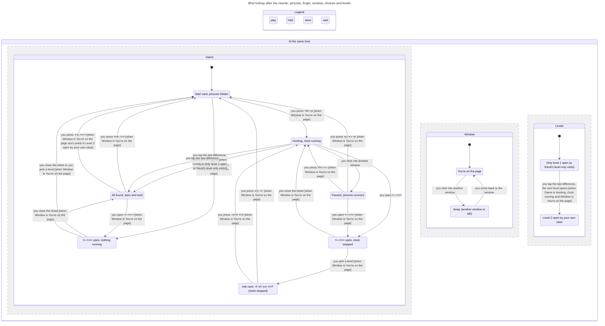

# ভুল কোথায়?: statechart

## After the rewrite (`after-fix/`)
The spec `BhulKothay.tla` now mirrors the rewritten game:
- `components/bhul-game.tsx`, the handlers and effects (start, pauseFor, resumeFrom, load, replay, leave, pickLevel, stay, solved, tap, the pointer handlers, the blur and visibilitychange effect, the player's onPause/onResume/onRestart, fromHash);
- `lib/session.ts`, the phase and clock reducer;
- `lib/save.ts`, your own unlock (`openAfter`, `playable`);
- `lib/round.ts`, the taps (in the model: a miss, a find, the last find).

It runs twice:
- **Chart run** (`BhulKothay.cfg`: W = 2 differences, N = 2 levels, Full = FALSE, which merges a hidden tab into a blur since both go through `pauseFor("away")`): TLC reached 378 states; the chart has 11 states and 21 arrows (`after-fix/report.md`, `after-fix/chart.mmd`). The chart hides a friend's link (a reset to the start card from any state) and the steps that stay inside one chart state: the finger on a picture, the হারিকেন drag and lift, a tap where nothing differs, and the confetti.
- **Full check** (N = 3, Full = TRUE): 1,552 states (`after-fix/report-full.md`).

**All 13 rules hold in both runs, and so does NoDeadlock.** A mutation check put the old behaviours back into a copy of the spec (blur doesn't pause; opening সব লেভেল doesn't pause; a pick loads at once): NoProgressWhileAway, PausedWhenBlurred, LevelPickerFreezesPlay, InputReleasedWhenAway and NoWipeWithoutAsking then broke, so none of them is vacuous.

| Rule | In plain words | Before | After |
|---|---|---|---|
| NoProgressWhileAway (was ClockOnlyWhilePlaying) | The clock, and so the moving things, only run while you're on the page. | breaks | holds |
| PausedWhenHidden | Hiding the tab mid-hunt pauses the level. | holds | holds |
| PausedWhenBlurred | Clicking into another window pauses the level. | **breaks** | holds |
| InputReleasedWhenAway (new) | After you leave, no finger counts as on a picture. | (not modelled) | holds |
| NoTapUnderTheCover (new) | On the start card or under the pause cover, no finger is held, so nothing can be tapped. | (not modelled) | holds |
| LevelPickerFreezesPlay | While সব লেভেল or the ask card is open, the clock is stopped. | **breaks** | holds |
| NoWipeWithoutAsking (new) | No choice inside the game throws away a started level without a yes on the ask card. | (not modelled) | holds |
| NoDoubleResult | A level's result is saved once. | holds | holds |
| NoCheerAfterMovingOn | The confetti never lands on a new level. | holds | holds |
| ResultMatchesPlay (new) | The result shows exactly when every difference is found. | (not modelled) | holds |
| UnlockOnlyByClearing (new) | A level opens for good only when you clear the one before it. | (not modelled) | holds |
| LevelIsOpen (new) | The level on the pictures is open by your own play, or it's the friend's level you're visiting. | (not modelled) | holds |



### The bugs, fixed, with their tests (`tools/bhul-kothay/tests/rewrite.test.ts`)
1. **PausedWhenBlurred:** the game pauses itself on window `blur` and a hidden tab, and through the player's `onPause`; every pause also releases the finger and covers both pictures (so a stopped clock can't be used to study them). Test: *bug 1 · PausedWhenBlurred*. Live in Orca (Pixel 9 layout, level 2): playing ০:০১ → `blur` → 3 s later still ০:০১, phase `paused`, the cover and the player's menu up; `focus` back, still ০:০১ until চালিয়ে যাও.
2. **LevelPickerFreezesPlay:** opening সব লেভেল (the HUD badge or the button) pauses a running level; a pick from a started level asks first (১ এখানেই থাকো / ২ ছেড়ে যাও), and ছেড়ে যাও opens the level on its start card with the clock at ০:০০, never running. Test: *bug 2 · LevelPickerFreezesPlay*. Live: playing ০:০২ → সব লেভেল → 2.5 s later ০:০৩ (the pause instant), phase `paused` → pick লেভেল ৩ → the ask card → ছেড়ে যাও → level 3, phase `ready`, start card up.

### Quality-bar gaps closed
- **Pause:** the player's menu (⏸, Esc, P via `requestPause`), blur and hide; the pictures are covered while paused.
- **First screen:** a start card whose biggest thing is the start drawn as the game's art (the first picture under a magnifier, ringed in red), the lesson line with its kind icon, and the ★★★ target. The second picture stays hidden until the clock starts.
- **Phones:** both pictures fit the stage at once (each 388 × 242 on a Pixel 9), no page scroll while playing.
- **Danger and time:** the clock sits top-right with the ★★★ track, a meter and "★★★ ০:৩৫ পর্যন্ত"; the picture frames glow amber in the last 10 s before a star drops (a still border in ধীরে খেলো). Wrong taps show as "ভুল ১/২".
- **Hints:** they say their cost before you tap (+১০ সে.), and they teach: the first circles the area and names the kind ("…একটা জিনিস উল্টো দিকে ফিরে আছে"), the second shows the exact spot.
- **Pacing:** six worlds of five, one new thing per level, a named finale per world with a boss bar (হাটবার, নানাবাড়ির উঠান, খেয়াঘাট, রিকশার জ্যাম, সন্ধ্যার হাট, পুরো পাড়া অন্ধকার).
- **Sound:** a level-start call in the world's key, the ringing pen with a note that climbs with each find in a row, a soft miss, the hint glint, the lamp, the finish run, and the lights coming back in the dark.
- **The friend's banner** now sits on the start card, not above the game.

## Regenerate
```sh
# chart run (as in BhulKothay.cfg)
scripts/statechart.sh ai_docs/statecharts/bhul-kothay/BhulKothay.tla --view ai_docs/statecharts/bhul-kothay/view.ts --out ai_docs/statecharts/bhul-kothay/after-fix
rm ai_docs/statecharts/bhul-kothay/after-fix/tlc.out
# full check: the same spec with CONSTANTS W = 2 N = 3 Full = TRUE, its report saved as after-fix/report-full.md
```

## Before the rewrite (`before-fix/`)

The old spec mirrored `tools/bhul-kothay/components/spot-game.tsx` (now gone; `BhulKothay.tla` was rewritten for the new code). Output: `before-fix/report.md` and `before-fix/chart.mmd`. TLC reached 38 states. The chart draws 11 states and 21 arrows. It hides one step, a friend's link opening mid-game (`hashchange` → `goLevel(level, false)`), because that step resets to the ready veil from every state.

### Systems modelled
- **Play phase:** ready veil (শুরু করো) → hunting, with the clock running → paused veil (থেমে আছে) → stars and card. The model has 2 differences per level (the game has 5–7): none found, one found, then the last.
- **Time:** `clock.since` running or stopped, and the 1 s confetti timer after the last find, cleared by `goLevel`.
- **Pause and focus:** tab hidden or shown (`visibilitychange` pauses only while playing), and window focused or blurred.
- **Choices:** the সব লেভেল drawer, plus `goLevel(next, true)` from পরের লেভেল, আবার খেলো, শুরু থেকে and a level picked from the drawer.
- **Links:** a friend's link opens the level on the ready veil.
- **Saved progress:** `finish()` records once per level attempt.

Not modelled:
- **Held input.** A press is read only on `pointerup`, within 700 ms and 14 px, and every `pointerdown` replaces it. So a press left over from before a blur can't fire on its own.
- **Sound loops.** The game has none, only one-shot `circled`, `nothingHere` and `allFound`.
- **Star values.** `shared/game-core` `recordLevel` keeps the higher, unit-tested in `shared/tests/game-kit.test.ts`.
- **ReplayIsExact.** The seed is fixed per level (`levelSeed`), and `parseShared` rejects any other seed (`tools/bhul-kothay/tests`).

### Rules in plain words
| Rule | Says | Result |
|---|---|---|
| ClockOnlyWhilePlaying | The clock runs exactly while you're hunting. | holds |
| PausedWhenHidden | Hiding the tab stops the clock. | holds (checked live too) |
| PausedWhenBlurred | Clicking into another window stops the clock. | **breaks** |
| LevelPickerFreezesPlay | While the level list is open, the clock doesn't run. | **breaks** |
| NoDoubleResult | A level is saved once. | holds |
| NoCheerAfterMovingOn | The confetti never lands on a new level. | holds |

### Bugs
#### 1. PausedWhenBlurred: shared
- **The player's version:** "I answered a message in another window and the clock kept going, so I lost my third star."
- **Path:** শুরু করো → click into another window (2 steps).
- **Why:** the only pause is the `visibilitychange` handler. There is no `blur` listener.
- **Live replay (Orca):** level 1. শুরু করো, clock ০:০০ → `blur` → +3 s **০:০৩** → +6 s **০:০৬**, with no veil. `focus` back: ০:০৬, still running. Par for 3 stars on level 1 is 30 s, so a short look away costs a star.
- **Fix:** the shared away-pause hook. On blur or hide while playing: `stopClock()`, `press.current = null`, `setPhase("paused")`. The veil already says "থেমে আছে, ঘড়িও থেমে আছে".

#### 2. LevelPickerFreezesPlay: shared
- **The player's version:** "I picked a level from সব লেভেল and the clock was already running while the page scrolled up to the pictures."
- **Path:** open সব লেভেল → pick a level (2 steps). Also: start a level with the list open, and the clock runs behind it.
- **Why:** the drawer's `onPick` calls `goLevel(next, true)`, which starts the clock at once (`since: performance.now()`) and skips the ready veil. Then `scrollIntoView({behavior:"smooth"})` scrolls the pictures into view.
- **Live replay (Orca):** opened সব লেভেল with the clock at ০:১৪, picked লেভেল ১. The clock reset to ০:০০, **no veil**, and +3 s later read ০:০২ with the list still open.
- **Fix:** a pick from the list opens the level on the ready veil (`goLevel(next, false)`). Or opening the drawer pauses a running level. The same `<details>` + `LevelGrid` pattern is in every leveled game.

#### Rules that hold, checked live
- **PausedWhenHidden** (headless Chrome, because Orca's browser pins `document.hidden` to "visible", see `konta-nei/README.md`): playing ০:০২ → hidden 4 s → ০:০২ with the veil "থেমে আছে, ঘড়িও থেমে আছে" → চালিয়ে যাও → +1.2 s ০:০৩.
- **ResultMatchesPlay:** a full run of level 1 in Orca used hints, so it showed 2 lit stars, "হিন্ট ছাড়া পারলে ৩ তারা।", and `ektukhani-levels-bhul-kothay` = `{"1":2}`.

### Quality-bar gaps (one full run of level 1 in Orca, Pixel 9)
1. **No real pause.** There's no pause button, P or Esc, and no pause on blur. The paused veil appears only after a tab hide.
2. **The start veil is a plain button** over a blurred picture. It's big, but not the game's own art, and the H1 ("একই বাজারের দুটো ছবি, ৫টা জিনিস আলাদা") plus the kicker and HUD rows push the pictures down to y≈280.
3. **Two pictures stacked on a phone.** Each is ~240 px tall, so with the header both barely fit. On shorter phones you scroll between them to compare, which works against a spot-the-difference game. A side-by-side or swipe/toggle compare would serve phones better.
4. **No danger or time pressure in the corners.** The clock is a plain ০:০০ with no par marker or edge cue. You learn par only from the near-miss line after the level.
5. **Hints are one per press, with no count or cost shown up front.** The status says "হিন্ট নিলে বড়জোর ২ তারা" only after you press it. The button should say its cost before you tap.
6. **Little sound and no music:** a pen scratch plus a combo note, a soft buzz, and the win run. There's no ambience per place (bazaar, ghat, lane), and no signature on level start.
7. **Pacing:** worlds change only in difference count (5 → 6 → 7) and subtlety. There's no "boss" picture at levels 10, 20 or 30, and no new kind of difference announced when one is introduced (flip from 6, count from 4).
8. **The friend card is the friend's own claim** (time and wrong taps can't be re-checked). That's stated honestly, but the friend banner sits above the game and pushes the pictures further down.

Screenshots: `.shots/bhul-kothay-first-screen.png` (the start veil), `.shots/bhul-kothay-clear.png` (rings on the found differences, the clock at ০:০৪).

