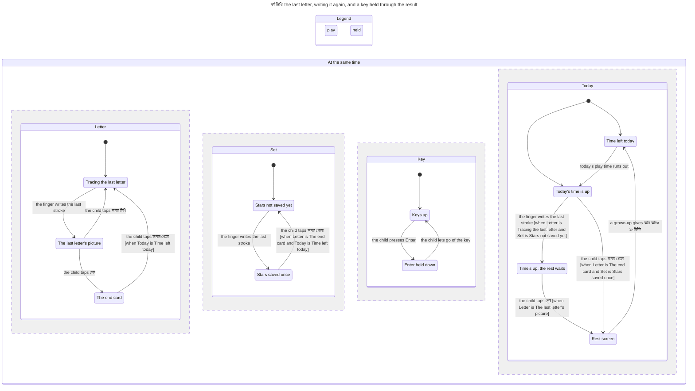

# বর্ণ লিখি statechart

A kids' game (ছোটদের জন্য, ages 4–7). The game was rewritten on 2026-11-05 (design: `ai_docs/game-dev/rewrites/borno-likhi.md`). The model has two parts so each chart stays under the 500-state budget:

| Spec | What it covers | Mirrors | TLC |
|---|---|---|---|
| `BornoLikhi.tla` / `.cfg`, view `view.ts` | the screens (cover, set list, letters, end card), the finger, the player's pause, window blur and coming back, the set list from the player's menu, the kids' daily limit and rest screen | `tools/borno-likhi/lib/session.ts`, `lib/trace.ts`, `components/likhi-game.tsx` (`begin`, `handle`, `onDown/onMove/onUp`, `useGamePlayer`), `shared/kids-kit.tsx` | 456 states, 2362 steps |
| `BornoLikhiLast.tla` / `.cfg`, view `view-last.ts` | the last letter, writing it again, and a key held through the picture or the end card | `session.ts` (`letterDone`, `goNext`, `writeAgain`, `freshKey`, `route`) | 33 states, 107 steps |

- `before-fix/` holds the run on the old code and the old spec (`BornoLikhi.tla`, `.cfg`, `view.ts`).
- `after-fix/` and `after-fix-last/` are runs on the rewritten code. **Every rule holds.** Charts: `after-fix/chart.mmd`, `after-fix-last/chart.mmd`.
- The keyboard's pen (arrow keys) writes through the same `move()` rules as a finger, so it is the same step in the model.
- Not modelled, on purpose: the parent gate and the rest screen's gate (the shared kit's, modelled in `ai_docs/statecharts/kar-chinho/KarChinhoGates.tla`; this game adds one `ParentGate` whose key is bumped by any touch outside it, the same code); the demo dot (a frame loop that stops under the menu and writes no state the rules read); the sound (one-shot `tone()`s only, no loops, no voice).

## Rules (plain words), all holding after the fix
**BornoLikhi.tla**
- **InputReleasedWhenAway:** after you leave the window or the menu opens, no finger counts as on the board; a tap that arrives while the window is still "away" (the click that brings focus back comes before its focus event) only wakes the game.
- **EnterNeverWritesAStroke:** Enter and Space never write a stroke. Only a finger, or the keyboard's pen following the path, does.
- **NothingWritesUnderTheMenu** and **TapBackIsNotAStroke:** no stroke is written under the pause menu or while away, and the first tap back never writes.
- **RestOnlyAtBreak:** the rest screen comes only between sets, never over a letter. If the limit passes on the last letter, the rest waits for the end card.
- **NoNewRoundPastLimit:** once today's time is up, খেলো, আবার খেলো and a set from the list show the rest screen, not a set. A reload past the limit opens on the rest screen.
- **EveryFinishCounts:** once the last letter's last stroke is written, the stars are saved and the limit checked in that same touch, whatever the hand does next.
- **ChoiceFreezesPlay:** the set list opens only from the cover, the end card or the player's menu, with the finger released, so nothing is written under it.

**BornoLikhiLast.tla**
- **NoDoubleResult:** a set records once, however many times its last letter is written again.
- **ResultNeedsFreshPress:** Enter or Space held through the last stroke or the end card never skips the picture or starts the next set (`freshKey`: not a repeat, and the key began after the screen appeared).
- **RestOnlyAtBreak**, again.

**Model check (mutations, run in a scratch copy, `scratchpad/borno-likhi/mutate.py`):** putting each old behaviour back breaks its rule at once.

| Old behaviour put back | Rule that breaks | Steps |
|---|---|---|
| Enter writes a stroke | EnterNeverWritesAStroke | 2 |
| blur doesn't release the finger | InputReleasedWhenAway | 3 |
| a tap that arrives while away counts as a touch | InputReleasedWhenAway | 3 |
| the player's menu leaves the finger down | InputReleasedWhenAway | 3 |
| stars saved only at →, not at the last stroke | EveryFinishCounts | 6 |
| `begin()` without `atBreak()` | NoNewRoundPastLimit | 2 |
| every completion records (no `recorded` guard) | NoDoubleResult | 3 |
| a held key's repeat acts on the picture | ResultNeedsFreshPress | 2 |

**The model's own find.** The first version of the spec broke InputReleasedWhenAway in 3 steps (the window blurs on the cover, you start a set, you touch the board while still "away"). Browsers send the click's `pointerdown` before the window's `focus` event, so a tap could write while the game still thought the window was away. `touchDown` now treats a tap while `away` as the waking tap (`session.test.ts` › bug 1).

## The bugs, and how each was fixed
| # | Bug (the reader's sentence) | Fix | Node test | Live check after the fix (Orca, own tab, localhost:3100) |
|---|---|---|---|---|
| 1 | **InputReleasedWhenAway:** "I switched windows mid-stroke; back on the page, the letter wrote itself as I moved the mouse, and my child's finger did nothing." | `session.blur/pause` clear the pointer; the component also drops its last point, the finger halo and the pen. `touchMove` releases a pointer whose `buttons` is 0 and ignores it. Pointer capture is lost on release. | `session.test.ts` › bug 1 (four tests: blur, a lift never heard, the player's menu, only the first finger) | Mouse down on ঋ, 25% along (reach 4), blur: `pointer` null, swallow armed, the player's menu open. 45% more mouse moves with no button: reach still 4, stroke 0. চালিয়ে যাও, then a fresh touch (id 7) counted and traced the whole stroke: stroke ১ done. Before: those moves wrote strokes ১ and ২, and the fresh touch did nothing. |
| 2 | **EnterWritesTheStroke:** "I tapped the speaker, then pressed Enter to write, and the sound flipped back on." | Keys are routed at `window` by screen, never by focus (`session.route`), with `preventDefault`. Enter and Space only replay the moving dot; arrow keys move the pen. The game has no top-row controls of its own (sound, ধীরে and pause live in the player's menu). | `session.test.ts` › bug 2 | Clicked the player's sound toggle (focus stays on it, sound off), pressed a trusted Enter: sound stayed off (`ektukhani-sound` = 0), the stroke and reach unchanged. Before: each Enter flipped the sound. Restored afterwards. |
| 3 | **FocusStaysOnTheBoard:** "after পরেরটা, Enter stopped working." | Keys never depend on focus; the buttons blur after a click, and the board is one stable element (only the letter's drawing is re-keyed). | `session.test.ts` › bug 3 | After → the next letter was on the board with focus elsewhere; 40 Enter keydowns (the first fresh, the rest repeats) changed nothing: stroke 0, reach 0, no help counted. |
| 4 | **SilentWhenMuted** (shared, fixed in the kit f4f75be) | No voice anywhere (site rule): no `speak`, `SpeakButton` or `speechSynthesis` in the game. | source check in `session.test.ts` | Source check only. |
| 5 | **HoldMeansHold** (kit, fixed in f4f75be) | The gate's own code. This game's gate also shuts on the next touch outside it. | kit tests | — |
| 6 | **NoWayOutWithoutGate:** "the card under the game opened a grown-up page." | `GamePage kids` shows only the kids' hub's rails, grid, header and footer; nothing in the child's view links to a grown-up page. The print link sits behind the gate. | — | Header, rails and footer checked on desktop and phone: kids' hub only. |
| 7 | **NoReadingNeeded:** "after the first letter my 4-year-old didn't know which button goes on." | The picture is the reward (180–300 px, was about 64 px); → and ↺ are drawings in 96 px buttons (→ wide, nudging); the end card's buttons are 112 px drawings. | `session.test.ts` › bug 7 (sizes at seven stage sizes, SVG in every button) | At 320 × 568: the picture 185 px, buttons 144 × 96 and 112 × 96, no sideways scroll. |
| gap | **Enter finishes a stroke without tracing and still earns 3 stars.** | Nothing finishes a stroke without a path: a run of near events is needed, jumps add at most 3 samples, stars need the finger near the path (`accuracyOf`). The keyboard writes with arrows. | `levels.test.ts` › scribbling is not tracing; `borno-likhi.test.ts` › stars, jumps | 40 synthetic Enter keydowns wrote nothing. Arrow keys (37 presses) wrote a stroke while following the path: 118 moves near, 3 off. |
| gap | **No input release on blur.** | See bug 1. | | |
| gap | **Word-only buttons, a 64 px reward.** | See bug 7. | | |

## The chart (after the fix, `after-fix/chart.mmd`)

```mermaid
---
title: "বরfl°°2509¶ßণ লfl°°2495¶ßখfl°°2495¶ß: screens, the finger, pause, the daily limit and keys"
---
stateDiagram-v2
  direction LR
  state "Legend" as legend {
    lg0: play
    lg1: held
  }
  class lg0 teal
  class lg1 yellow
  state "At the same time" as all {
    state "Set" as r0 {
      s0: The notebook cover (খ#2503;ল#2507;)
      s1: The set list
      s2: Tracing a letter
      s3: Letter's picture: পর#2503;রট#2494;
      s4: Tracing the last letter
      s5: Last letter's picture: শ#2503;ষ
      s6: The filled page (আব#2494;র খ#2503;ল#2507; / শ#2503;ষ)
      [*] --> s0
      s0 --> s1: the child opens the set list [when Menu is not Pause menu open and Today is not Rest screen]
      s0 --> s2: the child taps খ#2503;ল#2507; or আব#2494;র খ#2503;ল#2507; [when Menu is not Pause menu open and Today is Time left today]
      s1 --> s0: the page opens again
      s1 --> s0: #8592; from the set list [when Today is not Rest screen]
      s1 --> s2: the child picks a set [when Menu is not Pause menu open and Today is Time left today]
      s2 --> s0: the page opens again
      s1 --> s0: the child picks a set [when Menu is not Pause menu open and Today is not Time left today]
      s2 --> s3: the finger writes the last stroke [when Hand is Finger on the board and Menu is Playing]
      s1 --> s0: শ#2503;ষ, or নত#2497;ন কর#2503; শ#2497;র#2497; [when Menu is Pause menu open]
      s2 --> s0: শ#2503;ষ, or নত#2497;ন কর#2503; শ#2497;র#2497; [when Hand is not Finger on the board and Menu is Pause menu open]
      s2 --> s1: সব ল#2503;ভ#2503;ল from the pause menu [when Hand is not Finger on the board and Menu is Pause menu open]
      s3 --> s0: the page opens again
      s3 --> s4: the child taps #8594; [when Menu is not Pause menu open]
      s1 --> s2: #8592; from the set list [when Today is not Rest screen]
      s3 --> s0: শ#2503;ষ, or নত#2497;ন কর#2503; শ#2497;র#2497; [when Menu is Pause menu open]
      s3 --> s1: সব ল#2503;ভ#2503;ল from the pause menu [when Menu is Pause menu open]
      s4 --> s0: the page opens again
      s1 --> s3: #8592; from the set list [when Today is not Rest screen]
      s4 --> s5: the finger writes the last stroke [when Hand is Finger on the board and Menu is Playing]
      s4 --> s0: শ#2503;ষ, or নত#2497;ন কর#2503; শ#2497;র#2497; [when Hand is not Finger on the board and Menu is Pause menu open]
      s4 --> s1: সব ল#2503;ভ#2503;ল from the pause menu [when Hand is not Finger on the board and Menu is Pause menu open]
      s5 --> s0: the page opens again
      s5 --> s6: the child taps #8594; [when Menu is not Pause menu open]
      s1 --> s4: #8592; from the set list [when Today is not Rest screen]
      s6 --> s0: the page opens again
      s6 --> s2: the child taps খ#2503;ল#2507; or আব#2494;র খ#2503;ল#2507; [when Menu is not Pause menu open and Today is Time left today]
      s6 --> s1: the child opens the set list [when Menu is not Pause menu open and Today is not Rest screen]
      s6 --> s0: শ#2503;ষ, or নত#2497;ন কর#2503; শ#2497;র#2497; [when Menu is Pause menu open or Today is one of Time left today, Today's time is up]
      s5 --> s1: সব ল#2503;ভ#2503;ল from the pause menu [when Menu is Pause menu open]
      s5 --> s0: শ#2503;ষ, or নত#2497;ন কর#2503; শ#2497;র#2497; [when Menu is Pause menu open]
      s1 --> s6: #8592; from the set list [when Today is not Rest screen]
      s1 --> s5: #8592; from the set list
    }
    --
    state "Hand" as r1 {
      s7: Hands off
      s8: Finger on the board
      s9: Back from away, the next tap only wakes
      [*] --> s7
      s7 --> s8: the child touches the board [when Set is one of Tracing a letter, Tracing the last letter and Menu is Playing and Today is one of Time left today, Today's time is up]
      s7 --> s9: the window blurs [when Set is one of Tracing a letter, Tracing the last letter and Menu is not In another window and Today is one of Time left today, Today's time is up]
      s8 --> s7: the page opens again or the child lifts the finger or #9208; / P / Esc opens the player's menu or the finger writes the last stroke
      s8 --> s9: the window blurs
      s9 --> s7: the page opens again
      s9 --> s7: the child touches the board [when Menu is not Pause menu open]
      s9 --> s7: শ#2503;ষ, or নত#2497;ন কর#2503; শ#2497;র#2497; or চ#2494;ল#2495;য#2492;#2503; য#2494;ও or সব ল#2503;ভ#2503;ল from the pause menu [when Menu is Pause menu open]
    }
    --
    state "Menu" as r2 {
      s10: Playing
      s11: In another window
      s12: Pause menu open
      [*] --> s10
      s10 --> s11: the window blurs
      s10 --> s12: #9208; / P / Esc opens the player's menu
      s11 --> s10: the page opens again or the window comes back
      s11 --> s12: #9208; / P / Esc opens the player's menu
      s12 --> s10: the page opens again or শ#2503;ষ, or নত#2497;ন কর#2503; শ#2497;র#2497; or চ#2494;ল#2495;য#2492;#2503; য#2494;ও
      s12 --> s11: শ#2503;ষ, or নত#2497;ন কর#2503; শ#2497;র#2497; or চ#2494;ল#2495;য#2492;#2503; য#2494;ও
      s12 --> s10: সব ল#2503;ভ#2503;ল from the pause menu [when Set is none of The filled page (আব#2494;র খ#2503;ল#2507; / শ#2503;ষ), The notebook cover (খ#2503;ল#2507;), The set list and Today is not Rest screen]
      s12 --> s11: সব ল#2503;ভ#2503;ল from the pause menu [when Set is none of The filled page (আব#2494;র খ#2503;ল#2507; / শ#2503;ষ), The notebook cover (খ#2503;ল#2507;), The set list and Today is not Rest screen]
    }
    --
    state "Today" as r3 {
      s13: Time left today
      s14: Rest screen
      s15: Today's time is up
      s16: Time's up, the rest waits for the page
      [*] --> s13
      [*] --> s14
      s13 --> s15: today's play time runs out
      s14 --> s13: a grown-up gives আজ আরও ১০ ম#2495;ন#2495;ট
      s15 --> s14: the page opens again
      s15 --> s14: the child taps খ#2503;ল#2507; or আব#2494;র খ#2503;ল#2507; [when Set is one of The filled page (আব#2494;র খ#2503;ল#2507; / শ#2503;ষ), The notebook cover (খ#2503;ল#2507;) and Hand is Hands off and Menu is not Pause menu open]
      s15 --> s14: the child picks a set [when Set is The set list and Hand is Hands off and Menu is not Pause menu open]
      s15 --> s16: the finger writes the last stroke [when Set is Tracing the last letter and Hand is Finger on the board and Menu is Playing]
      s16 --> s14: the page opens again
      s16 --> s14: the child taps #8594; [when Menu is not Pause menu open]
      s16 --> s14: সব ল#2503;ভ#2503;ল from the pause menu or শ#2503;ষ, or নত#2497;ন কর#2503; শ#2497;র#2497; [when Menu is Pause menu open]
      s14 --> s16: #8592; from the set list [when Set is The set list]
    }
  }
  class s2 teal
  class s3 teal
  class s4 teal
  class s5 teal
  class s8 teal
  class s9 teal
  class s14 yellow
  class s16 teal
```


## The last letter (after the fix, `after-fix-last/chart.mmd`)


## Regenerate
```sh
rm -rf ai_docs/statecharts/borno-likhi/after-fix ai_docs/statecharts/borno-likhi/after-fix-last
scripts/statechart.sh ai_docs/statecharts/borno-likhi/BornoLikhi.tla --view ai_docs/statecharts/borno-likhi/view.ts --out ai_docs/statecharts/borno-likhi/after-fix
scripts/statechart.sh ai_docs/statecharts/borno-likhi/BornoLikhiLast.tla --view ai_docs/statecharts/borno-likhi/view-last.ts --out ai_docs/statecharts/borno-likhi/after-fix-last
rm ai_docs/statecharts/borno-likhi/after-fix*/tlc*.out
```
