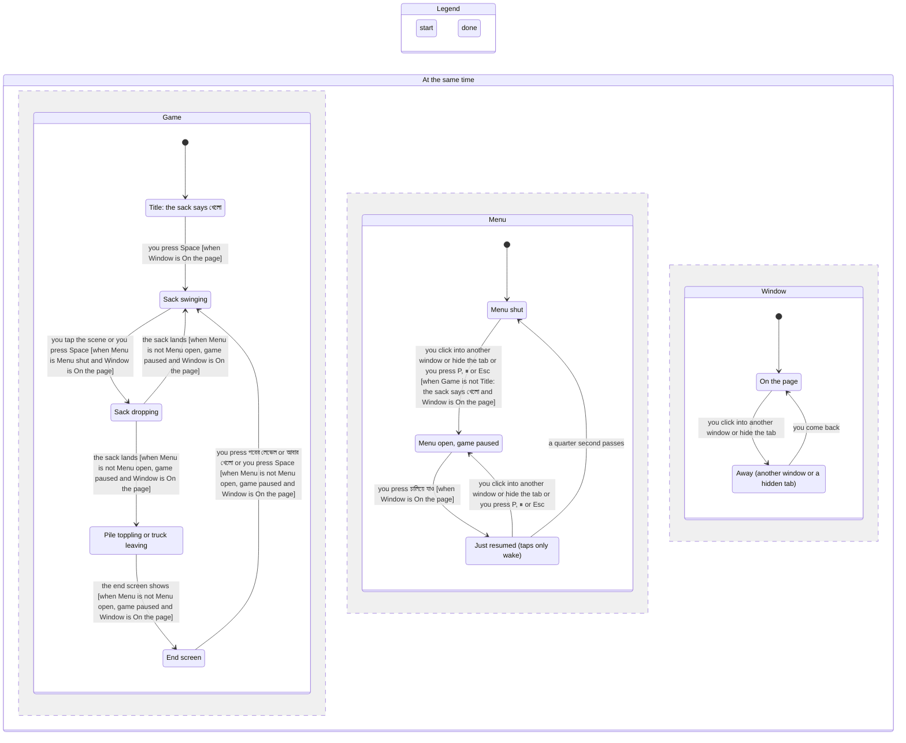

# বস্তার পাহাড়: statechart (after the rewrite)

The game was rewritten in Nov 2026 (design: `ai_docs/game-dev/rewrites/bostar-pahar.md`). This folder has both halves:
- **before-fix/**: the model of the shipped game (`BostarPahar.tla`, `.cfg`, `view.ts` as they were, and their run). It found three bugs.
- **after-fix/**: the run of today's `BostarPahar.tla`. It has 122 states and 688 steps, and all 12 rules hold.

## What the model mirrors
- `tools/bostar-pahar/components/crane-game.tsx`: `begin`, `finish`, the keydown/keyup effect, `onStage`, the blur/focus/visibility effect, the sound effect, and `useGamePlayer`'s `onPause` and `onResume`.
- `lib/session.ts`, the pure session the component forwards every event to: `ticking`, `canDrop`, `keyDown`, `keyUp`, `freshResultKey`, `wantWind`, `syncLoops`, `blur`, `hide`, `pause` and `resume`.
- `lib/step.hot.ts`: `tap`, the landing, and the end of a round.
- `shared/game-player-client.tsx`:
  - blur and hide open the menu once the game has been touched;
  - the menu stops keydown reaching the game;
  - pausing cuts scheduled tones (`silenceScheduled`).

Abstractions:
- the level is a gusty one, so the wind loop is in play;
- "fresh" means the end screen appeared under 450 ms ago (`RESULT_GUARD`);
- "guard" means চালিয়ে যাও was pressed under 250 ms ago (`RESUME_GUARD`);
- "held" means Space, Enter or ↓ is physically down.

The level unlock with a friend's link is tested in node (`statechart FriendOpensNoGap` in `tests/session.test.ts`), using the same `openLevel` and `nextAhead` as অ্যান্টেনা ঠিক করো's unlock model.

## Before → after
| | Before | After |
|---|---|---|
| Page | Its own hero above the game, a `#tool` section, its own pause chip and cover | `<GamePage>`. The game reads `useGamePlayer()` for pause, resume and restart. P calls `player.requestPause()`. |
| Held Space | Every auto-repeat keydown could drop the next sack and restart the run | `session.keyDown` drops only on a fresh press: not `event.repeat`, and not while the key is already held. |
| End screen keys | Any Space or Enter called `proceed()` at once | `freshResultKey`: a non-repeating keydown at least 450 ms after the screen appeared. |
| Window blur | Nothing; the drop, the fall and the result ran on | `session.blur` lets go of the key, the player opens its menu, `useGameLoop` stops, and `step()` does nothing unless `ticking`. |
| The tap that brings you back | (no such case: the cover's button resumed) | After চালিয়ে যাও, taps for 250 ms only wake the game (`canDrop`). |
| Wind loop | (no loop) | `syncLoops` runs after every event and every step. The wind plays exactly when `wantWind` holds. |
| Star chimes | `setTimeout`s, cleared on restart | Scheduled `tone()`s that the pause, `begin()` and sound-off cut. |

## Rules (plain words)
| Rule | The reader's sentence | Before | After |
|---|---|---|---|
| PausedWhenHidden | Hiding the tab mid-round pauses it. | held | holds |
| **PausedWhenBlurred** | Clicking into another window mid-round pauses it. | **broke** | holds |
| **EveryDropIsATap** | Every sack drops because you pressed, never on the key's auto-repeat. | **broke** | holds |
| **NoTapPastResult** | A press already on its way never skips the end screen. | **broke** | holds |
| NoChimeAfterLeaving | Star chimes play only on the end screen, with the menu shut. | held | holds |
| NoDoubleResult | The end of a round fires its sounds once. | held | holds |
| FocusClickIsNotADrop | The tap that brings you back from the menu never drops a sack. | (not in model) | holds |
| InputReleasedWhenAway | Away or paused, no key counts as held. | (not in model) | holds |
| LoopOnlyWhenMeaningful | The wind plays only while you play a gusty round with sound on. It never plays paused, away, muted or after the round. | (not in model) | holds |
| LoopComesBack | When a gusty round runs with sound on, the wind is playing, so turning sound on or resuming brings it back. | (not in model) | holds |
| NoDeadlock | You can always do something. | held | holds |

**Mutation check** (`scratchpad/bostar-pahar/mut/`): each change below puts back the old behaviour, and the named rule breaks.
| Change | Rule that breaks |
|---|---|
| The auto-repeat drops again | EveryDropIsATap |
| Blur doesn't pause | PausedWhenBlurred |
| The end screen takes any key | NoTapPastResult |
| No wake-up guard | FocusClickIsNotADrop |

So the rules are not vacuous.

## Bugs (found before, fixed now)

### 1. EveryDropIsATap: "I held Space and the game kept dropping sacks and restarting by itself."
- **Path:** you press Space → the held key repeats.
- **Replay before (Orca):** one keydown, then a repeat every 33 ms for 5 s. There were 4 runs in 5 s, each with "০টা বস্তা".
- **Replay after (Orca, Pixel 9 size, 4 Nov 2026):** the same input on level 2 gave one drop in 5 s (`hung` 1) and no restart. The screen stayed on play.
- **Fix:** `session.keyDown` ignores `event.repeat` and a key already held. Keyup and blur release it.
- **Tests:**
  - `statechart EveryDropIsATap: holding Space drops one sack, never more on the browser's auto-repeat`;
  - `…a keydown that isn't flagged repeat but arrives while the key is still held does nothing`.

### 2. NoTapPastResult: "The pile fell, I pressed Space once more and the result vanished before I could read it."
- **Path:** you press Space → the sack slips off → the result shows → you press Space.
- **Replay before:** a Space 150 ms after the result: the result was gone, and a new run had started.
- **Replay after (Orca):** the autopilot cleared level 2. A Space 150 ms after the end screen appeared left the end screen up. A fresh Enter 850 ms after went on to level 3.
- **Fix:** `freshResultKey` (450 ms, no repeats, menu shut). Game keys are handled at `window` with `preventDefault`, and the end buttons blur after a click.
- **Test:** `statechart NoTapPastResult: a press as the pile falls, or held through it, never skips the end screen`.

### 3. PausedWhenBlurred: "I dropped a sack and clicked into another window; when I came back the run was already over."
- **Path:** you press Space → you click into another window.
- **Replay before:** 82 frames ran after the blur, and the pile tipped and the result showed with no focus.
- **Replay after (Orca):** a tap, then a blur 50 ms later. The phase stayed `drop`, with `timer` 0.05 s at the blur and 0.05 s 1.5 s later, and the player's menu was open. After চালিয়ে যাও, the sack landed normally.
- **Fix:** `session.blur` and the player's menu. `step()` returns unless `ticking`.
- **Tests:**
  - `statechart PausedWhenBlurred: a sack in the air waits while you're in another window…`;
  - `statechart PausedWhenHidden: hiding the tab stops the swing and lets go of the key`.

### Also fixed in the rewrite (shared patterns)
- **FocusClickIsNotADrop:** after চালিয়ে যাও, a tap within 250 ms only wakes the game. Live: the wake tap left the sack swinging, and a tap 400 ms later dropped it. Test: `statechart FocusClickIsNotADrop…`.
- **The wind loop comes back:** sound on or resume restarts it, and pause, mute and the end screen stop it. Test: `statechart LoopOnlyWhenMeaningful and LoopComesBack…`.
- **Friend links:** clearing a friend's far level records its stars in `ektukhani-ahead-bostar-pahar` and opens nothing in between. Test: `statechart FriendOpensNoGap…`.
- **Address bar:** the game never sets `location.hash` and never pushes history.

## The chart (after-fix)


## Live-replay notes
- Orca throttles `requestAnimationFrame` to about 2 frames a second in a tab that isn't on screen. The replays used a shim, `requestAnimationFrame = cb => setTimeout(() => cb(performance.now()), 16)`. The game code was unchanged.
- Orca pins `document.hidden` to false, so the hidden-tab path is checked by the model and the node test.

## Regenerate
```sh
scripts/statechart.sh ai_docs/statecharts/bostar-pahar/BostarPahar.tla --view ai_docs/statecharts/bostar-pahar/view.ts --out ai_docs/statecharts/bostar-pahar/after-fix
rm ai_docs/statecharts/bostar-pahar/after-fix/tlc*.out
```
