# ক্যারম: statechart

## After the rewrite (`after-fix/`)
The spec `Carrom.tla` now mirrors the rewritten game:
- `lib/session.ts`: the screens, what the hand holds, the hum's rule, the slip's keys and the fanfare;
- `lib/save.ts`: your own open boards;
- `components/carrom-game.tsx`: the blur, focus, visibility and stage effects, the strike, the end;
- `components/sound.ts`: the hum is replaced whenever the sound switch has flipped since it was made.

It runs twice:
- **Full check:** `CarromFull.cfg`, with Full = TRUE (hidden tab, scroll and the held key modelled on their own). TLC reached 3,242 states (`after-fix/report-full.md`).
- **Chart run:** `Carrom.cfg`, with Full = FALSE, to fit the 500-state chart budget. A hidden tab and a scroll away merge into a blur (all three take the same Away step), and the held key merges into the pull. TLC reached 470 states; the chart has 17 states and 41 arrows (`after-fix/report.md`, `after-fix/chart.mmd`).

**All 14 rules hold in both runs, and so does NoDeadlock.** A mutation check put two old behaviours back into copies of the spec. With "clearing any board opens the next", UnlockOnlyByClearing broke in 5 steps. With "a scroll away doesn't pause or let go", PausedWhenScrolledAway and InputReleasedWhenAway broke. So none of these rules is vacuous.

| Rule | In plain words | After |
|---|---|---|
| PausedWhenHidden, PausedWhenBlurred, PausedWhenScrolledAway (new) | Hiding the tab, clicking away or scrolling the board off screen pauses play, mid-roll included. | hold |
| InputReleasedWhenAway | Nothing counts as held unless play is live, so a scroll can't strand a held Space (bug 1). | holds |
| LoopOnlyWhenMeaningful | The hum plays only while you pull or hold and the board answers (bug 2). | holds |
| LoopComesBack | If you're pulling with sound on, the hum plays. Turning sound back on brings it back. | holds |
| NoHumOffThePlay | No hum on the start card, the pause or the slip. | holds |
| ShotFixedOnceFired | The striker's size (the difficulty) changes only on the start card, never mid-strike (bug 4). | holds |
| ChoiceFreezesPlay (new) | While সব বোর্ড is open, nothing moves. | holds |
| UnlockOnlyByClearing | Your boards open only by clearing the one before. A friend's board 2 opens nothing for good (bug 5). | holds |
| LevelIsPlayable (new) | The board you're on is open, or it's this visit's friend board. | holds |
| CheerOnlyOnItsResult (new) | The fanfare is queued only on its own slip; loading a board drops it. | holds |
| HeldKeyIsStale (new) | A key held through the end stays stale until released, and the slip leaves only on a fresh press. | holds |

```mermaid
---
title: "Carrom after the rewrite: board, window, hand and hum, boards"
---
stateDiagram-v2
  direction LR
  state "Legend" as legend {
    lg0: play
    lg1: held
    lg2: done
  }
  class lg0 teal
  class lg1 yellow
  class lg2 blue
  state "At the same time" as all {
    state "Game" as r0 {
      s0: Start card
      s1: Aiming
      s2: Start card, সব ব#2507;র#2509;ড open
      s3: Paused (থ#2503;ম#2503; আছ#2503;)
      s4: Paused by সব ব#2507;র#2509;ড
      s5: Discs rolling
      s6: End slip
      s7: End slip, fanfare queued
      [*] --> s0
      s0 --> s1: you press শ#2497;র#2497; কর#2507; [when Window is Board on screen]
      s0 --> s2: you open সব ব#2507;র#2509;ড [when Window is Board on screen]
      s1 --> s0: you open a friend's board-2 link [when Hand is one of Hands off, Hands off, sound off and Boards is not Only a friend's board 2 cleared, board 2 still shut]
      s1 --> s3: you click into another window
      s1 --> s4: you open সব ব#2507;র#2509;ড
      s2 --> s0: you close সব ব#2507;র#2509;ড or you pick a board [when Window is Board on screen]
      s2 --> s0: you open a friend's board-2 link [when Window is Board on screen and Boards is not Only a friend's board 2 cleared, board 2 still shut]
      s4 --> s0: you pick a board [when Window is Board on screen]
      s4 --> s1: you close সব ব#2507;র#2509;ড [when Window is Board on screen]
      s4 --> s0: you open a friend's board-2 link [when Window is Board on screen and Boards is not Only a friend's board 2 cleared, board 2 still shut]
      s1 --> s5: you let go and the striker flies [when Hand is one of Pulling, hum playing, Pulling, sound off]
      s3 --> s1: you press চ#2494;ল#2495;য#2492;#2503; য#2494;ও [when Window is Board on screen]
      s3 --> s0: you open a friend's board-2 link [when Window is Board on screen and Boards is not Only a friend's board 2 cleared, board 2 still shut]
      s3 --> s4: you open সব ব#2507;র#2509;ড [when Window is Board on screen]
      s5 --> s1: the discs stop
      s5 --> s0: you open a friend's board-2 link [when Boards is not Only a friend's board 2 cleared, board 2 still shut]
      s5 --> s6: the discs stop and the strikes run out
      s5 --> s7: the discs stop and the board is cleared
      s5 --> s3: you click into another window
      s5 --> s4: you open সব ব#2507;র#2509;ড
      s6 --> s0: you press পর#2503;র ব#2507;র#2509;ড or আব#2494;র খ#2503;ল#2507; [when Window is Board on screen]
      s6 --> s0: you open a friend's board-2 link [when Window is Board on screen and Boards is not Only a friend's board 2 cleared, board 2 still shut]
      s7 --> s6: the fanfare plays
      s7 --> s0: you press পর#2503;র ব#2507;র#2509;ড or আব#2494;র খ#2503;ল#2507; [when Window is Board on screen]
      s7 --> s0: you open a friend's board-2 link [when Window is Board on screen and Boards is Board 2 opened by clearing board 1]
      s4 --> s5: you close সব ব#2507;র#2509;ড [when Window is Board on screen]
      s3 --> s5: you press চ#2494;ল#2495;য#2492;#2503; য#2494;ও [when Window is Board on screen]
      s5 --> s7: the discs stop and the strikes run out [when Boards is not Board 1 open]
    }
    --
    state "Window" as r1 {
      s8: Board on screen
      s9: Another window has focus
      [*] --> s8
      s8 --> s9: you click into another window
      s9 --> s8: you come back to the window
    }
    --
    state "Hand" as r2 {
      s10: Hands off
      s11: Hands off, sound off
      s12: Pulling, hum playing
      s13: Pulling, sound off
      [*] --> s10
      s10 --> s11: you turn sound off [when Window is Board on screen]
      s10 --> s12: you pull back or hold ম#2494;র#2507; [when Game is Aiming and Window is Board on screen]
      s11 --> s10: you turn sound on [when Window is Board on screen]
      s11 --> s13: you pull back or hold ম#2494;র#2507; [when Game is Aiming and Window is Board on screen]
      s12 --> s10: you click into another window or you open সব ব#2507;র#2509;ড or you let go and the striker flies
      s12 --> s13: you turn sound off
      s13 --> s12: you turn sound on
      s13 --> s11: you click into another window or you open সব ব#2507;র#2509;ড or you let go and the striker flies
    }
    --
    state "Boards" as r3 {
      s14: Board 1 open
      s15: Board 2 opened by clearing board 1
      s16: Only a friend's board 2 cleared, board 2 still shut
      [*] --> s14
      s14 --> s15: the discs stop and the board is cleared [when Game is Discs rolling and Window is Board on screen and Hand is one of Hands off, Hands off, sound off]
      s14 --> s16: the discs stop and the board is cleared [when Game is Discs rolling and Window is Board on screen and Hand is one of Hands off, Hands off, sound off]
      s16 --> s15: the discs stop and the board is cleared [when Game is Discs rolling and Window is Board on screen and Hand is one of Hands off, Hands off, sound off]
    }
  }
  class s0 teal
  class s1 teal
  class s2 teal
  class s3 yellow
  class s4 yellow
  class s5 teal
  class s6 blue
  class s7 blue
  class s12 teal
  class s13 teal
```



### The five bugs, fixed
Each line gives the fix and its node test.

1. **Space stuck when the board scrolls away.** A held key always ends on its own keyup, wherever focus went. Leaving the view lets go and pauses. Test: `bug 1 KeysOnlyWhileBoardShows…` (`tests/session.test.ts`).
2. **The hum drones with the board off screen.** The hum follows `humWanted` (live play and something held) on every step, and every pause or away calls `letGo()`. Tests: `bug 2 LoopOnlyWhenMeaningful…` and `LoopComesBack…`.
3. **Discs roll while another window has focus.** Our own blur pauses the session. The player's menu sends the same blur, and the discs step only while `live()`. Test: `bug 3 PausedWhenBlurred…`.
4. **বড় স্ট্রাইকার resizes a rolling striker.** The toggle is gone. The difficulty sets the striker's size when the game is made, and it can be changed only on the start card. Test: `bug 4 ShotFixedOnceFired…`.
5. **A friend's board link opens every board.** Your own open boards live in `ektukhani-carrom-open`, migrated once from the unbroken run of cleared boards, and `openAfter` opens only past the frontier. Test: `bug 5 UnlockOnlyByClearing…`.

### Live checks in Orca (after the fix)
`window.__carrom` (dev only) exposes the game, the session and `aimAt(plan)` for an autopilot.
- **Bugs 1 and 2:**
  - Hold Space on board 1: hold is `key` and one hum oscillator is live.
  - `scrollTo(0, 3000)`: inView is false, the phase is `paused`, hold is `none`, and no hum is live.
  - The keyup that follows: strikes stays 0. Scroll back and press চালিয়ে যাও: the board plays.
- **Bug 3:** strike on board 1, then window `blur` 150 ms later. 1.5 s on, no disc has moved more than 1 mm and the phase is `paused`. After focus and চালিয়ে যাও, the strike finishes: `clear`, 1 strike.
- **Bug 5:** clear storage and open `/carrom#s=7110&t=7&c=10&n=রাফি`. The autopilot clears মতিন চাচার বোর্ড in 5 strikes ("রাফির চেয়ে ২ চাল কম!"). Stars are `{"10":3}` and your open boards stay at 1. Reload without the link: সব বোর্ড offers only board 1.
- **World 1, end to end:** the autopilot clears boards 1–5 with ★★★, and মন্টু ভাইয়ের বোর্ড in 5 strikes.

## Regenerate
```sh
scripts/statechart.sh ai_docs/statecharts/carrom/Carrom.tla --view ai_docs/statecharts/carrom/view.ts --out ai_docs/statecharts/carrom/after-fix
scripts/statechart.sh ai_docs/statecharts/carrom/Carrom.tla --config ai_docs/statecharts/carrom/CarromFull.cfg --view ai_docs/statecharts/carrom/view.ts --out /tmp/carrom-full
rm ai_docs/statecharts/carrom/after-fix/tlc.out
```

---

# Before the rewrite (`before-fix/`)
The spec described here was replaced by the after-fix one above; it is in git history at `e8c5f5a`, and its results stay in `before-fix/`.

Spec `Carrom.tla`, config `Carrom.cfg` and view `view.ts`, mirrored from `tools/carrom/components/carrom-game.tsx`, `shared/game-kit.ts` (`useGameLoop`, `useLevels`), `shared/game-sound.ts` (`loop`, `setSoundOn`), `shared/game-ui.tsx` (`SoundToggle`) and `shared/game-core.ts`. Results are in `before-fix/report.md` and `before-fix/chart.mmd`: 492 states, 21 chart states, 60 arrows.

**Result: 5 rules held and 5 broke. All 5 bugs reproduced live in Orca.**

## Systems modelled
- **Play phase:** ready → playing → paused → over. The strike is either aiming or rolling (`g.phase` is `aim` or `moving`).
- **Tab, window and scroll:**
  - `hide` on `visibilitychange` runs `pause()` and then `letGo()`.
  - Window `blur` runs `letGo()` only. It doesn't pause.
  - `boardInView` from `useInView` gates the game loop when phase is ready, and gates every arrow and Space key, **keyup included**.
- **Input:**
  - A finger pulling on the board or holding মারো. Both end on `pointerup`, which pointer capture always delivers.
  - Space held from the keyboard, which fires on `keyup`.
- **Sound:**
  - The pull's `loop("hum")`. `tick()` starts it while pulling or charging and stops it otherwise. It only exists while `useGameLoop` runs.
  - The site switch: `SoundToggle onChange={stopHum}`. While sound is off, `loop()` returns a silent stub.
- **Striker size:** `toggleBig()` calls `setStrikerSize` at any moment, rolling included.
- **Boards:** stars, the stored unlock, the picker bound `Math.max(levels.unlocked, level)`, আবার খেলো, পরের বোর্ড, picking a board, and a friend's board link.

The model is smaller than the game in these ways:
- One strike per board instead of 10. Each strike is the same aim → roll → stop loop.
- 2 boards instead of 10. A board counts as passed when the strike pockets something.
- The saved stars are reduced to none, board 1 passed, or only board 2 passed.
- A held ← or → follows the same keyup rule as Space and is left out.
- Duo mode, the turn banner and the confirm dialog are left out.
- Scrolling is modelled only while aiming, and a reset brings the board back on screen.
- A `CONSTRAINT StopAtResize` stops exploring past a resized striker, to stay under the 500-state chart budget.

## Rules in plain words
| Rule | Plain words | Result |
|---|---|---|
| PausedWhenHidden | Hiding the tab mid-game pauses it. | holds |
| PausedWhenBlurred | Clicking into another window mid-game pauses it. | **breaks** |
| InputReleasedWhenAway | After blur or hide, nothing counts as held. | holds |
| KeysOnlyWhileBoardShows | A key only counts as held while the board is on screen, because only then does its release count. | **breaks** |
| LoopOnlyWhenMeaningful | The hum plays only while you pull and the board answers. | **breaks** |
| LoopComesBack | If you're pulling, the board answers and sound is on, the hum plays. Turning sound back on brings it back. | holds |
| NoHumOffThePlay | No hum on the pause card or the result. | holds |
| ShotFixedOnceFired | Once the striker leaves your finger, its size doesn't change until the discs stop. | **breaks** |
| UnlockOnlyByClearing | A board opens for good only when you pass the one before it. | **breaks** |
| NoDeadlock | There's always a next step. | holds |

## Bugs

### 1. KeysOnlyWhileBoardShows: Space gets stuck when the board scrolls away (game)
- **What the player sees:** "I held Space, scrolled the page and let go. মারো stayed charged, the hum never stopped, and the board ignored my finger."
- **Path:**
  0. The board is waiting.
  1. You hold Space.
  2. You scroll past the board.

  After that, `keyup` returns early because `!boardInView`.
- **Live replay (Orca):**
  - `keydown " "`: মারো reads "ছাড়লেই টোকা" with `data-on=true`, and one hum oscillator is live.
  - Scroll to the rules section: the board shows 0%, and the hum oscillator is still live.
  - `keyup " "`: মারো is still charged and the hum is still live.
  - Scroll back so the board shows 100%. Pull back on the board and let go: no strike (চাল is still ১/১০) and the hint doesn't change. `onBoardDown` refuses while `live.charging` is set.
  - 3 s later it's still charged, with the hum still live.
- **Fix:**
  - Always honour the `keyup` of a hold that `keydown` started, whatever the target or `boardInView`. A held Space or arrow should end on its own keyup.
  - Also call `letGo()` when `boardInView` turns false.

### 2. LoopOnlyWhenMeaningful: the hum drones with the board off screen (game)
- **What the player sees:** "I held মারো and scrolled the board away before my first strike. The hum kept droning at one pitch, and letting go fired a strike I couldn't see."
- **Path:**
  0. The board is waiting.
  1. You pull back or hold মারো.
  2. You scroll past the board.

  `useGameLoop` stops while the phase is ready and the board is out of view, so `tick()` never runs `stopHum()`.
- **Live replay (Orca):**
  - Pointer down on মারো: one hum oscillator is live.
  - Scroll away so the board shows 0%. The oscillator is still live, and still live 4 s later.
  - Pointer up: a strike fires off screen. The phase is `playing`, the hint says "গুটি গড়াচ্ছে…" and the hum stops only then.
- **Fix:** when the board leaves view, `letGo()`. That stops the hum and cancels the hold. Pause from playing too, the way পাটি বুনি does. Or keep the loop running while a hold exists.

### 3. PausedWhenBlurred: the discs roll while another window has focus (shared)
- **What the player sees:** "I clicked into another window mid-roll, and when I came back the strike had already finished."
- **Path:**
  0. The board is waiting.
  1. You hold Space.
  2. You let go and the striker flies.
  3. You click into another window.
- **Live replay (Orca):** fire with মারো at power 0.6, then window `blur`. 6 s later the strike has settled: চাল goes from ১ to ২ and the hint reads "এবার ঢুকল না। পরের চালে হবে।". No pause card appears.
- **Harm:** small, because the outcome is fixed at release. But the bar asks every game to pause on blur, and you miss watching your own shot.
- **Fix:** the `blur` listener should call `pause()` before `letGo()`. Use the shared away-handler, the same one shobdo-khoja and পাটি বুনি need.

### 4. ShotFixedOnceFired: বড় স্ট্রাইকার resizes a rolling striker (game)
- **What the player sees:** "I tapped বড় স্ট্রাইকার while my striker was rolling, and it grew in the middle of the shot."
- **Path:**
  0. The board is waiting.
  1. You hold Space.
  2. You let go and the striker flies.
  3. You tap বড় স্ট্রাইকার.
- **Live replay (Orca):** read through the game ref. Press মারো with a keyboard click (power 0.6): `g.phase` is `moving` at striker speed 1632 and radius 21. Tap বড় স্ট্রাইকার: the radius is now 25 while the striker is still moving at speed 1314.
- **Fix:** disable the toggle while `g.phase === "moving"`. Or keep the choice and apply `setStrikerSize` only in `settle()` and `newGame()`.

### 5. UnlockOnlyByClearing: a friend's board link opens every board, for good (shared with shobdo-khoja)
- **What the player sees:** "My friend's board-10 link opened all ten boards in my picker. I passed board 4 and now five boards stay open, though I never played boards 1 to 3."
- **Path (4 steps):**
  1. You open a friend's board-2 link.
  2. You hold Space.
  3. You let go and the striker flies.
  4. The discs stop and board 2 is passed.

  The saved stars now mean only board 2 is passed, and board 2 is open for good.
- **Live replay (Orca):**
  - Clear storage and open `/carrom#s=513530&t=8&l=10&n=রাফি`. The board shows "বোর্ড ১০ · টুর্নামেন্টের ফাইনাল" and 10 boards are enabled.
  - Pick board 4 and take 10 strikes with মারো. To skip aiming ten real shots, 6 coins were marked pocketed through the game ref before the last strike.
  - The slip reads "বোর্ড ৪ পার! ★★" and `ektukhani-levels-carrom` holds `{"4":2}`.
  - Reload without the link. The game opens on "বোর্ড ৫ · নানাবাড়ির বারান্দা" with 5 boards enabled.
- **Fix:** shared with shobdo-khoja bug 4. Open only the friend's own board, and don't let a board above `unlocked` raise the stored unlock.

## Quality-bar gaps (played end to end in Orca, with screenshots from headless Chrome)
1. **First win in 10 s:** board 1 needs 1 point. Ten straight মারো presses at the default aim scored 0 ("একটাও না"). A new player has no first shot set up to hit a coin. Aim the opening striker at a sure pocket, or have the ghost finger aim at one.
2. **First screen:** the H1 and lead sit above the board. On a 390 × 844 phone the bottom of মারো is at 851 px, just below the fold, and smaller phones lose the whole control row. The pause button is greyed until the first strike.
3. **Pause:** this gap is partly met. P, Esc and the button work, and hiding the tab pauses. Blur doesn't pause, and the pause is an overlay, not a menu with নতুন করে শুরু, কীভাবে খেলবে, শব্দ and সব বোর্ড.
4. **Choices:**
   - সব বোর্ড sits in a collapsed `<details>` under the board.
   - Picking a board mid-game in solo throws away the strikes in progress without asking (duo asks).
   - The একা/দুজনে switch resets at once.
   - Nothing is numbered, and no default is marked.
5. **Middle of the screen:** in duo, the "সাদার পালা" turn banner covers the board centre for 1.5 s after each change of turn. In solo the "টেনে ছাড়ো" pill sits over the striker lane at the start, which is acceptable as onboarding.
6. **Pacing:** the 10 boards differ only in their scatter seed and point thresholds. No board brings a new element. The "finale" is a name only, with no named boss moment.
7. **Settings:** the game has its own toggles (নিশানা রেখা, বড় স্ট্রাইকার) next to the shared ones. They're fine as assists, but বড় স্ট্রাইকার must not act mid-roll (bug 4), and neither says what it changes.
8. **Ending and sound:** this meets the bar.
   - The slip has stars, points, the coins, the exact gap to the next star and the best on this board.
   - The card replays the same scatter.
   - Sounds: a wooden click, clack, টুপ, cushion thump, coin, rising combo and the pull hum. The hum has the scroll bug above.

Screenshots:
- `.shots/carrom-first.png`: the first screen at 390 × 844, with মারো cut off at the bottom.
- `.shots/carrom-result.png`: the slip after ten straight strikes, 0 points.

## Regenerate (before the rewrite)
```sh
scripts/statechart.sh ai_docs/statecharts/carrom/Carrom.tla --view ai_docs/statecharts/carrom/view.ts --out ai_docs/statecharts/carrom/after-fix
rm ai_docs/statecharts/carrom/after-fix/tlc.out
```
Before re-running, update the spec to match the fixed code:
- `WindowBlurs` pauses.
- A scroll away lets go and pauses.
- The Space keyup is always honoured.
- `YouToggleBigStriker` is disabled while rolling.
- The picker and unlock follow the new rule.

Keep `CONSTRAINT StopAtResize` only while the resize bug exists.
