# ছায়া মেলাও: statechart

Kids' game (ছোটদের জন্য, ages 3–6). Rewritten 2026-11-05: drag-and-snap shadow matching, 4 worlds, 11 levels.

Specs (all rules hold, `after-fix*/report.md`):
- `Chhaya.tla` / `Chhaya.cfg` with `view.ts`, output in `after-fix/`: the page around a round (screens, the toy in the hand, the hold between walls, pause and away, the rest screen). 414 states.
- `ChhayaStars.tla` with `stars-view.ts`, output in `after-fix-stars/`: how a round earns its stars (the forced last toy is not scored). 61 states.
- `ChhayaKeys.tla` with `keys-view.ts`, output in `after-fix-keys/`: a key held through the end of a round. 9 states.
- `KidsGate.tla` / `gate-view.ts`, output in `gate-before-fix/`: the shared parent gate. Unchanged by this rewrite (the kit is shared); its two residual breaks are in the section "Residual".
- `before-fix/`: the model of the old code, with its report, chart and the old spec as `Chhaya.before.tla`.

Code mirrored: `lib/session.ts`, `lib/drag.ts`, `lib/round.ts`, `components/game.tsx`, `shared/kids-kit.tsx`.

## Rules, in plain words
| Rule | In plain words | Result |
|---|---|---|
| NoProgressWhileAway | Nothing moves on while you look away or have a menu or list open: no next wall, no end screen, no chime to an empty room. | **holds** (broke on the old code) |
| InputReleasedWhenAway | After blur, hide, pause or a list, no toy is in the hand. | holds |
| NothingMovesUnderTheMenu / WakeTapIsNotAMove | A toy is lifted and dropped only while play is live; the touch that brings focus back only wakes the game. | holds |
| EveryFinishCounts / NoDoubleResult | The round is saved once, at the match that finishes it, with the child there. | holds |
| RestOnlyAtBreak / NoNewRoundPastLimit | The rest screen comes only between rounds; a round never starts past the limit. | holds |
| ChoiceFreezesPlay | The level list is a choice screen: nothing runs under it. | holds |
| NoStrayRestart | No level number is on screen during play, so a stray tap can't restart a round. | holds (broke on the old code) |
| NoReadingNeeded | Every control the child needs to go on is a picture, a number or a drawing. | holds (broke on the old code) |
| StarsNeverDrop / ResultMatchesPlay / EveryRoundEarnsAStar / NoThreeStarsWithSlips | A level's best only goes up; the stars shown are this round's. | holds |
| ResultNeedsFreshPress / RepeatNeverStarts | A held or repeating key never skips the end screen or starts a round. | holds |

## The chart (`after-fix/chart.mmd`)

```mermaid
---
title: "ছfl°°2494¶ßযfl°°2492¶ßfl°°2494¶ß মfl°°2503¶ßলfl°°2494¶ßও: the lamp, the wall, the toy in your hand, the hold, the rest screen"
---
stateDiagram-v2
  state "Legend" as legend {
    lg0: play
    lg1: held
    lg2: done
  }
  class lg0 teal
  class lg1 yellow
  class lg2 blue
  state "Wall The unlit lamp (ব#2494;ত#2495; জ#2509;ব#2494;ল#2494;ও)" as s0 {
    state "Window Nothing to hold" as s1 {
      s2: Today Time left today
      s3: Today Rest screen
    }
  }
  state "Wall The level list" as s4 {
    state "Window Nothing to hold" as s5 {
      s6: Today Time left today
      s7: Today Rest screen
    }
  }
  state "Wall A shadow on the wall" as s8 {
    state "Window In front" as s9 {
      s10: Today Time left today
    }
    state "Window Menu open or looking away, the hold waits" as s11 {
      s12: Today Time left today
    }
  }
  state "Wall Wall matched, the hold runs" as s13 {
    state "Window In front" as s14 {
      s15: Today Time left today
    }
    state "Window Menu open or looking away, the hold waits" as s16 {
      s17: Today Time left today
    }
  }
  state "Wall A toy in your hand" as s18 {
    state "Window In front" as s19 {
      s20: Today Time left today
    }
  }
  state "Wall Last shadow matched, round saved, the hold runs" as s21 {
    state "Window In front" as s22 {
      s23: Today Time left today
      s24: Today Time's up, the rest waits for the end screen
    }
    state "Window Menu open or looking away, the hold waits" as s25 {
      s26: Today Time left today
      s27: Today Time's up, the rest waits for the end screen
    }
  }
  state "Wall End screen (আব#2494;র খ#2503;ল#2507; / শ#2503;ষ)" as s28 {
    state "Window Nothing to hold" as s29 {
      s30: Today Time left today
      s31: Today Rest screen
    }
  }
  [*] --> s2
  [*] --> s3
  s2 --> s6: you open the level list
  s2 --> s10: you tap the lamp or আব#2494;র খ#2503;ল#2507;
  s3 --> s2: a grown-up gives আজ আরও ১০ ম#2495;ন#2495;ট
  s6 --> s2: the page opens again or you go back from the list or নত#2497;ন কর#2503; শ#2497;র#2497;, or শ#2503;ষ
  s6 --> s10: you tap the lamp or আব#2494;র খ#2503;ল#2507; or you go back from the list
  s10 --> s15: you drop it on the right shadow (or tap it, with one shadow open)
  s10 --> s12: the window blurs, or #9208; / P / Esc
  s10 --> s20: you lift a toy
  s2 --> s12: you tap the lamp or আব#2494;র খ#2503;ল#2507;
  s2 --> s3: the page opens again or you tap the lamp or আব#2494;র খ#2503;ল#2507;
  s6 --> s12: you tap the lamp or আব#2494;র খ#2503;ল#2507; or you go back from the list
  s15 --> s10: the hold runs out: next wall or the end screen
  s15 --> s17: the window blurs, or #9208; / P / Esc
  s12 --> s10: চ#2494;ল#2495;য#2492;#2503; য#2494;ও, or the window comes back
  s6 --> s3: you tap the lamp or আব#2494;র খ#2503;ল#2507;
  s12 --> s2: নত#2497;ন কর#2503; শ#2497;র#2497;, or শ#2503;ষ
  s20 --> s2: the page opens again
  s20 --> s10: you drop it on a wrong shadow or in the air: it goes home
  s20 --> s6: you open the level list
  s20 --> s15: you drop it on the right shadow (or tap it, with one shadow open)
  s20 --> s12: the window blurs, or #9208; / P / Esc
  s6 --> s15: you go back from the list
  s10 --> s23: you drop it on the right shadow (or tap it, with one shadow open)
  s17 --> s15: চ#2494;ল#2495;য#2492;#2503; য#2494;ও, or the window comes back
  s17 --> s2: নত#2497;ন কর#2503; শ#2497;র#2497;, or শ#2503;ষ
  s20 --> s3: the page opens again
  s6 --> s17: you go back from the list
  s23 --> s2: the page opens again
  s23 --> s6: you open the level list
  s23 --> s30: the hold runs out: next wall or the end screen
  s23 --> s26: the window blurs, or #9208; / P / Esc
  s10 --> s24: you drop it on the right shadow (or tap it, with one shadow open)
  s20 --> s23: you drop it on the right shadow (or tap it, with one shadow open)
  s6 --> s23: you go back from the list
  s30 --> s2: the page opens again or নত#2497;ন কর#2503; শ#2497;র#2497;, or শ#2503;ষ
  s30 --> s10: you tap the lamp or আব#2494;র খ#2503;ল#2507;
  s30 --> s6: you open the level list
  s24 --> s7: you open the level list
  s24 --> s31: the hold runs out: next wall or the end screen
  s24 --> s27: the window blurs, or #9208; / P / Esc
  s26 --> s2: the page opens again or নত#2497;ন কর#2503; শ#2497;র#2497;, or শ#2503;ষ
  s26 --> s6: you open the level list
  s26 --> s23: চ#2494;ল#2495;য#2492;#2503; য#2494;ও, or the window comes back
  s20 --> s24: you drop it on the right shadow (or tap it, with one shadow open)
  s6 --> s30: you go back from the list
  s6 --> s26: you go back from the list
  s30 --> s12: you tap the lamp or আব#2494;র খ#2503;ল#2507;
  s7 --> s6: a grown-up gives আজ আরও ১০ ম#2495;ন#2495;ট
  s30 --> s31: you tap the lamp or আব#2494;র খ#2503;ল#2507;
  s31 --> s30: a grown-up gives আজ আরও ১০ ম#2495;ন#2495;ট
  s27 --> s7: you open the level list
  s27 --> s24: চ#2494;ল#2495;য#2492;#2503; য#2494;ও, or the window comes back
  s27 --> s3: নত#2497;ন কর#2503; শ#2497;র#2497;, or শ#2503;ষ
  s7 --> s3: নত#2497;ন কর#2503; শ#2497;র#2497;, or শ#2503;ষ
  s31 --> s3: নত#2497;ন কর#2503; শ#2497;র#2497;, or শ#2503;ষ
  s4 --> s3: the page opens again
  s8 --> s2: the page opens again
  s8 --> s6: you open the level list
  s8 --> s3: the page opens again
  s13 --> s2: the page opens again
  s13 --> s6: you open the level list
  s13 --> s3: the page opens again
  s21 --> s3: the page opens again
  s28 --> s3: the page opens again
  class s2 blue
  class s3 yellow
  class s6 blue
  class s7 yellow
  class s10 teal
  class s12 teal
  class s15 teal
  class s17 teal
  class s20 teal
  class s23 teal
  class s24 teal
  class s26 teal
  class s27 teal
  class s30 blue
  class s31 yellow
```


## Bugs found on the old code, and how each was fixed
### 1. NoProgressWhileAway: "I matched the last shadow and switched apps; when I came back the round was over, the stars were saved and the chime had already played" (game)
- **Path:**
  - 0: lamp off
  - 1: you press the switch
  - 2: you tap the right picture
  - 3: you look away
  - 4: a moment later the next shadow comes
  - The round-end version is the same with the last shadow.
- **Live replay (Orca, 10:05, trusted Orca tab; blur and `visibilitychange` were dispatched; the game listens to neither, so the replay is exact even though Orca pins `document.hidden`):**
  - (a) I tapped the right picture at t = 17 548 ms and went away at once. At 19 000 ms (+1452 ms) the next shadow was up (`dots done,now,…`), and the lamp click (2 oscillators) played while away.
  - (b) On the 6th shadow I tapped the right picture and went away. At +1473 ms `finish()` ran while away:
    - `ektukhani-levels-chhaya-melao` became `{"1":3}`;
    - `sfx.win` (4 oscillators) and three StarReveal chimes (at +260, +520 and +780 ms) played;
    - `.cm-done` showed. With that day over the limit, the rest screen came up too.
- **Fix:** keep the `NEXT_MS` id. On blur or `visibilitychange → hidden`, clear it and remember that it was pending. On return, run it again after the same 1.5 s, so the child sees the object reveal and the result. The shared game player's away hook should do this for every game. **Shared pattern** (all three of my games).

### 2. NoReadingNeeded: "My 4-year-old finished six shadows and then didn't know which button meant 'again'" (game)
- **Path:** 0 → 1 switch → 2 right → 3 next shadow → 4 right → 5 round ends. The done screen offers আবার খেলো, শেষ and আব্বু-আম্মুকে দেখাও, all words only.
- **Live (Orca, Pixel 9, 16:5x):** the buttons read `["আবার খেলো","শেষ","আব্বু-আম্মুকে দেখাও"]` and none has an icon. On a phone they sit below the fold under the six found pictures (`.shots/chhaya-melao-done-phone.png`).
- **Fix:** give each button a picture: ↻ or the lamp switch for আবার খেলো, a closed door or a moon for শেষ, two adult faces for আব্বু-আম্মুকে দেখাও. Show the found pictures smaller, or after the buttons, so the next action is on the first screen. **Game** (the kit's `ShowParentButton` is word-only too, so that part is shared).

### Fixes
| # | Fix | Node test (`tests/session.test.ts`) | Live replay on the new code (Orca) |
|---|---|---|---|
| 1 NoProgressWhileAway | The 1.5 s `setTimeout` is gone. The hold is `session.hold`, run down by `S.tick` every 100 ms and **only while `S.live`** (not paused, not away, no list or rest screen). The round is saved at the last match itself, not at the end of the timer. | `NoProgressWhileAway: matching the last shadow and switching apps…`, `…the next wall never comes while away, paused, or behind the level list`, `EveryFinishCounts` | Matched the last shadow, dispatched blur: after 4 s the screen was still `play`, `hold` still 2200, no new write to the stars key (the one write came at the match), `recorded` 1. After চালিয়ে যাও the hold ran 2200 → 1500 in 0.7 s and the end screen came. |
| 2 NoReadingNeeded | The end buttons are two equal 112 px picture buttons (a circling arrow, a closed door) right under the counts, with আব্বু-আম্মুকে দেখাও under them; the parent's lines come after. | `NoReadingNeeded: the end buttons are pictures of at least 96 px…` | Pixel 9 emulation: all three buttons on the first screen (`.shots/chhaya-melao-phone-end.png`). |
| Gap: level chips | Each level is a tiny wall (shadows above, toys below) with its name; each world has a one-line idea. | `levels: ids 1–5 keep their old meaning…`, `each level teaches exactly one new thing` | `.shots/chhaya-melao-phone-list.png` |
| Gap: stray tap | The level grid is gone from play. The list is its own screen, opened from the title chip, the end screen or the pause menu's সব লেভেল; closing it gives the round back and the first tap only wakes it. | `StrayTap: the level list is not on screen during play…` | list opens and closes mid-round with the round intact |

## Systems modelled
- **Play phase:** lamp (title) → a wall (a shadow, a toy in the hand) → wall matched, the hold runs → next wall → … → last shadow matched, round saved, the hold runs → end screen. The model uses 2 walls (the code has 2–8).
- **Toy in the hand:** one pointer only, tap versus drag, dropped on blur, pause, a list or a lost press. (Tap-then-tap and the one-shadow tap are the same transition as a drop on the right shadow.)
- **Time:** the hold (the one clock, only while live), the kit's 10 s play counter, the nudge finger (a picture only, cleared on pause and away).
- **Pause and away:** the player's menu, blur, hide, resume; the first touch back only wakes the game unless the menu took it.
- **Sound:** one-shot sounds only (lift, land, miss, lamp, stars, a finale tune). No loops, no voice.
- **Results and stars:** `levels.record` at the last match (keeps the better).
- **Kids' limit:** `atBreak()` when a round starts and at the last match; the rest screen only at a break.

## Residual (shared kit, unchanged)
- **KidsGate OnlyAGrownUpOpensIt / NoShareForKids:** a child who keeps up 2 s holds and taps at random still gets in about once per 20 holds. One action runs, then the gate shuts. Shared.
- **Page frame:** the player's kids header and rails now cover the earlier adult-nav finding.

## Quality-bar gaps from the first analysis, and where each went
1. **First screen (§1):** good. The switch is the game's own art and the largest thing on the wall. The ghost finger shows on the first visit.
2. **Ending (§10):** the next action is below the fold on a phone, and in words only (bug 2). The method line ("প্রথমবারেই সবগুলো…") is good.
3. **Choices (§4, §2):** the five levels are bare numbers. Nothing says what ধাপ ৪ (same family) or ধাপ ৫ (turned shadows, 6+) changes. Show a small picture of the change on each chip.
4. **Stray taps:** LevelGrid is live under the wall during play, so a single tap on a number restarts the round with no warning. Hide it or dim it while a round is on.
5. **Pause and away (§7):** there's no pause, and the timer runs on while away (bug 1).
6. **Pacing (§9):** 5 levels × 6 shadows with one new idea each. That's good. Level 5's turns jump to age 6+ with no bridge (a 90° turn first, then flips).
7. **Sound (§11):** a lamp click, a soft miss, the good and win sounds, and star chimes. The game works on mute. There's no signature sound.
8. **Celebration:** confetti appears only when every level has its first star, which follows the brief.

All eight are addressed in the rewrite design (`ai_docs/game-dev/rewrites/chhaya-melao.md`): the lamp is the first screen, level cards show their change, no level grid in play, the player's pause, a bridge level (একটু কাত) before full turns, a world tune and a signature knock-and-bell.

## Regenerate
```sh
scripts/statechart.sh ai_docs/statecharts/chhaya-melao/Chhaya.tla --view ai_docs/statecharts/chhaya-melao/view.ts --out ai_docs/statecharts/chhaya-melao/after-fix
scripts/statechart.sh ai_docs/statecharts/chhaya-melao/ChhayaStars.tla --view ai_docs/statecharts/chhaya-melao/stars-view.ts --out ai_docs/statecharts/chhaya-melao/after-fix-stars
scripts/statechart.sh ai_docs/statecharts/chhaya-melao/ChhayaKeys.tla --view ai_docs/statecharts/chhaya-melao/keys-view.ts --out ai_docs/statecharts/chhaya-melao/after-fix-keys
rm -f ai_docs/statecharts/chhaya-melao/after-fix*/tlc*.out
```
Each `--out` folder must be new or empty.
