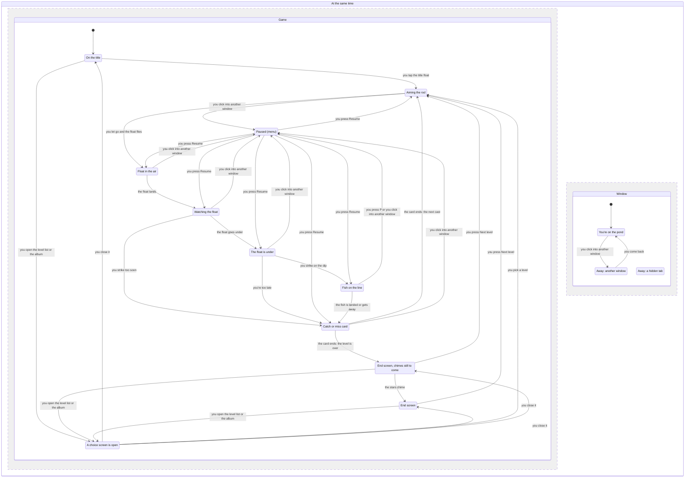

# ছিপ ফেলো: statechart

Two halves:
- **before-fix/**: the model of the shipped 15-level game, which broke 5 of 11 rules (5 bugs, plus a minor slow-mode bug). That spec is `ChhipFelo.tla` at HEAD before the rewrite (git history); its report and chart stay in `before-fix/`.
- **after-fix/**: the model of the rewrite (Nov 2026). TLC: 462 states, 2492 steps, **all 14 rules hold** (13 plus NoDeadlock). The chart draws 14 states and 34 arrows.

## Files
| File | What |
|---|---|
| `ChhipFelo.tla`, `ChhipFelo.cfg`, `view.ts` | The rewritten game: the screens, one cast, the shared player's menu, window focus and the tab, the choice screens (সব লেভেল, the album), your finger or Space, the reel hum, the end screen's scheduled tones, ধীরে খেলো mid-cast, a friend's far level. |
| `before-fix/report.md`, `chart.mmd` | The old model's run (5 broken rules). |
| `after-fix/report.md`, `chart.mmd` | Today's run. |

**What the model mirrors:**
- `tools/chhip-felo/components/chhip-felo.tsx`: `begin` (silenceScheduled, a fresh trip, goTo play), `finish` (stars, `afterClear`, scheduled tones), the blur/focus/visibility effect, the sheet effect, the sound effect, `useGamePlayer`'s `onPause`/`onResume`, and the P key (`player.requestPause()`);
- `lib/session.ts`, the pure session every event goes through: `ticking`, `wantHum`, `syncHum`, `blur`/`hide` (let go, arm the wake-up swallow), `pause`, `resume`, `openSheet`, `goTo`, `pointerDown` (swallows the first tap back), `keyDown`, `freshResultKey`;
- `lib/trip.ts` + `lib/step.hot.ts`: aim → fly → wait → reel → the catch or miss card, all on game time (slow mode only feeds smaller steps);
- `lib/levels.ts`: `afterClear`, `playable`, `readUnlock`;
- `shared/game-player-client.tsx`: blur, hide and P open the menu once you've touched the game; pausing cuts scheduled tones.

## Before → after
| | Before | After |
|---|---|---|
| Page | Its own hero, `#tool`, and a pause overlay only on a hidden tab | `<GamePage>` and the player's real menu; P calls `player.requestPause()`. |
| Blur | Nothing: a held finger or Space stayed held, the hum kept going, and the tap back struck | `session.blur` lets go and arms `swallow`; the player opens the menu; `syncHum` stops the hum. |
| Hum | Started and stopped by hand in five places | `syncHum` after every step and event; a fresh loop every start, never a stub left from while muted. |
| Celebrations | `setTimeout`s for the fanfare, the combo, the coin and the confetti, never cleared | Scheduled `tone()`s, cut by the player's pause and by `begin()` (`silenceScheduled`). The component has no timers (a test reads its source). |
| Level list | A `<details>` under the pond, open any time, picking threw the trip away | A choice screen from the title or the end screen; `session.sheet` stops the water. |
| Friend's far level | Its stars went into the levels key, and `unlockedLevel` opened every level below it | Its stars are kept, but the game's own unlock (`ektukhani-unlock-chhip-felo`) rises only through `afterClear`. |
| ধীরে খেলো | Rescaled the bite's clock mid-cast | Every clock is game time; slow mode feeds the trip 0.65 of each step. |
| Result keys | Space on the result started the next trip at once | Only a fresh, non-repeating keydown after the screen appeared. |

## The chart (after-fix/chart.mmd)

(The generated file also carries the legend, the colours and the guards; this copy drops them for reading.)

## Rules, in plain words (after-fix: all hold)
| Rule | In plain words | Before | After |
|---|---|---|---|
| NoProgressWhileAway | The float, the bite and the line don't move while you're in another window or tab. | held (working tree) | holds |
| InputReleasedWhenAway | After you leave, no finger or Space still counts as held. | **broke** | holds |
| PausedWhenHidden | Hiding the tab mid-cast pauses with the menu. | held | holds |
| PausedWhenBlurred | Clicking into another window mid-cast pauses with the menu. | **broke** | holds |
| ClickBackIsNotAMove | Until the wake-up tap, the game sits on the menu, so the click that brings you back never strikes. | (new) | holds |
| LoopOnlyWhenMeaningful | The reel hums only while a fish is on the line, the water moves and sound is on. | **broke** | holds |
| LoopComesBack | When it should hum, it hums, also after sound comes back or after চালিয়ে যাও. | held | holds |
| PausedMeansFrozen | Nothing moves while the menu is up. | held | holds |
| ChoiceFreezesPlay | Nothing moves while সব লেভেল or the album is open. | (new) | holds |
| FanfareOnlyOnTheResult | The end screen's chimes and fanfare never go off over a new level. | **broke** | holds |
| OpenLevelsAreEarned | A friend's link lets you play their level, not skip the ones before it. | **broke** | holds |
| SlowToggleKeepsTheBite | Turning ধীরে খেলো on or off mid-wait never loses a fish that hasn't bitten. | (minor bug) | holds |
| TypeOK, NoDeadlock | | held | hold |

## Bugs, each fixed and replayed as a node test
1. **"I held Space to reel, answered a message, came back and the line snapped."** Fix: `session.blur`/`hide` let go of every finger and key. Test: `tests/session.test.ts` › *bug 1, InputReleasedWhenAway*.
2. **"I came back to the window by tapping the pond and it counted as a strike."** Fix: the player opens its menu on blur, and `session.pointerDown` swallows the first tap after a blur or hide (চালিয়ে যাও counts as that tap). Test: *bug 2, PausedWhenBlurred*.
3. **"I switched to WhatsApp mid-reel and the whirr kept going."** Fix: `syncHum` runs after every step and event, wants the hum only while ticking, and starts a fresh loop each time. Test: *bug 3, LoopOnlyWhenMeaningful*.
4. **"I tapped পরের লেভেল and the fanfare went off over the new pond."** Fix: every celebration is a scheduled `tone()`; `begin()` and the player's pause call `silenceScheduled()`; the component keeps no timers. Test: *bug 4, FanfareOnlyOnTheResult* (reads the component's source).
5. **"My friend's link took me straight to বিল, and levels 1–4 were all open."** Fix: the game's own unlock, migrated once from the old stars, raised only by `afterClear`. Test: *bug 5, OpenLevelsAreEarned*.
6. **Minor: ধীরে খেলো mid-wait lost a fish that never bit.** Fix: one game clock; slow mode feeds smaller steps. Test: `tests/trip.test.ts` › *bug: ধীরে খেলো turned on or off mid-wait never loses a fish*.
7. **Gap: picking a level mid-trip threw it away with no question.** The level list is now a choice screen off the title and the end screen only, and it freezes play (*a choice screen, the menu or the pond scrolled away freezes play*).

The replays of the old bugs (with numbers) are in this file's history at HEAD; the short version: tension 0.40 → 1.00 and a snap 1.4 s after coming back with Space "held" (bug 1); `["early"]` on the tap back at `t 0.22` (bug 2); `{starts 1, stops 0}` two seconds after blur (bug 3); `sfx.levelUp` and confetti at +910 ms with level 7 in `aim` (bug 4); `{"5":3}` opening levels 1–6 (bug 5).

## Live checks after the rewrite (Orca, Pixel 9 layout 412 × 860)
- **Blur mid-reel:** the hum's sawtooth went `{starts 0, stops 1}` at the blur, `session.paused` true, the menu up ("থেমে আছে"), and the line frozen (tension and clock unchanged over 2 s). চালিয়ে যাও brought a fresh hum (`starts 1`) and the reel went on.
- **World 1 end to end** by an in-page autopilot (MessageChannel pump in place of the throttled rAF, a test-harness shim only): levels 1–4 at 3 stars each, বুড়ো রুই landed at 6 kg 650 g (trophy saved), unlock 5, the album at 6 fish.
- **Later waters:** level 5–8 in the বিল (lily pads on the cast line, the leap tell on the top edge, a গজার leaping out), and the বিল boss.
- Orca pins `document.hidden` to false, so the tab-hide path is proven by the model and `tests/session.test.ts` (`S.hide`), as the player doc notes.

## Regenerate
```sh
scripts/statechart.sh ai_docs/statecharts/chhip-felo/ChhipFelo.tla --view ai_docs/statecharts/chhip-felo/view.ts --out ai_docs/statecharts/chhip-felo/after-fix
rm ai_docs/statecharts/chhip-felo/after-fix/tlc*.out
```
The chart hides these steps (the report still checks them): the sound switch, ধীরে খেলো, a friend's link, a cleared friend level, the choice screens on the play screen, hiding the tab (it acts like another window), window moves off the play screen or while paused, and P except mid-reel.
