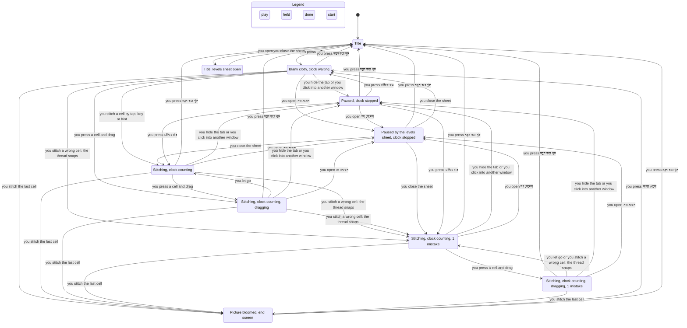

# ছবি ফোটাও statechart

The first half is the model **before** the rewrite (its bugs and their live replays). The second half, **After the rewrite**, is the model of the new code: every rule holds. The old spec is kept in `before-fix/Chhobi.tla`.

---

## Before the rewrite

Spec (kept in `before-fix/`): `Chhobi.tla` / `Chhobi.cfg` / `view.ts`, mirrored from the old `picture-game.tsx` and `tools/chhobi-photao/lib/game.ts`. TLC: 320 states, 1680 steps. Chart: `before-fix/chart.mmd` (9 states, 36 arrows). Report: `before-fix/report.md`.

## Systems modelled
- **Play phase:** blank picture (clock not started) → filling in → solved. Each paint may or may not solve the picture.
- **Time:** the hidden clock `clock.current` (`since`, `spent`, `started`). `ticking` means `since !== null`. The first paint starts it. `stopClock()` runs on hide and on solve, and `resume()` restarts it.
- **Pause and focus:** tab visible or hidden, window focused or blurred, the pause overlay, চালিয়ে যাও.
- **Input:** a drag stroke (`stroke.current`): `onDown` starts it, `onMove` extends it, and up/cancel/lost-capture end it. Keyboard and হিন্ট paint single cells.
- **Choices:** the অ্যালবাম and সব লেভেল drawers (`<details>`), picking a level, শুরু থেকে, পরের লেভেল, আবার খেলো.
- **Celebration timers:** the win sound, star chimes and confetti after `celebrate()`.
- **Links:** a friend's link opens its level (`goLevel(found.level)`).
- Two levels stand in for thirty. Left out: sound loops (none in this game) and kids' rules (not a kids' game). Saved stars come from `recordLevel`, which keeps the max (StarsNeverDrop holds by reading the shared code).

## Rules in plain words
| Rule | Plain words | Result |
|---|---|---|
| ClockStillWhileAway | The clock counts only while you're on the page. | **breaks** |
| InputReleasedWhenAway | After blur or hide, no drag counts as held. | **breaks** |
| ChoiceFreezesPlay | While you look through the levels or the album, the clock doesn't count. | **breaks** |
| PausedWhenHidden | A started picture is paused while its tab is hidden. | holds |
| PausedMeansStill | Paused means the clock is stopped and nothing is being drawn. | holds |
| ClockStopsOnTheCard | Once the picture is solved, the clock has stopped for good. | holds |
| CheerOnlyForThisPicture | The win sound and confetti never fire after you've moved on. | holds |
| ReplayIsExact | A friend's link opens exactly the friend's picture. | holds |
| TypeOK, NoDeadlock | | hold |

## Bugs

Replays ran in Orca (my own tab) by reading the real React state (`PictureGame` hooks: `game`, `paused`, `result`, and the `clock` and `stroke` refs) and sending `PointerEvent`s at cell centres. Blur and focus were plain `window` events. Orca pins `document.hidden` to `false`, so the hide checks ran inside a src-less iframe filled with the page's own HTML, where I controlled `document.hidden` (see the ghontar-sur README).

### 1. ClockStillWhileAway: "the clock counted while I was in another window" (shared)
- **Path (2 steps):** you press a cell and drag → you click into another window: *Filling in, clock counting, …, you're in another window*. With a plain tap, it's the same without the drag.
- **Why:** only `visibilitychange` stops the clock. `blur` isn't handled.
- **Live (level 1):** filled one cell, clock 1.0 s → blurred for 5 s → clock **6.0 s**, `paused: false`, no overlay → came back and finished → the result reads "**১০ সেকেন্ড**, একটাও ভুল ঘর নেই।" (`{seconds: 10}`). Half of that was time spent away. The time is on the card and in the friend's comparison (`compareLine(seconds, …)`), so it matters.
- **Fix (shared):** pause and `stopClock()` on `window` `blur`, as on hide (the shared player does this for every game).

### 2. InputReleasedWhenAway: "a drag kept painting after I'd let go" (shared)
- **Path (2 steps):** you press a cell and drag → you click into another window: *drag still held while you're away*.
- **Why:** `hide()` drops the stroke, but nothing drops it on blur, and `onMove` never checks that a button is still down (`event.buttons`). If the pointerup is lost (for example, you release the mouse after another app has taken focus), every later pointermove over the grid keeps extending the old stroke.
- **Live (level 1, last row):** pointerdown on the first cell → 1 cell filled, stroke held → blur → a `pointermove` over the last cell of the row with **no button held** (`buttons: 0`) → **5 cells filled**, stroke still held. The events were synthetic, so the replay proves what the handlers do. It doesn't prove that Chrome drops the pointerup on a real alt-tab; that part is an assumption.
- **Fix (shared):** on `blur`, set `stroke.current = null` (the same for every game that keeps a held pointer or key). In `onMove`, end the stroke when `event.pointerType === "mouse" && event.buttons === 0`.

### 3. ChoiceFreezesPlay: "the clock ran while I looked through the levels" (shared)
- **Path (2 steps):** you open সব লেভেল or the album → you press a cell: *Filling in, clock counting, levels drawer open*. You can also open the drawer mid-picture.
- **Live:** filled a cell (clock 0.1 s), opened সব লেভেল, waited 4 s → clock **4.1 s**, not paused.
- **Fix (shared):** the drawers are choices, and choices pause. Put সব লেভেল and the album in the shared pause menu, or `stopClock()` while a drawer is open and restart it on close (only if the picture has started and isn't solved).

### Rules that hold, checked live
- **PausedWhenHidden / PausedMeansStill** (iframe): Space filled cell 0, clock 1.0 s → tab hidden 1.5 s → `paused: true`, clock still **1.0 s**. The focused cell became disabled and focus fell to `<body>`, so Backspace while paused reached nothing (cell 0 stayed filled). The handler has no pause check of its own, but disabled cells cover the gap.
- **ClockStopsOnTheCard / CheerOnlyForThisPicture:** `celebrate()` calls `stopClock()`, and `goLevel()` clears every celebration timer.

## Quality-bar gaps (level 1 played through the tutorial drag and to the clear screen, in Orca at Pixel 9)
1. **First screen:** on a phone, the 5×5 board pushes its bottom rows, the ভরাট / খালি দাগ switch and the tools below the fold. A one-line instruction and the H1 sit above the board. Screenshot: `.shots/chhobi-photao-first-screen.png`.
2. **The clock is hidden during play:** time is the score that goes on the card and is compared with a friend's, but the HUD shows only the level, the stars and the pictures count. The bar asks for a small corner timer in Bangla digits.
3. **Pause is not a menu:** there's no pause button, P or Esc. It pauses only on tab hide (not blur, bug 1).
4. **Choices don't pause:** the drawers (bug 3) sit under the game with no recommended pick. The level list should live in the pause menu.
5. **Danger:** a wrong fill costs a star with no warning at the edge. The "over" clue only turns red after a line has too many cells.
6. **Pacing:** level 1's tutorial is good: the first row glows, one sentence, and a win in a few seconds. After that, the levels grow in size and nothing new arrives (no new mark, no new rule, no "boss" picture to end a world).
7. **Ending:** the clear screen reveals the picture with a ripple, gives its name, a line, time and mistakes, then the card. Good. But the time can include time spent away (bug 1). Screenshot: `.shots/chhobi-photao-solved.png`.
8. **Sound:** the stitch swish, the ✕ tick, a rising combo per line, and the reveal run are all meaningful. No loop. Every sound also shows on screen.


---

## After the rewrite

Spec: `Chhobi.tla` / `Chhobi.cfg` / `view.ts`, mirrored from `tools/chhobi-photao/components/photao-game.tsx`, `components/board.tsx`, `lib/session.ts`, `lib/play.ts` and `lib/progress.ts`. Report: `after-fix/report.md` (TLC, 2 levels, mistakes counted to 3: **6,336 states, every rule holds**). The chart is drawn from the smaller model (1 level, mistakes counted to 1: 252 states), because the chart budget is 500 states: `after-fix/chart.mmd` (report: `after-fix/chart-report.md`).

### What changed in the model
- The clock **waits for the first stitch** (`armed`), runs exactly while playing, and a pause before the first stitch resumes with the clock still waiting.
- The shared player owns pause (the blur, the hidden tab, Esc, ⏸). The game also listens to blur, pagehide and visibilitychange itself, so it is safe outside a player.
- সব লেভেল is a **choice moment**: it pauses (`why = sheet`), and an away pause on top of it never closes it. It also opens from the pause menu through `onLevels`.
- A stitch that contradicts the picture is **refused** (the cell stays as it was), counts one mistake for that cell, and ends the stroke.
- Your own unlock lives in `ektukhani-unlock-chhobi-photao` (migrated once). A friend's far-ahead level is a visit: it records stars and opens nothing between.

### Rules (all hold)
| Rule | Plain words |
|---|---|
| ClockStillWhileAway | The clock counts only while you are on the page. |
| PausedWhenHidden, PausedWhenBlurred | A round is never "playing" while its tab is hidden or the window is blurred. |
| InputReleasedWhenAway | No drag counts as held while you are away, paused, in the sheet, or on the result. |
| PausedMeansFrozen | Paused means the clock is stopped and no stroke is held. |
| ClockMeansPlaying, ClockWaitsForTheFirstStitch | The clock runs exactly while playing after the first stitch. |
| ChoiceFreezesPlay | While the sheet is open, nothing advances. |
| CheerOnlyOnTheResult | The bloom sound and confetti never fire after you have moved on. |
| OpenLevelsAreEarned, UnlockNeverShrinks, LevelIsPlayable | Only your own clears open levels; a friend's level never opens the ones before it. |
| StarsNeverDrop, ResultMatchesPlay | Recorded stars only go up, and are at least what this round earned. |
| TypeOK, NoDeadlock | |

### The three old bugs, fixed, replayed live (Pixel 9 emulation in Orca, level 3)
1. **ClockStillWhileAway** (was: 1.0 s → 6.0 s after 5 s away). Now: tapped a cell, clock **1003 ms**, blur, 4 s away, clock **1003 ms**, `paused/away`. The first press on the board after coming back **only resumed** (0 cells filled), then the clock went on to 2505 ms. Node test: `bug 1, ClockStillWhileAway / PausedWhenBlurred`.
2. **InputReleasedWhenAway** (was: a buttonless `pointermove` after blur filled 4 more cells). Now: pointerdown on the first cell (1 cell), blur, a mouse `pointermove` with `buttons: 0` over the last cell of the row: **0 more cells**. The board releases on blur, on the player's pause, on lost capture, and on a mouse move with no button. Node test: `bug 2, InputReleasedWhenAway`.
3. **ChoiceFreezesPlay** (was: 4 s in a drawer cost 4 s). Now: opened the sheet mid-round, waited 3.5 s: phase `paused/sheet`, clock moved **0 ms**. Node test: `bug 3, ChoiceFreezesPlay`.

New rules found while writing the model, each with a node test: a wrong stitch is refused and counts once per cell (`a wrong stitch is refused…`), stitches never clear locked নানির ফোঁড় (`নানির ফোঁড়: locked…`), and a held Enter never skips the result (`a result key needs a fresh press…`, replayed live: a repeating Enter left level 26 on its result, a fresh Enter went on to 27).

### Chart (after-fix, from the small model)


### Regenerate
```sh
# the rules, full model (Count = 2, Cap = 3)
scripts/statechart.sh ai_docs/statecharts/chhobi-photao/Chhobi.tla --view ai_docs/statecharts/chhobi-photao/view.ts --out ai_docs/statecharts/chhobi-photao/after-fix
# the chart: copy the spec and view to a scratch folder, set Count = 1 and Cap = 1 in its Chhobi.cfg, run the same command there
rm ai_docs/statecharts/chhobi-photao/after-fix/tlc.out
```
The chart hides: the celebration timers (they stay on the end screen), friend links, and level picks (the same reset as নতুন করে শুরু).
