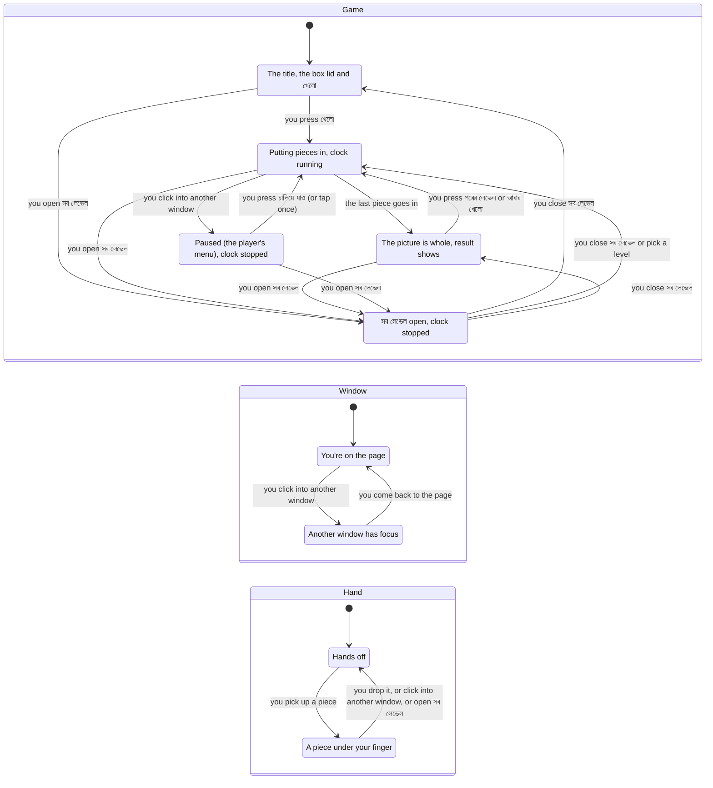

# ছবির টুকরো: statechart

## After the rewrite (`after-fix/`)
The spec `Jigsaw.tla` now mirrors the rewritten game: `components/tukro-game.tsx` (start, load, pauseFor/resumeFrom/wake, onDrop/solved, the sheet, the blur, pagehide and visibilitychange listeners, the link boot), `components/table.tsx` (the canvas table's pointer input and cancel), `lib/session.ts`, `lib/progress.ts` and `lib/play.ts`. The view hides the hidden tab (it takes the blur's path), a friend's link and নতুন করে শুরু (both go to the title), a level from the sheet (it acts like আবার খেলো) and the result's timers. TLC checks all of them.

TLC: 417 states, 1735 steps. The chart has 10 states and 16 arrows. **All 12 rules hold** (`after-fix/report.md`). New since before-fix: UnlockNeverShrinks, ChoiceFreezesPlay (the sheet pauses play), LevelIsPlayable (the level on screen is open, has stars, or is the friend's visit).



### The bugs, fixed
| Bug | Fix | Node test (`tests/rewrite.test.ts`) | Live replay (Orca) |
|---|---|---|---|
| 1. ClockStillWhileAway / PausedWhenBlurred | The game listens for `blur`, `pagehide` and `visibilitychange`, and the player's `onPause`; all go through `session.pause("away")`, which banks the clock. Only চালিয়ে যাও (or the first press after coming back, which only resumes) starts it again. | `bug 1, ClockStillWhileAway / PausedWhenBlurred: …` | Pixel 9, level 1: a synthetic `blur` opened the player's menu, the phase went `playing → paused/away`, and the clock read `০:৩০` before and `০:৩০` 3 s later. The সব লেভেল sheet held the clock at `০:১৬` for 2.2 s. P opened the player's menu. |
| 2. PieceDroppedWhenAway | `table.cancel()` runs on blur, the player's pause, `pointercancel` and lost capture. A mouse move with `buttons === 0` cancels too. The piece glides back to its slot. | `bug 2, PieceDroppedWhenAway: …` | Pixel 9: a mouse drag with six moves held piece 3 (`held() = 3`). After `blur`, `held() = -1`. After `focus`, a buttonless move far away carried nothing. |
| 3. CheerOnlyOnTheResult | Every celebration timeout goes in one list, cleared by `load()` (every new table) and on unmount. The fanfare is scheduled on the audio clock at the win, so the player's pause cuts it. A drop on a finished table returns `none`, so a second finish can't happen. | `bug 3, CheerOnlyOnTheResult: …` | Desktop: on the last drop of level 1, `OscillatorNode.start` counted 8 (the thock plus the whole fanfare). 100 ms later I opened সব লেভেল and picked level 2. The next 2 s added 9 starts (the scatter on level 2), no confetti canvas, and no end screen. |
| 4. OpenLevelsAreEarned | The game keeps its own unlock, `ektukhani-unlock-chhobir-tukro`. It is migrated once from the shared rule and raised only by clearing a level that was already open. A friend's level is a visit. | `bug 4, OpenLevelsAreEarned: …` and `saved progress migrates once: …` | Clean storage, then `#s=71185&t=40&l=5&n=Rafi`. The banner read "Rafi ১৬ টুকরোর ছবি ৪০ সেকেন্ডে জোড়া লাগিয়েছে।" I solved it in 7 s ("Rafi-এর চেয়ে ৩৩ সেকেন্ড আগে!", primary button "তোমার লেভেলে ফেরো"). Storage held `{"5":3}` and unlock `1`. After a reload without the hash, the title opened on লেভেল ১, and the sheet listed open levels **১, ৫** only (before: ১–৬). |
| Minor: double finish | `dropPiece` refuses a placed piece or a finished table. | `bug 3, …` | — |
| Minor: clock vs result rounding | `session.seconds` is the one rounding for the HUD and the result. | `result keys need a fresh press …` | — |
| Found in the rewrite: a frozen scatter | rAF's timestamp can be earlier than the kick that asked for it. A negative `dt` stopped the frame loop with the pieces still waiting at home (seen in headless Chrome). `stepAnim` now asks for another frame instead. | `a frame stamped before the kick …` | headless Chrome: the scatter wait timers stayed at `[60,100,140,180]` before the fix and drained after it. |

Shared patterns closed as well:
- P calls `player.requestPause()`.
- Result keys need a fresh press 0.4 s after the result appears (`session.resultKey`).
- Enter and Space on buttons, the board and the tray do their own job, and clicked buttons drop focus.
- The sheet pauses play.
- The first press after coming back only resumes (`wake()`).

### Regenerate
```sh
scripts/statechart.sh ai_docs/statecharts/chhobir-tukro/Jigsaw.tla --view ai_docs/statecharts/chhobir-tukro/view.ts --out ai_docs/statecharts/chhobir-tukro/after-fix
rm ai_docs/statecharts/chhobir-tukro/after-fix/tlc*.out
```
The before-fix spec is in git history (`Jigsaw.tla` before this rewrite); its outputs stay in `before-fix/`.

---

# Before the rewrite

Spec `Jigsaw.tla` / `Jigsaw.cfg`, view `view.ts`, output `before-fix/` (`report.md`, `chart.mmd`).
It mirrors `tools/chhobir-tukro/components/jigsaw-game.tsx` (`wake`, `finish`, `settle`, `onDown`/`onMove`/`onUp`/`onCancel`, `goLevel`, the `visibilitychange` handler `hide`, `readFriend`, the window keydown handler), plus `tools/chhobir-tukro/lib/game.ts` and `unlockedLevel` in `shared/game-core.ts`.
TLC: 164 states, 826 steps. The chart has 18 states and 32 arrows. **4 rules hold and 5 break, from 4 bugs.** (ClockStillWhileAway and PausedWhenBlurred share one cause.)

## Systems modelled
- **Play phase:** `ready → playing → paused → done`. `wake()` runs on the first tap or drag of a piece, and also resumes from paused. `finish()` runs when the last piece snaps. `goLevel()` runs for পরের লেভেল, আবার খেলো, শুরু থেকে, the সব লেভেল grid and a friend's link.
- **Clock:** `clock.since ≠ null`. It runs exactly while the phase is `playing`. `stopClock()` is called in `finish()` and `hide()`.
- **Pause and focus:** the tab can be visible or hidden, and the window focused or blurred. The only away handler is `visibilitychange → hidden`, and it pauses only a `playing` phase. There is no blur listener, no pause button and no pause key.
- **Input:** a piece in your hand (`grab.moved`). Releasing it needs a `pointerup`, which in the model reaches the page only while the page has focus (as in antenna). `hide()` calls `onCancel()`. Nothing releases the piece on blur.
- **Timers:** `setTimeout(finished, 250)` (the win fanfare) and `setTimeout(confetti, 900)` in `finish()`. Their ids are never kept. The star chimes come from the shared `StarReveal`, which clears its own timers.
- **Levels and links:** 2 levels in the model. `cleared` is the set of levels with stars. `unlocked = min(count, 1 + highest cleared)`, the same formula as the code. A friend link (`#s=<seed>&t=<s>&l=<L>`) opens level L, even when L is locked.

Abstractions:
- One more piece finishes a painting. A wrong drop only puts the piece back.
- Stars are "cleared or not". `recordLevel` keeps the max; that logic is pure and covered by `tests/chhobir-tukro.test.ts`.
- No painting is finished within 900 ms of the previous one, so `YouPlaceTheLastPiece` needs the old timeouts to have fired. This keeps the regions chart honest and changes no rule.
- Not modelled: sound loops (the game has none; every sound is a one-shot `tone()`/`hiss()` that mutes itself), rotation (pure, tested), tray reslotting on resize (pure, tested).

The chart hides one kind of step: picking a level from সব লেভেল in the middle of a round or while paused. It acts like আবার খেলো and would add 8 arrows.

## Rules, in plain words
| Rule | In plain words | Result |
|---|---|---|
| ClockStillWhileAway (NoProgressWhileAway) | The clock that decides your stars doesn't run while you're in another tab or window. | **breaks** |
| PausedWhenHidden | When the tab hides, a round in progress pauses. | holds |
| PausedWhenBlurred | When you click into another window, a round in progress pauses. | **breaks** |
| PieceDroppedWhenAway (InputReleasedWhenAway) | When you leave the page, the piece in your hand is let go. | **breaks** |
| PausedMeansFrozen | While paused, the clock is stopped and no piece is in your hand. | holds |
| ClockMeansPlaying | The clock runs exactly while you're putting pieces in. | holds |
| CheerOnlyOnTheResult (NoDoubleResult's twin) | The win fanfare and the confetti go off only while the finished painting is on screen. | **breaks** |
| OpenLevelsAreEarned (UnlockNeverShrinks' twin) | Only levels you've earned are open: one past the unbroken run of cleared levels. | **breaks** |
| TypeOK, NoDeadlock | | hold |

## Bugs

### 1. ClockStillWhileAway / PausedWhenBlurred: "I answered a message in another window, and my clock kept running, so I lost a star"
- **Path (report):** 0, a new table → 1, you tap a piece (the clock starts) → 2, you click into another window (the clock keeps running).
- **Live replay (Orca, level 1):**
  - I tapped a tray piece with a pointerdown and pointerup on the stage, which ran `wake()`, then dispatched `blur`.
  - The clock read `০:০০ → ০:০৩ → ০:০৮ → ০:১২` over about 12 s.
  - No veil appeared and the phase stayed `playing`.
  - Orca's window was unfocused the whole time (`document.hasFocus() = false`), so on a desktop the clock also counts time spent in another app.
- **Fix:** listen for `blur` (and `pagehide`) and treat it exactly like `visibilitychange → hidden`: if the phase is `playing`, call `stopClock()` and `onCancel()`, then show the veil. **Shared:** sudoku has the same gap. Put the fix in one shared away hook (`useAwayPause(onAway)` in `shared/game-kit.ts`) that listens to both events.

### 2. PieceDroppedWhenAway: "I alt-tabbed mid-drag, came back, and the piece was stuck to my mouse"
- **Path:** 0 → 1, you pick up a piece and drag it → 2, you click into another window (the piece is still in your hand).
- **Live replay:**
  - I sent pointerdown on a tray piece and six pointermoves onto the board, with no pointerup, then dispatched `blur`. After 2 s I sent `focus` and a `pointermove` with `buttons: 0` (no button held).
  - The piece kept the `ct-drag` class and followed the bare pointer: from (32, 216) to (212, 346), then to (72, 496).
  - The clock kept running (`০:০৪ → ০:০৭`).
  - The next click anywhere is read as the drop.
  - The premise, a `pointerup` lost while the window is away, depends on the platform. When it happens, the code has nothing that lets go: `onMove` checks only the pointer id, never `event.buttons`.
- **Fix:** run `onCancel()` on `blur` (part of fix 1). In `onMove`, treat `event.buttons === 0` on a mouse as a release (or a cancel). **Shared:** this is the "never keep held state across blur" rule from `game-statechart`.

### 3. CheerOnlyOnTheResult: "I tapped পরের লেভেল and the win fanfare and confetti went off over the new puzzle"
- **Path:** 0 → 1, you drag a piece → 2, the last piece goes in (the fanfare and confetti are still to come) → 3, you press পরের লেভেল (a new table, and both are still to come).
- **Live replay:**
  - I instrumented `OscillatorNode.start` and watched `document.body` for the confetti canvas. Then I solved level 1 (3 stars, 1 s) and clicked পরের লেভেল at once.
  - The fanfare played at +192 ms: four tones at 523, 659, 784 and 1047 Hz.
  - The confetti canvas was added at +844 ms.
  - Both happened while the page showed "লেভেল ২ · ভোর" with a fresh tray and the clock at `০:০০`.
  - The shared `StarReveal` chimes did not ring; they unmount cleanly.
  - Enter on the result also runs `goLevel(level + 1)` and does the same.
  - These timeouts also survive unmounting, so navigating away within 0.9 s can drop confetti on the next page.
- **Fix:**
  - Keep both timeout ids in a ref and clear them in `goLevel()` and on unmount.
  - Better: play the fanfare inside the result's own effect (like `StarReveal`), so it can't outlive the result.
  - **Shared pattern:** sudoku has the same uncleared-celebration-timeout bug. A `useCelebration()` in the kit that owns these timers would fix both.

### 4. OpenLevelsAreEarned: "My friend sent me level 5. I solved it, and levels 2 to 6 opened without my playing them"
- **Path:** 0 → 1, you open a friend's link (level 2 of 2) → 2, you drag a piece → 3, the last piece goes in. Level 2 is cleared, level 1 is not, and both are open.
- **Live replay:**
  - With clean storage I opened `/chhobir-tukro#s=71185&t=40&l=5&n=Rafi`. The banner read "Rafi ১৬ টুকরোর ছবি ৪০ সেকেন্ডে জোড়া লাগিয়েছে।" and 1 level was open.
  - I solved it, and the result read "Rafi-এর চেয়ে ৩৯ সেকেন্ড আগে!". Storage held `{"5":3}`.
  - After a reload without the hash, the game opened on **লেভেল ৬**, and the সব লেভেল grid showed **6 open**: ১, ২, ৩, ৪, ৫ (৩ তারা) and ৬. I had never played levels 1–4.
  - A friend's level-30 link opens all 30 levels.
- **Fix:** make `unlockedLevel` count only the contiguous run of cleared levels from 1, and let a friend's level stay playable for that visit only. **Shared:** this is `shared/game-core.ts`, the same bug sudoku and switchboard found. Fix it once there.

### Minor (not in the model)
- **A double finish from two inputs:** while you drag the last piece with the mouse, Enter on the focused board runs `tapCell` → `settle(selected)` and finishes the round. The mouse's `pointerup` then runs `settle` again. `placePiece` returns the same table, so `remaining = 0` and `finish()` runs a second time: a second fanfare, a second record and a second confetti. `onDown` blocks a second finger, but `onBoardKey` has no `grab` check. To fix it, return early from `settle` when the piece is already placed or the phase is `done`.
- **A friend link mid-round wipes the table:** a `hashchange` while you're playing runs `goLevel()` with no question. শুরু থেকে sits next to ঘোরাও ↻ on rotate levels and wipes the table on one tap, with no confirmation. Rounds are short (under 3 minutes), so this is low priority.
- **The clock and the result can disagree:** the clock shows `floor(elapsed)` and the result shows `round(elapsed)`, so "০:০৯" can become "১০ সেকেন্ড".
- **The hide handler can't be tested live:** Orca pins `document.hidden` (`Cannot redefine property: hidden`), so the veil was not seen live. PausedWhenHidden holds in the model and in the code: `hide()` calls `stopClock()` and `onCancel()` and sets `paused`.

## Quality-bar gaps (game-quality-bar)
1. **Pause isn't a real menu (§7):** there's no pause button, P does nothing, and Esc only deselects a piece. Pause happens only when the tab hides; blur doesn't pause (bug 1). The veil offers only চালিয়ে যাও, with no নতুন করে শুরু, কীভাবে খেলবে, শব্দ or সব লেভেল.
2. **On a phone the first screen has no start action (§1):** on a Pixel 9 the H1, lead, HUD and board fill the screen, and the tray of pieces, which is the thing you touch to start, sits below the fold. The start action should be the biggest thing on screen. The SEO H1 and lead sit above the player (§12).
3. **New ideas arrive without an introduction (§9):** rotation starts at level 11. The only cues are ", ঘোরানো" in the small sub-line and a status message after a wrong drop. Nothing shows that you tap a selected piece again, or press R, to turn it. The jumps to 5×5 (level 14) and 6×6 (level 21) aren't announced either.
4. **Choices (§4):** the level ladder hides in a closed `<details>` drawer. পরের লেভেল doesn't say what the next level changes (for example "এবার ৪×৪" or "এবার টুকরো ঘোরানো"). There's no difficulty or "ghost picture" choice.
5. **No finale per world (§9):** levels 10, 20 and 30 end with the usual result and confetti on the first clear. There's no named final painting and no special card for finishing ভোর, গোধূলি or জোছনা.
6. **The HUD has no progress cue (§5):** the thumbnail (top-left) and clock (top-right) are in the right places, but the pieces left show only in the status line under the tray ("আর ৫টা টুকরো"). A thin progress bar would fix this. The status line also changes meaning (hint, mistake, streak) with no visual difference.
7. **The celebration is split across systems (§10, §11):** the star pop (`StarReveal`), the fanfare (an uncleared timeout) and the confetti (another uncleared timeout) aren't one thing, and two of them leak (bug 3).
8. **Strengths to keep:**
   - The first win comes within 10 s on level 1: 9 pieces with a strong ghost image.
   - The result shows real stats and a near-miss line with exact seconds.
   - The friend compare line is kind, and the card is personal and good-looking.
   - There are 5 own sounds: the cardboard snap is the signature, with a climbing combo, plus slide, turn, lift and win. Each has a visible twin (flash, shake, rotation).
   - No console errors.

## Screenshots
- `.shots/chhobir-tukro-phone-first-screen.png`: Pixel 9, level 1. The board fills the screen and the tray is below the fold (trust only the top; Orca repeats the image).
- `.shots/chhobir-tukro-desktop-rotate-level.png`: desktop, level 11 (৪×৪, ঘোরানো) mid-round, with the "জায়গা ঠিক, টুকরোটা শুধু ঘোরানো" status after a turned drop.
- `.shots/chhobir-tukro-desktop-result.png`: the result (3 stars, "নদীর পানিতে কমলা আলো, একটা ফাঁকও নেই।", the friend compare line, পরের লেভেল / আবার খেলো).
- `.shots/chhobir-tukro-card.png`: the share card, exported from its canvas.

## Regenerate
```sh
scripts/statechart.sh ai_docs/statecharts/chhobir-tukro/Jigsaw.tla --view ai_docs/statecharts/chhobir-tukro/view.ts --out ai_docs/statecharts/chhobir-tukro/before-fix
rm ai_docs/statecharts/chhobir-tukro/before-fix/tlc*.out
```
After the fixes, update the spec in four places:
- `WindowBlurs` pauses a `playing` round, stops the clock and drops the piece.
- `Fresh` clears `cheer`.
- `Unlocked` uses the contiguous run.
- `FriendLinkOpens` still opens any level for that visit, but `Unlocked` never counts it.

Then re-run into `ai_docs/statecharts/chhobir-tukro/after-fix`. All 9 rules must hold.

Note for testers: I removed every `ektukhani-*chhobir-tukro*` key my runs wrote. Storage had none before.
