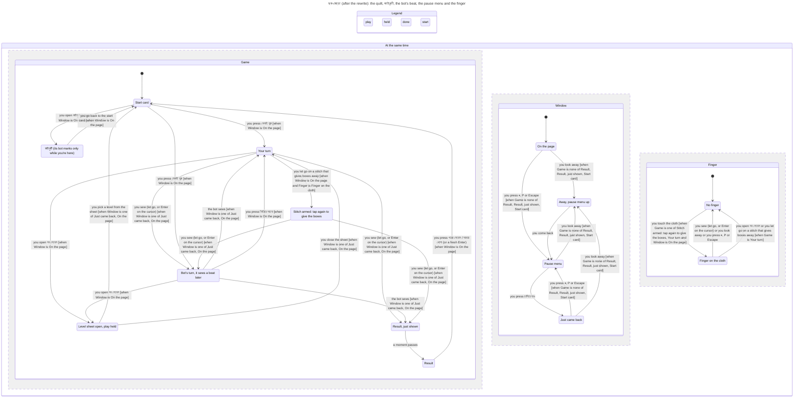

# ছক-জোড়া statechart

## After the rewrite (2026-11-04)
Model: `ChhokJora.tla` with `ChhokJora.cfg` (the drawn chart, `Full = FALSE`: one person, a game already touched) and `ChhokJoraFull.cfg` (the full check, `Full = TRUE`: both modes, an untouched page), plus `view.ts`. It mirrors:
- `tools/chhok-jora/lib/flow.ts`: `running`, `kataRunning`, `held`, `start`, `kata`, `toTitle`, `finish` (and its `cheer`), `menu`, `away`, `sheet`, `handOff`, `awake`, `takesTap`, `takesResultKey`;
- `lib/input.ts`: `press`, `lift`, `release`, `ghostOf`, `attempt` (the second tap), `keyAct`;
- `components/chhok-game.tsx`: `load` (which calls `silenceScheduled()`), `startPlay`, the bot effect armed only on `running && botTurn`, `apply` and `finishGame` (stars and the cheer in the same step), `tryStitch`, `takeBack`, the pointer handlers, the window key handler with `dropFocus`, the blur/focus/visibility effect, `useGamePlayer` `onPause` / `onResume` / `onRestart`, the sheet;
- `components/kata.tsx`: its bot effect armed only on `live && botTurn`, `fresh`, `onHome`;
- the player's menu, which opens on blur and hide once the game has been touched.

Runs:
- `after-fix/report.md` and `after-fix/chart.mmd`: 390 states, 14 chart states, 28 arrows;
- `after-fix/report-full.md`: 642 states, both modes.

**Every rule holds in both runs:** TypeOK, BotsWaitWhileAway, QuiltWaitsOffScreen, QuiltFrozenUnderKatakuti, PausedWhenAway, InputReleasedWhenAway, GhostOnlyUnderAFinger, NoCheerAfterMovingOn, ResultStaysABeat, NoDoubleResult, EnterNeverUndoes, ComeBackIsNotAMove, HandOffIsNotAMove, ChoiceFreezesPlay, BotOnlyAgainstYou, NoDeadlock.

**Mutant check** (`scratchpad/chhok-jora/mutant/`, not kept): let blur keep the finger, drop the result guard, and arm the quilt's bot on the play screen alone. InputReleasedWhenAway, ResultStaysABeat and BotsWaitWhileAway each break at once.

### What changed in the model
- **কাটাকুটি is its own screen.** It opens only from the start card, so no quilt is ever in play under it. The quilt's bot needs the play screen and nothing holding it; কাটাকুটি's bot needs its own screen and nothing holding it.
- **Presence is a hold.** Blur or a hidden tab holds both bots and the clock, menu or no menu. Coming back starts a 350 ms guard: the press that brings you back never sews.
- **The finger is released** on blur, hide, the menu, the sheet and pointercancel. The pale stitch is drawn from the finger and "play runs", so it can't outlive either.
- **The result appears in the same step as the last stitch**, with its stars and its cheer. The cheer is scheduled on the audio clock; every load (আবার খেলো, পরের লেভেল, নতুন করে শুরু) calls `silenceScheduled()` and drops it. Only a fresh Enter 0.4 s after the result goes on.
- **Enter belongs to the cloth.** Clicked buttons drop focus, the arrows blur a focused button, and with the cursor out Enter sews its gap.
- **New:** the second tap (a stitch that gives away more than it must is armed first), and the hand-off guard for two people (a tap within 350 ms of the turn passing is the passer's).

| Rule | In plain words | Result |
|---|---|---|
| BotsWaitWhileAway | No bot sews or marks while you're in another window, on another tab, or in the menu. | holds (BotsWaitWhileHidden broke before) |
| QuiltWaitsOffScreen | While কাটাকুটি is on screen, the quilt's bot can't move. | holds (broke before) |
| QuiltFrozenUnderKatakuti | While কাটাকুটি stays on screen, nothing on the quilt changes. | holds |
| PausedWhenAway | Mid-game and away, the pause menu is up. | holds |
| InputReleasedWhenAway | Away, in the menu or the sheet, no finger counts as on the cloth. | holds (broke before) |
| GhostOnlyUnderAFinger | The pale stitch shows only under a finger that is down now, on the page. | holds (broke before) |
| NoCheerAfterMovingOn | The cheer belongs to the result on screen. | holds (broke before) |
| ResultStaysABeat | A key held through the last stitch can't wipe the finished quilt. | holds (broke before) |
| NoDoubleResult | A quilt is recorded once, only while its result shows. | holds |
| EnterNeverUndoes | Enter never presses ফিরিয়ে আনো. | holds (bug 7 before) |
| ComeBackIsNotAMove | The press that brings you back never sews. | holds |
| HandOffIsNotAMove | The passer's second tap never sews for the next player. | holds |
| ChoiceFreezesPlay | While সব লেভেল is open, nothing moves and the clock stops. | holds |
| BotOnlyAgainstYou | Two people: no turn belongs to a bot. | holds |

| Bug | Fix | Node test | Live check (Orca, after the fix) |
|---|---|---|---|
| 1. Lose fanfare over কাটাকুটি | কাটাকুটি is a screen of its own, reached only from the start card; `running` needs the play screen. | `bug 1 · QuiltWaitsOffScreen` | কাটাকুটি opened from the start card; there is no quilt in play and no way to reach one from the quilt's HUD. |
| 2. Enter wiping a finished quilt | `takesResultKey`: a fresh press, 0.4 s after the result. | `bug 2 · ResultStaysABeat` | Level 1 finished; a repeat Enter left the result up; a trusted Enter went on to লেভেল ২. |
| 3. Win fanfare over a fresh quilt | No celebration timer: the cheer plays in `finishGame` on the audio clock, and `load` calls `silenceScheduled()`. | `bug 3 · NoCheerAfterMovingOn` | With `OscillatorNode.start` and `cancelScheduledValues` counted: 8 notes started at the finish, and আবার খেলো 50 ms later cut 25 scheduled notes. |
| 4. কাটাকুটি bot moving while away | Its bot effect waits on `live` (`kataRunning`) and re-checks it when the timer fires. | `bug 4 · BotsWaitWhileHidden` | Marked the middle cell, then blur: 1 mark after 1.5 s; after coming back the bot marked (2). |
| 5–6. Ghost stitch after a hide | `release()` on blur, hide, menu, sheet and cancel; the ghost is `ghostOf(finger, running)`. | `bugs 5 and 6 · InputReleasedWhenAway and GhostOnlyUnderAFinger` | Finger 5 held on নানুর নকশিকাঁথা, then blur: 0 ghost lines; নানু's bot held 2.5 s (56 open gaps → 56); after চালিয়ে যাও it sewed (55). |
| 7. Enter undoing a stitch | `keyAct`: with the cursor out Enter sews; clicks drop focus; arrows blur a focused button. | `bug 7 · EnterNeverUndoes` | Trusted click on ফিরিয়ে আনো (53 → 55 open gaps, focus on BODY), ArrowRight (cursor), Enter: sewn (55 → 54). |



### Regenerate
```sh
D=ai_docs/statecharts/chhok-jora
scripts/statechart.sh $D/ChhokJora.tla --view $D/view.ts --out $D/after-fix                                 # the chart (Full = FALSE)
scripts/statechart.sh $D/ChhokJora.tla --config $D/ChhokJoraFull.cfg --view $D/view.ts --out <new folder>  # the full check; copy its report.md to after-fix/report-full.md
rm $D/after-fix/tlc*.out
```
The chart folds কাটাকুটি into one state and hides the guards running out, নতুন করে শুরু and a cancelled touch. It draws looking away and ⏸ only from the quilt and কাটাকুটি, and সব লেভেল and ফিরিয়ে আনো only from your turn. The model and the reports keep all of them.

## Before the rewrite (kept for the record)


Spec `before-fix-model/ChhokJora.tla` / `.cfg`, view `before-fix-model/view.ts`, output `before-fix/` (`report.md`, `chart.mmd`).
It mirrors `tools/chhok-jora/components/quilt-game.tsx` (`stitch`, `fresh`, the bot effect, the finished effect, the hide handler, `keyHandler`, `onPointerDown`/`Up`/`Cancel`, the mode buttons) and `tools/chhok-jora/components/katakuti-game.tsx` (`play`, the bot effect, `again`).
TLC: 396 states, 1296 steps. The chart has 17 states and 38 arrows (it hides "you press Enter on a gap" when no box closes and "the touch is cancelled"). **2 rules hold, 6 break** (plus TypeOK and NoDeadlock). All six bugs reproduced live in Orca. A 7th bug (Enter on a focused button) was found by the পাকা-কাঁচা model and replayed here.

### Systems modelled
- **Quilt phase:** fresh → your turn ⇄ bot's turn → (paused) → just finished → result. Abstracted to one box left: a stitch closes it (the end) or passes the turn.
- **Pause and tab:** the hide handler pauses only a quilt with moves that isn't over. There's no blur handler and no pause button.
- **Finger:** `pointer.current` and the ghost stitch. Press, lift (sews if play is allowed), cancel. Nothing releases the finger on hide or blur. A finger that went away while hidden is modelled as "stale": its pointerup never comes, and a new touch has a new id.
- **Timers:** the bot's 560 ms timeout (it checks `botTurn` and `paused`, not which game is on screen), and the finished effect's bare `setTimeout(…, 450)` cheer, which `fresh()` doesn't clear.
- **Result and keys:** আরেকবার, and Enter or Space on the result (`phase === "over"` calls `fresh(level)`), with no guard.
- **কাটাকুটি:** your mark, the bot's 480 ms reply (no pause, no visibility check), আরেক দান. The quilt stays mounted, and not paused, underneath.

Not modelled: two-player quilt (the same timers without the bot), undo (it replays from moves and was checked by hand), the best score (`finished` ref, recorded once) and কাটাকুটি stars (`recordLevel`, pure). No sound loops.

### Rules, in plain words
| Rule | In plain words | Result |
|---|---|---|
| PausedWhenHidden | A hidden tab pauses a quilt in play. | holds |
| BotsWaitWhileHidden | No bot moves while the tab is hidden, on either board. | **breaks** |
| QuiltWaitsOffScreen | While কাটাকুটি is on screen, the quilt underneath doesn't move. | **breaks** |
| InputReleasedWhenAway | After a hide, no finger counts as on the cloth. | **breaks** |
| GhostOnlyUnderAFinger | The ghost stitch shows on screen only under a finger that is down now. | **breaks** |
| NoCheerAfterMovingOn | The win or lose sound and the confetti play only while that quilt's result is on screen. | **breaks** |
| ResultStaysABeat | A finished quilt stays on screen for a moment; a stray key can't wipe it at once. | **breaks** |
| NoDoubleResult | A quilt is recorded once. | holds |
| TypeOK, NoDeadlock | | hold |

### Bugs

#### 1. QuiltWaitsOffScreen: "I switched to কাটাকুটি, and a moment later the quilt's lose fanfare played over my কাটাকুটি game"
- **Path:** 0 fresh quilt → 1 you sew a stitch (bot's turn) → 2 you open কাটাকুটি → 3 the bot sews (here the last box: the quilt finishes under কাটাকুটি, the best is saved and the cheer is queued).
- **Live replay (Orca):**
  - (a) Against সহজ বট I sewed one stitch, and the fiber read `moves 1, turn 1`. Within 30 ms I clicked কাটাকুটি, and `.cj-kboard` was on screen. 1 s later the quilt's state read `moves 2, turn 0`, and one 1150 Hz needle tick (the bot's stitch sound) had played after the switch.
  - (b) I played a quilt down to 2 gaps on my turn, sewed one that closed nothing, and switched to কাটাকুটি at once, with the best score key cleared. At +527 ms the bot's needle tick and a box chime (523 Hz) played. At +986 ms `sfx.lose` played (392 → 330 → 262 Hz) while কাটাকুটি was on screen, and `ektukhani-best-chhok-jora-sohoj` was written (`"1"`) for a quilt the player never saw end.
- **Fix:** make the bot effect wait while কাটাকুটি is on: `if (!botTurn || paused || katakuti) return;`. Or better, pause the quilt when কাটাকুটি opens and resume it on the way back. Also, the mode buttons call `fresh()`, so the old quilt can never be seen again. Either keep it (a "ফিরে যাও" back to the same quilt) or drop it on purpose. **Game-specific.**

#### 2. ResultStaysABeat: "I closed the last box with Enter, pressed Enter once more, and my finished quilt vanished before I saw it"
- **Path:** 0 fresh quilt → 1 you press Enter on the last gap (just finished) → 2 you press আরেকবার or Enter: a fresh quilt.
- **Live replay (Orca, দুজনে):** I sewed all 38 gaps with pointer taps. The game was `over`, scored 5–11, and `.cj-over` showed. 80 ms later I sent one Enter `keydown` on `window`. 113 ms after the end the quilt was fresh (`moves 0`), the status read "দুই ফোঁড়ের মাঝে চাপো…" and the result panel was gone. The same happens against a bot when you keep pressing Enter while it sews its last stitch.
- **Fix:** guard the "over → fresh" key like জোড়া মেলাও's `AGAIN_GUARD_MS`. Ignore Enter and Space on the result for about 600 ms after `over`, or require focus on আরেকবার. **Shared pattern:** jora-melao already has the guard for taps; put one `useAgainGuard()` in `shared/game-kit.ts`.

#### 3. NoCheerAfterMovingOn: "I pressed আরেকবার right away, and the win fanfare and confetti burst over the empty quilt"
- **Path:** the same as bug 2. After step 2, "Cheer on its way" is still set on a fresh quilt.
- **Live replay (Orca):** in the same run as bug 2, with `AudioParam.setValueAtTime` instrumented, `sfx.win` (523, 659, 784, 1047 Hz) fired at +428 ms on the fresh quilt, and one confetti `<canvas>` was added to `body`.
- **Fix:** push the 450 ms timeout into a `timers` ref and clear it in `fresh()`, on a mode change and on unmount, as katakuti-game.tsx already does. **Shared pattern** (uncleared celebration timers; sudoku has the same bug).

#### 4. BotsWaitWhileHidden: "In কাটাকুটি I made my move, switched apps, and the bot moved while I was away"
- **Path:** 0 → 1 you open কাটাকুটি → 2 you mark a cell → 3 you hide the tab → 4 the কাটাকুটি bot marks while hidden.
- **Live replay (Orca):** I marked the middle cell, then dispatched `visibilitychange` and `blur`. 50 ms later 1 mark was on the board. 750 ms later there were 2 marks, and the status read "তোমার পালা।". `katakuti-game.tsx` has no visibility or blur listener at all, so the replay is exact even though Orca pins `document.hidden` to `false` (see below). The quilt's own bot does wait (PausedWhenHidden holds).
- **Fix:** give কাটাকুটি the quilt's rule. Pause on `visibilitychange → hidden` (and on blur, through the shared away hook), and let the bot effect return while paused. **Shared:** the away hook every game needs.

#### 5 and 6. InputReleasedWhenAway and GhostOnlyUnderAFinger: "I touched the cloth, my phone locked, and when I came back a pale stitch was still drawn there"
- **Path:** 0 fresh quilt → 1 you touch the cloth (ghost shows) → 2 you hide the tab (nothing releases the finger) → 3 the tab shows again: the ghost stitch is still on screen with no finger down.
- **Live replay (Orca):** on a fresh quilt I sent `pointerdown` (touch, id 7) on gap 20, and 1 ghost line showed (`stroke-opacity .6`). Then I dispatched `visibilitychange` twice, for away and back, with no pointerup. The ghost was still there right after, and 1.5 s later. On a fresh quilt the hide handler does nothing (no moves), so this replay is exact. On a started quilt the hide pauses; resuming with a new tap (id 10) leaves `ghost` set, so it shows again after চালিয়ে যাও.
- **Fix:** on `visibilitychange → hidden`, `blur` and `pointercancel`, set `pointer.current = -1` and `setGhost(-1)`. Clear `ghost` in `YouResume` too. **Shared:** "release input on away" belongs in the same away hook.

#### 7. Enter on a focused button (found by the পাকা-কাঁচা model, replayed here): "I clicked ফিরিয়ে আনো, picked a gap with the arrows, pressed Enter, and it undid another stitch instead of sewing"
- `keyHandler` skips Space and Enter when the target is inside `button, a, summary`, so the browser clicks the focused button instead.
- **Live replay (Orca, trusted input):** in দুজনে mode with 6 stitches on the cloth, I clicked ফিরিয়ে আনো (5 stitches, focus `ফিরিয়ে আনো`). ArrowRight showed the cursor. Enter left 4 stitches, and another Enter left 3. Each Enter undid a stitch, and none sewed the cursor's gap. With focus on সহজ বট, Enter restarts the quilt. With focus on ধীরে খেলো, Enter toggles slow mode.
- **Fix:** when a cursor is shown (`cursor >= 0`) and the board is in view, take Space and Enter for the board whatever is focused. Or blur those buttons after a pointer click. **Shared** with paka-kancha bug 1.

#### Minor (not in the model)
- কাটাকুটি's tally ("এই বটের সাথে আজকের হিসাব") resets every time you leave কাটাকুটি and come back, because the component unmounts. The word "আজকের" promises more than that.
- `fresh()` reuses a friend's seed whenever `friend.level` matches, so আরেকবার after a friend's link deals the same opening again and again.

#### Couldn't replay live
- **Tab hide on a started quilt:** Orca pins `document.hidden` as a non-configurable getter that returns `false` (`Cannot redefine property: hidden`), so the pause branch can't fire live. PausedWhenHidden holds in the model and in the code (`hide()` checks `moves.length && !over`). Every bug replay above uses a step where `document.hidden` doesn't change what the code does.

### Quality-bar gaps (game-quality-bar)
1. **Easy isn't easy (§2):** a random player lost 1–15 against সহজ বট. The easy bot takes every box with three sides at once, so a beginner who doesn't know the chain rule gets crushed, and the first win is far beyond 10 seconds.
2. **Difficulty isn't explained (§2):** সহজ বট, কঠিন বট and দুজনে have no line saying what changes ("সহজ বট ঘর পেলেই নেয়, কঠিন বট ফাঁদও পাতে").
3. **Danger (§6):** nothing warns that your ghost stitch would give a box its third side. `isSafe` already exists. A warm edge or a red-tinted ghost would teach the key rule at the moment it matters.
4. **Pause (§7):** pause happens only on a tab hide. There's no pause button, no P or Esc, no blur pause, and no menu (চালিয়ে যাও, নতুন খেলা, কীভাবে খেলবে).
5. **Pacing (§9):** the quilt has no levels or stages. After two games there's nothing new: no bigger cloth, no new rule, no named final bot.
6. **First screen (§1):** on a Pixel 9 the board's bottom row sits below the fold, under the hero, four mode chips and the score pills. The hint stitch pulses, which is a good start cue.
7. **Choices (§4):** কাটাকুটি is a fourth chip in the same row as the bots, and the quilt you were playing is thrown away when you come back (bug 1 fix note).
8. **Ending (§10):** good. The score line, a record line with an exact "আর ১টা পেলে" and a verified replay link. Only the wipe (bug 2) and the stray cheer (bug 3) spoil it.
9. **Sound (§11):** good. A needle stitch (with a lower tick for the bot), a box chime that climbs with the chain, and win and lose sounds. No signature tune.

### Screenshots
- `.shots/chhok-jora-sc-first.png`: Pixel 9 first screen against সহজ বট. The board's last row is cut off.
- `.shots/chhok-jora-sc-over.png`: the finished quilt, 1–15 against সহজ বট. Orca's phone mode blanks the scrolled area, so trust only the cloth.

### Regenerate
```sh
scripts/statechart.sh ai_docs/statecharts/chhok-jora/before-fix-model/ChhokJora.tla --view ai_docs/statecharts/chhok-jora/before-fix-model/view.ts --out <new folder>
rm -f ai_docs/statecharts/chhok-jora/before-fix/tlc*.out
```
The cfg has `CONSTRAINT Explore` (stop past a wiped result or a quilt finished under কাটাকুটি) to keep the model under 500 states. TLC writes the counterexamples for the two action properties to `tlc-BotsWaitWhileHidden.out` and `tlc-QuiltWaitsOffScreen.out`. Their paths are copied above. After the fixes, make the bot wait while কাটাকুটি is on, clear the cheer in `Fresh`, add the again-guard (gate `YouStartANewQuilt` on `~beat`), release the finger in `TabHides`, pause কাটাকুটি on hide, then re-run into `after-fix/`. All 10 rules must hold.
