# ছড়ার তালে statechart (before and after the rewrite)

Kids' game (ছোটদের জন্য, ৩–৬). The first model, `ChhorarTalBefore.tla` (with `ChhorarTalBefore.cfg` and `view-before.ts`), found the bugs below on the old code (`before-fix/`: 456 states, 5 rules broke). The rewrite changed every system, so the model was rewritten too: `ChhorarTal.tla` / `ChhorarTal.cfg` / `view.ts` mirror the new code and **all rules hold** (`after-fix/report.md`, `after-fix/chart.mmd`: 348 states, 20 chart states, 55 arrows).

Three shared kids' rules are modelled once, in `ai_docs/statecharts/prithibi-ghuri/` (GateNeedsAnAdult, GateClosesBehindTheParent, NoOutboundForKids, NoNewRoundPastLimit). The rewrite still obeys them: the gate is the kit's, the child's view has no links, and a round past the limit never starts (`begin(over)`).

## Systems modelled (after the rewrite)
Mirrored from `tools/chhorar-tal/lib/session.ts`, `lib/run.ts` (`rewind`), `lib/tick.hot.ts` (`advance`) and `components/game.tsx`.
- **Screens:** title (the big drum) → count-in → the ছড়া (early lines, last line) → end screen (buttons wake after a 700 ms guard) → আবার খেলো, শেষ, or the ছড়া list (which opens only from the title or the end screen).
- **The beat clock and the window:** `useGameLoop` runs only while the window has focus and the tab shows; the player's pause menu blurs the window; both owe the beat a count-in.
- **Keys:** Space and Enter are routed at `window` and always prevented, so they tap the drum on a ছড়া, start on the title, and never press the last clicked button or scroll the page.
- **The finish:** when the last beat ends, `finished()` records the stars and runs `atBreak()` at that very step.
- **The daily limit:** the rest screen, a parent's ১০ more minutes.
- No voice and no sound loop exist any more, so they are not modelled (a node test forbids any speech call in the tool).

## Rules in plain words
| Rule | Says | Before | After |
|---|---|---|---|
| NoProgressWhileAway | The beat stops while you are in another window or tab, or the player's menu is open. | holds | holds |
| CountInOnReturn | Coming back, two beats are counted in again before play carries on. | no such rule: the beat just carried on | holds |
| SpaceNeverRestarts | Space or Enter during the ছড়া plays the drum and never starts it over. | **broke** | holds |
| SpaceReachesTheDrum | Space during the ছড়া never just scrolls the page. | **broke** | holds |
| EveryFinishCounts | A ছড়া you finished is always recorded and checked against the daily limit, when it ends. | **broke** | holds |
| WakeAndOweOnlyInARound | The first tap back only wakes the game, and a count-in is owed only in a round. | no such rule | holds |
| RestOnlyAtBreak | The rest screen comes only between rounds. | holds | holds |
| NoReadingNeeded / VoiceOnlyOnTheResult | A 3–5 year old needs no reading or voice. | **broke** | removed: no voice; the beat is a ball, sticks and dots (node test `the tool never touches the network, speaks…`) |

A mutation check: if চালিয়ে যাও did not count in again (`YouResume` leaving `owed` set), TLC reports CountInOnReturn broken, so the model is not vacuous.

## Bugs found by the first model, and their fixes
Live replays ran in Orca on 2026-11-04 against the old code (the old numbers are kept in `before-fix/report.md`) and again on 2026-11-05 against the new code (below). The old kit already fixed the mute part of the voice bug.

### 1. SpaceNeverRestarts (game-specific)
- **The player's version:** "I tapped ছড়া ১, then pressed Space to play the drum, and the ছড়া started over from the beginning."
- **Path:** tap a ছড়া number → press Space.
- **Old code:** Space on a focused ছড়া button clicked it → `start()` again.
- **Fix:** Space and Enter are handled at `window` with `preventDefault` (`routeKey`), and a clicked button is blurred. A round begins only from the title or the end screen, and the end screen's keys need a fresh press after the guard.
- **Node tests:** `SpaceNeverRestarts: during a ছড়া Space and Enter are taps on the drum…`.
- **Live replay (new code, trusted click and trusted Space):** clicked the ছড়া ২ card (focus fell to `BODY`, the card unmounts), 6.5 s in the clock was on beat 2; a trusted Space gave `taps` 1, beat 3, the same round (clock 2980 ms), `scrollY` 0.

### 2. SpaceReachesTheDrum (game-specific)
- **The player's version:** "After আবার খেলো, Space just scrolled the page down and the drum didn't play."
- **Old code:** nothing listened for keys unless the drum itself had focus.
- **Fix:** the same window handler. On the title, in a round and on the end screen Space is always prevented; the player's menu, the rest screen and the list take their own keys.
- **Node tests:** `SpaceReachesTheDrum: on every screen the game owns, Space never scrolls the page`.
- **Live replay:** with nothing focused during a round, a trusted Space moved `scrollY` 0 → 0 and counted as a tap.

### 3. EveryFinishCounts (game-specific)
- **The player's version:** "She found the rhyme, tapped the next ছড়া right away, and the first one never got its stars. And the rest screen never came."
- **Old code:** the finish ran behind a 1.8 s timer that the next ছড়া cancelled.
- **Fix:** there is no timer. The round ends at its last beat: `finished()` saves the stars and runs `atBreak()` at that very step (`finishRun`). The end screen's buttons wake after 700 ms, so the tap that was still drumming can't start the next round.
- **Node tests:** `EveryFinishCounts: the ছড়া is recorded and the limit checked at the moment its last beat ends…` and `…a second round records its own finish`.
- **Live replay (new code, 2026-11-05):** on ছড়া ৫ (বৃষ্টি) I put today's kids' time far past the limit one beat before the end, then tapped the drum and আবার खेলো the moment the ছড়া ended. The screen stayed on the end screen (serial 1, recorded 1), `ektukhani-levels-chhorar-tal` gained `"6":3`, and the rest screen showed. The shared key was restored afterwards.

### 4. NoReadingNeeded (game-specific, closed by the owner's no-voice rule)
- **Old code:** the words only showed as text, the voice read them only with a Bangla voice, and the rhyme pick showed a word to find.
- **Fix:** the beat is a hopping ball over drum dots, the ঢুলি's sticks swing, and a quiz-free rhyme is shown instead (rhyme ends share a colour and a thread ties two beads). Every sound has a picture.

### Quality-bar gaps closed
1. **Keyboard play:** fixed with bugs 1 and 2.
2. **No pause or count-in on return:** the player's pause, a blur and a hidden tab each owe the beat a count-in; on return the line starts again from its first word (the next line when you were on a rest). **Live replay:** `blur` for 3 s moved the clock 0 ms and started 0 oscillators; the player's menu opened (engaged page); চালিয়ে যাও gave a count-in beat (counted 1, then 2) and play carried on from beat 11, the first word of the line it was in. The click that brings a bare window back is swallowed (`firstTapBackCounted` 0, the next tap counted).
3. **The first screen and the middle:** the middle is now the picture, the ball and the dots; the words sit under them in big type.
4. **No feedback for mute play:** the dot fills, the ring, the sticks and the bead all show a landed tap. The ring differs in shape too (thick gold ring vs thin grey ring).
5. **No ending reward:** the finished picture is the reward and the card.
6. **Pacing:** 8 ছড়া in 3 worlds, each level one new idea, a named finale per world.

## The chart (after the rewrite)

```mermaid
---
title: "chhorar-tal: the screens, the beat, the window, keys and the daily limit"
---
stateDiagram-v2
  direction LR
  state "Legend" as legend {
    lg0: play
    lg1: held
  }
  class lg0 teal
  class lg1 yellow
  state "At the same time" as all {
    state "Round" as r0 {
      s0: Title (the big drum)
      s1: ছড#2492;#2494; list (nothing runs)
      s2: Counting in (২, ১)
      s3: ছড#2492;#2494; playing, early lines
      s4: ছড#2492;#2494; playing, last line
      s5: End screen (buttons waking, stars counting), stars saved
      s6: End screen (আব#2494;র খ#2503;ল#2507; / শ#2503;ষ, live), stars saved
      [*] --> s0
      s0 --> s1: you open the ছড#2492;#2494; list [when Beat is No beat and Window is On the page and Today is not Rest screen (আজ এট#2497;ক#2497;ই)]
      s0 --> s2: you tap the big drum or you press Space on the title [when Beat is No beat and Window is On the page and Today is Time left today]
      s1 --> s0: you close the list [when Beat is No beat and Window is On the page and Keys is not Space tapped the drum and Today is not Rest screen (আজ এট#2497;ক#2497;ই)]
      s1 --> s2: you pick a ছড#2492;#2494; in the list [when Beat is No beat and Window is On the page and Today is Time left today]
      s2 --> s3: the two beats are counted in [when Beat is Beat running and Window is On the page]
      s3 --> s4: the beat moves on [when Beat is Beat running and Window is On the page]
      s4 --> s5: the last beat ends: stars saved, limit checked [when Beat is Beat running and Window is On the page]
      s3 --> s2: you come back [when Beat is Away: beat stopped and Window is Away (another window or tab) and Keys is not Space goes to the game]
      s3 --> s2: you tap চ#2494;ল#2495;য#2492;#2503; য#2494;ও [when Beat is Player's menu open: beat stopped]
      s5 --> s6: the end screen's buttons wake up
      s5 --> s1: you open the ছড#2492;#2494; list [when Beat is No beat and Window is On the page and Today is not Rest screen (আজ এট#2497;ক#2497;ই)]
      s4 --> s2: you come back [when Beat is Away: beat stopped and Window is Away (another window or tab) and Keys is not Space goes to the game]
      s4 --> s2: you tap চ#2494;ল#2495;য#2492;#2503; য#2494;ও [when Beat is Player's menu open: beat stopped]
      s6 --> s2: you tap আব#2494;র খ#2503;ল#2507; [when Beat is No beat and Window is On the page and Today is Time left today]
      s6 --> s1: you open the ছড#2492;#2494; list [when Beat is No beat and Window is On the page and Today is not Rest screen (আজ এট#2497;ক#2497;ই)]
      s6 --> s0: you tap শ#2503;ষ [when Beat is No beat and Window is On the page and Today is not Rest screen (আজ এট#2497;ক#2497;ই)]
      s1 --> s5: you close the list [when Beat is No beat and Window is On the page and Today is not Rest screen (আজ এট#2497;ক#2497;ই)]
      s2 --> s4: the two beats are counted in [when Beat is Beat running and Window is On the page]
      s1 --> s6: you close the list [when Beat is No beat and Window is On the page and Today is not Rest screen (আজ এট#2497;ক#2497;ই)]
    }
    --
    state "Beat" as r1 {
      s7: No beat
      s8: Away: beat stopped
      s9: Beat running
      s10: Player's menu open: beat stopped
      [*] --> s7
      s7 --> s8: you click into another window or hide the tab
      s7 --> s9: you tap the big drum or you press Space on the title [when Round is Title (the big drum) and Today is Time left today]
      s7 --> s10: you open the player's menu
      s8 --> s7: you come back [when Round is none of Counting in (২, ১), ছড#2492;#2494; playing, early lines, ছড#2492;#2494; playing, last line and Keys is not First tap back only wakes the game]
      s8 --> s10: you open the player's menu
      s7 --> s9: you pick a ছড#2492;#2494; in the list [when Round is ছড#2492;#2494; list (nothing runs) and Today is Time left today]
      s9 --> s8: you click into another window or hide the tab
      s9 --> s10: you open the player's menu
      s10 --> s7: you tap চ#2494;ল#2495;য#2492;#2503; য#2494;ও [when Round is none of Counting in (২, ১), ছড#2492;#2494; playing, early lines, ছড#2492;#2494; playing, last line and Keys is not First tap back only wakes the game]
      s8 --> s9: you come back [when Round is one of Counting in (২, ১), ছড#2492;#2494; playing, early lines, ছড#2492;#2494; playing, last line and Keys is not Space goes to the game and Today is not Rest screen (আজ এট#2497;ক#2497;ই)]
      s10 --> s9: you tap চ#2494;ল#2495;য#2492;#2503; য#2494;ও [when Round is one of Counting in (২, ১), ছড#2492;#2494; playing, early lines, ছড#2492;#2494; playing, last line and Today is not Rest screen (আজ এট#2497;ক#2497;ই)]
      s9 --> s7: the last beat ends: stars saved, limit checked [when Round is ছড#2492;#2494; playing, last line]
      s7 --> s9: you tap আব#2494;র খ#2503;ল#2507; [when Round is End screen (আব#2494;র খ#2503;ল#2507; / শ#2503;ষ, live), stars saved and Today is Time left today]
    }
    --
    state "Window" as r2 {
      s11: On the page
      s12: Away (another window or tab)
      [*] --> s11
      s11 --> s12: you click into another window or hide the tab
      s12 --> s11: you come back
      s12 --> s11: you tap চ#2494;ল#2495;য#2492;#2503; য#2494;ও [when Beat is Player's menu open: beat stopped]
    }
    --
    state "Keys" as r3 {
      s13: Space goes to the game
      s14: Space started the ছড#2492;#2494;
      s15: Space tapped the drum
      s16: First tap back only wakes the game
      [*] --> s13
      s13 --> s14: you press Space on the title [when Round is Title (the big drum) and Beat is No beat and Window is On the page and Today is not Rest screen (আজ এট#2497;ক#2497;ই)]
      s13 --> s15: you press Space or you tap the drum [when Round is one of Counting in (২, ১), ছড#2492;#2494; playing, early lines, ছড#2492;#2494; playing, last line and Beat is Beat running and Window is On the page and Today is not Rest screen (আজ এট#2497;ক#2497;ই)]
      s13 --> s16: you click into another window or hide the tab [when Round is one of Counting in (২, ১), ছড#2492;#2494; playing, early lines, ছড#2492;#2494; playing, last line and Beat is one of Beat running, Player's menu open: beat stopped and Window is On the page and Today is not Rest screen (আজ এট#2497;ক#2497;ই)]
      s14 --> s15: you press Space or you tap the drum [when Round is one of Counting in (২, ১), ছড#2492;#2494; playing, early lines, ছড#2492;#2494; playing, last line and Beat is Beat running and Window is On the page and Today is not Rest screen (আজ এট#2497;ক#2497;ই)]
      s14 --> s13: you tap the big drum [when Round is Title (the big drum) and Beat is No beat and Window is On the page and Today is not Rest screen (আজ এট#2497;ক#2497;ই)]
      s16 --> s15: you tap the drum or you press Space [when Beat is Beat running and Window is On the page]
      s16 --> s13: you tap চ#2494;ল#2495;য#2492;#2503; য#2494;ও [when Beat is Player's menu open: beat stopped]
      s14 --> s13: you pick a ছড#2492;#2494; in the list [when Round is ছড#2492;#2494; list (nothing runs) and Beat is No beat and Window is On the page and Today is not Rest screen (আজ এট#2497;ক#2497;ই)]
      s14 --> s13: you tap আব#2494;র খ#2503;ল#2507; [when Round is End screen (আব#2494;র খ#2503;ল#2507; / শ#2503;ষ, live), stars saved and Beat is No beat and Window is On the page and Today is not Rest screen (আজ এট#2497;ক#2497;ই)]
      s16 --> s13: the last beat ends: stars saved, limit checked [when Round is ছড#2492;#2494; playing, last line and Beat is Beat running and Window is On the page]
      s15 --> s13: you tap আব#2494;র খ#2503;ল#2507; [when Round is End screen (আব#2494;র খ#2503;ল#2507; / শ#2503;ষ, live), stars saved and Beat is No beat and Window is On the page and Today is not Rest screen (আজ এট#2497;ক#2497;ই)]
      s15 --> s13: you pick a ছড#2492;#2494; in the list [when Round is ছড#2492;#2494; list (nothing runs) and Beat is No beat and Window is On the page and Today is not Rest screen (আজ এট#2497;ক#2497;ই)]
      s15 --> s13: you tap the big drum [when Round is Title (the big drum) and Beat is No beat and Window is On the page and Today is not Rest screen (আজ এট#2497;ক#2497;ই)]
      s15 --> s14: you press Space on the title [when Round is Title (the big drum) and Beat is No beat and Window is On the page and Today is not Rest screen (আজ এট#2497;ক#2497;ই)]
    }
    --
    state "Today" as r4 {
      s17: Time left today
      s18: Today's time is up
      s19: Rest screen (আজ এট#2497;ক#2497;ই)
      [*] --> s17
      s17 --> s18: today's time runs out
      s18 --> s19: you tap the big drum or you press Space on the title [when Round is Title (the big drum) and Beat is No beat and Window is On the page and Keys is not First tap back only wakes the game]
      s18 --> s19: you pick a ছড#2492;#2494; in the list [when Round is ছড#2492;#2494; list (nothing runs) and Beat is No beat and Window is On the page and Keys is not First tap back only wakes the game]
      s19 --> s17: a parent gives ১০ more minutes [when Beat is not Away: beat stopped and Window is On the page]
      s18 --> s19: the last beat ends: stars saved, limit checked [when Round is ছড#2492;#2494; playing, last line and Beat is Beat running and Window is On the page]
      s18 --> s19: you tap আব#2494;র খ#2503;ল#2507; [when Round is End screen (আব#2494;র খ#2503;ল#2507; / শ#2503;ষ, live), stars saved and Beat is No beat and Window is On the page and Keys is not First tap back only wakes the game]
    }
  }
  class s8 yellow
  class s9 teal
  class s10 yellow
  class s12 yellow
  class s19 yellow
```


## Regenerate
```sh
scripts/statechart.sh ai_docs/statecharts/chhorar-tal/ChhorarTal.tla --view ai_docs/statecharts/chhorar-tal/view.ts --out ai_docs/statecharts/chhorar-tal/<new-folder>
rm ai_docs/statecharts/chhorar-tal/<new-folder>/tlc*.out
# the old model: ChhorarTalBefore.tla with view-before.ts
```
