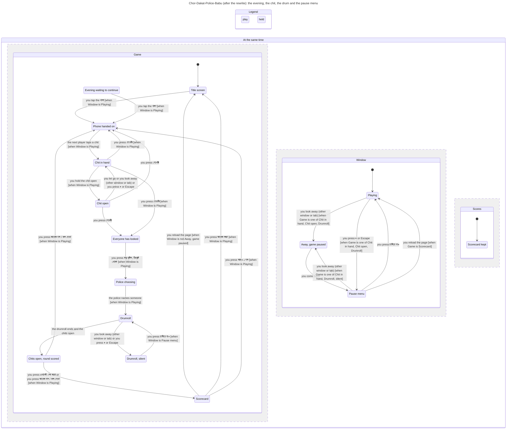

# চোর-ডাকাত-পুলিশ-বাবু: statechart

## After the rewrite (2026-11-04)
Model: `ChorPolice.tla` / `ChorPolice.cfg` / `view.ts`. It mirrors `tools/chor-police/lib/game.ts` (`act`, `GUARD_MS`, `restore`, `saveOf`), `lib/cues.ts` (hush on leaving the roll, the fanfare once), `components/chit-game.tsx` (`send`, the roll-timer effect keyed on `player.paused`, `onPause` / `onResume` / `onRestart`, the blur effect, the window key handler) and the menu in `shared/game-player-client.tsx`.
Run: `after-fix/report.md` and `after-fix/chart.mmd`. TLC found 152 states. **Every rule holds:** TypeOK, ChitClosedWhenAway, ChitOnlyWhilePeeking, NoTapPastResult, FinishedStaysFinished, DrumStopsWithRound, PausedWhenAway (new), NoDoubleResult, NoDeadlock.
A mutant check (the scorecard guard removed, the roll timer let run under the menu, `d` ignored on restore) breaks NoTapPastResult at once, so the rules have teeth.

What changed in the model:
- The hand-off and the pick are one tap (`pass` → `peek` by tapping a chit). The drum is its own phase, `roll`.
- Pause is the shared player's menu (`menu`). Blur, hide, ⏸ and Escape open it. It folds the chit, stops the drum (`silenceScheduled`), and the roll timer cannot fire under it. চালিয়ে যাও gives a fresh tap guard and drums again from the first beat.
- Every press is guarded, `again`, `end` and `more` included. The scorecard's guard is 1.2 s, and window keys do nothing on the scorecard at all. `again` goes to the title screen, not to a new round.
- The save has `d: 1` for a finished evening. `restore()` honours it.

| Bug | Fix | Node test | Live replay (Orca, after) |
|---|---|---|---|
| 1. NoTapPastResult | guard on every press, 1.2 s on the scorecard; no window key acts on the scorecard; আরেক সন্ধ্যা goes to the title | `bug 1 (NoTapPastResult): …` | saved evening at ৪ of ৫, ফল দেখো focused, 4 trusted Enters over 3.9 s: `over` at 1089 ms, then nothing. Board ৩৭০০ ৩০০০ ২৫০০ ২৩০০ stayed; save `g=00101 … "d":1` |
| 2. FinishedStaysFinished | `saveOf` writes `d: 1`; `restore` treats it as finished | `bug 2 (FinishedStaysFinished): …` | one round, এখানেই শেষ করো (save `"d":1`), reload: the থালা reads "চিরকুট তোলো", names kept, no HUD |
| 3. DrumStopsWithRound | the player's `silenceScheduled()` on pause, the `hush` cue on leaving the roll, and the roll timer only while not paused | `bug 3 (DrumStopsWithRound): …` | `OscillatorNode` instrumented; police named someone, ⏸ 200 ms later: 12 tones, 9 after the pause, the last one cut 30 ms after the pause (was 512 ms). Phase stayed `roll` for 2 s under the menu; চালিয়ে যাও drummed 13 tones and revealed 785 ms later |

Also checked live: blur during an open chit opens the menu, folds the chit and makes the game inert; resume keeps the peek screen with দেখেছি enabled. নতুন করে শুরু from the menu goes to the title, with "আগের খেলায় ফেরো" when rounds had been scored. Back closes immersive mode and stays on the page. Keys 1 and 2 name a suspect, and Escape opens the menu. Orca pins `document.hidden`, so the hide path can't fire there. It is the same `away()` path as blur in the player.



## Regenerate
```sh
scripts/statechart.sh ai_docs/statecharts/chor-police/ChorPolice.tla --view ai_docs/statecharts/chor-police/view.ts --out ai_docs/statecharts/chor-police/after-fix
rm ai_docs/statecharts/chor-police/after-fix/tlc*.out
```
The chart hides the tap guard and নতুন করে শুরু everywhere, the pause except from the chit and the drum, and the reload except from the scorecard. The model and the report keep all of them.

## Before the rewrite (kept for the record)

Model: `before-fix-model/ChorPolice.tla` / `.cfg` / `view.ts`. It mirrors `tools/chor-police/components/chit-game.tsx` (dispatch, press, accuse, reveal/holdStart, the blur and visibility effect, the over effect, and the save and restore effects) and `tools/chor-police/lib/game.ts` (`act`).
Run: `before-fix/report.md` and `before-fix/chart.mmd`. TLC found 356 states. The chart has 21 states and 41 arrows.

## Systems modelled
- **Play phase:** setup → pass → peek → call → guess → reveal → (pass … | over). The evening has LIMIT = 2 rounds and 2 players (the code has 4). "setup" with rounds > 0 is the paused screen.
- **Settle guard:** `fresh` means less than 450 ms (SETTLE_MS) since the screen changed. `press`, `pickChit` and `accuse` check it. `again`, `end` and `more` skip it.
- **Input:** the folded chit can be in the plate, picked and closed, held open, or seen. Pointer up, pointer cancel, lost capture, key up, blur and hide all close it.
- **Window:** on the page, or away. Blur and hide do the same thing here: `setOpen(false)`.
- **Time:** the 750 ms roll timer (`rollTimer`) and the 12 drum tones that `drumroll()` puts on the audio clock all at once.
- **Results:** the fanfare and confetti effect on `[over, rounds]`, the record, and the early end ("এখানেই শেষ করো").
- **Saved progress:** each change is saved to `chor-police-game`. A reload restores the evening paused only when `0 < caught.length < limit`. Otherwise it keeps only the names and points.
- Not modelled: sound loops (the game has none), kids' limits (not a kids' game) and friend links (they only show a card; `parseGame` checks the total).

## Rules (each is an INVARIANT)
| Rule | In plain words | Result |
|---|---|---|
| ChitClosedWhenAway | A chit is never open while you are in another window or tab. | holds |
| ChitOnlyWhilePeeking | A chit is in your hand only on the peek screen. | holds |
| NoTapPastResult | The scorecard is never wiped by a press that lands as it appears. | **breaks** |
| FinishedStaysFinished | An evening you ended never comes back as "paused mid-evening". | **breaks** |
| NoRollAfterLeaving | The drumroll timer never fires after you leave the guess screen. | holds |
| DrumStopsWithRound | The drumroll is heard only while the police is choosing. | **breaks** |
| NoDoubleResult | The fanfare and confetti fire once each time the scorecard appears. | holds |
| NoDeadlock | You can always do something. | holds |

## Bugs

### 1. NoTapPastResult: "I pressed Enter twice on ফল দেখো and the whole evening's scores vanished."
- **Path** (report, NoTapPastResult; the model's shortest path reaches the scorecard through the early end): steps 1–18 play a round, then 19 "you press এখানেই শেষ করো" and 20 "you press Enter again / আরেকবার" while the scorecard has just appeared.
- **Cause:** `press()` handles the result first (`if (over) { sfx.tap(); again(); return; }`), before its own `SETTLE_MS` check. The main button keeps keyboard focus from "ফল দেখো" to "আরেকবার", and `again()` runs `dispatch(…, false)`. So any Enter or Space on the scorecard starts a new evening at once. The save effect then overwrites `chor-police-game` with `g=` (empty).
- **Live replay (Orca):** a saved evening at round 5 of 5 (board ৩৫০০ ১৮০০ ৩৬০০ ২৬০০, save `g=00100`), the main button "ফল দেখো" focused, then two trusted `orca keypress Enter`:
  - `over` at 223 ms;
  - `pass` at 949 ms;
  - board `০ ০ ০ ০`, "১ম দান · মোট ৫ দান";
  - save `{"h":"s=357491742&t=0&g=","l":5}`.

  The evening is gone, and the scorecard never showed.
- **Not reproduced (model fixed):** a finger double tap at the same spot at phone width. The scorecard moves the button down: a second tap 150 ms later landed on the stage, and the "আরও ৫ দান" link moved under "স্কোরকার্ড". So the model gives that path no stray-tap mark.
- **Fix (shared):** treat the result like any other screen change. Use one shared guard, for example a `useSettle()` / `resultGuard(ms)` in `shared/game-kit.ts`, that every result button and key handler checks. In chor-police, move the `over` branch after the settle check and use `dispatch(…, true)` for again, end and more. Add a node test: `act(reveal) → over` then an immediate "again" inside 450 ms is a no-op.

### 2. FinishedStaysFinished: "We ended the game after one round, the page reloaded, and it came back saying the game was paused."
- **Path** (report, FinishedStaysFinished): one round is played (steps 1–18). Then 19 "you press এখানেই শেষ করো" and 20 "you reload the page" give "Paused, though the evening had ended".
- **Cause:** the restore effect calls a save finished only when `caught.length >= savedLimit`. An early end keeps `l` at the chosen limit, so the restore treats it as unfinished.
- **Live replay:** at "খেলা শেষ · ১ দান" ("জিতেছে তৃতীয়জন, ১০০০ পয়েন্ট!"), the save was `{"h":"s=24935242&t=1000&g=0","l":5}`. After a reload the page showed "খেলা থামানো আছে। নাম ঠিক করে চালিয়ে যাও।", the button read "চালিয়ে যাও · ২য় দান", and the board read ৫০০ ৮০০ ১০০০ ০ with "২য় দান · মোট ৫ দান".
- **Fix (game):** on "end", also save `l = rounds`, or save an explicit `done: true` with the game. Restore it as finished, which keeps only the names and points. Add a node test for the restore decision.

### 3. DrumStopsWithRound: "I pressed থামাও during the drumroll and the drum kept beating on the paused screen."
- **Path** (report, DrumStopsWithRound): steps 1–16 reach the police screen. Then 17 "the police names someone" and 18 "you press থামাও" give "Setting up, drum still beating".
- **Cause:** `drumroll()` puts 12 `tone()` calls on the audio clock at once. `dispatch` clears `rollTimer`, but nothing can cancel the scheduled oscillators.
- **Live replay:** with `OscillatorNode.start` instrumented, the police named someone and থামাও came 200 ms later. 12 drum tones were scheduled, 9 of them after the pause, and the last beat came 512 ms after the pause. The screen was already "চিরকুট তোলো" (setup).
- **Fix (shared):** add a cancellable group to `shared/game-sound.ts`, such as `const g = sounds(); g.tone(…); g.stop()`, or a gain node per burst. Call `stop()` from dispatch, pause and reset. Minor, but the same cause lets any multi-note jingle outlive its screen in every game.

## Quality-bar gaps (played end to end in Orca: 5 rounds, the early end, the scorecard)
1. **First screen:** the start action ("চিরকুট তোলো") sits below the four name fields and the round chips. At Pixel 9 width it is below the fold (`.shots/chor-police-sc-first.png`). The plate is the biggest thing on screen, but tapping it does nothing.
2. **Words above the game:** the H1 and lead sit above the player and push the plate down. The bar (§12) wants them below.
3. **Too many taps per hand-off:** each player taps "আমি …, চিরকুট তুলব", picks a chit, holds it, then taps "দেখেছি". That is 4 actions × 4 players before the police guess, so a round takes about 20 taps. Merge picking the chit into the hand-off, so tapping a chit is the "I'm here".
4. **Pause is not a menu:** "থামাও" throws you back to setup and restarts the round's hand-out. P and Esc do nothing. Nothing pauses on blur, which is fine for a turn game, but there is no resume that keeps the screen.
5. **Round choice:** the ৫/১০/১৫ দান chips don't say what they mean in time ("প্রায় ১০ মিনিট"), and the default isn't marked as recommended.
6. **Reveal moment:** the drumroll is good, but the 750 ms roll is the only suspense, and the reveal hands out all four chits at once. A one-by-one flip of the two suspects would land the joke.
7. **Ending:** the scorecard shows real stats and the card is personal (good). But a stray Enter skips it (bug 1), and "আরও ৫ দান খেলো" is a small link right under it.
8. **Sound:** rustle, drumroll, whiff and fanfare are distinct and meaningful. The drumroll can't be stopped (bug 3).

Screenshots: `.shots/chor-police-sc-first.png` (first screen, start below the fold), `-peek.png` (chit held open), `-guess.png` (the police's choice), `-reveal.png` (round scored, the board on top), `-over.png` and `-card.png` (scorecard).
