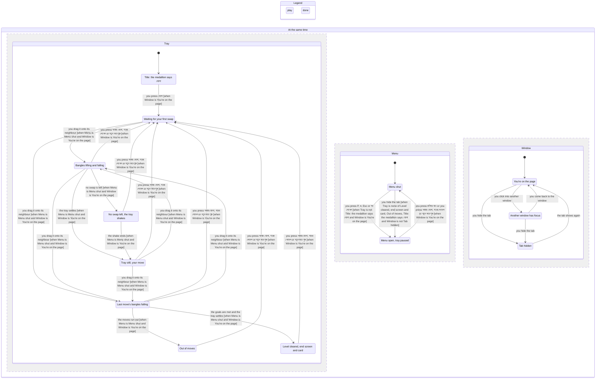

# চুড়ির বাজার statechart

## After the rewrite (`after-fix/`)
The spec `Churir.tla` (with `Churir.cfg` and `view.ts`) now mirrors `tools/churir-bazar/components/churir-game.tsx` (swap, settled, finish, begin, the player's onPause and onResume, the blur, focus and visibility listeners), `lib/session.ts` (live, canMove and its 250 ms breath, press, dragCounts, wantRattle and syncLoops, startRun and cheer) and `lib/save.ts`. TLC reaches 220 states. The chart draws 13 states and 26 arrows: the tray, the menu and the window. The hand, the sound switch with the rattle, and the result's notes are checked by the rules but hidden from the drawing. The open levels and the friend's link are left out of the model (together they would pass the 500-state budget) and proved by `tests/session.test.ts` and the live replay below.

| Rule | Says | Result |
|---|---|---|
| InputReleasedWhenAway | Away, in another window, or under the menu or a choice, no press is still in flight. | holds |
| NoDragWithoutAPress | A press in flight always has a button or finger down: a mouse that moves with no button held is never a drag. | holds |
| PausedWhenHidden | Hiding the tab with a level under way shows the pause menu when you come back. | holds |
| RattleOnlyWhileShaking | The rattle plays only while the tray shakes, with sound on and the screen live. | holds |
| RattleComesBack | While the tray shakes on a live screen with sound on, the rattle plays (sound on or চালিয়ে যাও brings it back). | holds |
| NoCheerAfterYouMoveOn | The result's notes are scheduled only while that level's result is on screen. | holds |
| LinkOpensOnlyItsLevel, SavedUnlockIsEarned (node test) | A friend's link opens its own level and nothing in between; your open level only rises by your own clears. | holds |
| ResultNeedsFreshPress (node test) | A key held through the last move never picks an end-screen choice. | holds |

### The four bugs, fixed
1. **InputReleasedWhenAway.** `onBlur`, `onVisibility`, the player's pause and `lostpointercapture` all drop the press (`S.blur`, `S.hide`, `S.pause`, `S.release`). `S.dragCounts` ignores a mouse move with no button held (`event.buttons === 0`) and drops the press. The focus that brings the window back wakes the tray only: presses in the first 250 ms are ignored (`S.focus(s, now)`). Tests: `bug 1 · InputReleasedWhenAway`, `bug 1 · a mouse move with no button held is not a drag`, `the click that brings focus back is not a move`.
2. **NoCheerAfterYouMoveOn.** The cheer has no timer any more. The result's call, jingle and star notes are scheduled on the audio clock (`tone(…, delay)`), confetti fires at once, and `begin()` calls `S.startRun(session, silenceScheduled)` first. The game's only `setTimeout` is the idle hint, and it is cleared on every input, pause, blur, new run and unmount. Test: `bug 2 · NoCheerAfterYouMoveOn` (also checks the source for one timer).
3. **RattleComesBack.** The rattle belongs to the shake segment of the move's timeline, not to an 800 ms timer. `S.wantRattle` (live, sound on, shaking) decides it, and `syncLoops` runs after sound on or off, pause, resume, blur, focus and the end of the shake, so a loop created while muted is replaced when sound returns. Test: `bug 3 · RattleOnlyWhileShaking / RattleComesBack`.
4. **LinkOpensOnlyItsLevel / SavedUnlockIsEarned.** The phone keeps its own open level (`ektukhani-churir-bazar-open`, set once from the old rule) and opens the next level only when you clear your own open level. A friend's level is playable on its own (`visit`), its stars are recorded, nothing in between opens. `unlockedLevel` itself is untouched. Test: `bug 4 · UnlockNeverShrinks / SavedUnlockIsEarned`.

**Live replays (Orca, new code).**
- **Bug 1 (level 1, Pixel 9).** A mouse `pointerdown` on a bangle, then `blur` (the button let go in another window), 100 ms, `focus`, then `pointermove` over the next bangle with `buttons: 0`: moves **0 → 0** (before the fix, 15 → 14 and a move spent). After চালিয়ে যাও a real drag swapped (moves 1), answered in 1–9 ms from the event to the first drawn frame.
- **Bug 2 (level 1).** The level cleared in two moves (1140 points); the end screen showed 1.55 s after the last swap. Pressing পরের লেভেল 600 ms later stopped **62 scheduled oscillators** (`stop` calls), started none afterwards (0 new in the next 2.6 s), and level 2 opened with no confetti canvas.
- **Bug 3 (level 24, a shake after the 17th swap, desktop bar).** Control: **1** looped source at the start of the shake. Sound off mid-shake: `rattle` false. Sound back on 80 ms later, shake still on: `rattle` true and **1** new looped source started (before the fix, 0).
- **Bug 4 (empty storage, friend link `#s=3001&t=1330&v=2&l=3&m=…&n=Mim`).** The banner read "Mim ৩ নম্বর লেভেলে ১৩৩০ পয়েন্ট পেয়েছে। ৮ চালে পার, ১ তারা", and সব লেভেল showed **levels 1 and 3 open** (before: 1–3). I cleared level 3: stars `{"3":1}`, open key `1`. After a reload with no hash the game opened on level 1 with only level 1 open (before: it opened on level 4).
- **Pause on blur** works in Orca: a plain window blur opened the player's menu and stopped the tray; the autopilot had to press চালিয়ে যাও. The hidden-tab replay (Orca pins `document.hidden`) is `S.hide` plus `PausedWhenHidden` in the model.



## Regenerate
```sh
scripts/statechart.sh ai_docs/statecharts/churir-bazar/Churir.tla --view ai_docs/statecharts/churir-bazar/view.ts --out ai_docs/statecharts/churir-bazar/<new-folder>
rm ai_docs/statecharts/churir-bazar/<new-folder>/tlc*.out
```

---

## Before the rewrite (`before-fix/`)
The spec then was `before-fix/Bangles.tla`, `Bangles.cfg` and `view.ts`, mirrored from `components/bangle-game.tsx` (since replaced). What follows is that run, kept as it was.


Model: `Bangles.tla`, `Bangles.cfg` and `view.ts`, mirrored from `tools/churir-bazar/components/bangle-game.tsx`, plus `shared/game-kit.ts` (`useGameLoop`) and `shared/game-sound.ts` (`loop`, `setSoundOn`).
Output: `before-fix/report.md` and `before-fix/chart.mmd`. TLC reached 164 states, and the chart draws 19 states and 38 arrows.

## Systems modelled
- **Tray.** The tray waits for the first swap, then is still, or lifting and falling (a cascade). It can also be in the last move's cascade (`game.over` is already true, so hiding the tab doesn't pause it), stuck with চুড়ি ঝাঁকাও showing, shaking, won, or out of moves.
- **Pause and focus.** The window can be on the page, blurred, or the tab hidden. `hide()` stops the rattle and pauses when a move was made and the level isn't over. `useGameLoop` stops its rAF while the tab is hidden. The component has no blur listener.
- **Input.** A drag in flight is `press.current`. `onPointerUp` and `onPointerCancel` clear it, and so does a pointer move that swaps.
- **Sound.** The shake's rattle (`loop("static")`) and the site-wide switch.
- **Timers.** The end effect's `setTimeout(jingle, 120)` and `setTimeout(win + confetti | good, 450 + 260 × stars)`, and `setTimeout(sfx.lose, 150)` when the moves run out.
- **Choices.** `begin()` is reached from LevelGrid (open even mid-cascade), আরেকবার, আবার খেলো, পরের লেভেল, Enter and a friend's link.

**Left out:** levels and the friend link. Together they would multiply the model past the 500-state chart budget. This game opens levels with the same shared code as bhimruler-chak (`open = Math.max(levels.unlocked, friend?.level ?? 1)` on line 109, and `unlockedLevel` in `shared/game-core.ts`), which `ai_docs/statecharts/bhimruler-chak/Orchard.tla` models. Bug 4 below replays it live here.

The chart hides one kind of step: starting a level mid-round. It resets the tray just as the arrow from the end states does.

## Rules, in plain words
| Rule | In plain words | Result |
|---|---|---|
| InputReleasedWhenAway | Once you leave the window or the tab, no drag is still in flight. | **breaks** |
| PausedWhenHidden | Hiding the tab with a level under way shows the pause card when you come back. | holds |
| RattleOnlyWhileShaking | The rattle plays only while the tray shakes, with sound on, the tab shown and the game not paused (LoopOnlyWhenMeaningful). | holds |
| RattleWhileShaking | While the tray shakes on screen with sound on, the rattle plays (LoopComesBack). | **breaks** |
| NoCheerAfterYouMoveOn | The end jingle, the win or lose sound and the confetti play only on that level's result. | **breaks** |
| LinkOpensOnlyItsLevel and SavedUnlockIsEarned | These come from bhimruler-chak's model, and the same code is in this game. | **break** (replayed live, see bug 4) |

In the model, 2 rules held and 3 broke. TypeOK and NoDeadlock also hold. The shared unlock rules also break, which the live replay shows.

## Bugs

### 1. InputReleasedWhenAway: "I alt-tabbed mid-drag, came back, moved the mouse over the tray, and it swapped two bangles and spent a move" (shared pattern)
- **Path:** (0) Waiting for your first swap → (1) you press on a bangle → (2) you click into another window. The drag is still in flight. Then you come back, the pointer moves across the tray, and two bangles swap.
- **Live replay (Orca, level 1):** The count read চাল বাকি ১৫. I sent a mouse `pointerdown` on bangle 23, then `blur`, and no `pointerup` (the button was let go in the other window). After 2 s I sent `focus`, and the count still read ১৫. Then I sent one `pointermove` over bangle 30 with `buttons: 0`. The count read **চাল বাকি ১৪** and the points read **১৮০**: a real move was spent with no button held.
- **Same through a hidden tab (headless Chrome):** After one swap the count read ১৪. I held the mouse down on bangle 16, hid the tab for 1 s and came back to the pause card. I pressed চালিয়ে যাও and moved over bangle 17 with no button held, and the count read **১৩**.
- **Fix:** Set `press.current = null` on `blur` and in `hide()`. In `onPointerMove`, ignore mouse events whose `event.buttons === 0`. Also listen for `lostpointercapture` to clear the press.

### 2. NoCheerAfterYouMoveOn: "I pressed পরের লেভেল straight away, and the confetti and win sound went off on the next level" (game; the pattern is shared)
- **Path:** (0) Waiting for your first swap → (1) you swap two bangles (the last move) → (2) the goals are met, with the end sound and confetti still to come → (3) you start a level. The new level's tray waits, and the cheer is still to come.
- **Live replay (Orca):** I cleared level 1 with the bot's three swaps (23–30, 16–17, 24–25): ৯৫০ পয়েন্ট, 3 stars. I pressed পরের লেভেল 1 ms after the result showed, and level 2 opened. The jingle's 12 tones then fired at **+97 ms**, and the win sound's 4 tones and the **confetti canvas fired at +1207 ms, on লেভেল ২ (ready)**.
- **Cause:** The end effect's `window.setTimeout`s are never kept or cleared. `begin()` doesn't clear them, and neither does unmount. mukhe-mukhe-hisab does this right with `later()` and `stopAll()`.
- **Fix:** Keep the timeout ids in a ref and clear them in `begin()` and on unmount. A shared `useTimers()` (`later`, `clearAll`) in `shared/game-kit.ts` would serve every game.

### 3. RattleWhileShaking: "I turned the sound back on while the bangles were shaking, and the shake stayed silent" (game)
- **Path:** (0) Waiting for your first swap → (1) you turn sound off → (2) you swap two bangles → (3) no swap is left → (4) you press চুড়ি ঝাঁকাও → (5) you turn sound on. The tray is still shaking, with sound on and no rattle.
- **Live replay (Orca, level 2):** The fixed board reached "no swap left" after 10 swaps (38–45, 38–39, 4–11, 19–26, 22–29, 39–46, 21–22, 41–48, 5–6, 37–38), with চাল বাকি ১০. I instrumented `AudioBufferSourceNode.prototype.start` to count looped sources. I turned sound off, pressed চুড়ি ঝাঁকাও, and turned sound on 150 ms later: **0 looped sources started** during the rest of the shake. **Control:** on the same board with sound on throughout, pressing চুড়ি ঝাঁকাও started **1** looped source at once.
- **Also:** resuming after a hide mid-shake never restarts the rattle. In ধীরে খেলো the shake lasts 0.75 / 0.6 = 1.25 s, but the rattle's 800 ms timer cuts it 0.45 s early. These are small, because the shake is under a second.
- **Fix:** In `SoundToggle`'s `onChange`, and in resume, restart the rattle when the tray is shaking: `on && shaking && (rattle.current = loop("static", 3600))`. Stop it when the shake phase ends, not on a fixed 800 ms timer.

### 4. LinkOpensOnlyItsLevel and SavedUnlockIsEarned: "a friend's link to level 3 opened level 2, and after I cleared it, levels 2–4 stayed open for good" (shared; see bhimruler-chak)
- **Live replay (Orca):** With empty storage, I opened `/churir-bazar#s=3008&t=1640&l=3&m=ADAgAHAlARAmAYAzAh&n=Mim`, a valid link built from the greedy bot's 9 winning moves on level 3. The banner read "Mim ৩ নম্বর লেভেলে ১৬৪০ পয়েন্ট পেয়েছে", and LevelGrid showed **levels 1–3 open** with nothing cleared. I replayed the same 9 moves, and the result read "লেভেল ৩ পার, ১৬৪০ পয়েন্ট" with storage `{"3":2}`. I reloaded without the hash. The game **opened on level 4**, and LevelGrid showed levels 1, 2, 3 (২ তারা) and 4 open.
- **Fix:** Use the shared fix described in bhimruler-chak's README (`unlockedLevel` counts an unbroken run from 1, and the friend's level is open on its own).

## Quality-bar gaps (from playing levels 1–3 end to end in Orca)
1. **Pause isn't a menu.** There is no pause button and no P or Esc. The pause card appears only after the tab hides, and offers only চালিয়ে যাও.
2. **The streak badge overlaps the HUD.** "পরপর ×২" sits on the goal chip at the top centre of the tray, and it stays there while the tray is stuck (`.shots/churir-bazar-stuck.png`).
3. **Stuck locks out everything but the shake.** While stuck, আবার শুরু and the level arrows are disabled (`busy`), and only LevelGrid still works. That is fine, but no line explains it.
4. **Choices aren't explained.** The level arrows and the "সব লেভেল" drawer show no line on what the next level adds. The goal chips are pictures only, and the goal sentence exists only as an `aria-label`.
5. **Celebrations bleed into the next level** (bug 2), so the reward lands on the wrong screen.
6. **No danger signal at the edge.** With ≤ 3 moves left, only the চাল badge changes (`data-low`) and one status line appears. There is no edge glow.
7. **No boss moments.** Each world brings one new piece (রংধনু in বৈশাখী মেলা, a sixth colour in চুড়িপট্টি), which is good pacing, but nothing marks the end of a world.
8. **Words lead the first screen.** The H1 and the lead sit above the tray. A friend's link adds the friend's card above it too, pushing the tray down on a phone.

What works: the level 1 hint pulses the first swap, and a win comes in 3 moves (about 3 s). The bonus math is shown ("বাকি ১২ চাল × ৫০ = ৬০০"). The friend link is replayed and verified. The sounds are synthesized clinks with one signature (রিনিঝিনি).

Screenshots: `.shots/churir-bazar-stuck.png` (no swap left, চুড়ি ঝাঁকাও, the streak badge over the goal chip) and `.shots/churir-bazar-result.png` (the level 1 result, 3 stars and the bonus line).

## How the replays were done
- In Orca, swaps were mouse `PointerEvent`s at cell centres from `getBoundingClientRect()`. Each swap waited until আবার শুরু was enabled again (not busy). The board for each level is fixed by its seed, so the move lists came from the game's own `lib/bot.ts` and `lib/game.ts`, run in node.
- Orca pins `document.hidden` to "visible", so the hidden-tab replay in bug 1 ran in headless Chrome over CDP, with `Object.defineProperty(document, 'hidden', …)` and a `visibilitychange` event.
- I cleared the game's localStorage keys after each replay.

## Regenerate
```sh
scripts/statechart.sh ai_docs/statecharts/churir-bazar/Bangles.tla --view ai_docs/statecharts/churir-bazar/view.ts --out ai_docs/statecharts/churir-bazar/after-fix
rm ai_docs/statecharts/churir-bazar/after-fix/tlc.out
```
After the fix, every rule must hold. Rerun bhimruler-chak's model for the shared unlock rules.
