# চড়ুই তাড়াও: statechart

## After the rewrite (`after-fix/`)
The spec `Churui.tla` now mirrors the rewritten game:
- `components/field-game.tsx` (begin, load, pause, resume, openList, closeList, finishRun, again, clapAt, steerLoops, the key, pointer, blur, focus, visibility and hashchange handlers);
- `lib/session.ts`, the pure phase machine the component runs (`start`, `pause`, `resume`, `away`, `back`, `finish`, `again`, `choiceOk`, `reset`, `pick`, `cheerMayPlay`, `canClap`, `moving`, `loopStep`);
- `lib/progress.ts`, your own unlock (`afterClear`, `playable`), and `lib/step.hot.ts` for the boss that holds the dusk.

It runs twice:
- **Full check** (`Full = TRUE`: three ক্ষেত, a hidden tab, Enter held through the end): TLC reached 10,048 states (`after-fix/report-full.md`).
- **Chart run** (`Full = FALSE`, as committed): 400 states; the chart has 13 states and 55 arrows (`after-fix/report.md`, `after-fix/chart.mmd`). The one ক্ষেত in this run is a finale, so the boss is drawn. The rustle and the celebration are checked as rules but not drawn, because each follows the game phase.

**All 16 rules hold in both runs, and so do NoDeadlock and the StarsNeverDrop property.** A mutation check put old behaviours back into copies of the spec; each broke exactly the rule it should:
- a blur that doesn't pause: PausedWhenBlurred and LoopComesBack;
- a resume that forgets the rustle: LoopComesBack;
- a tap on the pause that claps: FirstTapOnlyResumes;
- a dusk that doesn't wait for the boss: DuskWaitsForBoss;
- a friend's clear that opens every ক্ষেত: OpenLevelsAreEarned.

| Rule | In plain words | Before | After |
|---|---|---|---|
| PausedWhenHidden | Hiding the tab mid-round pauses it. | holds | holds |
| PausedWhenBlurred | Clicking into another window mid-round pauses it. | **broke** | holds |
| NoProgressWhileAway | Birds don't eat while you're in another window. | **broke** | holds |
| ChoiceFreezesPlay | While সব ক্ষেত is open, the afternoon is still. | **broke** | holds |
| NoFanfareAfterMovingOn (CelebrationOnItsOwnCard) | The cheer and confetti play only on their own card. | **broke** | holds |
| ReplayIsExact | When the friend's ক্ষেত is on, their seed is what flies. | holds | holds |
| LoopOnlyWhenMeaningful (new) | The eating rustle plays only while a bird eats in a live round on a focused, visible page with sound on. | n/a (no loop before) | holds |
| LoopComesBack (new) | Whenever a bird eats in a live round with sound on, the rustle plays, after a pause or sound off and on too. | n/a | holds |
| NoRustleOnTheCard (new) | No rustle on the title or the card. | n/a | holds |
| NoDoubleResult (new) | A round ends once: stars, the dusk sound and confetti happen once. | n/a | holds |
| HeldKeyNeverSkips (new) | An Enter held from before the card never takes its choice. | n/a | holds |
| FirstTapOnlyResumes (new) | The tap that brings you back resumes; it never claps. | n/a | holds |
| OpenLevelsAreEarned (new) | Every ক্ষেত below your unlock is one you cleared yourself. | n/a | holds |
| DuskWaitsForBoss (new) | A finale's dusk falls only after its boss bird is chased off. | n/a | holds |
| StarsNeverDrop (property) | Cleared ক্ষেত stay cleared. | n/a | holds |
| NoDeadlock | Every state has a way out. | holds | holds |

No held input is modelled: a clap is one tap or one key press and the arrows hop the hand to a bird, so there is no key to leave held (InputReleasedWhenAway does not apply).

```mermaid
---
title: "Churui Tarao after the rewrite: the afternoon, the list, the window and a link"
---
stateDiagram-v2
  direction LR
  state "Legend" as legend {
    lg0: wait
    lg1: play
    lg2: held
    lg3: done
  }
  class lg0 blue
  class lg1 teal
  class lg2 yellow
  class lg3 blue
  state "At the same time" as all {
    state "Game" as r0 {
      s0: Title (ম#2494;ঠ#2503; ন#2494;ম#2507;)
      s1: Afternoon on, grass clear
      s2: সব ক#2509;ষ#2503;ত open
      s3: Card shows: all grain gone
      s4: Paused
      s5: সব ক#2509;ষ#2503;ত open, afternoon paused
      s6: Boss bird at the grain, dusk waits
      s7: Birds pecking (rustle)
      s8: Card shows: dusk, field passed
      [*] --> s0
      s0 --> s1: you press ম#2494;ঠ#2503; ন#2494;ম#2507; [when Window is You're on the page]
      s0 --> s2: you open সব ক#2509;ষ#2503;ত [when Window is You're on the page]
      s1 --> s0: you press নত#2497;ন কর#2503; শ#2497;র#2497;
      s1 --> s0: a friend's link opens [when Link is No friend's link]
      s1 --> s3: the last grain is eaten
      s1 --> s4: you click into another window or you press P or #9208;
      s1 --> s5: you open সব ক#2509;ষ#2503;ত
      s1 --> s6: the boss bird flies in
      s1 --> s7: a bird lands at the grain
      s2 --> s0: you close সব ক#2509;ষ#2503;ত or you pick a ক#2509;ষ#2503;ত or you press নত#2497;ন কর#2503; শ#2497;র#2497; [when Window is You're on the page]
      s2 --> s0: a friend's link opens [when Link is No friend's link]
      s3 --> s2: you open সব ক#2509;ষ#2503;ত [when Window is You're on the page]
      s3 --> s1: you press আব#2494;র খ#2503;ল#2507; [when Window is You're on the page]
      s3 --> s0: you press নত#2497;ন কর#2503; শ#2497;র#2497; [when Window is You're on the page]
      s3 --> s0: a friend's link opens [when Link is No friend's link]
      s4 --> s1: you tap the field
      s4 --> s0: a friend's link opens [when Link is No friend's link]
      s4 --> s0: you press নত#2497;ন কর#2503; শ#2497;র#2497; [when Window is You're on the page]
      s4 --> s1: you press চ#2494;ল#2495;য#2492;#2503; য#2494;ও [when Window is You're on the page]
      s4 --> s5: you open সব ক#2509;ষ#2503;ত [when Window is You're on the page]
      s5 --> s0: you pick a ক#2509;ষ#2503;ত or you press নত#2497;ন কর#2503; শ#2497;র#2497; [when Window is You're on the page]
      s5 --> s0: a friend's link opens [when Link is No friend's link]
      s5 --> s1: you close সব ক#2509;ষ#2503;ত [when Window is You're on the page]
      s6 --> s0: you press নত#2497;ন কর#2503; শ#2497;র#2497;
      s6 --> s0: a friend's link opens [when Link is No friend's link]
      s6 --> s3: the last grain is eaten
      s6 --> s4: you click into another window or you press P or #9208;
      s6 --> s5: you open সব ক#2509;ষ#2503;ত
      s6 --> s1: you clap the boss off for good
      s7 --> s0: you press নত#2497;ন কর#2503; শ#2497;র#2497;
      s7 --> s0: a friend's link opens [when Link is No friend's link]
      s7 --> s1: the last bird at the grain is shooed
      s7 --> s3: the last grain is eaten
      s7 --> s4: you click into another window or you press P or #9208;
      s7 --> s5: you open সব ক#2509;ষ#2503;ত
      s7 --> s6: the boss bird flies in
      s2 --> s3: you close সব ক#2509;ষ#2503;ত [when Window is You're on the page]
      s4 --> s6: you tap the field
      s4 --> s7: you tap the field
      s4 --> s6: you press চ#2494;ল#2495;য#2492;#2503; য#2494;ও [when Window is You're on the page]
      s4 --> s7: you press চ#2494;ল#2495;য#2492;#2503; য#2494;ও [when Window is You're on the page]
      s5 --> s6: you close সব ক#2509;ষ#2503;ত [when Window is You're on the page]
      s5 --> s7: you close সব ক#2509;ষ#2503;ত [when Window is You're on the page]
      s1 --> s8: dusk falls, the field is passed
      s6 --> s7: you clap the boss off for good
      s8 --> s1: you press আব#2494;র খ#2503;ল#2507; [when Window is You're on the page]
      s8 --> s0: you press নত#2497;ন কর#2503; শ#2497;র#2497; [when Window is You're on the page]
      s8 --> s0: a friend's link opens [when Link is No friend's link]
      s8 --> s2: you open সব ক#2509;ষ#2503;ত [when Window is You're on the page]
      s7 --> s8: dusk falls, the field is passed
      s2 --> s8: you close সব ক#2509;ষ#2503;ত [when Window is You're on the page]
    }
    --
    state "Window" as r1 {
      s9: You're on the page
      s10: Another window has focus
      [*] --> s9
      s9 --> s10: you click into another window
      s10 --> s9: you come back to the window
      s10 --> s9: you tap the field [when Game is Paused]
    }
    --
    state "Link" as r2 {
      s11: No friend's link
      s12: Friend's afternoon, their seed
      [*] --> s11
      [*] --> s12
      s11 --> s12: a friend's link opens
    }
  }
  class s0 blue
  class s1 teal
  class s3 blue
  class s4 yellow
  class s5 yellow
  class s6 teal
  class s7 teal
  class s8 blue
```



### The bugs, fixed, with their tests (`tools/churui-tarao/tests/session.test.ts`)
1. **PausedWhenBlurred + NoProgressWhileAway** ("I clicked into another window and came back to sparrows eating my paddy"): the game listens to window `blur` itself (and the player's pause sends one): `away()` pauses, the rustle stops. Focus never resumes by itself; the player's menu does, and the afternoon waits half a second after a resume. Test: *bug 1 · PausedWhenBlurred + NoProgressWhileAway*. **Live in Orca** (Pixel 9, ক্ষেত ১২): t = 2.44 s, rustle live → `blur` → phase `paused`, the player's menu open, rustle off → five bursts of 60 forced steps: t and grain unchanged → `focus`: still `paused` → চালিয়ে যাও → `playing`.
2. **ChoiceFreezesPlay** ("I opened সব লেভেল to look at the stars and the field kept getting eaten"): opening the list or the badge pauses a round in progress (`pick()` → `pause()`), the loop skips the step while `picking`, and the list closes onto a resume only if it paused the round. The player's সব লেভেল opens it too (`onLevels`). Test: *bug 2 · ChoiceFreezesPlay*. **Live:** ক্ষেত ১২, t = 2.48 s, grain 98% → the badge opens the list (`paused`, `picking`) → 360 forced steps → t = 2.48 s, grain 98%.
3. **NoFanfareAfterMovingOn** ("I pressed আবার খেলো right after winning and the confetti and fanfare went off over my new round"): every celebration timer carries its run number; `again()`, `load()` and every reset bump the run, and `cheerMayPlay` drops a timer from an older run or a card behind the list. Timers are also cleared on unmount. Test: *bug 3 · NoFanfareAfterMovingOn*. **Live:** a three-star ক্ষেত: staying on the card brought 1 confetti canvas; pressing আবার খেলো 0.9 s after the card appeared brought 0 in the next 3.2 s.
- **Also fixed:** after a click the button drops focus, so the next Space claps instead of pressing the old button; P calls the player's `requestPause()` (one menu); game keys are ignored while paused; the end screen takes only a fresh key after a 0.7 s guard (*HeldKeyNeverSkips*); a friend's far-ahead ক্ষেত records stars but opens nothing (*OpenLevelsAreEarned*, `ektukhani-unlock-churui-tarao`); scrolling the field away pauses through the player.
- **Game rules replayed as node tests** (`tests/game.test.ts`): a scare tap answers in the same call (no step in between, so the drawn frame follows it within one event); every arrival can be read (at least 0.7 s between its shadow becoming tappable and its first peck, across every ক্ষেত and 8 seeds); each boss takes its claps, moves after each, ignores a second clap in the same moment and holds the dusk; a শালিক hops on the first clap; one clap in a মুনিয়া flock reaches several; each tenth of grain lost is one event (the edge pulse); a lost ক্ষেত has no stars.

### Quality-bar gaps, closed
1. **First screen:** the start is the code-drawn কাকতাড়ুয়া with its arms out over heavy শীষ and a bird taking off, labelled মাঠে নামো; the ক্ষেত, its one new thing, the three modes and the star marks are small under it.
2. **Pause:** the shared player's menu (চালিয়ে যাও, নতুন করে শুরু, সব লেভেল, কীভাবে খেলবে, শব্দ, ধীরে খেলো) on P, Esc, the button, blur and hide; the game's own toggle is gone.
3. **Levels:** twelve ক্ষেত in three worlds, each adding one thing, each world ending with a named boss bird (পালের গোদা, ঝুঁটি শালিক, ডাকাত টিয়া).
4. **Danger:** the screen edge glows orange under the pass mark and red under 20%, a warm pulse along the bottom edge for each lost tenth, and a chevron at the edge a bird will fly in from.
5. **HUD:** the ক্ষেত badge top-left (opens the list), the seconds to dusk top-centre (a boss's name and pips under it), the sheaf and grain line with its star notches top-right; the middle stays clear.
6. **Sound:** a landing signature, the clap, the shoo, a peck tick, the eating rustle, the boss calls, the dusk crickets, a world call at the start.
7. **Ending:** the heading, stars one by one, stats counting up (ধান, হুশ, টানা সেরা, এক তালিতে), the exact near-miss line, numbered choices with the first recommended.

### Screenshots (Pixel 9 and desktop, Orca)
`.shots/churui-tarao-phone-title.png`, `-phone-story.png`, `-phone-play1.png`, `-phone-play2.png`, `-phone-boss12.png`, `-phone-danger-orange.png`, `-phone-levels.png`, `-phone-end-lost.png`, `-phone-end12.png`, `-phone-card.png`, `-phone-pause.png`, `-phone-friend.png`, `-desktop-launch.png`, `-320-title.png`, `-card-w2-boss.png`.

### Regenerate
```sh
D=ai_docs/statecharts/churui-tarao
# the drawn chart: Churui.cfg as committed (Full = FALSE)
scripts/statechart.sh $D/Churui.tla --view $D/view.ts --out $D/after-fix-new
# the full check: set CONSTANT Full = TRUE in a copy of Churui.cfg and run it into another folder
rm $D/after-fix-new/tlc*.out
```
The `before-fix/` output came from the original spec (in git history before this rewrite).

---

## Before the rewrite (the original analysis)
Model: `Churui.tla`, `Churui.cfg` and `view.ts`. These mirror `tools/churui-tarao/components/churui-game.tsx` as it was on `games-to-the-bar` (commit a5fb4f1).
Run: `before-fix/report.md` and `before-fix/chart.mmd`. TLC checked 304 states. The chart draws 17 states and 43 arrows.

## Systems modelled
- **Play phase:** ready → playing → paused → over. `start()`, `pause()`, the চালিয়ে যাও overlay and button, P, Esc and Space.
- **Pause and focus:** the window is on the page, another window has focus, or the tab is hidden. The game listens only to `visibilitychange` (line 167). There is no blur or focus listener.
- **Time:** the game loop steps while playing and the tab shows. rAF keeps running in a blurred window. `ateAway` records grain eaten while another window had focus.
- **Choices:** the সব লেভেল `<details>` (open or closed), picking a level, পরের লেভেল and আবার খেলো / আরেকবার.
- **Timers:** the celebration that `finish()` queues in `timers.current` (sfx.good, or levelUp and confetti). `setUp()` clears it. `start()` and `readFriend()` don't.
- **Links:** a friend's link on load or by hashchange. Mid-round, only the banner changes. Otherwise the friend's field waits on the ready screen. `lvl` and `seed` track whether the field on screen is the friend's.
- **Not modelled:** held input (every clap is one tap or key press, so nothing can stay held) and sound loops (the game has none, only one-shots). Saved stars aren't modelled either: `recordLevel` keeps the max, and the migration runs only while the levels key is empty. Both are covered by `tests/churui.test.ts`.

## Rules (plain words)
| Rule | Plain words | Result |
|---|---|---|
| PausedWhenHidden | Hiding the tab mid-round pauses it. | holds |
| PausedWhenBlurred | Clicking into another window mid-round pauses it. | **breaks** |
| NoProgressWhileAway | Sparrows don't eat grain while you're in another window. | **breaks** |
| ChoiceFreezesPlay | While the সব লেভেল list is open, the afternoon doesn't move on. | **breaks** |
| NoFanfareAfterMovingOn | The win cheer and confetti only happen while the result card shows. | **breaks** |
| ReplayIsExact | On the friend's level, the ready screen always has the friend's field (same seed). | holds |
| NoDeadlock | Every state has a way out. | holds |

## Bugs
### 1. PausedWhenBlurred and NoProgressWhileAway (shared)
- **Player's sentence:** "I clicked into another window for a moment and came back to sparrows eating my paddy."
- **Path:** (0) ready → (1) you tap the field → (2) you click into another window, still playing → (3) a sparrow nibbles.
- **Live replay (Orca):** `start`, then `window.dispatchEvent(new Event('blur'))`, then wait 6 s. The phase stayed `playing`. The clock went 0.47 s → 3.90 s and grain went 100% → 96%. `document.hasFocus()` was false the whole time. (Orca throttles rAF in a background pane to about 1 frame a second, so the clock moved slower than real time. It still moved.)
- **Fix:** add a `blur` listener that calls `pause()`, next to the `visibilitychange` one. Better still, move the game onto the shared game player or a shared `usePauseWhenAway(pause)` hook in `shared/game-kit.ts`.

### 2. ChoiceFreezesPlay (shared)
- **Player's sentence:** "I opened সব লেভেল to look at the stars and the field kept getting eaten."
- **Path:** (0) ready → (1) you open সব লেভেল → (2) you tap the field, and the round runs with the list open. The same happens if you open the list mid-round.
- **Live replay:** mid-round, `summary.click()` opened the list (`open: true`). After 6 s the phase was still `playing`, the clock had gone −0.38 s → 1.53 s and grain 100% → 99%.
- **Fix:** pause on the `<details>` `toggle` event when it opens (`onToggle={e => e.currentTarget.open && pause()}`). Or put the level grid inside the pause menu. Churui also has no in-view pause, unlike হাঁড়িভাঙা and পিয়নের সাইকেল: scroll the field away and the sparrows keep eating. Add `useInView(stage)` → `pause()` too.

### 3. NoFanfareAfterMovingOn (shared pattern)
- **Player's sentence:** "I pressed আবার খেলো right after winning and the confetti and fanfare went off over my new round."
- **Path:** (0) ready → (1) you tap the field → (2) dusk falls and the field is passed (the cheer is queued for (stars+1)×260 ms) → (3) you press আবার খেলো, and the new round runs with the cheer still to come. A friend's link opening on the card does the same (`readFriend` doesn't clear timers).
- **Live replay:** the field was untouched with the clock at 44.7 s. The card showed at t=2047 ms (100% ধান). আবার খেলো was pressed at 2252 ms and the phase became `playing`. Confetti appeared at 3010 ms, 758 ms into the new round.
- **Fix:** clear `timers.current` inside `start()` (and in `readFriend`), the way `setUp()` does. Better, add one shared `useTimers()` to the kit that clears on reset, unmount and pause.

### Smaller things noticed in the code (not separate rules)
- After you resume with the bar's চালিয়ে যাও button, focus stays on that button. The next Space then presses the button and pauses again instead of clapping. P doesn't resume. Only Space (with focus on the page) or a click does.

## Quality-bar gaps (played once end to end, Pixel 9, autopilot)
1. **First screen:** the start action is a plain green শুরু করো button in a dark panel over the middle of the field. It isn't the game's own art (for example, the কাকতাড়ুয়া clapping or a sparrow to tap), and there is no difficulty choice beyond ধীরে খেলো.
2. **Pause is not a real menu:** "খেলা থেমে আছে" plus one button. It has no নতুন করে শুরু, কীভাবে খেলবে, শব্দ or সব লেভেল. It doesn't pause on blur, on scrolling away, or on opening the level list.
3. **Level design:** ten fields that differ only in numbers (gap, ramp, nibble speed, flight speed). There is no new idea per level (a crow, a bold sparrow that needs two claps, wind) and no named "boss" field at the end. মোড়লের ক্ষেত is just more sparrows.
4. **Danger:** losing grain has no edge glow or vignette. The grain bar only shrinks in the top pill.
5. **HUD:** the grain bar, sparrow count and clock sit in a top strip, which is good. But the ready and result panels cover the middle of the field.
6. **Sound:** the chirp, clap, flutter and peck are good one-shots. There is no stage tune, and on mute nothing shows a sparrow landing off to one side (no edge pointer).
7. **Ending:** real stats and an exact near-miss line ("আর ২% ধান বাঁচলেই ৩ তারা"), with পরের লেভেল pre-focused. This meets the bar.
8. **Pacing:** within a level, the singles → pairs → groups ramp works. Across levels, the change is barely felt.

Screenshots: `.shots/churui-tarao-sc-ready.png` (ready screen, level 2), `.shots/churui-tarao-sc-play.png` (mid-round), `.shots/churui-tarao-sc-over.png` (result, 88%, 2 stars).

Testing note: every agent's Orca tab shares the 127.0.0.1:3100 origin. During this run, another tab cleared `localStorage` (the level-1 stars vanished between two of my rounds, and other games' keys went too). The game's `record()` merges with what is stored, so this was not a game bug.
