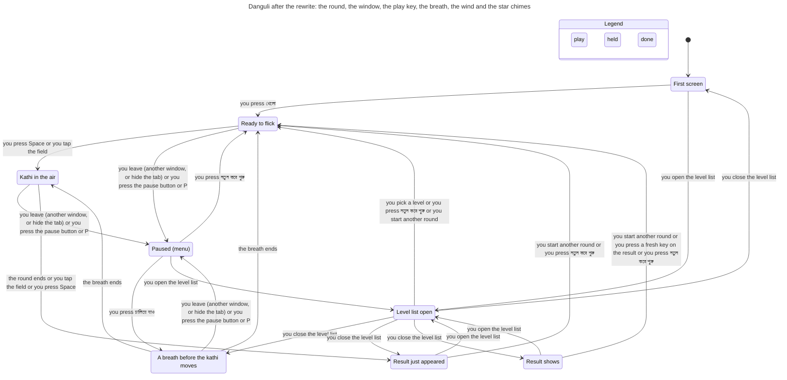
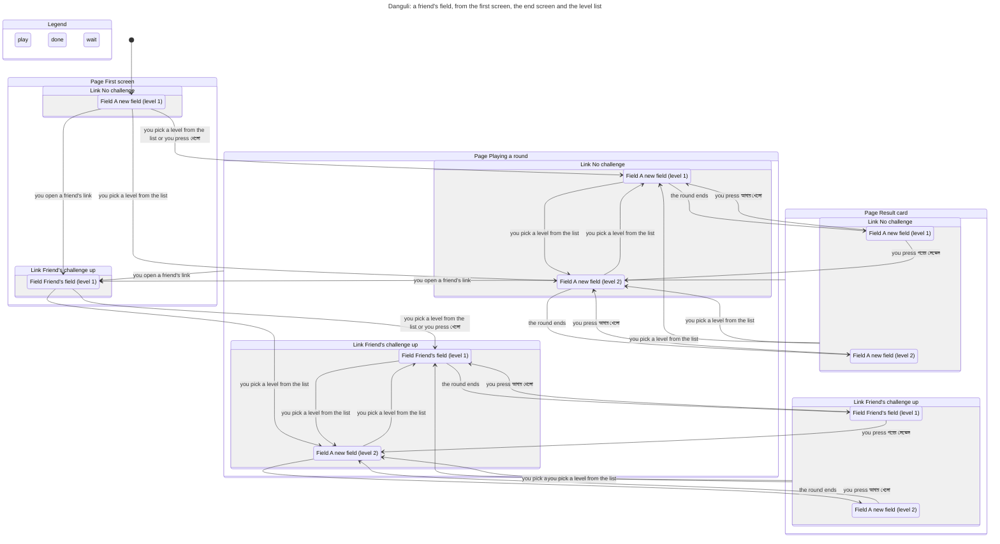

# ডাংগুলি: statechart

**Before the rewrite:** the model is `before-fix/Danguli.tla` with `before-fix/Danguli.cfg` and `before-fix/view.ts`. It mirrors `tools/danguli/components/danguli-game.tsx` and `tools/danguli/lib/game.ts` as they were on `games-to-the-bar`. Its report and chart are in `before-fix/`. **After the rewrite** is the section "After the rewrite (`after-fix/`)" further down: `Danguli.tla` and `DanguliLink.tla` at the top of this folder now mirror the new code.

TLC reached 279 states. Four of the eight rules break. The chart (`before-fix/chart.mmd`) draws 12 states and 22 arrows. It hides the resets that every state has, plus arrows that repeat ones already drawn.

## Systems modelled
- **Play phase:** a round of hits, `aim → pop → fly → rest`, then the result card (`over`). The game has three hits; the model has one, because at two hits TLC finds the same breaks in 504 states, too many for the chart.
- **Pause and focus:** the থামাও button and P/Esc toggle, the tab hidden or shown, and the window focused or blurred.
- **Input:** the play key (Space, Enter or ↑), its keyup, and the keyboard's auto-repeat while it is held. A canvas tap is the same `press()` with no key held.
- **Time:** step() lets the কাঠি fall, a hit fly and settle, and the rest after a hit end. finish() also sets setTimeout timers for the star chimes and confetti.
- **Choices:** proceed() on the card (পরের লেভেল when a level is won, otherwise আবার খেলো), the level grid, and নতুন মাঠে খেলো.
- **Links:** a friend's challenge link loaded at start or by hashchange, and whether the field you're on is theirs.
- **Left out:** saved stars (`recordLevel` keeps the max, so they can't drop), slow mode (it only scales time), and the name and card format. There is no sound loop: every sound is a one-shot.

## Rules
| Rule | In plain words | Result |
|---|---|---|
| PausedWhenHidden | Hide the tab while the কাঠি is up and the game pauses. | holds |
| PausedWhenBlurred | Click into another window while the কাঠি is up and the game pauses. | **breaks** |
| InputReleasedWhenAway | Nothing counts as held after you leave the page. | holds (the game keeps no held state) |
| HeldKeyActsOnce | One press does one thing. Holding the key never flicks, swings or skips on its own. | **breaks** |
| ResultStaysUntilYouChoose | The result card stays until you make a fresh choice. | **breaks** |
| NoDoubleResult | A round ends once (one finish(), one set of stars). | holds |
| CelebrationOnlyOnResult | Star chimes and confetti play only on the result card. | holds (start() clears the timers) |
| ReplayIsExact | While a friend's challenge is up and you're on their level, you play their field. | **breaks** |

## Bugs

### 1. PausedWhenBlurred: "I flicked the কাঠি, glanced at another window, and came back to a miss" (shared)
- **Path:** (0) ready to flick → (1) you press Space: the কাঠি is in the air → (2) you click into another window: it's still in the air and the game is still running.
- **Why:** the only pause effect is `visibilitychange`, and nothing listens for `blur`. `useGameLoop` keeps stepping while the window is blurred, so `step()` lets the কাঠি fall and records `strike(…, 0)`, a ground miss.
- **Live replay (Orca tab, synthetic events):** Space keydown and keyup → button `মারো!`, hits `—|—|—`. Window `blur` → no change, no pause overlay. 2.5 s later, still away → button `পরের মার`, hits `ফসকে|—|—`. The first of the three hits was lost while away. The Orca tab itself had no focus (`document.hasFocus()` false) and the game still ran.
- **Fix:** pause on `blur` the same way as on hide (in pop, fly or rest), and resume only from চালিয়ে যাও. This belongs in the shared player or a shared `usePauseWhenAway()` in `shared/game-kit.ts`, so every game gets it.

### 2. HeldKeyActsOnce: "I held Space a moment too long and the batter swung on his own" (shared)
- **Path:** (0) ready → (1) you press Space: the কাঠি is in the air → (2) the held key repeats: the swing happens without a second press.
- **Why:** `onKey` never checks `event.repeat`, so every auto-repeat of Space, Enter or ↑ calls `press()`.
- **Live replay:** one keydown of Space, then repeat keydowns every 33 ms from 0.5 s on (like a held key). At 540 ms the repeat swung on the rise: hits `ফসকে|—|—`. After that it skipped the rest (947 ms), flicked again (981 ms), swung (1155 ms) and so on. Holding the key played the whole round as misses.
- **Fix:** ignore `event.repeat` in `onKey`, as স্যার ঘুরলেই থামো already does during play. Shared: one key helper for every game.

### 3. ResultStaysUntilYouChoose: "I held Space and the result flashed past; a new round started" (shared)
- **Path:** (0) ready → (1) you press Space → (2) the কাঠি lands untouched → (3) the held key repeats: it plays by itself → (4) the held key repeats: the card is skipped.
- **Why:** on the card, Space, Enter or ↑ calls `proceed()`, and a repeat counts as a press. A key held from the last hit goes straight past the card into পরের লেভেল or আবার খেলো.
- **Live replay:** in the same held-Space run, the card appeared at 2112 ms and was gone at 2147 ms, about one repeat later, with a fresh round on `কাঠি তোলো`. In 10.8 s of holding, the game played six rounds by itself, and each card lasted about 35 ms. Each one still recorded a best (here 0 ডাং).
- **Fix:** on the card, act only on a keydown with `!event.repeat` that started after the card appeared. Keep the 450–600 ms guard that দেরি হয়ে গেল uses. Shared: a `useResultGuard()` that every game's card uses.

### 4. ReplayIsExact: "My friend's banner says 'একই মাঠ', but I'm on a new field" (game)
- **Path:** (0) ready to flick on the friend's field → (1) you pick a level from the grid: the challenge is still up, on a new field.
- **Why:** `LevelGrid onPick={next => play(next)}` calls `play(next, seed = newSeed())`, even for the friend's own level. `again()` keeps the friend's seed, but only while they are already the rival.
- **Live replay:** open `/danguli#s=12345&t=30&h=10-12-8&n=rafi`. The HUD reads `মোট ০ ডাং · লক্ষ্য ৩০` and the banner reads `rafi ৩০ ডাং মেরেছে। একই মাঠ, এবার তোমার পালা।`. Open সব লেভেল and press লেভেল ১. The HUD now reads `মোট ০ ডাং` (the target is gone, so `rival` is null and the seed is new), and the banner still promises the same field.
- **Fix:** in `onPick`, use the friend's seed when `friend.level === next`, as `again()` does.
- **Side finding:** in the first attempt the HUD still showed `লক্ষ্য ৩০` after the pick, until the next render. `start()` replaces `game.current` (a ref), and every `setState` it calls sets the value already there, so React skips the render. The HUD can show the previous field's target until something else re-renders. The rewrite should keep the field in state, or force a render on `start()`.

## Quality-bar gaps (from a play in Orca, phone and desktop)
1. **First screen:** the H1, the lead and the level line sit above the stage. The start action (কাঠি তোলো) is an ordinary button under the canvas, below the fold on a 412×915 phone. It is not the biggest thing on screen.
2. **Pause:** থামাও is a toggle with no menu (no নতুন করে শুরু, কীভাবে খেলবে, শব্দ or ধীরে খেলো inside it). Blur doesn't pause (bug 1). Hiding pauses only while the কাঠি is up.
3. **Input:** a held key plays the game by itself and skips the result (bugs 2 and 3).
4. **The middle of the screen:** the two-line tutorial card sits in the sky over the play area, and "ক্যাচ! আউট!" draws inside the field. The hit chips and total are fine at the top.
5. **Pacing:** each level changes wind, pop height and (from level 4) the fielders together, so there's more than one new idea per level. Level 10 (ওস্তাদ রহিম চাচা) is only a bigger number, not a named moment.
6. **Choices:** the level grid is hidden in a `<details>` under the toggles, with no numbering or keys. The default after a win (পরের লেভেল as primary) is right.
7. **Danger:** nothing warns as the কাঠি nears the ground. The yellow band is the only timing cue, and it is easy to miss on a phone.
8. **Sound:** flick, knock (pitch by quality), crowd, splash, thud, star chimes and win make enough meaningful sounds. There's no signature tune.
9. **Ending (good):** the card shows real stats: stars, ডাং, the gap to the next star, this phone's best, and the versus line. The share card and link work.

Screenshots: `.shots/danguli-first-screen.png` (phone first screen; the stage starts halfway down), `.shots/danguli-third-hit.png` (the third hit caught), `.shots/danguli-result.png` (the result: 1 star, 14 ডাং, পরের লেভেল).

## After the rewrite (`after-fix/`)
Model: `Danguli.tla`, `Danguli.cfg` and `view.ts` now mirror the rewritten code: `tools/danguli/lib/session.ts` (ticking, canTap, wantWind, syncLoops, blur/focus/hide/show, pause/resume, openSheet/closeSheet, setSound, keyDown/keyUp, goTo, freshResultKey, wake, step) and `tools/danguli/components/game.tsx` (begin, show, engaged, away/back, the player's onPause/onResume/onRestart/onLevels, tap, onDown, finish, readLink, the sound effect, the window keys). The spec from before is kept in `before-fix/`. It models one hit (not three) on a windy level (the চর), because only those have a loop; the intro story is part of the first screen.

The friend's field is a second, tiny model, `DanguliLink.tla` with `DanguliLink.cfg` and `view-link.ts` (`tools/danguli/lib/challenge.ts` `seedFor`, and `readLink`, `start`, `again`, `pickLevel`), so the first chart stays small. Its report and chart are in `after-fix-link/`.

TLC on `Danguli.tla`: 244 states, 1380 steps. **Every rule holds:** TypeOK, PausedWhenHidden, PausedWhenBlurred, InputReleasedWhenAway, HeldKeyActsOnce, ResultStaysUntilYouChoose, NoDoubleResult, CelebrationOnlyOnResult, NoProgressWhileAway, PauseOnlyMidRound, LoopOnlyWhenMeaningful, LoopComesBack, NeverAStub, ChoiceFreezesPlay, BreathAfterAway and NoDeadlock.
TLC on `DanguliLink.tla`: 10 states, 46 steps. **Holds:** TypeOK, **ReplayIsExact** and NoDeadlock.

The rules are not vacuous: with the repeat guard (`~repeat`) removed from `KeyDownActs`, TLC reports HeldKeyActsOnce broken again, on a 3-step path (first screen, you press খেলো, you press Space, the held key repeats). `HeldKeyActsOnce` and `ResultStaysUntilYouChoose` follow the definitions in `session.ts` (`keyDown`, `freshResultKey`), so the node tests below are what prove the code matches them.

### The fixes
1. **Blur (bug 1, PausedWhenBlurred):** the game lives in the shared player, which opens its menu on blur, hide and Escape. `session.ts` marks the round stale, the loop never steps while `ticking` is false, and coming back runs a 36-step (0.6 s) breath with the কাঠি hanging where it was. Test: `statechart PausedWhenBlurred (bug 1)`.
2. **Held Space (bug 2, HeldKeyActsOnce):** `keyDown(s, repeat)` returns false for a repeat. Test: `statechart HeldKeyActsOnce (bug 2)`.
3. **Held key through the result (bug 3, ResultStaysUntilYouChoose):** result keys pass `freshResultKey`: a non-repeating keydown that arrived after the screen appeared, not under the menu or the list. Test: `statechart ResultStaysUntilYouChoose (bug 3)`.
4. **Friend's field from the list (bug 4, ReplayIsExact):** every start goes through `seedFor`, from the list, আবার খেলো and নতুন করে শুরু alike. The HUD reads the level from React state, so it can't show the old target (the side finding). Tests: `statechart ReplayIsExact (bug 4)` in `tests/session.test.ts` and `tests/link.test.ts`.
- Also: `statechart NoProgressWhileAway` (a loop mounted while another window has focus never steps), `statechart ChoiceFreezesPlay`, `statechart LoopOnlyWhenMeaningful and LoopComesBack` (the wind stops on blur, the menu, the result, and a fresh one starts when sound comes back, never a stub), `statechart NoDoubleResult` in `tools/danguli/tests/session.test.ts`; `statechart UnlockNeverShrinks` in `tools/danguli/tests/link.test.ts`.
- **A new finding from the model:** a friend's link opened (hashchange) while the result card was up left the star chimes ringing on the first screen. The model's `CelebrationOnlyOnResult` failed until `FriendLinkOpens` cut them; `components/game.tsx` now calls `silenceScheduled()` before `show("title")`.

### Live checks after the fix (Orca, Pixel 9 emulation, rAF swapped for a 60 Hz pump because Orca throttles a background tab to about 1.5 fps)
- **Blur mid-air, level 12:** round time 0.78 s, `blur` → the player's menu up, session paused and stale, the wind loop stopped (loop stops 0 → 1) → 2.5 s later round time still 1.08, hits `—|—|—`. Before: the কাঠি fell and the hit was a recorded miss. চালিয়ে যাও: 12 breath steps left, the wind restarted as a new loop (loop starts 1 → 2).
- **Held Space (one keydown, then repeats every 33 ms for 5.6 s):** flicked once; the কাঠি landed untouched; hit 2 stayed on `কাঠি তোলো` for the last 3 s. 0 swings, 0 flicks by itself. Before: six rounds in 10.8 s.
- **Held through the result:** 3.5 s of repeats with the result up (phase 4): it stayed. Then a fresh Enter keydown started the next round. Before: the card lasted about 35 ms.
- **Sound switch:** menu → শব্দ off → on → চালিয়ে যাও: wind loop starts 3 → 4 (a fresh loop).
- **Old link** `#s=12345&t=30&h=10-12-8&n=rafi`: the banner, level 1 on the new ladder; সব লেভেল → লেভেল ১ plays seed 12345 (`__danguli.round().seed`). Before: a new seed.
- **Hide (headless Chrome over CDP, because Orca pins `document.hidden`):** after a hide the menu was up and the round time stayed 0.17 s through 2.6 s; after চালিয়ে যাও it ran to 0.35 s in 0.7 s (the 0.6 s breath).
- **Console:** no errors or warnings.

### Chart (after the fix)


### Chart: the friend's field


## Regenerate
```sh
scripts/statechart.sh ai_docs/statecharts/danguli/Danguli.tla --view ai_docs/statecharts/danguli/view.ts --out ai_docs/statecharts/danguli/<new-folder>
scripts/statechart.sh ai_docs/statecharts/danguli/DanguliLink.tla --view ai_docs/statecharts/danguli/view-link.ts --out ai_docs/statecharts/danguli/<another-folder>
# the model before the rewrite:
scripts/statechart.sh ai_docs/statecharts/danguli/before-fix/Danguli.tla --view ai_docs/statecharts/danguli/before-fix/view.ts --out ai_docs/statecharts/danguli/<third-folder>
```
Delete each folder's `tlc.out`. The chart hides the sound switch, the repeat and let-go arrows, the star chimes and the friend's link arrows; the model and the report keep them.

