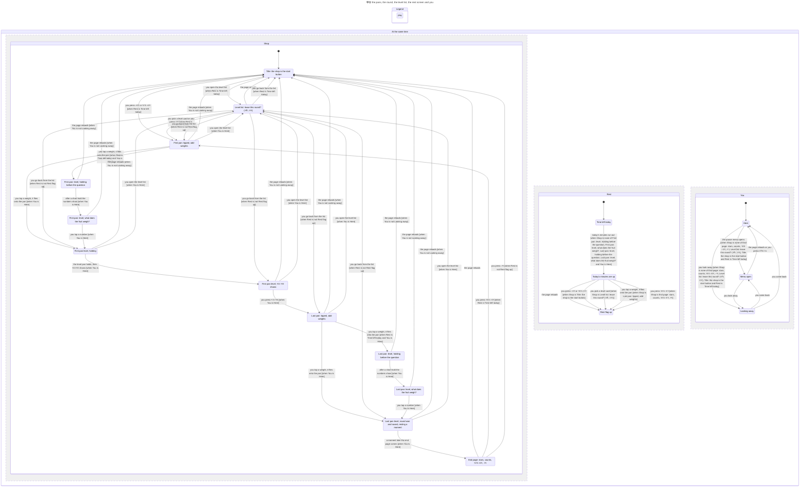

# দাঁড়িপাল্লা: statechart

Kids' game (ছোটদের জন্য, ages 6–11), so NoReadingNeeded (ages 3–5) doesn't apply. The game was rewritten on 2026-11-05 (design: `ai_docs/game-dev/rewrites/daripalla.md`). Spec: `Daripalla.tla` / `Daripalla.cfg` / `view.ts`, mirrored from `tools/daripalla/lib/session.ts`, `lib/sim.ts`, `lib/clock.hot.ts`, `components/game.tsx` (`begin`, `drain`, the loop's step, `useGamePlayer`) and `shared/kids-kit.tsx`.

- **`before-fix/`** is the run on the old code with the old spec (`before-fix/Daripalla.tla`, `.cfg`, `view.ts`, `report.md`, `chart.mmd`): 496 states, three rules broken.
- **`after-fix/`** is the run on the rewritten code: **397 states, 1337 steps, every rule holds** (TLC `NoDeadlock` too). The chart draws 18 states and 50 arrows. Run: `scripts/statechart.sh ai_docs/statecharts/daripalla/Daripalla.tla --view ai_docs/statecharts/daripalla/view.ts --out ai_docs/statecharts/daripalla/after-fix` (a new, empty `--out`; delete `tlc*.out`).
- **Mutation checks (run in scratch copies):** putting back an old behaviour breaks the rule at once.
  - Letting পরের পাল্লা be pressed with no hold breaks **YouSeeEveryPanBalance**.
  - Recording the stars only at the end page breaks **EveryFinishedRoundCounts**.
  - Letting the end page come while away breaks **NothingMovesWhileAway**.
  - Letting a level card start a touched round with no ask breaks **LeavingAsksFirst**.

## What the rewrite changed in the model
- **One clock, no timers.** The old game ran the round-end wait in a `setTimeout` that nothing stopped. Now `advance()` runs on the fixed-step loop: the hold after a level pan (900 ms), the wait before a fruit's question (600 ms), the end page's wait (1800 ms) and the idle ghost finger. A blur, a hidden tab or the pause menu stops the loop, and the step also checks `clockMayRun()` because a window `focus` restarts the loop even while the menu is open.
- **The round is won at the press** (`EV.WON` → `session.won()` → `levels.record()` and `atBreak()`), not 1.8 s later. Only the end page waits.
- **পরের পাল্লা arrives only after the hold**, so no tap that levels a pan can ever land on it. The question's numbers wait too.
- **The level list is a choice screen with a "leave this round?" ask** for a touched round (the pause menu's সব লেভেল), and পরের ধাপ is gone: the list and শেষ do it.
- **Easing is per round.** `newRun` starts at pace 0; three misses in a row ease only the pans after them.
- **Not modelled (node tests instead):** the first tap after coming back only wakes the game (`session.test.ts` › the tap that brings focus back is not a move), the pace and quiet-ease logic (`sim.test.ts` › easing is per round), the star thresholds, saved-progress migration.
- The model has one level kind at a time (`fill` or `find`), 2 pans a round and a one-star record that is not drawn (`best # 1` in `Explore`), to keep the chart under 500 states. `unlockedLevel` is not modelled: every level is open in the list, as in the other kids' games.

## Rules in plain words, all holding after the fix
| Rule | Plain words |
|---|---|
| **YouSeeEveryPanBalance** | The next pan comes only after the level pan has held; the tap that levels a pan never also presses পরের পাল্লা. |
| **EveryFinishedRoundCounts** | A round you finished is recorded, and the daily break checked, the moment its last pan is level. |
| **NothingMovesWhileAway** | While you are away or the menu is open, the hold, the question and the end page never come. |
| **LeavingAsksFirst** | A touched round is only left from the list after you press চলো. |
| **ChoiceFreezesPlay** | Nothing in the round changes while the level list is open. |
| **NoDoubleResult** | A round is recorded once. |
| **RestOnlyAtBreak** | The rest screen never covers a round: if the limit passes mid-round it waits for the end page. |
| **RestStaysUntilAGrownUp** | After the rest screen, no round is played until a grown-up gives more time. |
| **FreshRoundStartsClean** | A new round starts at the first pan with nothing missed. |
| **NoNetwork / NoChildData** | Nothing is sent; only stars and play time are written. |
| **StarsNeverDrop** | A recorded star count never goes down. |
| TypeOK, NoDeadlock | hold |

## The bugs, and how each was fixed
| # | Bug (the reader's sentence) | Fix | Node test | Live replay after the fix |
|---|---|---|---|---|
| 1 | **YouSeeEveryPanBalance:** "On my phone, the moment the pan levelled the next pan was already there; I never saw it balance." (old replay: `pointerdown:touch`, then `click:touch:kit-primary`, dots `now,-,-,-,-` → `done,now,-,-,-`.) | The tray no longer swaps to a button under the finger. পরের পাল্লা mounts 0.9 s after the level pan (clock), and ignores a click within 250 ms of arriving. A fruit's question waits 0.6 s. | `sim.test.ts` › bug 1 (two tests) | Headless Chrome, touch emulation, 412×915, a real `Input.synthesizeTapGesture` on the weight that levels the pan: **0.3 s later `index 0`, `stage done`, no button; 1.5 s later `index 0`, the button is there.** |
| 2 | **EveryFinishedRoundCounts:** "I finished all five pans, tapped a level, and my stars never came." | `EV.WON` records the stars and calls `atBreak()` in the press that levels the last pan; the end page waits 1.8 s after that. A won round is never "dirty", so the list never asks about it. | `session.test.ts` › bug 2 (three tests); `sim.test.ts` › bug 2 | Won the last pan on a phone: `ektukhani-levels-daripalla` = `{"1":3}` while the screen was still the play screen (0.1 s later and 2.6 s later). |
| 3 | **NoProgressWhileAway:** "I levelled the last pan and switched away; the win chime played and the stars were saved while I was gone." | The wait is a field the fixed-step clock counts down; blur, hide and the menu stop the loop, and the step checks `clockMayRun()`. | `sim.test.ts` › bug 3; `session.test.ts` › bug 3 | Blurred at the winning moment (the player's menu opened): `endT` stayed **1800 → 1800 over 2.6 s**, no end page, **audio starts 46 → 46**. A `focus` alone (menu still open): still 1800. After চালিয়ে যাও the end page came within 2.6 s and 3 star chimes started (46 → 49). |
| 4 | **Pace carried across levels:** a child eased on one level started the next eased. | `newRun` always starts at pace 0; the pace lives in the round. | `sim.test.ts` › bug 4 | — (pure logic) |
| 5 | **No confirm on restart from সব ধাপ.** | The pause menu's সব লেভেল opens the list; picking a level in a touched round shows the ask (থাকি, চলো), two 112 px picture buttons. | `session.test.ts` › bug 5; the model's `LeavingAsksFirst` | Phone, a touched round (one weight on): ⏸ → সব লেভেল → ফল দিয়ে মেলাও: still the list, the ask up (`ask 3`, `serial 1`, `added 1`). থাকি: `ask 0`, same round. Again, then চলো: a new round (`level 3`, `serial 2`, `added 0`). |
| 6 | **No pause.** | `useGamePlayer` (menu, P, Esc, blur, hide, ⏸); `onPause` also finishes a flying piece. | `session.test.ts` › bug 3 | Phone size: a blur opened the menu and froze the clock (see bug 3's numbers). Also in slow mode the beam jumps to its tilt, and a digit key puts a weight on without a flight. |

Shared patterns also fixed here, each with a node test: the click that brings focus back is not a move; result keys need a fresh press; one Enter never repeats a press (a held Enter on a focused weight is stopped at `window`); the share link only on the title; the rest screen is checked at the start of a round.

## The chart (after the fix)

