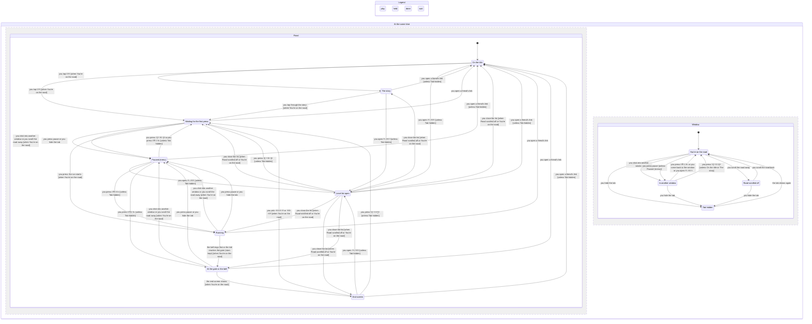

# দেরি হয়ে গেল: statechart

Two halves:
- **before-fix/**: the model of the shipped game (one bump ends the run, six school days), which found 4 bugs in 6 broken rules. `before-fix/notes.md` is that analysis with its live replays; the old spec is kept there as `Late.before.tla.txt`.
- **after-fix/**: the model of the rewrite (three worlds of four levels with a bell clock, a stumble instead of one bump, the shared player's menu), where every rule holds.

## Files
| File | What |
|---|---|
| `Late.tla`, `Late.cfg`, `view.ts` | The rewrite: the screens (title, story, road, end), the shared player's pause, where the window is, the level list, your hand (a key, the road under a thumb or a pad), the run and its bell, a friend's road against your own, and the end moment's scheduled chimes. |
| `before-fix/report.md`, `chart.mmd`, `notes.md`, `Late.before.*.txt` | The old model's run, the bug write-up and the old spec. |
| `after-fix/report.md`, `chart.mmd` | Today's spec: 328 states, 1844 steps, all 15 checks hold (TypeOK, the 13 rules below and NoDeadlock). |

**What the model mirrors:**
- `tools/deri-hoye-gelo/components/late-game.tsx`: `begin` (cuts scheduled tones and any confetti), `finish`, `keepStars` on `E.ARRIVE`, the blur/focus/visibility effect, the IntersectionObserver on the road, the sheet effect, the hashchange effect, and `useGamePlayer`'s `onPause`, `onResume`, `onRestart`, `onLevels`;
- `lib/session.ts`: `ticking`, `breathing`, `blur`, `hide`, `setInView`, `pause`, `resume`, `openSheet`, `closeSheet` (with its breath), `goTo`, `letGo`, the lane, key and pad presses, `takeInput` (a press between two steps still counts once), `freshResultKey`;
- `lib/step.hot.ts` and `lib/game.ts`: the first press (it starts the run and the bell, it doesn't jump), the gate, the bell, the end moment (`END`, then `OVER`);
- `shared/game-player-client.tsx`: blur, hide and scrolling the stage away open the menu once you've touched the game; চালিয়ে যাও and নতুন করে শুরু send a focus first; pausing cuts scheduled tones.
- Abstractions: the road is the run itself, with no distance; you have already touched the game; sound is on. The game has no sound loops (every sound is a one-shot or a delayed tone), so there is no loop rule. A stumble only moves the bell's clock, which `tests/levels.test.ts` checks (the bell's promise per mode).

## Rules (each holds after the fix)
| Rule | In plain words | Before | After |
|---|---|---|---|
| PausedWhenBlurred | Click into another window mid-run and the menu opens, the road waits. | **broke** | holds |
| InputReleasedWhenAway | Once you leave (another window, a hidden tab, the road scrolled off, the menu, the list, the end screen), no key, finger or latched press is held. | **broke** | holds |
| InputMatchesHand | The kid ducks only while you hold ↓ (or the pad, or a swipe). | **broke** | holds |
| ResultNeedsAFreshPress (was ResultStaysUntilYouChoose) | The end screen starts a run only from a fresh press, never from a key still down. | **broke** | holds |
| NoCelebrationAfterLeaving (was CelebrationOnlyOnResult) | The bell, chimes and confetti are only ever on the end screen, and never over your next run. | **broke** | holds |
| ReplayIsExact | The road you run is the one on screen: yours, or your friend's under their banner. | **broke** | holds |
| PausedWhenHidden | Hide the tab mid-run and the menu opens. | held | holds |
| NoDoubleResult | The end screen's chimes are made once, when it shows. | held | holds |
| ChoiceFreezesPlay | While the level list is open, nothing moves. | new | holds |
| StillWhenOffScreen | With the road scrolled off a desktop page, nothing moves. | new | holds |
| StarsKeptTheMomentYouWin | The stars are saved when the gate is reached, before the end screen, so leaving early never loses them. | new | holds |
| ProgressOnlyWhileTicking | A press taken, the gate, the bell and the end moment happen only while the road moves, never in the breath after চালিয়ে যাও. | new | holds |
| TheClickBackIsNotAPress | The click that brings focus back never jumps or ducks. | new | holds |

I also broke the spec on purpose to be sure the rules bite (the mutations are not kept): no release on blur, no cut of scheduled tones in `begin`, a result key that ignores a stale held key, and a tab that hides without pausing each broke the matching rule.

## The four bugs, fixed
1. **PausedWhenBlurred, InputReleasedWhenAway, InputMatchesHand:** "I held ↓, clicked another window, and the kid ran on, ducked, into a puddle." `session.blur` lets go (`letGo` with the run) and `ticking` needs focus; the player opens its menu. Test: `bug 1, PausedWhenBlurred` in `tests/session.test.ts`.
   - Live (Orca, 390 × 630, level 12): held ↓, the kid ducking at 73.6 m (`duckHeld` true). A window `blur`: `duckHeld` false, the session's duck 0, the menu open. Three seconds later the road was still at 1473 units and the clock at 7.67 s. After চালিয়ে যাও the road stood still for the 0.5 s breath (four samples 120 ms apart all at 1473), then moved (1477, 1490, 1512, 1539).
2. **ResultStaysUntilYouChoose:** "I held Space as I reached the gate, let go a second later, and a new run had already started." No button takes focus after a run, and the end screen's keys count only from a fresh, non-repeating keydown made after the screen showed (`freshResultKey`). Test: `bug 2, ResultStaysUntilYouChoose` (the pure rule plus a source check: no `.focus(` in the component).
   - Live: Space down at the gate and held through the end screen, a second of auto-repeat (12 `repeat` keydowns), then released: the screen stayed on the end screen, focus on the stage (not a button). A fresh Space 0.5 s later chose the first choice (a new run).
3. **CelebrationOnlyOnResult:** "The win fanfare and confetti went off in the middle of my next run." The component keeps no timers. The bell, the stars' chimes and the fanfare are delayed `tone()`s, which `begin()` (`silenceScheduled`) and the player's pause cut, and `begin()` takes down any confetti canvas still falling. The stars are recorded at `E.ARRIVE`. Test: `bug 3, NoCelebrationAfterLeaving` (no `setTimeout` in the component, `begin` cuts tones and confetti, the star and bell tones are delayed, `keepStars` on `E.ARRIVE`).
   - Live: after the fresh press above, 4 oscillator starts in the first 60 ms (the level's motif) and no confetti canvas on the page.
4. **ReplayIsExact:** "I opened my friend's link mid-run; the banner and the gate changed, but I was still on my own road." A link that arrives in a live page (the hashchange effect) ends the run: `run.current` becomes the friend's seed and level, and the title shows their road under their banner. Nothing changes under a run. Test: `bug 4, ReplayIsExact` (the handler creates the friend's run and shows the title; the address is only ever replaced with `history.replaceState`).
   - Live: mid-run on level 12, the hash set to a level-7 link: the screen went to the title with `{ seed: 4242, level: 7 }`, the banner "রাফি লেভেল ৭-এ ২০০ মিটার গিয়েছিল, তারপর ঘণ্টা পড়ে গেল।". (Setting the hash from a script pushes history, so the player also left full screen: the shared popstate pattern. The game itself never sets the hash.)

**Found while building (a new rule, not in the old model):** the orange "running late" edge lit on a clean run on the levels that speed up, because it compared the gate with the speed *now*. It now counts the road's own speed-up (`remainTable`). `tests/game.test.ts` (running late) shows it never lights on a clean run on any level in any mode, and lights by the stumble after each mode's limit.

## Also checked live in Orca
- All 12 levels cleared by an in-page autopilot (a steady player, with the rAF shim from the play-test skill, since Orca runs a hidden pane at 2 frames a second): clean times 9.1, 15.6, 21.0, 27.8, 26.7, 29.6, 30.8, 36.0, 33.3, 36.9, 39.9, 39.7 s, the same as the bot in tests. Level 1 in 9.1 s.
- An idle kid on level 12: 21 stumbles, the orange edge lit once the stumbles had used up the bell's slack (`tests/game.test.ts` pins it to the stumble past each mode's limit), the red edge pulse on each stumble, the clock red, the bell at 41.7 s: "দেরি হয়ে গেল!" with the exact stats and "৪১.৭ সে.".
- 320 px: no sideways scroll on the page, the title, the road, the menu or the list.

## The chart (after-fix/chart.mmd)


## Regenerate
```sh
scripts/statechart.sh ai_docs/statecharts/deri-hoye-gelo/Late.tla --view ai_docs/statecharts/deri-hoye-gelo/view.ts --out ai_docs/statecharts/deri-hoye-gelo/after-fix
rm ai_docs/statecharts/deri-hoye-gelo/after-fix/tlc*.out
```
