# ডাইনোসর খুঁজি: statechart

The game was rewritten on 2026-11-05 (design: `ai_docs/game-dev/rewrites/dinosaur.md`). `Dinosaur.tla` / `.cfg` / `view.ts` model the new code: **TLC 474 states, 1,698 steps; all 18 checks hold: 16 rules, TypeOK and NoDeadlock** (`after-fix/`). The model of the old code and its run with the broken rules are in `before-fix/` (`report.md`, `chart.mmd`; the old spec is in git history). The four bugs of that first run, each replayed live on 2026-11-04, are below with their fix and the replay after it.

Mirrored from:
- `tools/dinosaur/lib/session.ts` (screens, pause, away and swallow, the book, ▶, rest, fresh keys),
- `lib/stroke.ts` (press, drag, lift, release: the finger on the sand), `components/sand-layer.tsx` (release on blur, hide, cancel, lost capture, pause),
- `lib/round.ts` (dig → build → meet → facts per dinosaur; the last right food wins the round), `components/game.tsx` (`begin`, `sort`, `go`, the dig beat's effect, the window keys, the parent-gate closer),
- `shared/kids-kit.tsx` (`atBreak`, `RestScreen` as a modal, `ParentGate` closing after one action).

A level is two dinosaurs (`index` 0 and 1); a finale's second pit is another dig with the same rules, so it is not drawn. Bones are one flag: the pit is hiding bones, or every bone has lifted out. The game has no sound loops: every sound is a one-shot, so there is no loop rule.

## Rules (plain words), all holding after the fix
| Rule | Plain words |
|---|---|
| InputReleasedWhenAway | Once you leave the window, no finger or mouse button counts as down on the sand. |
| SandClearsOnlyUnderAFinger | The sand clears only while a finger (or the mouse button) is really down on it. |
| NothingMovesUnderTheMenu | With the pause menu open, nothing brushes. The dig beat waits (its effect is gated on the menu and the book). |
| PausedWhenAway | Away from the window during play, the pause menu is open. |
| ChoiceFreezesPlay | With the finder's book open, nothing brushes. |
| FirstTapBackOnlyWakes | The click that brings focus back is not a brush. |
| TimersBelongToThisDig | The "bones come up" beat exists only in a dig. |
| NoDoubleResult | A round is recorded once. |
| RestOnlyAtBreak, RestNeverOverADig | The rest screen shows only between rounds. It may be set at the tap that wins the last dinosaur, but stays hidden until the end screen. |
| NoRoundUnderRest | Nothing the child does (Tab, Enter, a tap) starts anything while the rest screen is up. |
| GateOnlyOnTheTitle, ShareNeverBehindTheChild | The share button is never open while the child plays; a round start or any tap elsewhere shuts it. |
| NoNetwork, NoChildData | Nothing is sent; only the stars and the finder's book are stored. |
| NoReadingNeeded | Every choice on every screen is a picture. |

**Model check (mutations, in a scratch copy):** not dropping the stroke on blur breaks **InputReleasedWhenAway** (and NothingMovesUnderTheMenu) in 3 steps. Letting a round start without closing the gate (and without the rest guard) breaks **GateOnlyOnTheTitle** in 2 steps. Saving the result on every dinosaur instead of the last breaks **RestOnlyAtBreak** and **RestNeverOverADig** in 8 steps.

**What the first model run on the new code found (and the spec was corrected to, not weakened):** the first draft let a round start from another window with the menu closed (`PausedWhenAway` broke in 2 steps). That was a model gap, not a game bug: a tap needs the window's focus, so every child action now requires `focused`. It also showed that `ParentGate` as first written ("open implies the parent holds it") was the wrong rule: a grown-up hands the phone back with the gate open. The real promise is the one now checked: the gate exists on the title only and shuts at the child's first tap anywhere else.

## The bugs, and how each was fixed
| # | Bug (the reader's sentence) | Fix | Node test | Live check after the fix (Orca, Pixel 9) |
|---|---|---|---|---|
| 1 | **InputReleasedWhenAway / SandClearsOnlyUnderAFinger:** "I was brushing when a message popped up. When I came back, the sand cleared wherever my mouse went, and my finger did nothing." | `lib/stroke.ts`: a press needs the primary pointer and, for a mouse, its button; a move with no button ends the stroke (`-1`); every new press replaces a stuck one. `sand-layer.tsx` releases the stroke on window blur, `visibilitychange`, `pointercancel`, `lostpointercapture` and when the board is not live (pause, beat). `game.tsx` releases it in `onPause`, the book and the level list. | `bug 1: a press lost in another window ends the stroke…`, `bug 1: a mouse move with the button gone…`, `bug 1: the sand layer drops the stroke on blur…` (tests/session.test.ts) | Mouse press at (5, 5), `blur` (the menu opened), `focus`, চালিয়ে যাও, then 45 hover `pointermove`s (`buttons: 0`) across bone 1: **0 bones found, 24 cells cleared before and after** (only the first press). Then two touch taps (ids 7 and 8): **24 → 122 cells cleared**: the finger is heard, and the first tap after resuming counted. |
| 2 | **RestOnlyAtBreak / NoRoundUnderRest:** "The rest screen was up, but the game behind it started a new dig." | Shared: `RestScreen` is now a real modal (everything else goes `inert`, focus held, keys and taps stopped in capture). Ours: `session.begin(s, over)` never starts a round past the limit; `atBreak()` runs when a round starts and at the tap that wins the last dinosaur (stars saved in the same tap, never in a timer); `touch()` and `advance()` ignore everything while the rest screen shows. | `bug 2: a round never starts under the rest screen…`, `bug 2: opening a round is a break, and so is the last food…` | Patched `ektukhani-kids-time` to read 99999 s in my tab only; finished level ২: the rest screen showed on the end screen, the game behind it `inert`, focus on `.kk-rest`. A trusted Enter (`orca keypress`) changed nothing: still the end screen, round serial 5 before and after. |
| 3 | **ParentGate:** "Ammu opened বড়দের জন্য to copy the link and gave me the phone back. The share button stayed there the whole time I played." | Shared: `ParentGate` closes after one action inside it and after 20 s. Ours: the gate lives on the title only, and a capture-phase `pointerdown` anywhere else in the game remounts it closed (`gateKey`). | `bug 3: an open parent gate shuts at the next tap anywhere else…` | Held the gate 2.3 s, answered the sum: `.kk-gate-open` and the share button showed. One `pointerdown` on the pit: **gate gone, share button gone**. |
| 4 | **NoReadingNeeded:** "At the end, I can't tell which button plays again and which one stops." | The end buttons are pictures at 112 px: ↻ (আবার খেলো) and a house (শেষ), equal size, with the grown-ups' icon on আব্বু-আম্মুকে দেখাও. The same blocks carry the foods (a leaf, a meat), the bones, ▶ (96 px) and the level cards. | `bug 4: every end button is a picture, at least 96 px` | `.shots/dinosaur-end.png`, `.shots/dinosaur-phone-finale-end.png`: three buttons, each with an svg, 112 px tall. |

## The quality-bar gaps, and what closed each
| Gap | What changed | Test |
|---|---|---|
| The fact card had no picture way in for ages 4–5 | The facts board is the **size picture**: the dinosaur on a bar of its real length over numbered buses (a rickshaw for the small ones), all to one scale. Under it the **food in pictures** (the mouth, an arrow, the leaf or meat). The lines are for the parent. | `gap: the fact card has picture ways in…` |
| No level ended a set with a big moment | Each world ends with a **named giant dug from two pits** (টি-রেক্স, ব্র্যাকিওসরাস, ডিপ্লোডোকাস): a name banner as it stands, the world's four-note tune, a medal and confetti on the end screen. | `gap: a world ends with a named giant…`, `nine levels in three worlds…` |
| The level list didn't show which dinosaurs a level holds | Each card shows its dinosaurs (colour once found, a shadow before). | `gap: the level list shows which dinosaurs…` |
| Nothing new per level | One new thing per level: brush, deep sand, rocks, not-bones, shadow-only board, unmarked sand, each world's finale. | `each level teaches exactly one new thing…` |

## Checked and holding
- **NoNetwork (live):** in Orca, across a full play of all nine levels, the 80 most recent requests were the page's own static files and fonts; no `fetch`, XHR or beacon in the code (`the tool's source never calls fetch…`).
- **NoChildData:** the game writes `ektukhani-levels-dinosaur` and `ektukhani-dinosaur-book`, plus the shared sound, slow and kids-time keys.
- **Every end of a round is one result:** `S.solve` records once per serial; `▶` and the end keys need a fresh press (`▶ and the end keys need a fresh press…`).

## The chart (after the fix)

```mermaid
stateDiagram-v2
  state "Legend" as legend {
    lg0: play
    lg1: rest
    lg2: done
  }
  class lg0 teal
  class lg1 yellow
  class lg2 blue
  state "Game The pit (খ#2497;#2433;ড#2492;#2495;)" as s0 {
    state "Window On the page" as s1 {
      state "Hand Hands off" as s2 {
        s3: Cover Nothing over the stage
        s4: Cover The book is open
        s5: Cover Parent gate open
        s6: Cover Rest screen
      }
    }
    state "Window Another window has focus" as s7 {
      state "Hand Hands off" as s8 {
        s9: Cover Nothing over the stage
        s10: Cover The book is open
        s11: Cover Parent gate open
        s12: Cover Rest screen
      }
    }
  }
  state "Game Digging" as s13 {
    state "Window On the page" as s14 {
      state "Hand Hands off" as s15 {
        s16: Cover Nothing over the stage
        s17: Cover The book is open
      }
      state "Hand Finger on the sand" as s18 {
        s19: Cover Nothing over the stage
      }
    }
    state "Window Pause menu open" as s20 {
      state "Hand Hands off" as s21 {
        s22: Cover Nothing over the stage
        s23: Cover The book is open
      }
    }
  }
  state "Game The level list" as s24 {
    state "Window On the page" as s25 {
      state "Hand Hands off" as s26 {
        s27: Cover Nothing over the stage
        s28: Cover The book is open
        s29: Cover Rest screen
      }
    }
    state "Window Another window has focus" as s30 {
      state "Hand Hands off" as s31 {
        s32: Cover Nothing over the stage
        s33: Cover The book is open
        s34: Cover Rest screen
      }
    }
  }
  state "Game Last bone lifting out" as s35 {
    state "Window On the page" as s36 {
      state "Hand Finger on the sand" as s37 {
        s38: Cover Nothing over the stage
      }
      state "Hand Hands off" as s39 {
        s40: Cover Nothing over the stage
        s41: Cover The book is open
      }
    }
    state "Window Pause menu open" as s42 {
      state "Hand Hands off" as s43 {
        s44: Cover Nothing over the stage
        s45: Cover The book is open
      }
    }
  }
  state "Game Building the skeleton" as s46 {
    state "Window On the page" as s47 {
      state "Hand Hands off" as s48 {
        s49: Cover Nothing over the stage
        s50: Cover The book is open
      }
    }
    state "Window Pause menu open" as s51 {
      state "Hand Hands off" as s52 {
        s53: Cover Nothing over the stage
        s54: Cover The book is open
      }
    }
  }
  state "Game What did it eat?" as s55 {
    state "Window On the page" as s56 {
      state "Hand Hands off" as s57 {
        s58: Cover Nothing over the stage
        s59: Cover The book is open
      }
    }
    state "Window Pause menu open" as s60 {
      state "Hand Hands off" as s61 {
        s62: Cover Nothing over the stage
        s63: Cover The book is open
      }
    }
  }
  state "Game Facts, #9654; waits" as s64 {
    state "Window On the page" as s65 {
      state "Hand Hands off" as s66 {
        s67: Cover Nothing over the stage
        s68: Cover The book is open
      }
    }
    state "Window Pause menu open" as s69 {
      state "Hand Hands off" as s70 {
        s71: Cover Nothing over the stage
        s72: Cover The book is open
      }
    }
  }
  state "Game Facts: round won, stars saved, #9654; waits" as s73 {
    state "Window On the page" as s74 {
      state "Hand Hands off" as s75 {
        s76: Cover Nothing over the stage
        s77: Cover The book is open
      }
    }
    state "Window Pause menu open" as s78 {
      state "Hand Hands off" as s79 {
        s80: Cover Nothing over the stage
        s81: Cover The book is open
      }
    }
  }
  state "Game End: #8635; / house" as s82 {
    state "Window On the page" as s83 {
      state "Hand Hands off" as s84 {
        s85: Cover Nothing over the stage
        s86: Cover The book is open
        s87: Cover Rest screen
      }
    }
    state "Window Another window has focus" as s88 {
      state "Hand Hands off" as s89 {
        s90: Cover Nothing over the stage
        s91: Cover The book is open
        s92: Cover Rest screen
      }
    }
  }
  [*] --> s3
  s3 --> s16: you tap খ#2497;#2433;ড#2492;#2495; or আব#2494;র খ#2503;ল#2507;
  s3 --> s27: the level list opens
  s3 --> s9: you click into another window: the menu opens, the stroke ends
  s3 --> s4: you open the finder's book
  s3 --> s5: a parent opens বড#2492;দ#2503;র জন#2509;য
  s16 --> s17: you open the finder's book
  s16 --> s19: you press the sand
  s16 --> s22: #9208;, P or Escape or you click into another window: the menu opens, the stroke ends
  s27 --> s16: you tap খ#2497;#2433;ড#2492;#2495; or আব#2494;র খ#2503;ল#2507;
  s27 --> s32: you click into another window: the menu opens, the stroke ends
  s27 --> s28: you open the finder's book
  s9 --> s3: you come back to the window
  s9 --> s11: a parent opens বড#2492;দ#2503;র জন#2509;য
  s3 --> s6: you tap খ#2497;#2433;ড#2492;#2495; with today's time used up
  s4 --> s3: you close the book
  s4 --> s10: you click into another window: the menu opens, the stroke ends
  s5 --> s16: you tap খ#2497;#2433;ড#2492;#2495; or আব#2494;র খ#2503;ল#2507;
  s5 --> s27: the level list opens
  s5 --> s4: you open the finder's book
  s5 --> s11: you click into another window: the menu opens, the stroke ends
  s17 --> s16: you close the book
  s17 --> s23: #9208;, P or Escape or you click into another window: the menu opens, the stroke ends
  s19 --> s16: the phone cancels the touch or you lift your finger
  s19 --> s38: the last bone of the pit comes out
  s19 --> s17: you open the finder's book
  s19 --> s22: #9208;, P or Escape or you click into another window: the menu opens, the stroke ends
  s22 --> s16: চ#2494;ল#2495;য#2492;#2503; য#2494;ও
  s22 --> s27: the level list opens
  s32 --> s27: you come back to the window
  s27 --> s29: you tap খ#2497;#2433;ড#2492;#2495; with today's time used up
  s28 --> s27: you close the book
  s28 --> s33: you click into another window: the menu opens, the stroke ends
  s10 --> s4: you come back to the window
  s11 --> s5: you come back to the window
  s5 --> s6: you tap খ#2497;#2433;ড#2492;#2495; with today's time used up
  s6 --> s12: you click into another window: the menu opens, the stroke ends
  s6 --> s3: a parent gives ten more minutes
  s38 --> s49: the beat ends: the bones come up to the board
  s38 --> s40: the phone cancels the touch or you lift your finger
  s38 --> s41: you open the finder's book
  s38 --> s44: #9208;, P or Escape or you click into another window: the menu opens, the stroke ends
  s23 --> s17: চ#2494;ল#2495;য#2492;#2503; য#2494;ও
  s23 --> s22: you close the book
  s33 --> s28: you come back to the window
  s29 --> s34: you click into another window: the menu opens, the stroke ends
  s29 --> s27: a parent gives ten more minutes
  s12 --> s6: you come back to the window
  s12 --> s9: a parent gives ten more minutes
  s49 --> s50: you open the finder's book
  s49 --> s53: #9208;, P or Escape or you click into another window: the menu opens, the stroke ends
  s49 --> s58: you place the last bone: the dinosaur stands
  s40 --> s49: the beat ends: the bones come up to the board
  s40 --> s41: you open the finder's book
  s40 --> s44: #9208;, P or Escape or you click into another window: the menu opens, the stroke ends
  s41 --> s40: you close the book
  s41 --> s45: #9208;, P or Escape or you click into another window: the menu opens, the stroke ends
  s44 --> s27: the level list opens
  s44 --> s40: চ#2494;ল#2495;য#2492;#2503; য#2494;ও
  s34 --> s29: you come back to the window
  s34 --> s32: a parent gives ten more minutes
  s50 --> s49: you close the book
  s50 --> s54: #9208;, P or Escape or you click into another window: the menu opens, the stroke ends
  s53 --> s27: the level list opens
  s53 --> s49: চ#2494;ল#2495;য#2492;#2503; য#2494;ও
  s45 --> s41: চ#2494;ল#2495;য#2492;#2503; য#2494;ও
  s45 --> s44: you close the book
  s58 --> s67: you pick the right food
  s58 --> s59: you open the finder's book
  s58 --> s62: #9208;, P or Escape or you click into another window: the menu opens, the stroke ends
  s54 --> s50: চ#2494;ল#2495;য#2492;#2503; য#2494;ও
  s54 --> s53: you close the book
  s67 --> s16: #9654;
  s67 --> s68: you open the finder's book
  s67 --> s71: #9208;, P or Escape or you click into another window: the menu opens, the stroke ends
  s59 --> s58: you close the book
  s59 --> s63: #9208;, P or Escape or you click into another window: the menu opens, the stroke ends
  s62 --> s27: the level list opens
  s62 --> s58: চ#2494;ল#2495;য#2492;#2503; য#2494;ও
  s68 --> s67: you close the book
  s68 --> s72: #9208;, P or Escape or you click into another window: the menu opens, the stroke ends
  s71 --> s67: চ#2494;ল#2495;য#2492;#2503; য#2494;ও
  s71 --> s27: the level list opens
  s63 --> s59: চ#2494;ল#2495;য#2492;#2503; য#2494;ও
  s63 --> s62: you close the book
  s72 --> s68: চ#2494;ল#2495;য#2492;#2503; য#2494;ও
  s72 --> s71: you close the book
  s58 --> s76: you pick the right food
  s76 --> s85: #9654;
  s76 --> s77: you open the finder's book
  s76 --> s80: #9208;, P or Escape or you click into another window: the menu opens, the stroke ends
  s85 --> s16: you tap খ#2497;#2433;ড#2492;#2495; or আব#2494;র খ#2503;ল#2507;
  s85 --> s90: you click into another window: the menu opens, the stroke ends
  s85 --> s86: you open the finder's book
  s85 --> s27: the level list opens
  s85 --> s3: you tap the house (শ#2503;ষ)
  s77 --> s76: you close the book
  s77 --> s81: #9208;, P or Escape or you click into another window: the menu opens, the stroke ends
  s76 --> s87: #9654;
  s80 --> s76: চ#2494;ল#2495;য#2492;#2503; য#2494;ও
  s80 --> s27: the level list opens
  s90 --> s85: you come back to the window
  s85 --> s87: you tap খ#2497;#2433;ড#2492;#2495; with today's time used up
  s86 --> s85: you close the book
  s86 --> s91: you click into another window: the menu opens, the stroke ends
  s87 --> s92: you click into another window: the menu opens, the stroke ends
  s87 --> s85: a parent gives ten more minutes
  s81 --> s77: চ#2494;ল#2495;য#2492;#2503; য#2494;ও
  s81 --> s80: you close the book
  s91 --> s86: you come back to the window
  s92 --> s87: you come back to the window
  s92 --> s90: a parent gives ten more minutes
  class s3 blue
  class s4 blue
  class s5 blue
  class s6 yellow
  class s9 blue
  class s10 blue
  class s11 blue
  class s12 yellow
  class s16 teal
  class s17 teal
  class s19 teal
  class s22 teal
  class s23 teal
  class s27 blue
  class s28 blue
  class s29 yellow
  class s32 blue
  class s33 blue
  class s34 yellow
  class s38 teal
  class s40 teal
  class s41 teal
  class s44 teal
  class s45 teal
  class s49 teal
  class s50 teal
  class s53 teal
  class s54 teal
  class s58 teal
  class s59 teal
  class s62 teal
  class s63 teal
  class s67 teal
  class s68 teal
  class s71 teal
  class s72 teal
  class s76 teal
  class s77 teal
  class s80 teal
  class s81 teal
  class s85 blue
  class s86 blue
  class s87 yellow
  class s90 blue
  class s91 blue
  class s92 yellow
```


## Regenerate
```sh
scripts/statechart.sh ai_docs/statecharts/dinosaur/Dinosaur.tla --view ai_docs/statecharts/dinosaur/view.ts --out ai_docs/statecharts/dinosaur/after-fix
rm -f ai_docs/statecharts/dinosaur/after-fix/tlc*.out
```
