# দশ ঘাটের নৌকা statechart

The game was rewritten on 2026-11-05 (design: `ai_docs/game-dev/rewrites/dosh-ghater-nouka.md`). Spec: `Nouka.tla` / `Nouka.cfg` / `view.ts`, mirrored from `tools/dosh-ghater-nouka/lib/session.ts`, `lib/sim.ts`, `lib/clock.hot.ts`, `components/game.tsx` (`begin`, `drain`, the loop's step, `useGamePlayer`) and `shared/kids-kit.tsx`.

- **`before-fix/`** is the run on the old code, with the old spec (`before-fix/Nouka.tla`, `.cfg`, `view.ts`): 328 states, 22 chart states, four rules broken. **`before-kit-fix/`** is the old game against the kit at b51e328.
- **`after-fix/`** is the run on the rewritten code: **432 states, 2098 steps, every rule holds** (TLC `NoDeadlock` too). The chart draws 20 states and 60 arrows.
- **Mutation checks (run in a scratch copy):** putting back the old behaviours breaks the rules at once. Letting the চরকি land under the open menu breaks **NothingMovesWhileAway**. Recording the stars only when the end page comes breaks **EveryFinishedRaceCounts**. Letting a mode chip act inside a race breaks **ModeNeverChangesInARace**.

## What the rewrite changed in the model
- **No timers.** The old game ran the চরকি, আব্বু's spin, his counting and the end of the race on loose `setTimeout`s. Now one fixed-step loop calls `advance()`; the চরকি, আব্বু's boat (which now races at the same time as you), the predict-mode boat and the finish are all in that call. A blur, a hidden tab or the pause menu stops the loop, and the loop's step also checks `clockMayRun()`, because a window focus restarts the loop even while the menu is still open.
- **The race is recorded at the arrival** (`EV.ARRIVED` → `session.arrived()` → `levels.record()` and `atBreak()`), not 900 ms later. Only the end page waits.
- **The mode chips and the share gate moved to the title.** There is nothing to tap in a race but the ghats and the চরকি.
- **No voice.** `speak()` is gone, so the old MuteMeansSilent rule has nothing to check.

## Rules in plain words, all holding after the fix
| Rule | Plain words |
|---|---|
| **FreshRaceStartsClean** | A new race starts with no spin and nothing counted; only your own press turns the চরকি. |
| **EveryFinishedRaceCounts** | A race your boat finished is recorded, and the daily break is checked, at the moment it arrives. |
| **NothingMovesWhileAway** | While you are away or the menu is open, no চরকি and no boat (yours or আব্বু's) moves. |
| **ModeNeverChangesInARace** | The mode chips are on the title only, so a tap on a mode never wipes a race (and a tap on the mode already on does nothing). |
| **ShareLinkOnlyOnTheTitle** | The share link is never in front of a race or the end page. |
| **RestOnlyAtBreak** | The rest screen comes only between races; if the limit passes mid-race it waits for the end page. |
| **NoNewRaceAfterTimeIsUp** | Once today's time is up, খেলো, আবার খেলো and a level from the list show the rest screen, not a race. |
| **ChoiceFreezesPlay** | The level list opens only from the title or the end page; nothing is turning under it. |
| **ResultNeedsFreshPress** | Enter or Space held through the finish never starts the next race. |
| TypeOK, NoDeadlock | hold |

## The bugs, and how each was fixed
| # | Bug (the reader's sentence) | Fix | Node test | Live check after the fix (Orca, own tab) |
|---|---|---|---|---|
| 1 | **FreshRaceStartsClean:** "I pressed বড়রা চালাবে while the চরকি spun, and the new race already had a number." | A race is one object with its spin inside it; a new race is a new object. Nothing outlives it (no timeout ids). | `dosh-ghater-nouka.test.ts` › bug 1 | Pressed the চরকি, restarted 150 ms later: back on the title, the next race started with `spin 0`. |
| 2 | **EveryFinishedRaceCounts:** "my boat reached the last ghat, I tapped a button, and the race was never counted." | `drain()` records the stars and calls `atBreak()` at `EV.ARRIVED`; only the end page waits 1.3 s. The mode buttons are gone from the race. | `session.test.ts` › bug 2 (two tests) | Finished level ১, restarted 100 ms after the boat arrived: `ektukhani-levels-dosh-ghater-nouka` = `{"6":3}` at 100 ms and 2.5 s later; the screen was the title. |
| 3 | **NothingRunsWhileAway:** "I left during আব্বু's turn, and his boat counted two ghats without me." | One clock, stopped by blur, hide and the menu. | `dosh-ghater-nouka.test.ts` › bug 3; `session.test.ts` › bug 3 | Blur after a spin: race clock **1183 ms → 1183 ms over 3 s**, boats unmoved. With the menu opened by a real blur, a focus event alone left the clock at **100 → 100 ms over 2.5 s**; চালিয়ে যাও then ran it (517 ms 1.5 s later). |
| 4 | **NoShareLinkDuringARace:** "the share link sat under the race after a grown-up opened it." | The gate is on the title only and unmounts when a race starts or the list opens. | `session.test.ts` › bug 4 | Source and model; the title is the only screen that renders it. |
| 5 | **A tap on the mode already on wipes the race.** | The chips are on the title, and `chooseMode` ignores the mode already on. | `session.test.ts` › bug 5 | Tapped the pressed chip: `duo` stayed false, the screen stayed the title, the serial did not move. |
| — | **Pause on blur** (shared pattern) | See bug 3. | | The player's menu opened on a blur in phone size. |
| — | **The first tap back is not a move** | `session.blur` arms a swallow; the next ghat or চরকি tap only wakes the game, unless the menu took it. | › the tap that brings focus back is not a move | — |
| — | **Result keys need a fresh press**, **Enter goes to the game** | Keys at `window` with `preventDefault`; the end page takes Enter only from a keydown after it appeared, never a repeat. | › result keys need a fresh press | — |
| — | **Rest at the start of a race** (kids' rule) | `begin()` asks `kids.atBreak()` first. | › RestOnlyAtBreak and NoNewRaceAfterTimeIsUp | Rest screen up with time set past the limit, race counter at 0. |

## The chart (after the fix)

```mermaid
---
title: "Dosh ghater nouka (boat race): screens, the race, pause, the mode chips, the share gate and the daily limit"
---
stateDiagram-v2
  state "Legend" as legend {
    lg0: play
    lg1: held
    lg2: done
  }
  class lg0 teal
  class lg1 yellow
  class lg2 blue
  state "Race The river (খ#2503;ল#2507;)" as s0 {
    state "Menu Playing" as s1 {
      s2: Today Time left today
      s3: Today Rest screen
    }
    state "Menu Menu open or away, the boats wait" as s4 {
      s5: Today Time left today
      s6: Today Rest screen
    }
  }
  state "Race The level list" as s7 {
    state "Menu Playing" as s8 {
      s9: Today Time left today
    }
    state "Menu Menu open or away, the boats wait" as s10 {
      s11: Today Time left today
    }
  }
  state "Race Press the চরক#2495;" as s12 {
    state "Menu Playing" as s13 {
      s14: Today Time left today
    }
    state "Menu Menu open or away, the boats wait" as s15 {
      s16: Today Time left today
    }
  }
  state "Race The চরক#2495; turning" as s17 {
    state "Menu Playing" as s18 {
      s19: Today Time left today
    }
    state "Menu Menu open or away, the boats wait" as s20 {
      s21: Today Time left today
    }
  }
  state "Race Tap the ghats" as s22 {
    state "Menu Playing" as s23 {
      s24: Today Time left today
    }
    state "Menu Menu open or away, the boats wait" as s25 {
      s26: Today Time left today
    }
  }
  state "Race Your boat at the last ghat, stars saved, the page in 1.3 s" as s27 {
    state "Menu Playing" as s28 {
      s29: Today Time left today
      s30: Today Time's up, the rest waits for the end page
    }
    state "Menu Menu open or away, the boats wait" as s31 {
      s32: Today Time left today
      s33: Today Time's up, the rest waits for the end page
    }
  }
  state "Race The end page (আব#2494;র খ#2503;ল#2507; / শ#2503;ষ)" as s34 {
    state "Menu Playing" as s35 {
      s36: Today Time left today
      s37: Today Rest screen
    }
    state "Menu Menu open or away, the boats wait" as s38 {
      s39: Today Time left today
      s40: Today Rest screen
    }
  }
  [*] --> s2
  [*] --> s3
  s2 --> s9: the child opens the level list
  s2 --> s5: #9208; / P / Esc or the window blurs or hides
  s2 --> s14: the child taps খ#2503;ল#2507; or আব#2494;র খ#2503;ল#2507;
  s3 --> s2: a grown-up gives আজ আরও ১০ ম#2495;ন#2495;ট
  s3 --> s6: #9208; / P / Esc or the window blurs or hides
  s9 --> s14: the child picks a level
  s9 --> s11: #9208; / P / Esc or the window blurs or hides
  s2 --> s3: the page opens again or the child taps খ#2503;ল#2507; or আব#2494;র খ#2503;ল#2507;
  s5 --> s2: the page opens again or নত#2497;ন কর#2503; শ#2497;র#2497;, সব ল#2503;ভ#2503;ল, or শ#2503;ষ or চ#2494;ল#2495;য#2492;#2503; য#2494;ও
  s6 --> s3: নত#2497;ন কর#2503; শ#2497;র#2497;, সব ল#2503;ভ#2503;ল, or শ#2503;ষ or চ#2494;ল#2495;য#2492;#2503; য#2494;ও
  s6 --> s5: a grown-up gives আজ আরও ১০ ম#2495;ন#2495;ট
  s14 --> s19: the child presses the চরক#2495;
  s14 --> s16: #9208; / P / Esc or the window blurs or hides
  s19 --> s24: the চরক#2495; stops
  s19 --> s21: #9208; / P / Esc or the window blurs or hides
  s9 --> s3: the child picks a level
  s11 --> s2: নত#2497;ন কর#2503; শ#2497;র#2497;, সব ল#2503;ভ#2503;ল, or শ#2503;ষ
  s11 --> s9: চ#2494;ল#2495;য#2492;#2503; য#2494;ও
  s16 --> s14: চ#2494;ল#2495;য#2492;#2503; য#2494;ও
  s16 --> s2: নত#2497;ন কর#2503; শ#2497;র#2497;, সব ল#2503;ভ#2503;ল, or শ#2503;ষ
  s24 --> s14: the child taps the right ghat
  s24 --> s29: the child taps the right ghat
  s24 --> s26: #9208; / P / Esc or the window blurs or hides
  s21 --> s2: নত#2497;ন কর#2503; শ#2497;র#2497;, সব ল#2503;ভ#2503;ল, or শ#2503;ষ
  s21 --> s19: চ#2494;ল#2495;য#2492;#2503; য#2494;ও
  s29 --> s2: the page opens again
  s29 --> s36: the end page comes
  s29 --> s32: #9208; / P / Esc or the window blurs or hides
  s24 --> s30: the child taps the right ghat
  s26 --> s2: নত#2497;ন কর#2503; শ#2497;র#2497;, সব ল#2503;ভ#2503;ল, or শ#2503;ষ
  s26 --> s24: চ#2494;ল#2495;য#2492;#2503; য#2494;ও
  s36 --> s2: the page opens again or নত#2497;ন কর#2503; শ#2497;র#2497;, সব ল#2503;ভ#2503;ল, or শ#2503;ষ
  s36 --> s14: the child taps খ#2503;ল#2507; or আব#2494;র খ#2503;ল#2507;
  s36 --> s9: the child opens the level list
  s36 --> s39: #9208; / P / Esc or the window blurs or hides
  s30 --> s37: the end page comes
  s30 --> s33: #9208; / P / Esc or the window blurs or hides
  s32 --> s2: the page opens again or নত#2497;ন কর#2503; শ#2497;র#2497;, সব ল#2503;ভ#2503;ল, or শ#2503;ষ
  s32 --> s29: চ#2494;ল#2495;য#2492;#2503; য#2494;ও
  s36 --> s37: the child taps খ#2503;ল#2507; or আব#2494;র খ#2503;ল#2507;
  s37 --> s36: a grown-up gives আজ আরও ১০ ম#2495;ন#2495;ট
  s37 --> s40: #9208; / P / Esc or the window blurs or hides
  s39 --> s2: the page opens again or নত#2497;ন কর#2503; শ#2497;র#2497;, সব ল#2503;ভ#2503;ল, or শ#2503;ষ
  s39 --> s36: চ#2494;ল#2495;য#2492;#2503; য#2494;ও
  s33 --> s30: চ#2494;ল#2495;য#2492;#2503; য#2494;ও
  s33 --> s3: নত#2497;ন কর#2503; শ#2497;র#2497;, সব ল#2503;ভ#2503;ল, or শ#2503;ষ
  s40 --> s37: চ#2494;ল#2495;য#2492;#2503; য#2494;ও
  s40 --> s39: a grown-up gives আজ আরও ১০ ম#2495;ন#2495;ট
  s40 --> s3: নত#2497;ন কর#2503; শ#2497;র#2497;, সব ল#2503;ভ#2503;ল, or শ#2503;ষ
  s7 --> s2: the page opens again
  s7 --> s3: the page opens again
  s12 --> s2: the page opens again
  s12 --> s3: the page opens again
  s17 --> s2: the page opens again
  s17 --> s3: the page opens again
  s22 --> s2: the page opens again
  s22 --> s3: the page opens again
  s27 --> s3: the page opens again
  s34 --> s3: the page opens again
  s4 --> s3: the page opens again
  class s2 blue
  class s3 yellow
  class s5 blue
  class s6 yellow
  class s9 blue
  class s11 blue
  class s14 teal
  class s16 teal
  class s19 teal
  class s21 teal
  class s24 teal
  class s26 teal
  class s29 teal
  class s30 teal
  class s32 teal
  class s33 teal
  class s36 blue
  class s37 yellow
  class s39 blue
  class s40 yellow
```


## Checked live and holding
- **No network, no child data:** the game's sources have no fetch, XHR, beacon, `/api`, share-client or speech (a test greps them). Storage holds `ektukhani-levels-dosh-ghater-nouka`, the new `ektukhani-mode-dosh-ghater-nouka` (the last mode), and the shared kids-time and sound keys.
- **Sound:** a whole race played 64 oscillator starts with sound on and 0 with the site switch off; the dev server's context stays suspended.
- **320 px:** no sideways scroll on the title or in a race (`scrollWidth` 320).

## Regenerate
```sh
scripts/statechart.sh ai_docs/statecharts/dosh-ghater-nouka/Nouka.tla --view ai_docs/statecharts/dosh-ghater-nouka/view.ts --out ai_docs/statecharts/dosh-ghater-nouka/after-fix
rm ai_docs/statecharts/dosh-ghater-nouka/after-fix/tlc.out
```
Use a fresh `--out` folder each run.

---

## The bugs found before the rewrite (as replayed then)
## Bugs (current code)
I replayed these in Orca, in my own tab. The page ran in a src-less iframe with an in-memory `localStorage` shim and a controllable `document.hidden`. I counted sounds by wrapping `OscillatorNode.prototype.start`, and read positions from the `.dg-line` aria-label ("তোমার নৌকা N নম্বর ঘাটে, আব্বু M নম্বর ঘাটে"). The game code hasn't changed since these replays, so they stand for the current code.

### 1. FreshRaceStartsClean: "I pressed বড়রা চালাবে while the চরকি spun, and the new race already had a number" (game)
- **Path (3 steps):** you spin your চরকি → you tap a mode button or a ধাপ: *the last race's চরকি still spinning* → the চরকি stops: *Your turn, a spin you never made is set*.
- **Why:** `turnSpinner()` schedules `setTimeout(() => setRace(current => spin(current, value)), SPIN_MS)` without keeping the id. `restart()` doesn't clear it, so it lands on the new race. The same happens with আব্বু's spin: his botSpin value lands on your turn in the new race.
- **Live:** at the start, the dots were `[null, null]` and the spinner was active. I pressed the spinner, and 200 ms later pressed বড়রা চালাবে: new race at the jetty, dots `[null, null]`. 900 ms later: your dots read "**১ ঘাট যাবে**", the spinner was inactive, and the target was "১ নম্বর ঘাট". You never spun in that race.
- **Fix (game):** keep the spin timeout in a ref, and clear it (and `setSpinning(null)`) in `restart()` and on unmount. Better, run the spin through a race id: drop the landing if `current !== raceAtSpin`. Node test: spin, restart, land → `race.spin === null`.

### 2. EveryFinishedRaceCounts: "my boat reached ১০, I tapped a button and the race was never counted, and the rest check was skipped too" (game)
- **Path (4 steps):** spin → the চরকি stops → you tap the ghats to where it stops (your boat at the last ghat, card coming) → you tap a mode button or a ধাপ: *a finished race never counted*.
- **Why:** the end-of-race effect (`[race]` deps) waits 900 ms before `levels.record()`, `setToday()`, `atBreak()` and `setPhase("end")`. `restart()` changes `race`, so the cleanup cancels the timer. The mode buttons are live until the end card covers them.
- **Live, 900/900 s used today:** the control race (25–29 s, autopilot) ended with the end card, the rest screen, and stars `{"1":3}` saved. In the replay I tapped বড়রা চালাবে **0 ms** after the boat reached ১০. Two seconds later there was no end card, **no rest screen**, stars `none`, and a fresh race at the jetty. So a child past the limit can keep finishing races and never see the rest screen.
- **Fix (game):** record and call `atBreak()` at once when `race.over` first becomes true (in the same `setRace` path, or an effect keyed on `race.over` that doesn't re-run on restart). Delay only the card. Or disable restarts while `race.over && phase === "play"`.

### 3. NothingRunsWhileAway: "I left during আব্বু's turn, and his boat counted two ghats without me" (game)
- **Path (4 steps):** spin → stops → you tap the ghats (আব্বু's turn) → you leave (another window or tab).
- **Why:** আব্বু's spin (1 s), his landing (800 ms) and his counting (850 ms a ghat), plus the child's own predict-mode auto-count, are plain `setTimeout`s gated only on `phase`, `race` and `spinning`. Nothing reads `document.hidden` or blur. The game is about hearing every number, so a turn that counts while nobody watches loses the point. It also plays the notes, and the words if sound is on, into a hidden tab.
- **Live:** at "তোমার নৌকা ৪ নম্বর ঘাটে, আব্বু ১ নম্বর ঘাটে", I sent blur and hid the tab (iframe). **5 s later:** "আব্বু **৩** নম্বর ঘাটে", and it was your turn again with the spinner active. You came back to a turn that had already happened.
- **Fix:** use the shared game player's pause (`useGameLoop` pauses on blur since 6775639), or have each bot timer wait while `document.hidden || !document.hasFocus()` and resume on `focus`/`visibilitychange`. A turn-based kids' game needs no pause screen; holding the bot is enough.

### 4. NoShareLinkDuringARace: "the share link sat under the race after a grown-up opened it" (shared, kids kit, low)
- **Path (1 step):** a grown-up opens বড়দের জন্য (mid-race, or on the end card followed by আবার খেলো).
- **Live:** the gate opened ("ছয় আর পাঁচ যোগ করলে কত?" → ১১). The race went on to "তোমার নৌকা ১ নম্বর ঘাটে", and খেলাটার লিংক পাঠাও was still visible. The kit now closes it within 60 s (measured 61 s in সৌরজগতের সফর).
- **Fix (shared):** same as sourojogot bug 2: close the page's gate when a race starts.

### Also found (not a rule in the spec): tapping the mode that's already on wipes the race (game)
- **Live:** mid-race at "তোমার নৌকা ৬ নম্বর ঘাটে, আব্বু ৩ নম্বর ঘাটে", I tapped ফোন চালাবে, which was already pressed (`aria-pressed=true`). Result: "তোমার নৌকা শুরুর জেটিতে, আব্বু শুরুর জেটিতে". The buttons sit right under the river, in a child's reach (`.shots/dosh-ghater-nouka-race.png`).
- **Fix:** ignore a tap on the current mode, and move the mode choice before the race or behind a small confirmation. That also closes the tap path in bug 1 and bug 2.

