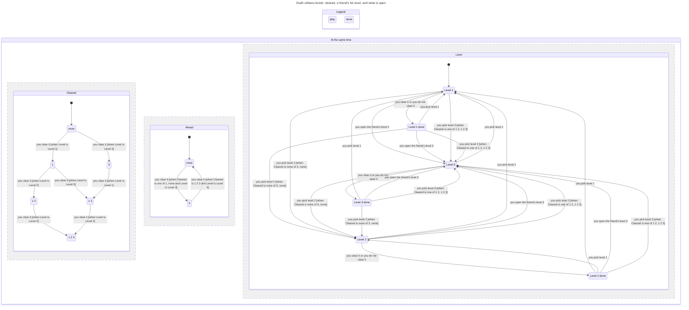

# দুধ উথলানোর আগে: statechart (after the rewrite)

Models: `Milk.tla` / `Milk.cfg` / `view.ts` (the play flow) and `Levels.tla` / `Levels.cfg` / `levels-view.ts` (the unlock rules).
Outputs: `before-fix/` (the old model, kept as the record of the four bugs), `after-fix/` (the new flow, every rule holds) and `after-fix-levels/`.
Mirrors `tools/dudh-uthlano/lib/session.ts`, `lib/round.ts`, `lib/step.hot.ts`, `lib/slot.ts`, `lib/levels.ts` and `components/game.tsx`.
TLC on `Milk.tla`: 336 states, 1506 steps; the chart draws 23 states and 59 arrows. On `Levels.tla`: 38 states.

## Systems modelled
| Region | Values | Code |
|---|---|---|
| Game | Title, Pot waiting, Milk rising, Pot's score shows, End screen | `Session.screen`, `Round.phase`, `begin()`, `press()`, `release()`, `liftNow()`, `stepRound()`, `finish()` |
| Choice | none, the player's menu, the level list | `Session.paused`, `Session.sheet`, `onPause`, `onResume`, `openSheet`, `closeSheet`, `pickLevel` |
| Window | on the page, another window has focus, tab hidden | `blur`, `focus`, `visibilitychange` (the shared `useGameLoop` also stops on both) |
| Hand | holding Space or a finger, hands off, a breath after coming back | `Session.held`, `Session.stale`, `Session.breath`, `HOLD_MS` |
| Hum | stove hums, no hum | `syncHum()` after every event, `voice` in `components/game.tsx` |
| Sound | on, off | the site-wide switch (`setSound`) |
| Celebration | confetti queued, nothing queued | `createSlot` (`timers.party`), cancelled by `begin()`, `takeLink()`, the player's pause and unmount |
| Link | none, friend's pots, another level | `takeLink()`, `parseShared()`, `again()` (a friend's seed stays only for the same level) |
| Levels (own spec) | cleared, a friend's far level kept in `ahead`, the open level | `openLevel()`, `nextAhead()`, `levels.record()` |

Abstracted: the pot count and the foam curve (`tests/pots.test.ts`, `tests/levels.test.ts` with headless bots), the story panels (part of Title), the doorbell (a banner with its own cancelled timer), and `shared/game-core.ts` `unlockedLevel()`, which is left as it is on purpose.

## Rules (plain words; all hold in `after-fix/`)
- **PausedWhenAway:** milk never rises while the tab is hidden or the window is blurred: either the pot ticks, or it is marked and waits a breath on return.
- **InputReleasedWhenAway:** once you leave the window, open the menu or the list, the game no longer thinks Space or your finger is held.
- **ClickThatBringsFocusBackIsNotAMove:** during the breath after coming back, a press does nothing.
- **ChoiceFreezesPlay:** the menu and the level list stop the milk.
- **HumOnlyWhileHeating:** the stove hums only while milk is rising on a running, visible page with sound on.
- **HumComesBack:** whenever it should hum, it hums (sound back on, resume, focus back).
- **CelebrationOnItsOwnCard:** the confetti is only ever queued on the end screen, and a new round cancels it.
- **Levels.tla:** `OnlyOpenLevelsAreOurs`, `FriendFarLevelOpensNothingBetween`, `OpenLevelCoversWhatYouCleared`, `ClearedLevelsStayCleared`.
- **ReplayIsExact** (a friend's pots stay the friend's, for the same level only) moved out of the model into the pure `lib/run.ts` (`rivalOf`, `againRun`, `pickedRun`), tested in `tests/challenge.test.ts` ("ReplayIsExact: ..."): level, seed and old/new must all match before a seed is kept.

## Bugs
### 1. PausedWhenBlurred: "I held Space, clicked another window, and the milk boiled over while I was away."
Shared bug (kalbaishakhi and jhalmuri have it too; same family as antenna's DialStillWhileAway).
- Path (report): pot waiting → you press and hold চেপে ধরো → you click into another window. Milk keeps rising.
- Live replay (Orca, own tab; `keydown " "` on `window`, then `blur`):

  | step | phase | foam | pot clock | holding |
  |---|---|---|---|---|
  | holding Space | rising | 6% | 0.43 s | yes |
  | blur | rising | 6% | 0.43 s | yes |
  | 3 s in the other window | rising | 55% | 3.45 s | yes |
  | still away | result, **spilled** | 100% | 5.95 s | no |

  Pot 1 scored 0 (উথলে গেল) without the player ever seeing it.
- Fix (shared): pause on `window` `blur` exactly as on hide: `hold.current = null; setHolding(false); setPaused(true)` when the pot is rising. Note: the in-progress shared `useGameLoop` change (09:36 today, not yet committed) stops frames on blur, which stops the rise, but does **not** clear `hold`, so bug 2 survives it; and there is still no visible "paused" state, so on focus the milk carries on with no warning.

### 2. InputReleasedWhenAway: "After I came back, pressing Space did nothing; the pot only came off when I let go."
Game-specific (it lives in `press()`: `if (hold.current) return;`), triggered by the shared blur gap.
- Path (report): you press and hold → you click into another window (the keyup is lost there).
- Live replay: pot 2, Space held at 5%, blur for 0.6 s (14%), back at 18%, **press Space at 21%: ignored** (button still "ধরে রাখো…", still rising), still rising at 31% 0.6 s later, then **keyup lifts it at 31%**. The player pressed to lift at 21% and got 31%, a lift they didn't time.
- Fix: clear `hold` on blur (and on `pointercancel`/`lostpointercapture`, which the button already does), or in `press()` treat a press while `hold` is stale (keyup never seen) as a lift.

### 3. HumComesBack: "I turned sound off and on while the milk was on, and the stove went silent."
Shared bug (kalbaishakhi's wind, antenna's static).
- Path (report): press and hold → sound off → sound on.
- Live replay: pot 3, tap Space → rising, **1** live hum oscillator; sound off → **0**; sound on → **0**; 1 s later (foam 24%) → **0**. `hum.current` holds the stopped handle.
- Fix (shared): `<SoundToggle onChange={on => on && round.current.phase === "rising" && !paused && (hum.current = loop("hum", 92))} />`, or a self-restoring `loop()` in the kit.

### 4. CelebrationOnItsOwnCard: "I pressed পরের রান্নাঘর and the win fanfare and confetti burst over the new kitchen."
Shared pattern (kalbaishakhi, jhalmuri).
- Path (report): …last pot's score → the round ends and the card shows (celebration queued) → you press আরেকবার or পরের রান্নাঘর → Pot waiting, celebration still queued.
- Live replay: kitchen 1, pots 90 · 90 · 91 → card "রান্নাঘর ১ পার ★★★ ৯১% এই রান্নাঘরে নতুন রেকর্ড!" at +0 ms → Space (পরের রান্নাঘর) at **+682 ms** (the 0.6 s guard had passed) → kitchen 2, pot 1 waiting → at **+1102 ms** four oscillators (`sfx.win`) and the confetti canvas, over kitchen 2.
- Fix: keep the timer id; clear it in `begin()` and on unmount. Or move the guard to 1.2 s so the card's own celebration always finishes first (both is best: the guard protects against stray taps, the clear against the level list).

## Fixes and where each is replayed
| Bug | Fix | Node test (`tests/session.test.ts`) | Live replay (Orca, Pixel 9, dev hooks `window.__du`) |
|---|---|---|---|
| 1 PausedWhenBlurred | `Session.blur/hide/pause/openSheet` mark the pot stale and stop `ticking`; `step()` returns unless ticking; the player's menu opens on blur | "PausedWhenBlurred: you hold, click another window for three seconds, and the milk has not moved" | Level 2, hold at 0.4 s (foam 7.7%); blur: held false, menu open; 3 s of steps away: foam 7.7%, still rising (before: 55% then spilled); চালিয়ে যাও: breath 0.5 s |
| 2 InputReleasedWhenAway | blur clears `held`; `press()` refuses `held`; the breath ignores a press | "InputReleasedWhenAway: after you come back, a press lifts the pot at once ..." | A press in the breath: phase unchanged, held false; after the breath the clock moved 0.417 s; the next press lifted at 17.4% and scored 17 (a lift at the foam's own height, not 10 points later) |
| 3 HumComesBack | `syncHum()` runs after every event; `setSound` marks the hum gone, so sound-on starts a fresh one | "HumComesBack and HumOnlyWhileHeating: ..." | Lit: 1 hum oscillator (sawtooth, 92 Hz); menu: no hum; sound off then on in the menu; resume: a second, fresh hum while the milk rises |
| 4 CelebrationOnItsOwnCard | confetti lives in a `createSlot`, cancelled by `begin()`, `takeLink()`, pause and unmount | "CelebrationOnItsOwnCard: the confetti queued for a card never fires after you start the next round" | 95 and 95 (3 stars): staying on the card shows the confetti canvas; pressing আবার খেলো 250 ms after the card shows none |

## The chart (`after-fix/chart.mmd`)

```mermaid
---
title: "Dudh uthlano: screen, pot, window, hand, hum, celebration and link"
---
stateDiagram-v2
  direction LR
  state "Legend" as legend {
    lg0: wait
    lg1: play
    lg2: done
  }
  class lg0 blue
  class lg1 teal
  class lg2 blue
  state "At the same time" as all {
    state "Game" as r0 {
      s0: Title
      s1: Pot waiting on the stove
      s2: Milk rising
      s3: Pot's score shows
      s4: End screen
      [*] --> s0
      s0 --> s1: you tap the pot to start [when Choice is No menu or list and Window is You're on the page]
      s0 --> s1: you pick a level from the list [when Choice is Level list open and Window is You're on the page]
      s1 --> s0: a friend's link opens [when Window is You're on the page and Link is No friend's link]
      s1 --> s2: you press and hold the big button [when Choice is No menu or list and Window is You're on the page and Hand is Hands off]
      s2 --> s0: a friend's link opens [when Window is You're on the page and Link is No friend's link]
      s2 --> s3: the milk boils over [when Choice is No menu or list and Window is You're on the page and Hand is not Hands off, a breath after coming back]
      s2 --> s3: you let go after holding [when Choice is No menu or list and Window is You're on the page and Hand is Holding Space or a finger]
      s3 --> s0: a friend's link opens [when Window is You're on the page and Link is No friend's link]
      s3 --> s1: the next pot comes [when Choice is No menu or list and Window is You're on the page and Hand is not Hands off, a breath after coming back]
      s3 --> s4: the last pot is scored and the level is not cleared or the last pot is scored and the level is cleared [when Choice is No menu or list and Window is You're on the page and Hand is not Hands off, a breath after coming back]
      s2 --> s1: you pick a level from the list [when Choice is Level list open and Window is You're on the page and Hand is Hands off and Hum is No hum]
      s2 --> s3: you press the big button to lift the pot [when Choice is No menu or list and Window is You're on the page and Hand is Hands off]
      s4 --> s0: a friend's link opens [when Window is You're on the page and Link is No friend's link]
      s4 --> s1: you press play again or you press next level [when Choice is No menu or list and Window is You're on the page]
      s3 --> s1: you pick a level from the list [when Choice is Level list open and Window is You're on the page and Hand is Hands off]
      s4 --> s1: you pick a level from the list [when Choice is Level list open and Window is You're on the page]
    }
    --
    state "Choice" as r1 {
      s5: No menu or list
      s6: Level list open
      s7: Player menu open
      [*] --> s5
      s5 --> s6: you open the level list [when Window is You're on the page]
      s6 --> s5: you close the list
      s6 --> s5: you pick a level from the list [when Window is You're on the page]
      s5 --> s7: the player's menu opens [when Game is not Title and Window is You're on the page]
      s7 --> s5: you press resume
    }
    --
    state "Window" as r2 {
      s8: You're on the page
      s9: Another window has focus
      s10: Tab hidden
      [*] --> s8
      s8 --> s9: you click into another window
      s8 --> s10: you hide the tab
      s9 --> s8: you come back to the window
      s9 --> s10: you hide the tab
      s10 --> s8: the tab shows again
    }
    --
    state "Hand" as r3 {
      s11: Hands off
      s12: Holding Space or a finger
      s13: Hands off, a breath after coming back
      [*] --> s11
      s11 --> s12: you press and hold the big button [when Game is Pot waiting on the stove and Choice is No menu or list and Window is You're on the page and Hum is No hum and Celebration is Nothing queued]
      s12 --> s11: a friend's link opens [when Link is No friend's link]
      s12 --> s11: the milk boils over or you let go after holding [when Game is Milk rising]
      s12 --> s11: you click into another window or you hide the tab or you open the level list or the player's menu opens or you let go quickly
      s11 --> s13: you come back to the window [when Game is none of End screen, Title and Choice is No menu or list and Window is Another window has focus and Hum is No hum and Celebration is Nothing queued]
      s11 --> s13: the tab shows again [when Game is none of End screen, Title and Choice is No menu or list and Window is Tab hidden and Hum is No hum and Celebration is Nothing queued]
      s11 --> s13: you close the list [when Game is none of End screen, Title and Choice is Level list open and Window is You're on the page and Hum is No hum and Celebration is Nothing queued]
      s11 --> s13: you press resume [when Game is none of End screen, Title and Choice is Player menu open and Window is You're on the page and Hum is No hum and Celebration is Nothing queued]
      s11 --> s12: you press the big button to lift the pot [when Game is Milk rising and Choice is No menu or list and Window is You're on the page and Celebration is Nothing queued]
      s13 --> s11: a friend's link opens [when Link is No friend's link]
      s13 --> s11: the breath after coming back passes or you click into another window or you hide the tab or you open the level list or the player's menu opens
      s12 --> s11: the last pot is scored and the level is not cleared or the last pot is scored and the level is cleared [when Game is Pot's score shows and Hum is No hum]
    }
    --
    state "Hum" as r4 {
      s14: No hum
      s15: Stove hums
      [*] --> s14
      s14 --> s15: you press and hold the big button [when Game is Pot waiting on the stove and Choice is No menu or list and Window is You're on the page and Hand is Hands off and Sound is Sound on and Celebration is Nothing queued]
      s15 --> s14: a friend's link opens [when Link is No friend's link]
      s15 --> s14: you turn sound off or you click into another window or you hide the tab or you open the level list or the player's menu opens
      s15 --> s14: the milk boils over [when Hand is not Hands off, a breath after coming back]
      s15 --> s14: you let go after holding [when Hand is Holding Space or a finger]
      s14 --> s15: you turn sound on [when Game is Milk rising and Choice is No menu or list and Window is You're on the page and Sound is Sound off and Celebration is Nothing queued]
      s14 --> s15: you come back to the window [when Game is Milk rising and Choice is No menu or list and Window is Another window has focus and Hand is Hands off and Sound is Sound on and Celebration is Nothing queued]
      s14 --> s15: the tab shows again [when Game is Milk rising and Choice is No menu or list and Window is Tab hidden and Hand is Hands off and Sound is Sound on and Celebration is Nothing queued]
      s14 --> s15: you close the list [when Game is Milk rising and Choice is Level list open and Window is You're on the page and Hand is Hands off and Sound is Sound on and Celebration is Nothing queued]
      s14 --> s15: you press resume [when Game is Milk rising and Choice is Player menu open and Window is You're on the page and Hand is Hands off and Sound is Sound on and Celebration is Nothing queued]
      s15 --> s14: you press the big button to lift the pot [when Hand is Hands off]
    }
    --
    state "Sound" as r5 {
      s16: Sound on
      s17: Sound off
      [*] --> s16
      s16 --> s17: you turn sound off
      s17 --> s16: you turn sound on
    }
    --
    state "Celebration" as r6 {
      s18: Nothing queued
      s19: Confetti queued
      [*] --> s18
      s18 --> s19: the last pot is scored and the level is cleared [when Game is Pot's score shows and Choice is No menu or list and Window is You're on the page and Hand is not Hands off, a breath after coming back and Hum is No hum]
      s19 --> s18: a friend's link opens [when Window is You're on the page and Link is No friend's link]
      s19 --> s18: you press play again or you press next level [when Choice is No menu or list and Window is You're on the page]
      s19 --> s18: the confetti plays
      s19 --> s18: you pick a level from the list [when Choice is Level list open and Window is You're on the page]
    }
    --
    state "Link" as r7 {
      s20: No friend's link
      s21: Friend's pots
      s22: Another level open
      [*] --> s20
      s20 --> s21: a friend's link opens [when Window is You're on the page]
      s21 --> s22: you pick a level from the list [when Choice is Level list open and Window is You're on the page and Hand is Hands off and Hum is No hum]
      s21 --> s22: you press next level [when Game is End screen and Choice is No menu or list and Window is You're on the page and Hand is Hands off and Hum is No hum]
    }
  }
  class s4 blue
  class s15 teal
  class s19 blue
```


## The unlock rules (`after-fix-levels/chart.mmd`)


## Quality-bar gaps from the old game, and where each closed
1. **Pause:** the player's menu (P, Esc, the button, blur, hide) with চালিয়ে যাও, নতুন করে শুরু, কীভাবে খেলবে, শব্দ, ধীরে খেলো, সব লেভেল.
2. **Away and back:** one rule for every screen (`Session`), with a breath on return.
3. **First screen:** the pot itself is the start; a one-line promise per mode; the level's one new thing.
4. **Choices:** the level list is a numbered pausing choice screen, one line per level, the next marked এটা খেলো, locked rows with a lock shape; the end screen's choices are numbered with a recommended one.
5. **Danger:** an orange edge from 80% and a red pulsing one from 92% (steady in slow mode), plus the alarm tick; under a lid the glow still warns.
6. **Sound:** nine meaning sounds with the doorbell as signature, one hum that comes back, a three-note clear tune per world.
7. **HUD:** corners only; the caller's line and the score pop sit in the top of the scene, off the rim.
8. **End:** real stats, the count-up, the near-miss, a personal card and a replayable link.

## Regenerate
```sh
scripts/statechart.sh ai_docs/statecharts/dudh-uthlano/Milk.tla --view ai_docs/statecharts/dudh-uthlano/view.ts --out ai_docs/statecharts/dudh-uthlano/<new-folder>
scripts/statechart.sh ai_docs/statecharts/dudh-uthlano/Levels.tla --view ai_docs/statecharts/dudh-uthlano/levels-view.ts --out ai_docs/statecharts/dudh-uthlano/<new-folder>
```
