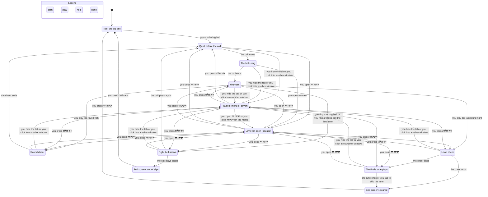

# ঘণ্টার সুর statechart

Two specs, both mirrored from the rewrite (`tools/ghontar-sur/lib/run.ts` and `components/bell-game.tsx`):
- `Ghontar.tla` / `Ghontar.cfg` / `view.ts`: the run, pause and focus, the সব লেভেল sheet, what is recorded and when. TLC: 267 states, 945 steps. Chart: `after-fix/chart.mmd` (12 states, 41 arrows). Report: `after-fix/report.md`. The first run (pots, before the rewrite) is kept in `before-fix/`.
- `GhontarLink.tla` / `GhontarLink.cfg` / `view-link.ts`: friend links. TLC: 15 states. Report: `after-fix/link/report.md`.

## What changed in the code because of the first run
The old game had a `pending` timer for the tune, the gap and the clear screen, and a separate `paused` flag, so a timer could outlive a pause. The rewrite has **one phase clock** (`spent`, `since`, `dur` in `run.ts`) that moves only while `why === null`, and `why` is `away` or `sheet`. There is nothing to cancel: "paused" and "nothing scheduled" are the same fact. Recording happens in the tap that decides the level (`finalize`), not behind a delay.

## Systems modelled
- **Play phase:** ready → lead → call → answer → (miss → lead) → cheer → (encore) → over. Two rounds, three slips, abstract counts.
- **Pause and focus:** tab visible or hidden, window focused or blurred, `why` (none, away, sheet), চালিয়ে যাও, the pause menu's সব লেভেল.
- **Choices:** the সব লেভেল sheet, picking a level, আবার খেলো, নতুন করে শুরু.
- **Recording:** `done` (won or lost) and `recorded`: the stars, the best and the open level are written once, the moment the last bell rings or the third slip lands.
- **Links (second spec):** a friend's level link (the level it names), an endless link, picking a level, playing again.
- Left out: sound (there is no loop; every note is a scheduled tone cut by the player's pause), the daily tune (the same paths as endless), the story, the rhythm grades.

## Rules in plain words
| Rule | Plain words | Result |
|---|---|---|
| PausedWhenHidden | A level in progress is paused while its tab is hidden. | holds |
| PausedWhenBlurred | It is also paused while you are in another window, so no bell rings to an empty room. | holds |
| NoProgressWhileAway | The clock, the call and the next round only move while you are on the page. | holds |
| ChoiceFreezesPlay | While সব লেভেল is open, nothing in the level advances. | holds |
| EveryClearIsRecorded | A level is recorded the moment it is decided, once, and never before. | holds |
| EveryClearIsShown | A cleared level always gets its cheer and its end screen, even if the tab hides on the last bell. | holds |
| NothingAfterTheCard | The end screen has nothing left to play and is only reached once the level is decided. | holds |
| ThirdSlipLoses | The third slip, and only the third, loses. | holds |
| ReadyIsFresh | The title is always a fresh level: round one, no slips, nothing decided. | holds |
| ReplayIsExact (link spec) | A friend's level link opens that level on its title. | holds |
| StartsAtTheFirstNote (link spec) | Every title, a friend's or your own, starts from the first note. | holds |
| TypeOK, NoDeadlock | | hold |

## The chart (after the fix)

The chart hides these steps: picking a level and restarting (a reset every state has), a friend's link from anywhere but the title, and coming back to the page (which does not resume; চালিয়ে যাও does).

## Bugs found in the first run, and how each is now fixed

Replays ran in Orca (my own tab) by reading the component's real React state (`PotGame` hooks: `game`, `cleared`, `paused`), counting `OscillatorNode.start` calls (each pot note is 2 oscillators), and tapping pots with `pointerdown` events.

**Orca limitation for hide/show:** Orca pins `document.hidden` to `false` (a non-configurable own property on every loaded document), so `visibilitychange` can't be faked on the page itself. For every hide step, the game ran inside a src-less iframe (which Orca doesn't patch), filled with the page's own HTML through `document.write`. It hydrated normally, and I controlled its `document.hidden`. Blur and focus were plain `window` events on the real page.

### 1. PausedMeansSilent: "the tune plays under the pause screen" (game-specific)
- **Path (report, 7 steps):** start → the tune ends → you finish a level's last tune → the clear screen shows → you hide the tab → you come back → you press পরের লেভেল: *Paused, but the tune plays*.
- **Why:** when the tab hides on the clear screen, the phase is already `listen`, so `hide()` pauses, and both overlays show. The clear screen sits on top (later in the DOM, same z-index). Its পরের লেভেল calls `nextLevel()` → `setCleared(null); playTune()` and never touches `paused`.
- **Live (level 1 cleared, 3 stars):** clear screen up `{phase: listen, round: 6, paused: false, cleared: true}` → hide → `{paused: true, overlays: [pause, clear]}` → show (same) → পরের লেভেল → `{paused: true, cleared: false}` → after 5.1 s: **12 oscillator starts (all 6 notes of round 6) under "থেমে আছে"**, phase `play`, and the status reads "এবার তুমি বাজাও · ০/৬" below the pause overlay. Tapping the right first pot is ignored (`at` stays 0). চালিয়ে যাও replays the whole tune again. Screenshot: `.shots/ghontar-sur-paused-but-your-turn.png`.
- **Fix:** `nextLevel()` returns early while `paused` (or calls `resume()`), and `hide()` drops the clear screen when it pauses (`setCleared(null)` and keep the stars), so only one overlay shows. Better still: one overlay state (`"none" | "paused" | "cleared"`).

### 2. EveryClearIsShown: "you cleared the level, but the clear screen never came" (game-specific)
- **Path (4 steps):** start → the tune ends → you finish a level's last tune → you hide the tab: *Paused, clear screen skipped*.
- **Why:** the "level" outcome saves the stars at once, but shows the clear screen from a 300 ms `later()`. `hide()` sees phase `listen` and calls `clearTimers()`, which kills that timer. `resume()` then starts the next tune.
- **Live:** autopilot repeated 5 tunes. On the last tap of the 5th, the tab hid at once: `{phase: listen, round: 6, score: 5, paused: true, cleared: null}`. Storage already had `{"1":3}`. Back on the tab, চালিয়ে যাও → `{paused: false, cleared: null}`. The HUD jumps to "লেভেল ২ · বাঁশির দোকান" with no bell, no stars and no পরের লেভেল.
- **Fix:** set `cleared` synchronously in `hitPot` (delay only the bell and the star chimes), or have `hide()` turn a pending clear into `setCleared(...)` before it clears timers.

### 3. PausedWhenBlurred / NoProgressWhileAway: "the tune played while I was in another window" (shared)
- **Path (2 steps):** start → you click into another window: *The tune plays, you're away*.
- **Why:** the game listens only to `visibilitychange`. A blur doesn't pause, and the tune timers keep firing.
- **Live:** started round 1 and blurred at once. 1.6 s later: 2 oscillator starts (the round's note), phase `listen` → `play`, status "এবার তুমি বাজাও · ০/১", no overlay. On longer rounds (6+ notes at level 2), a whole tune plays to nobody.
- **Fix (shared):** the shared player's blur/hide handler pauses real-time play. Here that means `window` `blur` → `clearTimers(); setPaused(true)` during `listen` (during `play` nothing runs on its own, so it's optional).

### 4. ChoiceFreezesPlay: "the tune played while I was picking a level" (shared)
- **Path (2 steps):** you open সব লেভেল → you press শুরু করো: *The tune plays, level list open*. You can also open the list while the tune plays.
- **Live:** `details.gs-levels` open, শুরু করো, 1.6 s later: phase `play`, 2 oscillator starts, list still open.
- **Fix (shared):** the level list belongs in the shared pause menu (সব লেভেল). Opening it pauses, like any other choice.

### 5. ReplayIsExact: "my friend started at level 2, but the link started me at level 1" (game-specific)
- **Path (1 step):** a friend's link opens: *Friend's tune ready, from level ১*.
- **Why:** the link is `#s=<seed>&t=<score>&n=<name>`. It doesn't carry `from`, and `setUp(found.seed)` always starts at level 1. A run started from the level list (round 6, 11, …) can be shared, and the friend must then play every round below it under the same 3-mistake budget.
- **Live:** picked level 2 (`from: 2, round: 6`), repeated rounds 6 and 7, then slipped 3 times → `{from: 2, score: 7, seed: 241554142}`. Opened `/ghontar-sur#s=241554142&t=7` → `{mode: friend, from: 1, round: 1}`, HUD "লেভেল ১ · মেলার গেট", banner "এক বন্ধু ৭টা সুর মনে রেখে বাজিয়েছে।". The same gap shows on this phone: the result said "তোমার সেরা ৭" for a level-1 run, though the 7 came from a run that started at round 6.
- **Fix:** add `f=<from>` to the link (`challengeHash` `extra`) and to `Shared`. `parseShared` reads it (1..10), and `setUp(seed, from)`. Also keep the best per start level, or only count runs from level 1.

### Rules that hold, checked live
- **PausedWhenHidden:** hiding during `listen` → `{paused: true}` with the overlay "থেমে আছে। চালিয়ে গেলে সুরটা আবার শুনবে।" (in the iframe).
- **NothingAfterTheCard:** the 3rd slip leads to `over` with no tune pending. আরেকবার starts a fresh `begin()`.


## Where each bug is replayed and fixed
Every replay is a node test in `tools/ghontar-sur/tests/rewrite.test.ts`, against the pure reducer, plus a pin on the component code that carries the fix.
| # | Bug | Fix | Test |
|---|---|---|---|
| 1 | The tune played under the pause screen (two overlays stacked). | One phase clock; the cheer carries on only after চালিয়ে যাও; the component draws its own cover only outside the player. | `bug 1 · PausedMeansSilent` |
| 2 | A cleared level's clear screen never came after a hide. | The last tap decides the level and calls `finalize` synchronously; hiding changes nothing but `why`. | `bug 2 · EveryClearIsShown` |
| 3 | The tune played while you were in another window. | `window` `blur` and a hidden tab both call `pauseFor("away")`; the call restarts from its lead-in on return. | `bug 3 · PausedWhenBlurred` |
| 4 | The tune played while the level list was open. | The sheet is a pause (`why: "sheet"`), reached from the badge and from the player's menu (`onLevels`). | `bug 4 · ChoiceFreezesPlay` |
| 5 | A friend's link started at level 1. | A level link carries `l` and `v=2` and opens that level and tune; an endless link starts at the first note. | `bug 5 · ReplayIsExact` |

## Live checks (Orca)
- **Blur and resume (live):** in the game, `blur` during a call opened the player's menu with the phase still `call`; 3.5 s later 0 oscillator starts. চালিয়ে যাও put it back at `lead`, and 2 notes (6 oscillator starts) rang in the next 2.8 s.
- **Answer speed (live):** pointer-down to the bell's `data-lit` attribute: 2.4–7 ms; to the next frame 9.6–27.8 ms.
- **Slow mode (live):** the call's gaps were 1.5× the normal beat (780 ms for a 520 ms beat, 1560 ms for a rest), and no swing animation ran.
- **Every note is also seen:** each note is 3 oscillator starts and a lit, swinging bell (`data-lit`), counted in the same run.

## Regenerate
```sh
scripts/statechart.sh ai_docs/statecharts/ghontar-sur/Ghontar.tla --view ai_docs/statecharts/ghontar-sur/view.ts --out ai_docs/statecharts/ghontar-sur/after-fix
scripts/statechart.sh ai_docs/statecharts/ghontar-sur/GhontarLink.tla --view ai_docs/statecharts/ghontar-sur/view-link.ts --out ai_docs/statecharts/ghontar-sur/after-fix/link
rm -f ai_docs/statecharts/ghontar-sur/after-fix/tlc.out ai_docs/statecharts/ghontar-sur/after-fix/link/tlc.out
```
