# ঘড়ি দেখি: statechart

The game was rewritten on 2026-11-05 (design: `ai_docs/game-dev/rewrites/ghori-dekhi.md`). `Ghori.tla` / `.cfg` / `view.ts` model the new code: **TLC 432 states, 2,648 steps; every rule holds** (`after-fix/`). The model of the old code, and its run with the broken rules, are in `before-fix/` (`Ghori.tla`, `.cfg`, `view.ts`, `report.md`, `chart.mmd`). The parent gate and the rest screen's gate are the shared kit's, modelled for the same component in `ai_docs/statecharts/kar-chinho/KarChinhoGates.tla`.

Mirrored from `tools/ghori-dekhi/lib/session.ts` (screens, ▶, pause, rest, keys), `lib/drag.ts` (the finger on a hand), `components/face.tsx` (`gate()`, `stopTurn()` on blur, hide and pause), `components/game.tsx` (`begin()`, `solved()`, `useGamePlayer`) and `shared/kids-kit.tsx`.

## Rules (plain words), all holding after the fix
| Rule | Plain words |
|---|---|
| NoDoubleResult | A round ends and is recorded once: one win sound, one `atBreak`, one write of the stars. |
| InputReleasedWhenAway | After you switch windows, no finger counts as holding a hand. |
| HandMovesOnlyUnderAFinger | A hand moves only while a finger or the mouse button is down on it. |
| NothingHeldOffTheClock | A hand is never held on a solved item or the end screen. |
| RestOnlyAtBreak | The rest screen comes only between rounds, never over an item. |
| NoNewRoundPastLimit | Past today's limit, খেলো, আবার খেলো and a level show the rest screen, not a round. |
| EveryFinishCounts | Once the last item is right, its stars are saved and the limit checked in that same tap. |
| NothingMovesUnderTheMenu | ▶ and the end screen wait while the pause menu is open. |
| ChoiceFreezesPlay | The level list holds no solved item under it. |
| ResultNeedsFreshPress | A key held through the last answer never skips ▶ or starts the next round. |

Old rules replaced: **NoReadingNeeded** is about what the screen draws, so it is a node test (`tests/kids.test.ts`) and a live check, not a state rule. **GateNeedsAFullHold, ChildCannotOpenGate, NoWayOutWithoutGate** were shared-kit bugs, now fixed there (`kids-kit`, the kids frame of `GamePage`). **NoNetwork** and **NoChildData** hold by a source test (no `fetch`, no `/api/`, no input).

**Model check (mutations, in a scratch copy):** letting ▶ run on the end screen with the item still solved (the old hidden শেষ দেখো button) breaks **NoDoubleResult** in 6 steps. Not dropping the gesture on blur breaks **InputReleasedWhenAway** in 3. Letting a hover follow a held hand breaks **HandMovesOnlyUnderAFinger**.

## The bugs, and how each was fixed
| # | Bug (the reader's sentence) | Fix | Node test | Live check after the fix (Orca, Pixel 9) |
|---|---|---|---|---|
| 1 | **NoDoubleResult:** "On the end card I pressed Enter again and the win tune played again, and again." | The last ✓ records the round once (`session.solve`). ▶ opens the end screen once and clears the solved flag; the item's buttons are unmounted on the end screen, so no hidden শেষ দেখো is left to press. Keys: a fresh press only. | `session.test.ts` › bug 1, 1b, result keys need a fresh press | Level ২ finale: ✓ on the last item wrote the stars once; Enter → end screen (14 tone starts, one write); then two repeating Enters and a repeating Space: still the end screen, no new write, no new tone. |
| 2 | **InputReleasedWhenAway / HandMovesOnlyUnderAFinger:** "I turned the big hand, switched windows, and when I came back it followed my mouse without my pressing." | `drag.move()` drops the gesture when no button is down (`buttons & 1 === 0`); `face.tsx` ends the turn (the hand clicks in) on blur, hide, pointercancel, lost capture and the player's pause; a new item drops the gesture; the first tap back only wakes the game. | `hands.test.ts` › bug 2, and the gesture rules | Dragged the long hand 270° → 330°, `blur`: the hand clicked to 360° and the turn ended (the player's menu opened); two hovers with `buttons: 0` left it at 360°. |
| 3 | **NoReadingNeeded:** "My 5-year-old can't read 'সাড়ে ৮টা', and there's no picture to show what time to make." | The target is a picture: a small clock beside the sky (the sun's place) and the words. Read cards have their own small clock. In world 4 the clock comes after a first slip (a wrong card shows its own). Level ১ has one hand. The first item shows the ghost finger. ✓ and ▶ are 96 px picture buttons; end buttons 112 px with icons. No voice. | `kids.test.ts` › bug 3, no voice, big buttons; `levels.test.ts` › the target picture | Screens: `.shots/ghori-dekhi-s360.png` (target clock, ✓), `-read360.png`, `-set320.png`. |
| 4 | **RestOnlyAtBreak, gate bugs, NoWayOutWithoutGate** | Shared kit (already fixed there). Here `begin()` and the last ✓ call `kids.atBreak()`; the rest screen shows on every screen but play. | `session.test.ts` › RestOnlyAtBreak | Covered by the kit's own checks. |
| — | **Pause on blur** (shared pattern) | The player owns it; `onPause` drops drags; the first tap back only wakes; `onLevels` gives সব লেভেল. | `session.test.ts` › the first tap back, nothing counts under the menu | Blur → the player's menu (সব লেভেল listed) → চালিয়ে যাও: `paused` false, swallow cleared after the breath. |

## Quality-bar gaps closed
First screen (a clock with turning hands and ▶ খেলো), picture target, smooth drag with a click-in and tick, hints that teach (wobble, ring on the number, the pie of the hour, ghost hands after two slips), 4 worlds with named finales, one phone screen (fits 320 × 568), the player's pause, picture end buttons, count-up end screen. See the design doc.

## The chart (after the fix)

```mermaid
---
title: "ঘডfl°°2492¶ßfl°°2495¶ß দfl°°2503¶ßখfl°°2495¶ß: screens, the clock under a finger, fl°°9654¶ß, pause, the daily limit and keys"
---
stateDiagram-v2
  direction LR
  state "Legend" as legend {
    lg0: play
    lg1: held
  }
  class lg0 teal
  class lg1 yellow
  state "At the same time" as all {
    state "Round" as r0 {
      s0: The clock (খ#2503;ল#2507;)
      s1: The level list
      s2: First item
      s3: Item right, #9654; waits
      s4: Last item
      s5: Last item right, stars saved, #9654; waits
      s6: The day's clocks (আব#2494;র খ#2503;ল#2507; / শ#2503;ষ)
      [*] --> s0
      s0 --> s1: the level list opens [when Window is not Pause menu open and Today is not Rest screen]
      s0 --> s2: the child taps খ#2503;ল#2507; or আব#2494;র খ#2503;ল#2507; [when Window is not Pause menu open and Today is Time left today]
      s1 --> s0: the page opens again
      s1 --> s2: the child picks a level [when Window is not Pause menu open and Today is Time left today]
      s2 --> s0: the page opens again
      s2 --> s1: the level list opens
      s2 --> s3: #10003; or the right card [when Hand is Hands at rest and Window is not Pause menu open]
      s3 --> s0: the page opens again
      s3 --> s1: the level list opens
      s3 --> s4: #9654; [when Window is not Pause menu open]
      s1 --> s0: the child picks a level [when Window is not Pause menu open and Today is Today's time is up]
      s1 --> s0: নত#2497;ন কর#2503; শ#2497;র#2497;, or শ#2503;ষ [when Window is Pause menu open]
      s2 --> s0: নত#2497;ন কর#2503; শ#2497;র#2497;, or শ#2503;ষ [when Hand is Hands at rest and Window is Pause menu open]
      s4 --> s0: the page opens again
      s4 --> s1: the level list opens
      s4 --> s5: #10003; or the right card [when Hand is Hands at rest and Window is not Pause menu open]
      s3 --> s0: নত#2497;ন কর#2503; শ#2497;র#2497;, or শ#2503;ষ [when Window is Pause menu open]
      s5 --> s0: the page opens again
      s5 --> s1: the level list opens
      s5 --> s6: #9654; [when Window is not Pause menu open]
      s4 --> s0: নত#2497;ন কর#2503; শ#2497;র#2497;, or শ#2503;ষ [when Hand is Hands at rest and Window is Pause menu open]
      s6 --> s0: the page opens again
      s6 --> s2: the child taps খ#2503;ল#2507; or আব#2494;র খ#2503;ল#2507; [when Window is not Pause menu open and Today is Time left today]
      s6 --> s1: the level list opens [when Window is not Pause menu open and Today is not Rest screen]
      s6 --> s0: নত#2497;ন কর#2503; শ#2497;র#2497;, or শ#2503;ষ [when Window is Pause menu open or Today is one of Time left today, Today's time is up]
      s5 --> s0: নত#2497;ন কর#2503; শ#2497;র#2497;, or শ#2503;ষ [when Window is Pause menu open]
    }
    --
    state "Hand" as r1 {
      s7: Hands at rest
      s8: A finger turns a hand
      [*] --> s7
      s7 --> s8: a finger goes down on the clock [when Round is one of First item, Last item and Window is Playing and Today is one of Time left today, Today's time is up]
      s8 --> s7: the page opens again or the finger comes up, the hand clicks in or the level list opens or the window blurs: the menu opens, the turn ends or #9208;, P or Escape
    }
    --
    state "Window" as r2 {
      s9: Playing
      s10: Pause menu open
      s11: Another window
      [*] --> s9
      s9 --> s10: the window blurs: the menu opens, the turn ends or #9208;, P or Escape
      s10 --> s9: the page opens again or নত#2497;ন কর#2503; শ#2497;র#2497;, or শ#2503;ষ or চ#2494;ল#2495;য#2492;#2503; য#2494;ও
      s10 --> s11: নত#2497;ন কর#2503; শ#2497;র#2497;, or শ#2503;ষ or চ#2494;ল#2495;য#2492;#2503; য#2494;ও
      s11 --> s9: the page opens again or the window comes back
      s11 --> s10: #9208;, P or Escape
    }
    --
    state "Today" as r3 {
      s12: Time left today
      s13: Rest screen
      s14: Today's time is up
      s15: Time's up, the rest waits for the end
      [*] --> s12
      [*] --> s13
      s12 --> s14: today's play time runs out
      s13 --> s12: a grown-up gives আজ আরও ১০ ম#2495;ন#2495;ট
      s14 --> s13: the page opens again
      s14 --> s13: the child taps খ#2503;ল#2507; or আব#2494;র খ#2503;ল#2507; [when Round is one of The clock (খ#2503;ল#2507;), The day's clocks (আব#2494;র খ#2503;ল#2507; / শ#2503;ষ) and Hand is Hands at rest and Window is not Pause menu open]
      s14 --> s13: the child picks a level [when Round is The level list and Hand is Hands at rest and Window is not Pause menu open]
      s14 --> s15: #10003; or the right card [when Round is Last item and Hand is Hands at rest and Window is not Pause menu open]
      s15 --> s13: the page opens again or the level list opens
      s15 --> s13: #9654; [when Window is not Pause menu open]
      s15 --> s13: নত#2497;ন কর#2503; শ#2497;র#2497;, or শ#2503;ষ [when Window is Pause menu open]
    }
  }
  class s2 teal
  class s3 teal
  class s4 teal
  class s5 teal
  class s8 teal
  class s13 yellow
  class s15 teal
```


## Regenerate
```sh
scripts/statechart.sh ai_docs/statecharts/ghori-dekhi/Ghori.tla --view ai_docs/statecharts/ghori-dekhi/view.ts --out ai_docs/statecharts/ghori-dekhi/after-fix
```
