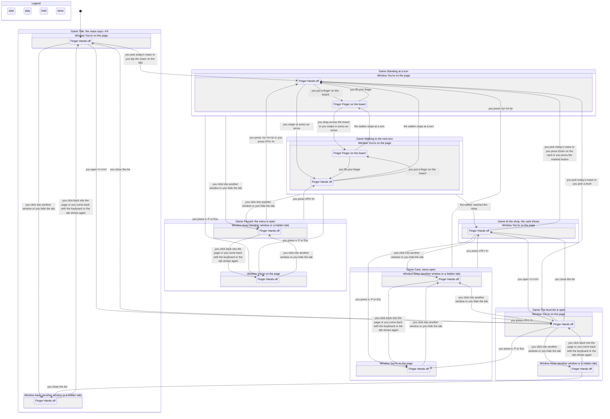
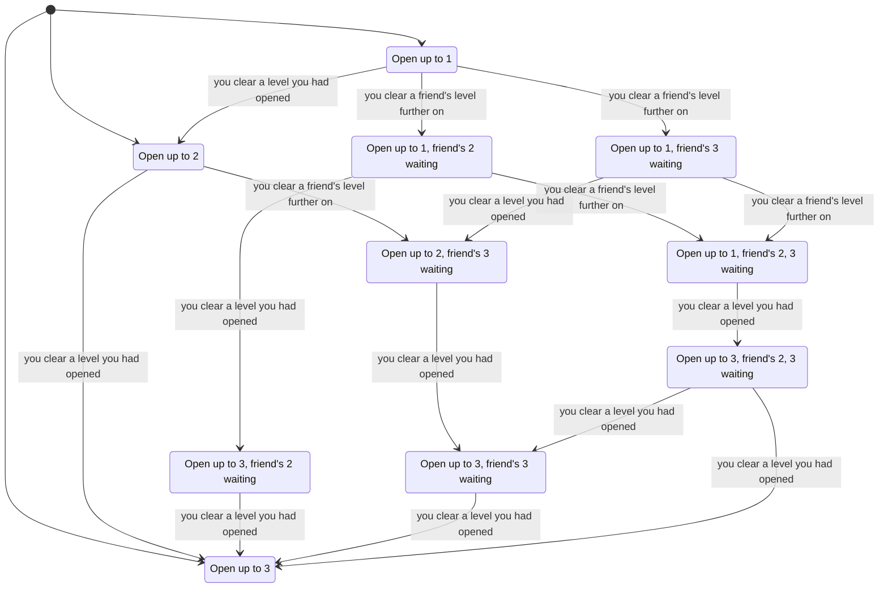

# গোলকধাঁধা: statechart

Two halves:
- **before-fix/**: the model of the shipped game, which found four bugs (the analysis is kept below, under "Before the rewrite"). The old spec is in git history (`Golokdhadha.tla` at a03ce2a).
- **after-fix/**: the model of the rewrite (Nov 2026), where every rule holds, plus `after-fix/unlock/` for the level unlock.

## Files
| File | What |
|---|---|
| `Golokdhadha.tla`, `Golokdhadha.cfg`, `view.ts` | The rewrite: screens, the shared player's menu, window focus, the finger on the board, the wake-up click, ধীরে খেলো, the level list, the end screen's keys. |
| `unlock/Unlock.tla`, `Unlock.cfg`, `view.ts` | Which levels open with a friend's link in the mix (3 levels stand in for 30). The same rule as অ্যান্টেনা ঠিক করো's, so the same spec. |
| `after-fix/report.md`, `chart.mmd` | 496 states, 2988 steps; all 13 rules (and NoDeadlock) hold. |
| `after-fix/unlock/` | 22 states; all 4 rules hold. |

**What the model mirrors:**
- `tools/golokdhadha/components/golokdhadha-game.tsx`: `begin`, `finish`, the blur/focus/visibility effect, the key handler, `onPointerDown/Move/Up`, and `useGamePlayer`'s `onPause`, `onResume` and `onRestart`;
- `lib/session.ts`: `ticking`, `blur`, `hide`, `pause`, `resume`, `pointerDown`, `pointerMoves`, `openSheet`, `freshResultKey`;
- `lib/choices.ts`: `endChoices` and `choiceForKey`;
- `shared/game-player-client.tsx`: blur, hide, Esc and ⏸ open the menu once the game is touched; চালিয়ে যাও and নতুন করে শুরু send a focus first.

The walker's own rules (swipes, turning back, buffered turns, gates, currents, rides) are in `tests/game.test.ts`; the model only needs "walking or standing". There are no sound loops: every sound is a one-shot or scheduled `tone()` that the pause cuts.

## Before → after
| | Before | After |
|---|---|---|
| Page | Its own hero, `#tool`, its own pause overlay | `<GamePage>`; the game reads `useGamePlayer()` for pause, resume, restart and the stage. |
| Window blur | Nothing: the clock ran on. | `session.blur` lets go, the player opens its menu, `step()` runs only while `ticking`. |
| A finger let go elsewhere | `drag` stayed set; a plain mouse move steered. | Blur and hide clear `drag`; `pointerMoves` wants the same pointer and, for a mouse, a held button. |
| The click back into the window | (not modelled) | Within 0.5 s of focus, `pointerDown` answers "wake" and nothing moves. |
| ধীরে খেলো mid-run | Changed `par` at once: slower time, more stars. | Speed and par are fixed in `createGame`/`begin`; `finish` grades with `parOf(game.where, game.mode, game.slow)`. Links carry `w=1`. |
| Enter on the card | `again()` on the daily, while the button said লেভেলে ফেরো. | `endChoices` decides once; the marked button and Enter both run choice ১, and only a fresh press counts. |

## Rules (plain words)
| Rule | The reader's sentence | Before | After |
|---|---|---|---|
| NoProgressWhileAway | The clock and the walker move only while you're on the page. | **broke** | holds |
| PausedWhenHidden | Hiding the tab pauses a run. | held | holds |
| PausedWhenBlurred | Clicking into another window pauses a run. | **broke** | holds |
| InputReleasedWhenAway | Once you leave the window or open the menu, no finger counts as held. | **broke** | holds |
| NoSteeringWithoutAPress | The walker moves only when you press, swipe or tap, never on a plain mouse move. | **broke** | holds |
| ClickBackIsNotAMove | The click that brings the window back never steers. | (new) | holds |
| WalkerStillUnlessPlaying | The walker never walks on the title or the card. | held | holds |
| StarsMatchYourSpeed | Your stars come from the speed the run began with. | **broke** | holds |
| EnterDoesWhatTheButtonSays | Enter on the card does what the marked button says. | **broke** | holds |
| ResultKeyNeedsFreshPress | A key held through the arrival never skips the card. | (new) | holds |
| ChoiceFreezesPlay | While the level list is open, nothing runs. | (new) | holds |
| NoDoubleResult | A run is recorded once. | (new) | holds |
| UnlockNeverShrinks, FriendOpensNoGap, FriendStarsKept (unlock) | What you could pick never shrinks; a friend's far level opens no gap and keeps its stars. | (new) | hold |

**Mutation check** (in `scratchpad`, not kept): blur not letting go breaks InputReleasedWhenAway and NoSteeringWithoutAPress; grading with the menu's `slow` breaks StarsMatchYourSpeed; accepting a repeat breaks ResultKeyNeedsFreshPress; no menu on blur breaks PausedWhenHidden and PausedWhenBlurred; and with no menu, no wake guard and a `ticking` that ignores focus, NoProgressWhileAway and ClickBackIsNotAMove break too. The rules are not vacuous.

## Bugs, fixed
1. **The clock runs while you're in another window.** Fixed by `session.blur` and the player's menu; `step()` checks `ticking`.
   - Tests: `statechart NoProgressWhileAway / PausedWhenBlurred…`, `statechart PausedWhenHidden…`.
   - Live after (Orca, Pixel 9, level 22): `blur` mid-run → menu open, `paused` true, `drag` null; the clock read 17.7 s and still 17.7 s 2 s later. চালিয়ে যাও → 18.45 s 0.8 s later. P opens the same menu; নতুন করে শুরু gives a fresh walk at 0.0 s.
2. **A plain mouse move steers after you let go in another window.** Fixed by clearing `drag` on blur, hide and pause, and `pointerMoves` (button held, same pointer).
   - Tests: `statechart InputReleasedWhenAway / NoSteeringWithoutAPress…`, `statechart ClickBackIsNotAMove…`.
   - Live after: `pointerdown` (buttons 1) → `drag` 7 → `blur` → `drag` null, menu open → চালিয়ে যাও → two `pointermove`s with buttons 0 (+40 px down, +40 px right) → phase still `ready`, clock 0.0, walker at home.
3. **ধীরে খেলো near the shop gives more stars for a slower time.** Fixed: the speed is read once in `createGame`, `finish` grades with the run's own par, and a slow run's link says `w=1` and must match the slow par exactly.
   - Tests: `statechart StarsMatchYourSpeed…`; in `levels.test.ts`, `bots: ধীরে খেলো never makes stars easier…`.
   - Live after: a run started at full speed, then `ektukhani-slow` set to 1 with the settings event mid-run → `game.speed` 14, `game.slow` false.
4. **Enter on the card doesn't do what the gold button says.** Fixed by `endChoices` (one list the buttons and keys share).
   - Test: `statechart EnterDoesWhatTheButtonSays…`.
   - Live after: today's maze finished → the marked button read "লেভেলে ফেরো"; a fresh Enter → the play screen on a level (26), not the daily.

**Smaller findings, fixed:**
- The clock and the card now share `tenthsOf` (test: `the clock and the card agree…`).
- A broken link opened in place now clears the old friend: `hashchange` sets the friend to whatever `parseShared` returns, `null` included.
- Shared patterns:
  - P calls `player.requestPause()`;
  - result keys need a fresh press (`result keys need a fresh press…`);
  - the level list pauses (`ChoiceFreezesPlay…`);
  - a friend's far level opens no gap (`this phone's unlock…`, and the unlock model);
  - buttons blur after a click and game keys are handled at `window`.

## The chart (after-fix)


## The unlock chart (after-fix/unlock)


## Regenerate
```sh
scripts/statechart.sh ai_docs/statecharts/golokdhadha/Golokdhadha.tla --view ai_docs/statecharts/golokdhadha/view.ts --out ai_docs/statecharts/golokdhadha/after-fix
scripts/statechart.sh ai_docs/statecharts/golokdhadha/unlock/Unlock.tla --view ai_docs/statecharts/golokdhadha/unlock/view.ts --out ai_docs/statecharts/golokdhadha/after-fix/unlock
find ai_docs/statecharts/golokdhadha/after-fix -name tlc.out -delete
```

---

# Before the rewrite

Spec: `Golokdhadha.tla` + `Golokdhadha.cfg`. View: `view.ts`. Output: `before-fix/report.md` and `before-fix/chart.mmd`. The model has 420 states and the chart is drawn.

The model mirrors `tools/golokdhadha/components/maze-game.tsx` as it is on `games-to-the-bar`. It covers `go`, `walkTo`, `begin`, `step`, `finish`, the `[maze, round]` reset effect, the `visibilitychange` handler `hide`, `resume`, `keyHandler` and `onPointerDown/Move/Up/Cancel`. It also mirrors `shared/game-kit.ts`: `useGameLoop` stops while the tab is hidden, and `useLevels.record` keeps the higher stars.

## Systems modelled
- **Play phase:** ready → playing (walking, or standing at a junction with the clock running) → paused → over. The game has no lose state.
- **Window:** focused, blurred (another window has focus) or hidden. Only `hide` pauses the game, and it pauses only a run that is playing.
- **Input:** a finger or mouse held on the board (`drag`), and the case where the button came up somewhere else but `drag` is still set. Arrow keys, the pad and taps each start one run to the next junction, so no key counts as held.
- **Speed:** ধীরে খেলো, and whether any part of this run was walked at full speed. `par` is recomputed from the current `slow` on every render.
- **Card keys:** which maze it is (a level or today's maze), and whether Enter on the card did what the gold button says.
- **Sound:** no loops. The footsteps, bump, bell and star chimes are one-shot tones, so `LoopOnlyWhenMeaningful` and `LoopComesBack` don't apply.

Left out to keep the chart under 500 states. Both hold:
- **Star-chime timeouts:** the `[maze, round]` effect clears them. Live check: finish level 1 and press আবার খেলো at once. The finish played tones `[470, 1760, 2637, 1568, 2349]`, and no tone played in the next 2.5 s.
- **Saved stars:** `recordLevel` only raises stars, which covers StarsNeverDrop and UnlockNeverShrinks. Tests: `shared/tests/game-kit.test.ts` and `tools/golokdhadha/tests/golokdhadha.test.ts` ("this phone's progress goes through readLevels and recordLevel").

## Rules (plain words)
| Rule | In plain words | Result |
|---|---|---|
| NoProgressWhileAway | The clock and the walker move only while you're on the page. | **breaks** |
| PausedWhenHidden | Hiding the tab pauses a run. | holds |
| PausedWhenBlurred | Clicking into another window pauses a run. | **breaks** |
| InputReleasedWhenAway | Once you leave the window, no finger or mouse counts as held. | **breaks** |
| NoSteeringWithoutAPress | The walker moves only when you press, swipe or tap, never when the mouse just moves. | **breaks** |
| WalkerStillUnlessPlaying | The walker never walks on the card or before the start. | holds |
| StarsMatchYourSpeed | Your stars come from the speed you actually walked at. | **breaks** |
| EnterDoesWhatTheButtonSays | Enter on the card does what the gold button says. | **breaks** |
| TypeOK, NoDeadlock | (structural) | hold |

Result: 3 rules held (plus TypeOK and NoDeadlock) and 6 broke.

## Bugs

### 1. The clock runs while you're in another window (NoProgressWhileAway, PausedWhenBlurred)
- **Player:** "I clicked over to WhatsApp Web for a moment, and the clock kept running and cost me a star."
- **Path:** press an arrow → click into another window. The game stays in `playing`, and `step()` keeps adding to `elapsed` and moving the walker.
- **Live replay (Orca, level 1):** with `document.hasFocus()` false, the clock went ৯.৬ → ১১.৭ in 2 s while focused. After `blur`, it went ১১.৭ → ১৩.৭ in 2 s. No overlay appeared and the phase stayed `playing`. In a first replay, the clock read ০.০ at blur and ২.২ three seconds later, still playing.
- **Fix:** pause on `window` `blur` the same way `hide` pauses: `state.phase = "paused"`. Also add a pause key (P/Esc) and a pause button. This should be the shared away-handling hook every real-time game uses.
- **Scope:** **shared.** `useGameLoop` and every game that copied the `visibilitychange`-only pause have the same gap.

### 2. A plain mouse move steers the walker after you let go in another window (InputReleasedWhenAway, NoSteeringWithoutAPress)
- **Player:** "I came back to the tab and the walker started walking when I only moved my mouse."
- **Path:** put the mouse down on the board → click into another window → let go there (the page never gets `pointerup`) → come back → move the mouse. `onPointerMove` checks only `pointerId`, never `buttons`. Nothing clears `drag` on blur or hide.
- **Live replay (Orca, level 1, synthetic pointer events):**
  1. `আবার শুরু`: phase ready, clock ০.০.
  2. `pointerdown` (buttons 1), then `blur` and `focus`: still ready, ০.০.
  3. Two `pointermove` events with **buttons 0** (+40 px down, then +40 px right): phase **playing**, clock ০.৫, status "মোড়ে এসে থামবে…". The walker walked.
- **Fix:**
  - Clear `drag.current` on `blur`, on `visibilitychange`, and on `lostpointercapture`.
  - In `onPointerMove`, ignore mouse events with `event.buttons === 0`.
- **Scope:** game. Check other canvas drag games for the same pattern.
- **Note:** a real lost `pointerup` depends on the browser and OS. The code relies on it entirely.

### 3. Turning on ধীরে খেলো near the shop gives more stars for a slower time (StarsMatchYourSpeed)
- **Player:** "I got 2 stars at full speed. Then I switched on ধীরে খেলো just before the shop and got 3 stars for a slower time."
- **Path:** press an arrow (full speed) → press ধীরে খেলো → the walker reaches the shop. `finish()` grades against `parFor(maze, SLOW_SPEED)` even though most of the run was walked at full speed. The link check accepts it, because it allows any stars between the normal and slow grades.
- **Live replay (Orca, level 1, route ↓11 cells, ↓3 cells; normal 3★ par ৪.৪, slow ৫.৪):**
  - Control: swipe 2 at clock ৪.৬ at full speed → **৪.৮ s, 2 stars**.
  - Same run with ধীরে খেলো pressed at ৪.৬ (the bar's par changed to ৫.৪ at once) → **৫.১ s, 3 stars**.
- **Fix:** read `slow` into the run at `begin()` and grade with that speed. Apply a toggle from the next reset ("পরের বার থেকে ধীরে"). The other option is to grade with the normal par whenever any cell was walked at full speed.
- **Scope:** game.

### 4. Enter on the card doesn't do what the gold button says (EnterDoesWhatTheButtonSays)
- **Player:** "On today's maze the big button said লেভেলে ফেরো. I pressed Enter and got the same maze again."
- **Path:** press আজকের ধাঁধা → finish → Enter. In `keyHandler`, `phase === "over"` calls `again()` on any maze that isn't a level below 30. The gold button calls `goTo(lastLevel)` on the daily maze and `playDaily` on level 30.
- **Live replay (Orca, daily 20261104, 9 swipes):** finished in ৮.৫ s with 3 stars. The gold button read "লেভেলে ফেরো". After Enter, the phase was `ready` and the label was still "আজকের গোলকধাঁধা". Screenshot: `.shots/golokdhadha-daily-card.png`.
- **Fix:** compute one `primary` action. The button renders it and Enter calls it.
- **Scope:** game.

### Smaller findings (not modelled)
- **The clock and the card disagree by 0.1 s.** `draw()` shows `Math.floor(elapsed*10)` and `finish()` records `Math.round(elapsed*10)`. Live: the HUD read ৩.৬ and the card read ৩.৭ (level 10). Fix: use one rounding for both.
- **An invalid link opened in place keeps the old friend.** On `hashchange`, `readFriend()` returns false, so the banner of the last valid link and its mode stay. On a fresh load, invalid links fall back correctly. Live: a forged `t=5` and a wrong seed each opened লেভেল ১১ with no banner, and a valid link opened লেভেল ১২ with the friend banner. ReplayIsExact holds.
- **PausedWhenHidden could not be replayed in Orca.** Orca pins `document.hidden` as a non-configurable own property set to `false`, so a hide can't be faked. The code (`hide`) and the model both show it pausing.

## Quality-bar gaps (from a run of levels 3–10 and today's maze on Pixel 9)
1. **Pause isn't a real menu.** It has no P/Esc key and no pause button, and blur doesn't pause. The overlay offers only চালিয়ে যাও, without নতুন করে শুরু, কীভাবে খেলবে or শব্দ.
2. **First screen.** The H1 and the site search sit above the board (the board starts at 239 px on a 923 px phone). The start is a status line under the board, not one big action on the game's own art (the house or the walker).
3. **Pacing: nothing new per level.** Levels 1–10 only grow (5×5 → 8×8). No new element arrives per level (one-way lanes, a gate, a key, a crowd). Level 10 ends world 1 with the same line as level 3 ("গলি পার, জিলাপির দোকান সামনে।") and confetti, with no named "boss" maze. The new world (মেঠোপথ, সুন্দরবন) isn't announced.
4. **Choices are buried.** The level list is a `<details>` under the tool chips. ধীরে খেলো is a chip that changes par mid-run (bug 3) and doesn't say what it does ("ধীরে হাঁটে, তারার সময় বেশি").
5. **The card isn't personal enough.** It draws the bare maze, not your pencil line or the dead ends you entered, which are the story of your run. The "clean" line is the only trace.
6. **Difficulty is flat for a good player.** A zero-thinking route earns 3 stars at about half the par (level 10: ৩.৭ s against ৭.৮ s). Fine for beginners, but the 3-star mark offers no challenge.
7. **HUD.** The clock sits top-right in Bangla digits (good). It has no progress cue (cells to the shop, or an edge pointer to the shop on 13×13+ mazes that pan). The clock and the card disagree by 0.1 s.
8. **Story.** No 2–4 panel intro for the "বাসা থেকে জিলাপির দোকান" world, though the game has one.
9. **Sound (fine).** Footsteps, bump, the shop-bell signature and star chimes all play, and it works on mute. No console errors.

## Screenshots
- `.shots/golokdhadha-first-screen.png`: the first screen on a phone (H1 above the board, level 3).
- `.shots/golokdhadha-midrun.png`: the pencil line mid-run, level 4.
- `.shots/golokdhadha-world-end.png`: level 10 finished, the walker at the shop.
- `.shots/golokdhadha-daily-card.png`: the daily card with "লেভেলে ফেরো" as the gold button (bug 4).
- `.shots/golokdhadha-result-card.png`: the share card for level 10 (bare maze, no route).

Side effect: the play-test saved golokdhadha stars for levels 1–10 in the Orca browser's storage. ধীরে খেলো was switched back off (`ektukhani-slow` = `0`).

The old spec that produced `before-fix/` is `Golokdhadha.tla` at commit a03ce2a.
