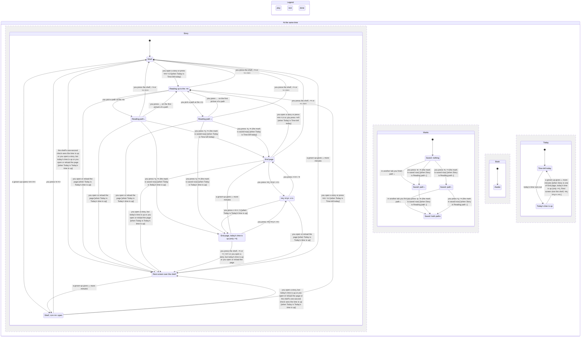
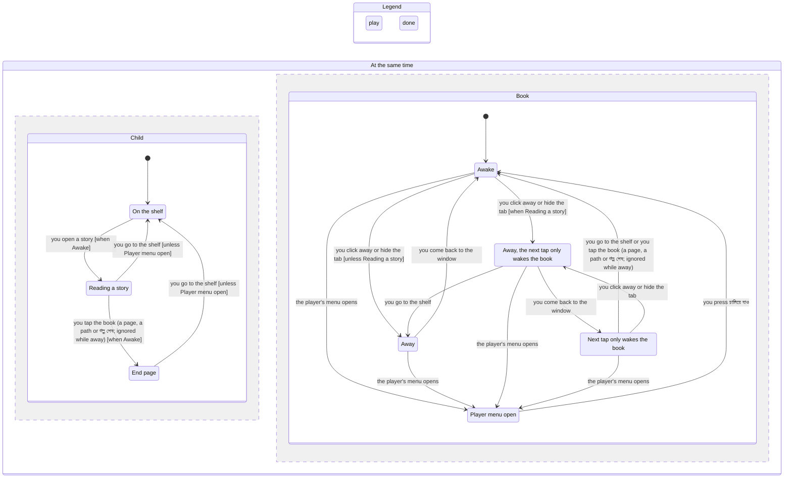

# গল্পের মোড় statechart (after the rewrite)

Specs, all mirrored from the new code:
- `Golper.tla` / `Golper.cfg` / `view.ts`: reading, read marks across two tabs, the daily limit and the rest screen, the gates. Mirrors `tools/golper-mor/lib/session.ts` (openStory, tryOther, nextPanel, choose, finish, toShelf, restart), `lib/progress.ts` (recordFinish) and `components/story-book.tsx` (restShows, the shelf's one-second check, the storage listener) with `shared/kids-kit.tsx`.
- `GolperFocus.tla` / `GolperFocus.cfg` / `view-focus.ts`: the player's pause menu and window focus around a story (`pause`, `resume`, `leave`, `returned`, `tapCounts`, `openStory`).
- `before-fix/` and `before-kit-fix/` are the old code's runs (the two bugs below). `after-fix/` and `after-fix-focus/` are the new code's runs; every rule holds.

One story with its two roads (side 0, 1) stands in for nine. The gate's hold timer and the header search are the shared code modelled in `../sourojogot/Sourojogot.tla`. The end page's 700 ms guard is one button's timer, proved by the node test "end page keys and buttons".

## Systems modelled
- **Reading:** shelf → reading up to the মোড় → a road picked → reading that road → গল্প শেষ (`finish()`: the limit is checked, the mark is saved, the end page shows) → অন্যটা / আবার / শেষ. The shelf button leaves from any page.
- **Read marks and a second tab:** `finish()` reads the saved copy again before it writes, so a tab opened earlier can't wipe what another saved. The `storage` event and a refresh on focus keep this tab's shelf in step.
- **Daily limit and rest screen:** the time counts only while the tab is visible and focused. `atBreak()` runs when a story starts (cover, আবার, অন্যটা) and in the very tap that finishes one. The shelf checks once a second. The rest screen covers the shelf only: the end page shows first, with its talk question, and offers only শেষ when the time is up.
- **Pause and focus:** the player's menu, blur and hide. Mid-story the first tap back only wakes the book; opening a story while away does nothing.
- **Gates:** the shelf's বড়দের জন্য unmounts when a story opens. আব্বু-আম্মুকে দেখাও exists only on the end page.
- **Left out:** sound (taps only; every note is a scheduled `tone()` the player cuts on pause, no loops) and clearing the marks (a grown-up action behind the gate).

## Rules in plain words
| Rule | Plain words | Result |
|---|---|---|
| ReadMarksNeverVanish | Every road read, in any tab, is still marked "পড়া হয়েছে" after a reload. | holds (broke before) |
| ShelfMatchesWhatIsSaved | This tab never shows a mark the phone has lost. | holds |
| NoStoryAfterTimeIsUp | Once today's time is up, no new story starts. | holds (broke before) |
| RestOnlyAtBreak | The rest screen appears only on the shelf, never inside a story. | holds |
| EndPageNeverCovered | The rest screen never hides the end page: its talk question stays until the child leaves. | holds (a gap before) |
| ShareOnlyOnTheShelf | The share link exists only on the shelf, never in a story. | holds |
| ShowParentOnlyAtTheEnd | আব্বু-আম্মুকে দেখাও appears only on the end page. | holds |
| AwayMidStoryIsAsleep | Away in the middle of a story, the book is paused or asleep, so the tap that brings focus back is not a move. | holds |
| NothingMovesWhileAway | No page turns, no road is picked and no story ends while the menu is open, the window is away or the book sleeps. | holds |
| TypeOK, NoDeadlock | | hold |

## Chart: reading, marks, limit and gates (`after-fix/chart.mmd`)


## Chart: pause and focus (`after-fix-focus/chart.mmd`)


## Bugs found before the rewrite, and how each is fixed
Both were replayed live in Orca on the old code (see `before-fix/`).

### 1. ReadMarksNeverVanish: "we read the টিফিন story on the phone, my child read another one in a second tab, and the টিফিন mark was gone" (game)
- **Path (4 steps):** you open the story → you pick a road → you press গল্প শেষ (saved: road ১) → in another tab you finish road ২: *A road you read lost its mark.*
- **Why:** `done()` built the new marks from this tab's React state, loaded once on mount, and overwrote the key.
- **Fix:** `recordFinish(raw, memory, …)` in `lib/progress.ts` reads the saved text at the moment of the write and adds the new mark to that; the shelf refreshes on `storage`, focus and visibility. If storage can't be read at all, this tab's own copy is used.
- **Node test:** "bug 1: a second tab can't wipe a read mark" (also shows the old way losing it) and "recordFinish: unreadable storage…".
- **Live (new code, Orca):** the page memory had only টিফিন; I wrote `{tiffin:[0], notun:[1]}` straight into storage as "the other tab"; then I read ১০ টাকার নোট. Saved: `{"read":{"tiffin":[0],"notun":[1],"taka":[1]},"today":["tiffin","notun","taka"]}`. Nothing lost.

### 2. NoStoryAfterTimeIsUp: "the time ran out on the shelf, and my child read a whole new story" (game and kit)
- **Path (2 steps):** today's time runs out → you open a story.
- **Why:** `atBreak()` ran only in `done()` and on mount.
- **Fix:** `openStory`, `tryOther` and `restart` all ask `atBreak()` first; past the limit nothing starts and the rest screen comes. The shelf runs a one-second check, so the rest comes while the child looks at covers. No kit change was needed.
- **Node tests:** "bug 2: once today's time is up, no story starts…", "gap: the rest screen waits behind the end page…", "RestOnlyAtBreak…", and the 3000-tap random child.
- **Live (new code, Orca):** (a) on the shelf with time left I raised the stored time to 900 of 900 s: after 1.5 s the rest screen covered the shelf. (b) I started a story, raised the time to 900 s mid-story: no rest screen in the story; I finished it: the end page showed "মং পেছনে তাকাল কেন?", আব্বু-আম্মুকে দেখাও and only the শেষ button; শেষ led to the rest screen. The stored time was put back afterwards.

## Quality-bar gaps from the first run, now closed
1. **The hint finger covered the first cover:** the ghost finger is now a ring on the big play button's edge (first ever run only), and the shelf's recommended book is marked by a ring, not an overlay.
2. **The rest screen hid the last talk question:** see EndPageNeverCovered. The end page stays and offers only শেষ.
3. **Read marks could vanish:** bug 1. Marks are two ribbons on each cover, plus a lamp for each finished shelf.
4. **End buttons:** আবার and শেষ are 108 px pictures of equal size, with অন্যটা first.
5. **No voice:** every `speak()` / `SpeakButton` is gone.

## Regenerate
```sh
scripts/statechart.sh ai_docs/statecharts/golper-mor/Golper.tla --view ai_docs/statecharts/golper-mor/view.ts --out ai_docs/statecharts/golper-mor/after-fix
scripts/statechart.sh ai_docs/statecharts/golper-mor/GolperFocus.tla --view ai_docs/statecharts/golper-mor/view-focus.ts --out ai_docs/statecharts/golper-mor/after-fix-focus
rm ai_docs/statecharts/golper-mor/after-fix*/tlc.out
```
The first chart hides only reloads that land on the shelf with time left. The second hides focus changes on the shelf.
