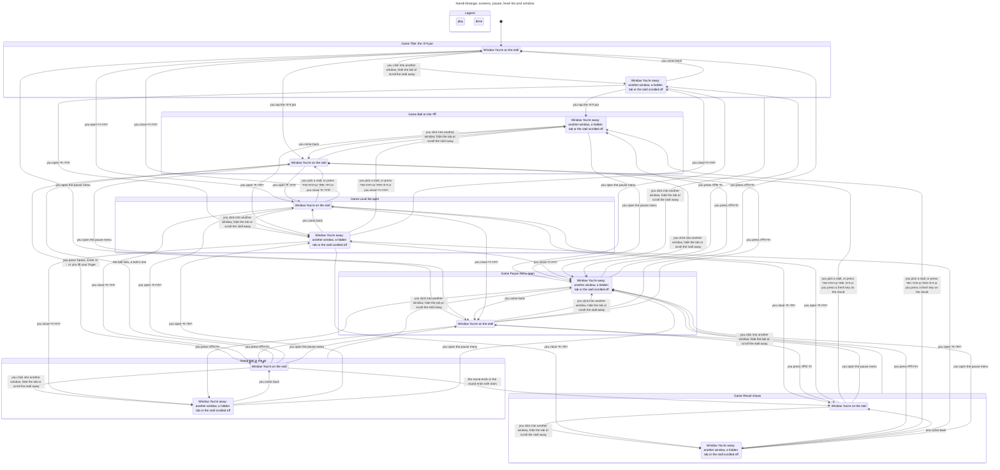

# হাঁড়িভাঙা: statechart

Two runs live here:
- `before-fix/`: the model of the game as it was on `games-to-the-bar` (commit a5fb4f1), with its own `Handi.tla`, `Handi.cfg`, `view.ts`, `report.md` and `chart.mmd`. Four rules broke.
- `after-fix/`: the model of the rewritten game (`Handi.tla`, `Handi.cfg`, `view.ts` in this folder), `report.md` and `chart.mmd`. TLC checked 474 states and **every rule holds**. The chart draws 12 states and 57 arrows.

The code the model mirrors: `tools/handi-bhanga/lib/session.ts` (the pure session: every rule about screens, pause, focus, input, wake-up and the wind loop) and `components/stall.tsx` (the handlers that call it, and `sync()` after each one).

## Systems modelled (after the rewrite)
- **Screens:** title (the খেলো pot) → play → result; the pause menu and the level list sit over any screen.
- **Ticking:** the stall steps only on the play screen, with the menu and the list shut, the tab showing, the window focused and the stall on screen (`session.ticking`). Falling balls and the end of a round need it.
- **Pause and focus:** a window blur or a hidden tab (one "away" here: `hide` is `blur` plus a hidden flag in the session), the player's pause menu, the level list, the stall scrolled off a desktop page (`setInView`).
- **Input:** ← → held, the throw key (Space, Enter, ↑), and the finger or mouse on the stall, either aiming a resting ball or moving the লাঠি under a flying one. Every way of leaving releases all three.
- **Wake-up:** after চালিয়ে যাও, closing the level list, a fresh round, or coming back to the window, the first tap or key only wakes the game (250 ms, `canAct`).
- **Wind loop:** plays on a windy stall while it steps with sound on. `sync()` runs after every handler.
- **Sound switch** and the **star chimes** (scheduled tones, cut by the player's `silenceScheduled`).
- **Result keys:** a key held through the end is stale until released; only a fresh, non-repeating press after the screen appears counts.
- **Choices:** the level list, পরের লেভেল and আবার খেলো all run one `begin()`.
- **Not in the model:** the physics, scoring, links and saved progress. They are pure and covered by `tests/rules.test.ts`, `tests/levels.test.ts` and `tests/link.test.ts`. The story is left out because it never changes a rule; the story's hold-to-skip timer is cleared on release, pause and unmount.

## Rules (plain words)
| Rule | Plain words | Before | After |
|---|---|---|---|
| PausedWhenHiddenOrBlurred | Leaving the window or hiding the tab stops the stall. | hidden held, blurred **broke** | holds |
| PausedWhenOffScreen | The ball never flies while the stall is off screen. | **broke** | holds |
| NoProgressWhileAway | You never lose a ball while you're away. | **broke** | holds |
| InputReleasedWhenAway | After you leave, open the menu or the list, or scroll off, no key, finger or mouse counts as held. | **broke** (the drag) | holds |
| ChoiceFreezesPlay | While the menu or the সব লেভেল list is open, nothing advances. | **broke** | holds |
| LoopOnlyWhenMeaningful | The wind loop plays only while a windy stall steps with sound on. | no loop | holds |
| LoopComesBack | When it should play and sound is on, it plays. | no loop | holds |
| NoFanfareAfterMovingOn | The star chimes only sound while the result shows (and sound is on, and the menu is shut). | held | holds |
| WakeOnlyWakes | The click that brings focus back never aims, throws or moves. | not modelled | holds |
| ResultKeyNeedsFreshPress | A key held through the end never skips the result. | not modelled | holds |
| NoDeadlock | Every state has a way out. | held | holds |

## Bugs found (before) and how each was fixed
Each was replayed live in Orca on the old game, then fixed, then replayed on the new one. The node test replays the same path against the pure session (`tests/session.test.ts`).

### 1. PausedWhenBlurred and NoProgressWhileAway
- **Player's sentence:** "I clicked into another window and lost a chance without seeing the ball fall."
- **Old replay:** শুরু করো, then `blur`. Within 2 s the phase was still `playing` and chances went 3 → 2.
- **Fix:** `blur` and `hide` release everything and `ticking` needs `win = here`; the player's menu opens on blur too.
- **New replay (stall 12, ball in the air at y 451.2, 3 balls):** `blur` → the menu opened, `paused: true`. 2.6 s later: y 451.2, game clock 0.833 s, 3 balls, nothing moved.
- **Test:** `PausedWhenBlurred: clicking into another window stops the stall, coming back starts it`, `PausedWhenHidden`, `NoProgressWhileAway`.

### 2. PausedWhenOffScreen
- **Player's sentence:** "I scrolled down a little, tapped the চাপো pad, and my ball flew and fell where I couldn't see it."
- **Old replay:** with 8% of the board showing, a tap on the pad threw the ball; 4 s later a chance was gone.
- **Fix:** `setInView` is part of `ticking` and of `canAct`; leaving the screen releases every hold. The pad is gone (the stall is the whole game).
- **New replay (desktop, 1280 × 500, page scrolled 1400 px so the board top was at −1305):** `inView` false. Space pressed: throws 0, game clock moved 0.00 s, phase `aim` after 2 s. Scrolled back: the next Space threw (throws 1, phase `fly`).
- **Test:** `PausedWhenOffScreen: a stall scrolled away never steps, and a round that starts off screen waits`.

### 3. InputReleasedWhenAway (the drag)
- **Player's sentence:** "I was dragging the stick, switched windows, came back, and the stick followed my mouse with no button held."
- **Old replay:** after a blur `gesture.id` stayed 1; a `pointermove` with `buttons: 0` moved the stick 212 → 94.
- **Fix:** every way of leaving calls `release()` (clears the keys and the pointer), and `pointerMove` ends the drag for a mouse with no button down.
- **New replay:** drag: stick 180 → 214.8, `pointer` 1, hand `move`. After `blur`: `pointer` −1, hand empty, stick 214.8. Back in the window, a mouse move with `buttons: 0`: stick 214.8 → 214.8.
- **Test:** `InputReleasedWhenAway (the drag): a mouse move with no button never moves the stall, and a lost pointerup lets go`, plus `an aim in progress is dropped when you leave, never thrown`.

### 4. ChoiceFreezesPlay
- **Player's sentence:** "I opened সব লেভেল mid-round and lost a ball while reading it."
- **Old replay:** with the list open and the board on screen, chances went 3 → 2 in 4 s.
- **Fix:** the list is a choice screen: `openSheet` pauses the session, and the player's সব লেভেল opens the same list (`onLevels`). Closing it starts the wake-up breath.
- **New replay:** ball in the air (clock 13.633 s, y 267.4, 2 balls, 1 lost); badge tapped → list open. 3 s later: clock 13.633, y 267.4, balls 2, lost 1. After ✕, a tap 100 ms later took no hold (`pointer` −1); a tap 400 ms later took hold (hand `move`).
- **Test:** `ChoiceFreezesPlay: while the level list is open nothing steps, and a tap that closes it only wakes the game`.

### Shared patterns checked on the new code (not bugs in the old game, but the same bug classes)
- **Result keys need a fresh press** (`ResultKeyNeedsFreshPress`): `freshResultKey` wants a non-repeating keydown that arrives 450 ms after the screen. Test: `result keys need a fresh press…`.
- **The click that brings focus back is not a move** (`WakeOnlyWakes`). Test: `the click that brings focus back is not a move…`.
- **A held throw key never throws twice.** Test: `a held throw key never throws twice, and auto-repeat is ignored`.
- **The wind loop** (`LoopOnlyWhenMeaningful`, `LoopComesBack`): counted in Orca by instrumenting the audio nodes (the dev server stays muted): the loop started once on stall 12 (`loopStart` 1), stopped on blur (`loopStop` 1), started again on চালিয়ে যাও (2) and stopped again on the next blur (2). Test: `LoopOnlyWhenMeaningful and LoopComesBack…`.
- **No celebration timer:** the star chimes are scheduled tones (`tone(…, delay)`), cut by the player's `silenceScheduled` on pause, a fresh round and sound-off. Nothing uses `setTimeout` except the 2.6 s "stop drawing the settled stall" timer, which is cleared on a new round and on unmount.

## Quality-bar gaps closed
1. **First screen:** a painted pot hanging from a rope with খেলো on its belly is the start button; the stall's one new thing, the star rule and the three modes sit under it.
2. **The end of a stall:** শেষ ডাক. With the last few pots left the লাঠি catches the ball and every catch is a new aimed throw. The skilled bot's last five pots take about 9–14 s (the old stall took about 50 s); asserted in `tests/levels.test.ts`.
3. **Level design:** three মেলা of four stalls, one new thing each, and a named মটকা to end each.
4. **Pause:** the player's menu, plus pausing on blur, hide, the level list and scrolling off.
5. **Danger at the edges:** the last ball pulses the frame; a ball the লাঠি can't reach glows the bottom edge on its side and shows a chevron on the floor; wind glows the side it blows from.
6. **HUD:** the stall badge top-left (it opens সব লেভেল), the মটকা's bar or the শেষ ডাক chip top-centre, score and balls top-right, a thin pots-broken line under them; nothing over the play area.
7. **Ending:** counted-up score, stars that pop, real stats, the near miss, numbered choices.
8. **Sound:** six sounds (throw swish, tock, crack ring, smash, firecracker, bell), the wind loop and a four-note motif per মেলা.

## Chart (after the fix): `after-fix/chart.mmd`
Regions shown: the screen or overlay, and whether you are on the stall. The model also tracks hands, wake-up, sound, wind and chimes; TLC checks all of them, and `before-fix/chart.mmd` shows the old game.



## Regenerate
```sh
scripts/statechart.sh ai_docs/statecharts/handi-bhanga/Handi.tla --view ai_docs/statecharts/handi-bhanga/view.ts --out ai_docs/statecharts/handi-bhanga/after-fix
```
(Use a fresh `--out` folder, then delete `tlc.out`.)

Screenshots from the first run: `.shots/handi-bhanga-sc-ready.png`, `.shots/handi-bhanga-sc-play.png`, `.shots/handi-bhanga-sc-over.png`. After the rewrite: see the design page, `ai_docs/game-dev/rewrites/handi-bhanga.md`.
