# হাত ধুই, দাঁত মাজি: statechart

The game was rewritten on 2026-11-05 (design: `ai_docs/game-dev/rewrites/hat-dhui.md`). The model has two parts, so each chart stays readable:

| Spec | What it covers | Mirrors | TLC |
|---|---|---|---|
| `HatDhui.tla` / `.cfg`, view `view.ts` | the title, a round (a timed routine or the কখন ধোব quiz), the one finish timer, the player's pause, away and back, a key held through the end, the daily limit and the rest screen | `tools/hat-dhui/lib/session.ts`, `lib/run.hot.ts`, `components/game.tsx` (`begin`, `won`, `armEnd`, `useGamePlayer`), `components/routine-view.tsx` (the step), `shared/kids-kit.tsx` | 473 states, 2 303 steps |
| `HatDhuiGates.tla` / `.cfg`, view `view-gates.ts` | who has the phone, the share gate on the title, the rest screen's gate | `components/game.tsx` (`<ParentGate key={gateKey}>`, the outside-tap listener), `shared/kids-kit.tsx` | small |

- `before-fix/` holds the run on the old code and the old spec (`before-fix/HatDhui.tla`, `.cfg`, `view.ts`, 346 states).
- `after-fix/` and `after-fix-gates/` are runs on the rewritten code. **Every rule holds.**
- **Model check (mutations, run in a scratch copy).** Putting the old behaviours back breaks the rules at once:
  - `toTitle` leaving the finish timer alive: **NoStaleTimer** breaks in 4 steps (▶ → the ring closes → ⏸ → নতুন করে শুরু).
  - Saving the stars only when the end screen comes: **EveryFinishCounts** breaks in 2 steps, and **ResultMatchesPlay** with it.
  - Letting the timer fire under the pause menu (no `~paused` guard): **NothingMovesUnderTheMenu** breaks in 4 steps.

## Rules (plain words), all holding after the fix
**HatDhui.tla**
- **RestOnlyAtBreak:** the rest screen comes only between rounds. If the limit passes while the ring closes, the rest waits for the end screen.
- **NoNewRoundPastLimit:** once today's time is up, ▶ খেলো and আবার খেলো show the rest screen, not a round. A reload past the limit opens on the rest screen.
- **EveryFinishCounts:** once the ring closes, or the last card is right, the stars are saved and the limit is checked in that same step, whatever the hand does next.
- **ResultMatchesPlay:** the end screen is for the round just finished; a timer from an older round never makes one.
- **NoStaleTimer:** the finish timer exists only for a finished round still on screen. `begin()` and `toTitle()` drop it, and it carries its round's serial.
- **NothingMovesUnderTheMenu:** the ring and the end timer do not move while the pause menu is open or the window is away; চালিয়ে যাও gives the timer back after a 0.5 s breath.
- **ResultNeedsFreshPress:** Enter or Space held through the end never starts the next round.

**HatDhuiGates.tla**
- **GateNeedsAnAdult**, **GateShutOutsideTheTitle** (the share gate lives on the title only; any other touch, a round starting, its one action or 20 s shut it), **RestGateOnlyOnTheRestScreen**, **OnlyParentsGiveMoreTime**, **RestOnlyAtBreak**.

**Rules replaced, and why.** The old model's `PausedWhenHidden`, `PausedWhenBlurred` and `NoProgressWhileAway` are now one rule, **NothingMovesUnderTheMenu**, which also covers the window being away. `ScreenAwake*` is gone as a model rule: the wake lock is a hook (`useWakeLock(!paused && !done)`) with no state of its own. `NoReadingNeeded` became a checked property of the page (tests: every end button is a picture of at least 96 px; the quiz question is a picture; the title has one ▶). `GateClosesBehindParent`, `NoShareForKids` and `ParentGate` are replaced by the gates model, as in the other kids' games: the header, search and the adult flagship are gone because `GamePage` now gives kids a kids-only frame. No rule here talks about voice: `speak()` is a no-op and the game makes no speech calls.

## The bugs, and how each was fixed
| # | Bug (the reader's sentence) | Fix | Node test | Live check after the fix (Orca, own tab) |
|---|---|---|---|---|
| 1 | **ResultMatchesPlay / RestOnlyAtBreak:** "the wash ended, I tapped দাঁত মাজা straight away, and it said ২ মিনিট দাঁত মাজলাম and the rest screen came." | The tabs are gone from play; only the title picks an activity. The finish timer is stamped with its round's serial, `begin()` and `toTitle()` drop it, `goToEnd` refuses a serial that is not the round on screen, and the unmount clears it. | `session.test.ts` › bug 1, stale finish timer; › bug 1 again, RestOnlyAtBreak | Ring closed at t = 19.9 s (stars `{"1":3}` saved at that step), ⏸ then নতুন করে শুরু inside the 1 s window: 1.8 s later the title shows, no end screen, no rest screen. Starting দাঁত মাজা next: the round stays on play. |
| 2 | **PausedWhenBlurred / PausedWhenHidden:** "I clicked away mid-wash; the ring stopped but it carried on by itself." | The routine's step moves the clock only through `clockMayRun(session)` (menu shut, window here, not finished); the page forwards blur, focus and hide to the session; the player's pause stops the loop and the end timer. | `session.test.ts` › bug 2; › a routine takes exactly its length of shown time (10 random blur and menu patterns each for 20 s and 120 s) | `blur` event: t held at 8.183 s for 1.5 s, `away` true; `focus`: it carried on. ⏸: t held at 8.583 s for 1.5 s; চালিয়ে যাও: 9.77 s 1.5 s later. |
| 3 | **ParentGate / NoShareForKids** (shared) | `GamePage` kids frame (kids-only header, rails and grid, no search); the share gate sits on the title only and shuts on the next touch elsewhere, a round starting, its one action or 20 s (kit). | `session.test.ts` › the page uses the shared player with the kids frame; the gates model | Header shows only the logo and ছোটদের খেলাঘর; no outbound link in the child's view. |
| 4 | **RestOnlyAtBreak, again:** the limit passing mid-brush. | `won()` runs `atBreak()` in the closing step, and the rest screen shows on every screen but play. | `session.test.ts` › RestOnlyAtBreak; › NoNewRoundPastLimit | Time read as past the limit mid-brush (tab-only `getItem` patch, nothing written): at the finish `resting` true and no `.kk-rest`; after the end screen came, `.kk-rest` was up. |
| 5 | **NoReadingNeeded:** "my 3-year-old can't tell একটু থামাও from আবার খেলো." | There is no pause button (the player's ⏸ is it). আবার খেলো and শেষ are 112 px picture buttons; the quiz question and answers are pictures; → is a 96 px round arrow. | `session.test.ts` › every end button is a picture of at least 96 px | End buttons measured 140 × 112 px; cards 96 px high; → 96 × 96 px. |
| — | **Pause freezes the finish timer** (shared pattern) | `onPause` stops it; `onResume` re-arms it after 0.5 s. | › pause freezes the finish timer | ⏸ at the finish: `paused`, `frozen`, `pending: end`. |
| — | **The click that brings focus back is not a move** | `session.blur` arms a swallow; the next tap on a bubble or card only wakes the game. | › the tap that brings focus back is not a move | — |
| — | **Result keys need a fresh press; Enter goes to the game; no hash or history push** | Keys at `window` with `preventDefault`; `freshKey`; `history.replaceState(history.state, …)`. | › result keys need a fresh press; › the address is updated with replaceState | A repeating Enter on the end screen stayed on the end screen; a fresh one started round 2. `#m=dat` selected দাঁত মাজা on load. |
| — | **No voice anywhere** | No `speak`, `SpeakButton` or `speechSynthesis` in the game. | › no voice anywhere | Source check. |

## The chart (after the fix)

```mermaid
---
title: "হfl°°2494¶ßত ধfl°°2497¶ßই, দfl°°2494¶ßfl°°2433¶ßত মfl°°2494¶ßজfl°°2495¶ß: screens, the finish timer, pause, the daily limit and keys"
---
stateDiagram-v2
  direction LR
  state "Legend" as legend {
    lg0: play
    lg1: held
  }
  class lg0 teal
  class lg1 yellow
  state "At the same time" as all {
    state "Round" as r0 {
      s0: The title (খ#2503;ল#2507;, three pictures)
      s1: কখন ধ#2507;ব, a card to pick
      s2: Washing or brushing, the ring filling
      s3: Last card right, stars saved, waiting for #8594;
      s4: Ring closed, stars saved, the end screen in 1 s
      s5: The end screen (আব#2494;র খ#2503;ল#2507; / শ#2503;ষ)
      [*] --> s0
      s0 --> s1: the child taps #9654; খ#2503;ল#2507; or আব#2494;র খ#2503;ল#2507; [when Window is not Pause menu open, everything waits and Today is Time left today]
      s0 --> s2: the child taps #9654; খ#2503;ল#2507; or আব#2494;র খ#2503;ল#2507; [when Window is not Pause menu open, everything waits and Today is Time left today]
      s1 --> s0: the page opens again
      s1 --> s3: the child picks the last right card [when Window is Playing]
      s2 --> s0: the page opens again
      s2 --> s4: the ring closes [when Window is one of Back from away, the next tap only wakes, Playing]
      s3 --> s0: the page opens again
      s3 --> s5: the child presses #8594; [when Window is one of Back from away, the next tap only wakes, Playing]
      s4 --> s0: the page opens again
      s4 --> s5: 1 s later the end screen comes [when Window is not Pause menu open, everything waits]
      s1 --> s0: নত#2497;ন কর#2503; শ#2497;র#2497;, সব ল#2503;ভ#2503;ল, or শ#2503;ষ [when Window is Pause menu open, everything waits]
      s2 --> s0: নত#2497;ন কর#2503; শ#2497;র#2497;, সব ল#2503;ভ#2503;ল, or শ#2503;ষ [when Window is Pause menu open, everything waits]
      s5 --> s1: the child taps #9654; খ#2503;ল#2507; or আব#2494;র খ#2503;ল#2507; [when Window is not Pause menu open, everything waits and Today is Time left today]
      s5 --> s0: the page opens again
      s5 --> s2: the child taps #9654; খ#2503;ল#2507; or আব#2494;র খ#2503;ল#2507; [when Window is not Pause menu open, everything waits and Today is Time left today]
      s5 --> s0: নত#2497;ন কর#2503; শ#2497;র#2497;, সব ল#2503;ভ#2503;ল, or শ#2503;ষ [when Window is Pause menu open, everything waits or Today is one of Time left today, Today's time is up]
      s3 --> s0: নত#2497;ন কর#2503; শ#2497;র#2497;, সব ল#2503;ভ#2503;ল, or শ#2503;ষ [when Window is Pause menu open, everything waits]
      s4 --> s0: নত#2497;ন কর#2503; শ#2497;র#2497;, সব ল#2503;ভ#2503;ল, or শ#2503;ষ [when Window is Pause menu open, everything waits]
    }
    --
    state "Window" as r1 {
      s6: Playing
      s7: Another window or tab, the ring waits
      s8: Pause menu open, everything waits
      s9: Back from away, the next tap only wakes
      [*] --> s6
      s6 --> s7: the window blurs or the tab hides
      s6 --> s8: #9208; / P / Esc opens the menu
      s7 --> s6: the page opens again or the window comes back
      s7 --> s8: #9208; / P / Esc opens the menu
      s8 --> s6: the page opens again or নত#2497;ন কর#2503; শ#2497;র#2497;, সব ল#2503;ভ#2503;ল, or শ#2503;ষ or চ#2494;ল#2495;য#2492;#2503; য#2494;ও
      s7 --> s9: the window comes back [when Round is not The title (খ#2503;ল#2507;, three pictures)]
      s8 --> s7: নত#2497;ন কর#2503; শ#2497;র#2497;, সব ল#2503;ভ#2503;ল, or শ#2503;ষ or চ#2494;ল#2495;য#2492;#2503; য#2494;ও
      s9 --> s6: the child picks the last right card [when Round is কখন ধ#2507;ব, a card to pick and Today is one of Time left today, Today's time is up]
      s9 --> s6: the page opens again
      s9 --> s7: the window blurs or the tab hides
      s9 --> s8: #9208; / P / Esc opens the menu
      s9 --> s6: the child taps #9654; খ#2503;ল#2507; or আব#2494;র খ#2503;ল#2507; or নত#2497;ন কর#2503; শ#2497;র#2497;, সব ল#2503;ভ#2503;ল, or শ#2503;ষ [when Round is The end screen (আব#2494;র খ#2503;ল#2507; / শ#2503;ষ) and Today is one of Time left today, Today's time is up]
    }
    --
    state "Today" as r2 {
      s10: Time left today
      s11: Rest screen
      s12: Today's time is up
      s13: Time's up, the rest waits for the end
      [*] --> s10
      [*] --> s11
      s10 --> s12: today's play time runs out
      s11 --> s10: a grown-up gives আজ আরও ১০ ম#2495;ন#2495;ট
      s12 --> s11: the page opens again
      s12 --> s11: the child taps #9654; খ#2503;ল#2507; or আব#2494;র খ#2503;ল#2507; [when Round is one of The end screen (আব#2494;র খ#2503;ল#2507; / শ#2503;ষ), The title (খ#2503;ল#2507;, three pictures) and Window is not Pause menu open, everything waits]
      s12 --> s13: the child picks the last right card [when Round is কখন ধ#2507;ব, a card to pick and Window is Playing]
      s12 --> s13: the ring closes [when Round is Washing or brushing, the ring filling and Window is one of Back from away, the next tap only wakes, Playing]
      s13 --> s11: the page opens again
      s13 --> s11: the child presses #8594; [when Round is Last card right, stars saved, waiting for #8594; and Window is one of Back from away, the next tap only wakes, Playing]
      s13 --> s11: 1 s later the end screen comes [when Round is Ring closed, stars saved, the end screen in 1 s and Window is not Pause menu open, everything waits]
      s13 --> s11: নত#2497;ন কর#2503; শ#2497;র#2497;, সব ল#2503;ভ#2503;ল, or শ#2503;ষ [when Window is Pause menu open, everything waits]
    }
  }
  class s1 teal
  class s2 teal
  class s3 teal
  class s4 teal
  class s11 yellow
  class s13 teal
```

The gates' chart is `after-fix-gates/chart.mmd`.

## Regenerate
```sh
scripts/statechart.sh ai_docs/statecharts/hat-dhui/HatDhui.tla --view ai_docs/statecharts/hat-dhui/view.ts --out ai_docs/statecharts/hat-dhui/after-fix
scripts/statechart.sh ai_docs/statecharts/hat-dhui/HatDhuiGates.tla --view ai_docs/statecharts/hat-dhui/view-gates.ts --out ai_docs/statecharts/hat-dhui/after-fix-gates
rm ai_docs/statecharts/hat-dhui/after-fix*/tlc.out
```
Use a fresh `--out` folder each run.

---

## The bugs found before the rewrite (as replayed then)
The model of the old code is `before-fix/HatDhui.tla`; its report and chart are in `before-fix/`.

## Rules
| Rule | In plain words | Result |
|---|---|---|
| RestOnlyAtBreak | The rest screen comes only between rounds, or before a round starts. It never cuts a routine. | **breaks** |
| ResultMatchesPlay | The done screen is for the routine you just finished. | **breaks** |
| PausedWhenHidden | If the tab hides mid-wash, the routine is paused, not just frozen. | **breaks** |
| PausedWhenBlurred | The same when you click into another window. | **breaks** |
| NoProgressWhileAway | The ring doesn't fill while you're away. | holds |
| ScreenAwakeOnlyWhileRunning / ScreenAwakeWhileRunning | The wake lock is held exactly while a routine runs on a visible tab. | hold |
| NoShareForKids | A child can't share. | **breaks** |
| GateClosesBehindParent | When the parent hands the phone back, the gate is shut. | **breaks** |
| ParentGate | No way off the page without the gate. | **breaks** |
| NoNetwork | Nothing is sent after load. | holds (live: no data requests) |
| NoChildData | Only progress and settings are stored. | holds |
| NoReadingNeeded | Every button a 3–5 year old must press has a picture or a sound cue. | **breaks** |

## Bugs
### 1. Stale finish timer (game-specific): ResultMatchesPlay and RestOnlyAtBreak
- **What the player sees:** "The wash ended, I tapped দাঁত মাজা straight away, and the brushing jumped to 'আজ ২ মিনিট ধরে দাঁত মাজলাম' and the rest screen. I never brushed."
- **Path** (report, RestOnlyAtBreak): 0 → today's time runs out → you press শুরু করো → the ring fills → you tap a tab → 0.7 s later the finish timer fires → "Done screen for a routine you never finished", plus the rest screen. ResultMatchesPlay takes the same path without step 1.
- **Live replay** (Orca, own tab):
  - Run at 10:15 and again at 16:54, the second on kit `23fd7c1`.
  - Today's time was set past the limit in my tab only: `Storage.prototype.getItem` was patched for `ektukhani-kids-time`, and writes to it were dropped.
  - At t=20 027 ms the wash showed "হয়ে গেছে". At 20 031 ms the script tapped দাঁত মাজা, and the brush "press শুরু" screen showed.
  - 1.2 s later:
    - h2 = **"আজ ২ মিনিট ধরে দাঁত মাজলাম"**.
    - The দাঁত মাজা tab was pressed.
    - **The rest screen was up.**
    - The saved levels were `{"1":3}`: the hand-wash star went to the done screen of the brush.
  - The ShowParent card would show the same false "২ মিনিট দাঁত মাজলাম".
  - Screenshots: `.shots/hat-dhui-bug-stale-finish-rest.png`, `.shots/hat-dhui-bug-stale-finish-card.png`.
- **Fix:**
  - Keep the timeout id in `Routine` and clear it in the unmount cleanup.
  - Better: have `finish()` take the mode it finishes, and ignore the call when `mode`/`round` has moved on (pass `round` into `onDone` and compare).
  - Add a node test: finish arrives after `open(other)` and changes nothing.

### 2. Away freezes the ring but doesn't pause (game, with the shared loop): PausedWhenHidden and PausedWhenBlurred
- **What the player sees:** "I clicked away mid-wash. The ring stopped, but it still said একটু থামাও. When I came back it carried on by itself."
- **Path:** you press শুরু করো → you click into another window, or the tab hides.
- **Live replay** (16:40):
  - 3 s in, the ring offset was 517.3.
  - On `blur` it stayed at 517.3, and 4 s later it was still 517.3. The button still said "একটু থামাও", and `.paused` was false.
  - On `focus`, with no tap, it read 460.7 two seconds later and the step had moved to "হাতের পিঠ ঘষো".
  - Orca pins `document.hidden` to false, in iframes too (`Cannot redefine property: hidden`). So the hide path was not driven live. In code it is the same path: `useGameLoop.restart` cancels the frame, and `Routine` has no hide handler beyond retaking the wake lock.
- **Fix:** on blur or hide, `Routine` calls `pause()`, which shows "আবার চালাও" and the elapsed seconds. Or the game moves onto the shared game player, which pauses on blur and hide. Resume should take a tap.

### 3. Ways out without the gate (shared: `site-shell.tsx`): ParentGate
- **What the player sees:** "My 4-year-old tapped a picture under the game and landed on আমার ছোটবেলা."
- **Path:** 1 step: the child taps a link in the header or the related games.
- **Live check** (10:28):
  - 21 visible links outside any gate: `/`, `/games`, `/chhotoder`, `/quiz`, `/tools`, `/amar-chhotobela` (the adult flagship, first in the related grid), `/abc-bazar`, the guide, privacy and others.
  - The header has a free-text search input ("গেম খোঁজো").
- **Fix (shared):** kids' pages get a kids frame:
  - The header has only the logo and ছোটদের খেলাঘর.
  - There is no search box.
  - The related grid shows kids' tools only, and adult links move behind the gate or into the parent note.

### 4. The gate stays open after the phone goes back (shared: `kids-kit.tsx`): GateClosesBehindParent and NoShareForKids
- **What the player sees:** "I opened বড়দের জন্য, changed my mind and gave the phone back. My child tapped খেলাটার লিংক পাঠাও."
- **Path:** a parent opens বড়দের জন্য → the parent hands the phone back. NoShareForKids adds: → someone shares.
- **Live:**
  - At 10:25 (old kit) the gate was open and the share button live 30 s later.
  - On kit `23fd7c1`, checked on abc-bazar at 16:50: still open at 30 s, shut by 62 s.
  - So the kit fix narrows the window to 60 s, but the rule still breaks inside it. Inside that window the child could also press "আজ আরও ১০ মিনিট" on the rest screen.
- **Fix (shared):** shut the gate after about 10 s with no action inside it. Or ask for the sum again just before the action.

### 5. Words-only buttons (shared pattern): NoReadingNeeded
- **What the player sees:** "My 3-year-old can't tell একটু থামাও from আবার খেলো."
- **Path:** 1 step (you press শুরু করো); the run screen has the text-only pause button.
- **Live DOM check:**
  - Text-only: "একটু থামাও" / "আবার চালাও", "আবার খেলো", "শেষ" and "আব্বু-আম্মুকে দেখাও" (the kit's `ShowParentButton`).
  - With a cue: the tab icons, "▶ শুরু করো" with the ghost finger, the quiz pictures and "পরেরটা →".
- **Fix:** give each its own icon: ⏸/▶ for pause, ↻ for আবার খেলো, a house or moon for শেষ, and an adult-and-child icon in `ShowParentButton` (shared).

## Quality-bar gaps (played end to end in Orca, 10:15–16:55)
1. **Leaving mid-routine.** The ring freezes silently. There is no pause screen and no "চালিয়ে যাও" (bug 2).
2. **Pause.** "একটু থামাও" is text only and 44–49 px tall, under the 96 px target for ages 3–5. ধীরে and 🔊 are 44 px pills.
3. **Ending.** "আবার খেলো" is primary while "শেষ" is secondary (equal size, unequal weight). Every end button is words only.
4. **কখন ধোব for 3–5 needs reading.** The question is text. The 🔈 button appears only with a Bangla voice, which is missing on most phones. The "why" line after a right pick is text only.
5. **One routine, one pace.** The 2-minute brush has no variety beyond the zone picture. A small mid-way cue (a germ that runs, "অর্ধেক হলো") would keep a 4-year-old at the sink.
6. **First screen.** The hero, lead and parent note come before the board. On a phone the ring is below the first screen until you press শুরু (it then scrolls itself into view).
7. **Ways out.** The site header search and the adult flagship sit in the child's view (bug 3).
8. **Sound.** A soft tune per beat, germ pops and a start chime: good, and it works on mute. The end has no signature sound distinct from `sfx.win`.
9. **Store.** No data requests after load. The only keys are `ektukhani-levels-hat-dhui` and `ektukhani-kids-time`, plus the shared settings.

Screenshots:
- `.shots/hat-dhui-bug-stale-finish-rest.png`: rest screen after the false finish.
- `.shots/hat-dhui-bug-stale-finish-card.png`: the brush done screen with nothing brushed.
- `.shots/hat-dhui-opens-on-rest.png`: opening past today's limit.
- `.shots/hat-dhui-quiz-done.png`: the quiz end.

## Regenerate
```sh
scripts/statechart.sh ai_docs/statecharts/hat-dhui/HatDhui.tla --view ai_docs/statecharts/hat-dhui/view.ts --out ai_docs/statecharts/hat-dhui/before-fix
rm -f ai_docs/statecharts/hat-dhui/before-fix/tlc*.out
```
After the fixes, update the spec and write to `--out ai_docs/statecharts/hat-dhui/after-fix`.
