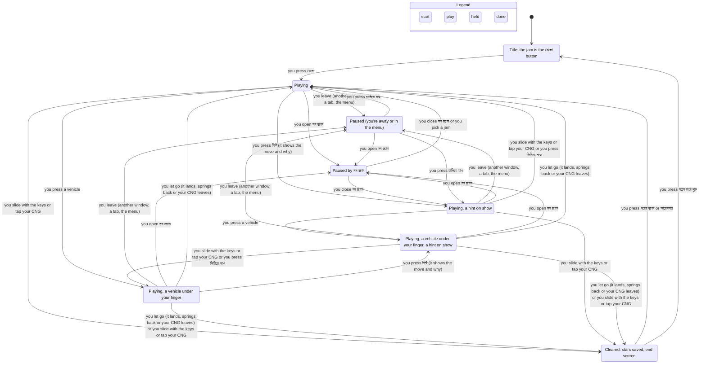

# জ্যাম ছাড়াও: statechart (after the rewrite)

Model: `Jam.tla`, `Jam.cfg` (chart run, N = 1), `Jam.full.cfg` (N = 3, every hidden step on), `view.ts`.
Reports and chart: `after-fix/report.md`, `after-fix/report-full.md`, `after-fix/chart.mmd`. The model before the rewrite, with its report and chart, is in `before-fix/` (`before-fix/spec/`).
Code mirrored: `tools/jam-chharao/components/jam-game.tsx`, `street.tsx`, `lib/session.ts`, `lib/progress.ts`, `lib/motion.hot.ts`, `lib/game.ts`.

TLC: 252 states (chart run), 30,357 (full run). Every rule holds, including NoDeadlock.

## Systems modelled
A turn-based puzzle: no clock to lose, no sound loops. The clock is only a stat (it runs exactly while the phase is "playing").
- **Phase:** title → story (first run) → playing ⇄ paused (`away` or `sheet`) → over. `lib/session.ts`.
- **Pause and focus:** blur, a hidden tab and the player's menu run `pauseFor("away")`; the street drops the finger. `useGamePlayer({ onPause, onResume, onRestart, onLevels })`.
- **Finger:** one drag on one vehicle (`Drag` in `lib/motion.ts`), released by pointerup, pointercancel, blur, hide, any phase that isn't "playing" and a clear.
- **Hint:** the first press shows the move and why and costs a star (`helped + 1`); the second press plays it for free. Any move, take-back or new jam clears it.
- **Choices:** সব জ্যাম (the sheet pauses play), পরের জ্যাম, আরেকবার, Enter on the result, a friend's link.
- **Results and progress:** the win is recorded once at the moment of the clear; your own unlock (`ektukhani-unlock-jam-chharao-v2`, migrated once from the old stars) rises only by clearing a jam that was already open.

## Rules (all hold)
| Rule | In plain words |
|---|---|
| InputReleasedWhenAway | After a blur, a hidden tab or the menu, no vehicle stays stuck to the pointer. |
| PressOnlyWhilePlaying | A finger is held only while the jam is live. |
| ClockStillWhileAway, PausedWhenHidden | The clock and every move stop while you're away. |
| NothingMovesWhilePaused (property) | While the pause screen shows, no move is made or taken back. |
| NoDropCountsWhilePaused (property) | A drag that began before the pause never lands as a move behind it. |
| ChoiceFreezesPlay | While সব জ্যাম is open, the jam is paused. |
| HintCostsOnce (property) | A hint costs when it is shown; playing the shown hint costs nothing more. |
| HintNeverOutlivesPlay | A hint on show belongs to a jam in play. |
| ChimesOnlyForThisWin | The win sound, confetti and end screen belong to this win only. |
| UnlockNeverShrinks, OpenLevelsAreEarned, LevelIsOpen | A friend's far-ahead jam opens nothing in between. |
| ReplayIsExact | A friend's link opens exactly its own jam (checked live; the replay is proven in `tests/link.test.ts`). |
| HeldKeyNeverSkips, ComingBackIsNotAMove, StoryOnce | Result keys need a fresh press; the press that brings you back only resumes; the story plays once. |

## Bugs found before the rewrite, and where each is now a test
Each was replayed live in Orca (see `before-fix/report.md` for the original paths) and fixed in the new code.

1. **InputReleasedWhenAway** ("the bus stayed stuck to my pointer after I clicked into another window"). Fix: `Street.drop()` on `blur`, `visibilitychange` and whenever the phase isn't "playing" releases the drag and the vehicle glides back. Test: `tests/session.test.ts` "bug 1, InputReleasedWhenAway". Live after the fix (Pixel 9 emulation): press the rickshaw, move it two cells, `blur`: phase `paused`, pos `5,0`; then focus, move, pointerup: moves stay 0.
2. **NothingMovesWhilePaused** ("ফিরিয়ে আনো still worked behind the pause screen"). Fix: take-back, slide, hint and tap all check `live()` (phase is "playing"); the player's menu makes the game inert. Test: "bug 2, NothingMovesWhilePaused". Live: one move made (moves 1), `blur`, then `z` and the ফিরিয়ে নাও button: moves 1, undone 0, phase `paused`.
3. **NoDropCountsWhilePaused** ("I let go behind the pause screen and it counted"). Fix: the drag is dropped first, and `onPointerUp` re-checks `live()`. Test: "bug 3, NoDropCountsWhilePaused". Live: press, move and lift while paused: moves still 1, pos `5,1`.

The rewrite's own model found three more, each fixed before it passed:
- **PressOnlyWhilePlaying, by a clear:** a vehicle held while the last CNG left (a key slide with a finger down). Fix: the street drops the drag whenever `phase !== "playing"`.
- **PressOnlyWhilePlaying, by the sheet:** opening সব জ্যাম with a finger down. The sheet sets `phase = "paused"`, so the same drop runs.
- **PressOnlyWhilePlaying, by a friend's link** (a hash change mid-jam): the title is not "playing", so the same drop runs.

## Chart (after the fix)
Hidden steps: coming back to the window, Enter held or released, the celebration timers, a restart or a friend's link from mid-jam, and the press that only wakes the jam (shown as চালিয়ে যাও).



## Quality-bar gaps closed (played in Orca, all 32 jams through real pointer events, 3 stars each with the solver's moves)
1. **Pause:** the player's menu (P, the button, blur, hide, Esc) with সব জ্যাম through `onLevels`.
2. **Pacing:** four streets with one new thing each (small vehicles, buses and trucks, bricks and barricades, a second CNG), a named finale each, one new lesson a jam, every line checked against the jam by a test.
3. **Choices:** the sheet pauses, lists the streets with what each adds, marks the finale and the recommended jam; the hint says what it costs before you press it.
4. **First screen:** the jam itself is the start button, one line says what's new; jam 1 is two moves.
5. **Sound:** every sound is a node start (counted live: lift 2, bump 1, move 3, no loops), the player's menu owns the sound switch.
6. **Ending and HUD:** the stats count up; the finale has a named bar (বাধা N, or CNG 0/2); corners only.

## Regenerate
```sh
scripts/statechart.sh ai_docs/statecharts/jam-chharao/Jam.tla --view ai_docs/statecharts/jam-chharao/view.ts --out ai_docs/statecharts/jam-chharao/after-fix
scripts/statechart.sh ai_docs/statecharts/jam-chharao/Jam.tla --config ai_docs/statecharts/jam-chharao/Jam.full.cfg --view ai_docs/statecharts/jam-chharao/view.ts --out <scratch>   # report-full.md
```
