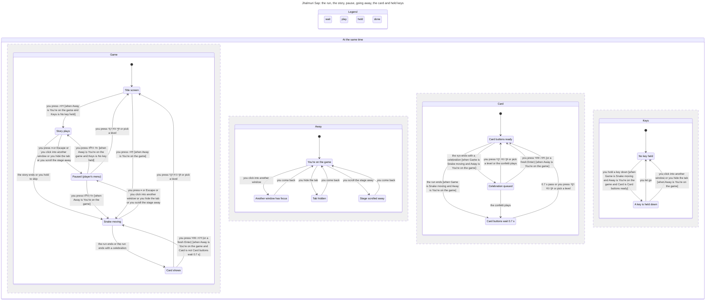

# ঝালমুড়ি সাপ: statechart

The game was rewritten on 2026-11-04 (design: `ai_docs/game-dev/rewrites/jhalmuri-sap.md`). The model now has two parts, so each chart stays readable:

| Spec | What it covers | Mirrors | TLC |
|---|---|---|---|
| `Snake.tla` / `Snake.cfg`, view `view.ts` | the title, the first-run story, the snake, the player's pause, going away (blur, hide, scroll), the end screen's 0.7 s guard and celebration, a key held through the crash | `tools/jhalmuri-sap/lib/session.ts`, `components/snake-game.tsx`, `shared/game-player-client.tsx`, `useGameLoop` | 84 states, 347 steps |
| `SnakeLevels.tla` / `SnakeLevels.cfg`, view `view-levels.ts` | the level list, a friend's link, this game's own unlock | `lib/progress.ts`, `lib/session.ts` (`pick`, `reset`), `choose`, the hashchange effect, `finish` | 100 states, 455 steps |

- `before-fix/` is the run on the code before the rewrite. Its spec is in git, at commit a6ee28b.
- `after-fix/` and `after-fix-levels/` are runs on the rewritten code. **Every rule holds.**

## Rules (plain words), all holding after the fix
**Snake.tla**
- **PausedWhenHidden**, **PausedWhenBlurred**, **PausedWhenScrolledAway:** neither the snake nor the story moves while the tab is hidden, another window has focus, or the stage is scrolled off the screen. Starting, resuming and আবার খেলো are refused there too.
- **CelebrationOnItsOwnCard:** confetti, the clear chime or the win sound play only while their own run's card shows.
- **ResultNeedsFreshPress:** a key held through the crash never starts the next run.
- **InputReleasedWhenAway:** after a blur or hide, no key or swipe counts as held.
- **StoryOnlyOnce:** the story plays on the first run only.

**SnakeLevels.tla**
- **ChoiceFreezesPlay:** the level list opens only on the title or the card, and nothing runs under it.
- **ReplayIsExact:** the friend's level carries the friend's ঠোঙা.
- **FriendClearOpensNothingBetween:** clearing a friend's far-ahead level opens no level in between.
- **OnlyPlayableLevels:** you only play levels that are open, have stars, or are the friend's level.
- **UnlockNeverShrinks** (a temporal property).

As a check of the model, swapping in the shared `unlockedLevel` rule breaks **FriendClearOpensNothingBetween** in 3 steps: a friend's link opens → খেলো → you clear it → "Levels 1–3 open".

## The bugs, and how each was fixed
| # | Bug (the reader's sentence) | Fix | Node test | Live check after the fix (Orca, own tab) |
|---|---|---|---|---|
| 1 | **PausedWhenBlurred:** "I clicked into another window and when I came back the snake had already crashed." | The player's blur pause calls `onPause` → `session.pause()`. `useGameLoop` stops frames on blur. The game also keeps its own `focused` flag, so nothing restarts while you're away. | `session.test.ts` › bug 1, PausedWhenBlurred | Pixel 9, immersive, level 5: moves 3 → blur → the menu opens, `inert` → moves 3 after 2.5 s → চালিয়ে যাও → still 3 at +450 ms (the 0.6 s breath) → 7 at +1.35 s. |
| 2 | **PausedWhenScrolledAway:** "I scrolled down, pressed আরেকবার, and the snake ran and crashed off-screen." | `session.start()` and `again()` refuse when the stage isn't in view (`useInView` on the game, 35%). The player pauses a running snake on scroll-away. Keys act only while the stage is in view. `scrollIntoView` is gone. | `session.test.ts` › bug 2, PausedWhenScrolledAway | Desktop, scrolled 1,461 px past the stage: ArrowUp, Enter and Space all leave it on the title (`inView=false`). Scrolled back: ArrowUp starts the run. |
| 3 | **CelebrationOnItsOwnCard:** "I pressed পরের লেভেল as soon as it lit up, and the clear chime played over my new run." | Every timer goes through `later()` and is cleared in `deal()` (reset, পরের লেভেল, আবার খেলো, a level pick, a link) and on unmount. The callback also checks `cheerMayPlay(session, run)`. Scheduled notes use `tone()`'s delay, so the player's pause cuts them. | `session.test.ts` › bug 3, CelebrationOnItsOwnCard | Level 1 cleared with ★★★ (gold forced), পরের লেভেল at +760 ms: 0 oscillators and no confetti between +900 and +1,500 ms. The control run stays on the card: 5 notes and confetti at +989 ms. |
| 4 | **ResultNeedsFreshPress** (shared pattern): a held Space or Enter could restart from the card once the guard lifted. | `again()` takes a key only if `!repeat` and it was pressed after the card appeared. Enter and Space are handled at `window` with `preventDefault`, and buttons blur after a click. | `session.test.ts` › result keys need a fresh press | No live check: the rule is in `again()`. |
| 5 | **Friend link opens levels in between** (shared pattern) | The game keeps its own unlock in `ektukhani-unlock-jhalmuri-sap`. It is migrated once from `unlockedLevel`, and `afterClear` raises it only for a level that was already open. পরের লেভেল appears only when the next level is playable. | `session.test.ts` › friend links…, UnlockNeverShrinks | Unlock 5, a link to level 9 (`s=777&t=150&l=9&g=0`), cleared ★★★: the stars are saved, the unlock stays at 6, and the card says "রিমার চেয়ে ৯০ বেশি!" |

**Quality-bar gaps closed (see the design):**
- the ঠোঙা start art;
- the 3-panel story with hold to skip;
- the level list as a numbered choice screen with "এটা খেলো";
- the HUD in the board's corners, with the floats moved to the score;
- the orange danger rim;
- named finales, world palettes, the shaker signature and world motifs;
- counted-up end stats.

## Chart: the run (`after-fix/chart.mmd`)


## Chart: levels, links and the unlock (`after-fix-levels/chart.mmd`)

```mermaid
---
title: "Jhalmuri Sap: the level list, a friend's link and the unlock"
---
stateDiagram-v2
  state "Legend" as legend {
    lg0: play
  }
  class lg0 teal
  state "Game Title or level list" as s0 {
    state "Level Your own level" as s1 {
      s2: Unlock Only level 1 open
      s3: Unlock Levels 1#8211;2 open
      s4: Unlock Levels 1#8211;3 open
    }
    state "Level Friend's level, friend's ঠ#2507;ঙ#2494;" as s5 {
      s6: Unlock Only level 1 open
      s7: Unlock Levels 1#8211;2 open
      s8: Unlock Levels 1#8211;3 open
    }
  }
  state "Game Snake moving" as s9 {
    state "Level Your own level" as s10 {
      s11: Unlock Only level 1 open
      s12: Unlock Levels 1#8211;2 open
      s13: Unlock Levels 1#8211;3 open
    }
    state "Level Friend's level, friend's ঠ#2507;ঙ#2494;" as s14 {
      s15: Unlock Only level 1 open
      s16: Unlock Levels 1#8211;2 open
      s17: Unlock Levels 1#8211;3 open
    }
  }
  state "Game Card (or level list)" as s18 {
    state "Level Your own level" as s19 {
      s20: Unlock Only level 1 open
      s21: Unlock Levels 1#8211;2 open
      s22: Unlock Levels 1#8211;3 open
    }
    state "Level Friend's level, friend's ঠ#2507;ঙ#2494;" as s23 {
      s24: Unlock Only level 1 open
      s25: Unlock Levels 1#8211;2 open
      s26: Unlock Levels 1#8211;3 open
    }
  }
  [*] --> s2
  s2 --> s11: you press খ#2503;ল#2507;
  s2 --> s6: a friend's link opens or you pick the friend's level
  s11 --> s6: a friend's link opens
  s11 --> s20: the snake crashes
  s11 --> s21: you clear your furthest level
  s6 --> s2: you pick a level
  s6 --> s15: you press খ#2503;ল#2507;
  s20 --> s2: you pick a level
  s20 --> s11: you press আব#2494;র খ#2503;ল#2507;
  s20 --> s6: a friend's link opens or you pick the friend's level
  s21 --> s12: you press আব#2494;র খ#2503;ল#2507; or you press পর#2503;র ল#2503;ভ#2503;ল
  s21 --> s3: you pick a level
  s21 --> s7: a friend's link opens or you pick the friend's level
  s15 --> s24: you clear the friend's level or the snake crashes
  s12 --> s21: you clear a level or the snake crashes
  s12 --> s7: a friend's link opens
  s3 --> s12: you press খ#2503;ল#2507;
  s3 --> s7: a friend's link opens or you pick the friend's level
  s12 --> s22: you clear your furthest level
  s24 --> s6: you pick the friend's level
  s24 --> s2: you pick a level
  s24 --> s15: you press আব#2494;র খ#2503;ল#2507;
  s24 --> s11: you press পর#2503;র ল#2503;ভ#2503;ল
  s7 --> s3: you pick a level
  s7 --> s16: you press খ#2503;ল#2507;
  s22 --> s13: you press পর#2503;র ল#2503;ভ#2503;ল or you press আব#2494;র খ#2503;ল#2507;
  s22 --> s4: you pick a level
  s22 --> s8: a friend's link opens or you pick the friend's level
  s20 --> s15: you press পর#2503;র ল#2503;ভ#2503;ল
  s21 --> s16: you press পর#2503;র ল#2503;ভ#2503;ল
  s16 --> s25: you clear the friend's level or the snake crashes
  s13 --> s8: a friend's link opens
  s13 --> s22: you clear a level or the snake crashes
  s4 --> s13: you press খ#2503;ল#2507;
  s4 --> s8: a friend's link opens or you pick the friend's level
  s25 --> s7: you pick the friend's level
  s25 --> s3: you pick a level
  s25 --> s16: you press আব#2494;র খ#2503;ল#2507;
  s25 --> s12: you press পর#2503;র ল#2503;ভ#2503;ল
  s8 --> s4: you pick a level
  s8 --> s17: you press খ#2503;ল#2507;
  s22 --> s17: you press পর#2503;র ল#2503;ভ#2503;ল
  s17 --> s26: the snake crashes or you clear the friend's level
  s26 --> s8: you pick the friend's level
  s26 --> s4: you pick a level
  s26 --> s17: you press আব#2494;র খ#2503;ল#2507;
  s26 --> s13: you press পর#2503;র ল#2503;ভ#2503;ল
  class s11 teal
  class s12 teal
  class s13 teal
  class s15 teal
  class s16 teal
  class s17 teal
```


## Live checks
- The dev build exposes `window.__jhalmuri = { game(), session }` (never in production). An autopilot reads it and presses arrow keys.
- With the autopilot, levels 1–4, 6, 7, 8, 10 and 11 were cleared, and 12 crashed into its tail, in Orca at 412 × 620.
- Screenshots are in `.shots/jhalmuri-sap-*.png`.
- Orca pins `document.hidden` to false, so the hide path was checked in node (`session.test.ts`) and through the player's soft-hide notes.

## Regenerate
```sh
scripts/statechart.sh ai_docs/statecharts/jhalmuri-sap/Snake.tla --view ai_docs/statecharts/jhalmuri-sap/view.ts --out ai_docs/statecharts/jhalmuri-sap/<new-folder>
scripts/statechart.sh ai_docs/statecharts/jhalmuri-sap/SnakeLevels.tla --view ai_docs/statecharts/jhalmuri-sap/view-levels.ts --out ai_docs/statecharts/jhalmuri-sap/<new-folder>
```
