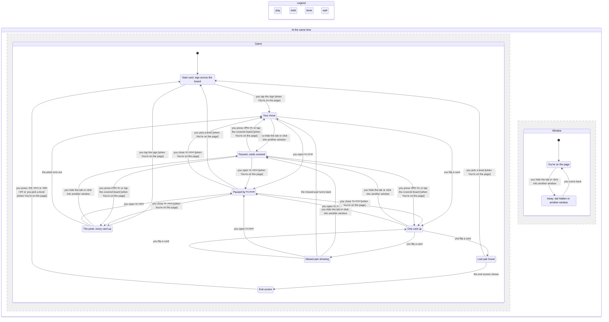

# জোড়া মেলাও statechart

## After the rewrite (`after-fix/`)
The spec `JoraMelao.tla` now mirrors the rewritten code: `tools/jora-melao/lib/session.ts` (`start`, `tick`, `tap`, `pause`, `resume`: one pausable clock for the peek and for a missed pair), `lib/play.ts` (`begin`, `endPeek`, `flip`, `settle` with the flight of the birds), `lib/save.ts` (`openAfter`) and `components/jora-game.tsx` (`commit`/`effects`, `finalize`, `load`, `pauseFor`/`resumeFrom`, the blur and `visibilitychange` listeners, `openSheet`/`closeSheet`). TLC reaches 424 states and 1,090 steps; the chart draws 11 states and 29 arrows. Abstractions: 2 levels (a peek board, a birds board), 1 pair a board, birds after every 2nd miss, one star a clear; two-player mode only repeats the same pause and timers. The page opens on a friend's link to level 2 while only level 1 is yours. Enter held through the end is a second small spec (`JoraKey.tla`, `after-fix-key/`) so the main chart stays under the state budget.

| Rule | In plain words | Result |
|---|---|---|
| PausedWhenHidden | A hidden tab or a blurred window (and the player's menu) stops the peek's seconds and the miss timer. | holds |
| NothingShowingWhilePaused | While paused, no missed pair is left face up: it turns back the moment you go away. | holds |
| NoProgressWhilePaused | Paused, no card turns, no pair is found, the peek does not run and the birds do not fly. | holds |
| TheWakeTapIsNotAMove | The tap that brings the window back only wakes the board; it never turns a card. | holds |
| TheListOutranksAway | Coming back from another window never closes সব লেভেল. | holds |
| LevelListFreezesPlay | While সব লেভেল is open, nothing counts. | holds |
| NoFlipsInThePeek | Nothing flips while every card is up. | holds |
| BirdsFlyOnlyWhenAMissTurnsBack | The birds fly only as a missed pair turns back, only on the birds' board, once for every 2nd miss (EveryFlightIsDue). | holds |
| NoDoubleResult, EndScreenMeansSaved | A board is saved once, right at the last pair, before the end screen shows. | holds |
| StarsNeverDrop, UnlockNeverShrinks | Stars and the open level only go up. | holds |
| **OpenLevelsAreEarned** | Every level below your open level has stars: levels open one by one by your own clears. A friend's far-ahead level records its stars and opens nothing in between. | **holds (was LevelsOpenInOrder, broken)** |
| ResultNeedsFreshPress (`JoraKey`) | Enter held through the last pair never skips the end screen. | holds |
| TypeOK, NoDeadlock | | hold |

### The bug, fixed, and the gaps closed
1. **LevelsOpenInOrder (the one bug of the first run).** A friend's level 12 link opened every level. Now `save.ts` keeps your own open level (`ektukhani-jora-melao-open`): clearing level L opens L + 1 only when L was already open (`openAfter`), the friend's far-ahead level records its stars apart, and "সব লেভেল শেষ" needs all 24 stars. Tests: `bug · LevelsOpenInOrder` (rewrite.test.ts). **Live (Orca, Pixel 9):** with my game's keys removed I opened `#s=4242&t=6&v=2&l=3&f=0218354b6a79` (a friend's verified 6-move link to level 3), played it (10 moves, ★★★ against the friend's 6: "এবার রাফি এগিয়ে"), and storage held `levels-jora-melao-v2 = {"3":3}` and `jora-melao-open = 1`. After a reload without the hash the game opened on লেভেল ১ and সব লেভেল showed only level 1 open, with level 3 locked and its ★★★ kept. The same link replays on the same deal, and old links (`#s=777&t=15&g=20&l=10&f=…`) still open as "বন্ধুর পুরোনো বোর্ড".
2. **Pause (gap 3):** the player's menu, P, blur and a hidden tab all run `pauseFor("away")`. Tests: `rule · PausedWhenHidden`, `NothingShowingWhilePaused`, `NoProgressWhilePaused`, `LevelListFreezesPlay` (session.test.ts). **Live:** on level 9 I started the peek, sent a window `blur`: the player's menu opened, the cards were covered, the peek bar stayed at `scaleX(0.082)` for 4 s, and after চালিয়ে যাও the last 0.08 of the peek ended within 0.2 s and play began.
3. **Pacing and finales (gaps 1, 2):** 24 levels with one new thing each (tests assert exactly one changed field), named finales with a boss bar.
4. **Danger (gap 4):** `atStake()` drives the amber edge; `cracked` the star that breaks. Test `stars, the exact gap to the next one, and the star that is at stake`.
5. **Choices (gap 5), end (gap 6):** সব লেভেল lists pairs and stars; the end screen replaces the board (no fold) and counts up real stats.
6. **Sound (gap 7):** a signature bell, a flutter for the birds, the edge tick, the crack knock, a world key for the clear ident; no loops.



## Regenerate
```sh
scripts/statechart.sh ai_docs/statecharts/jora-melao/JoraMelao.tla --view ai_docs/statecharts/jora-melao/view.ts --out ai_docs/statecharts/jora-melao/after-fix
scripts/statechart.sh ai_docs/statecharts/jora-melao/JoraKey.tla --view ai_docs/statecharts/jora-melao/viewkey.ts --out ai_docs/statecharts/jora-melao/after-fix-key
rm -f ai_docs/statecharts/jora-melao/after-fix*/tlc*.out
```

## Screenshots
`.shots/jora-melao-phone-launch.png`, `-phone-start.png`, `-phone-finale-play.png`, `-peek.png`, `-l19-end.png`, `-duo-over.png`, `-card-l16.png`, `-sheet-after.png`, `-320-play.png`, `-desktop.png`, `-friend.png`.

---

# The first run, before the rewrite (`before-fix/`)
Spec `JoraMelao.tla` / `JoraMelao.cfg`, view `view.ts`, output `before-fix/` (`report.md`, `chart.mmd`).
It mirrors `tools/jora-melao/components/pairs-game.tsx` (`tap`, `start`, `playLevel`, `again`, `nextLevel`, `pick`, the miss effect, the end effect, the `visibilitychange` effect, the opened/`hashchange` effect), `tools/jora-melao/lib/game.ts` (`flip`, `settle`) and `shared/game-core.ts` (`recordLevel`, `unlockedLevel`).
TLC: 403 states, 1357 steps. The chart has 12 states and 22 arrows (it hides "the cheer plays"). **7 rules hold, 1 breaks** (plus TypeOK and NoDeadlock). The bug reproduced live in Orca.

## Systems modelled
- **Board phase:** fresh board (the demo pair up) → one card up → a match, or a missed pair showing → … → last pair found → the "সব জোড়া মিলেছে" panel. Abstracted to one pair a board: more pairs only repeat the flip loop.
- **Pause and tab:** a hidden tab pauses a board in play and turns a missed pair back (`settle`). চালিয়ে যাও resumes. `tap()` does nothing while paused.
- **Timers:** the miss timer (1 s, or 1.8 s in ধীরে খেলো), which waits while paused; the 650 ms panel timer; and the cheer after the stars. `start()` clears the last two.
- **Levels and stars:** 2 levels, 1 or 2 stars per clear, `recordLevel` keeps the max, `unlockedLevel` = 1 + the highest level with stars, and `LevelGrid` shows `max(unlocked, level)` as open.
- **Links:** the page opens on the level this phone left off at, or on a friend's link. `parseCard` replays the flips and accepts any level.

Not modelled: two-player mode (no stars, the same pause and timers), the 400 ms again-guard (it only filters taps), and the `migrateLevels` one-time move (it writes levels 4 and 7 on purpose, for old bests). Blur isn't handled by the code. That's acceptable for a turn-based board: the only thing that moves while you look away is the miss timer turning your own two cards back. No sound loops.

## Rules, in plain words
| Rule | In plain words | Result |
|---|---|---|
| PausedWhenHidden | A hidden tab means a paused board. | holds |
| NothingShowingWhilePaused | While paused, no missed pair is left face up. | holds |
| NoProgressWhilePaused | While paused, no card turns and no pair is found. | holds |
| NoDoubleResult | A board is recorded once. | holds |
| NoCheerAfterMovingOn | The panel and the cheer belong to a finished board, never to the next one. | holds |
| LevelsOpenInOrder | A level has stars only if the level before it has stars, so levels open one by one. | **breaks** |
| StarsNeverDrop | Stars on a level never go down. | holds |
| UnlockNeverShrinks | An open level never closes. | holds |
| TypeOK, NoDeadlock | | hold |

## Bugs

### 1. LevelsOpenInOrder: "A friend sent me their লেভেল ১২ board; I finished it, and now every level is open and it says সব লেভেল শেষ!"
- **Path (report):** 0 the page opens from a friend's level 2 link → 1 you flip a card → 2 you match the last pair of the friend's level 2: level 2 has stars, and level 1 was never played.
- **Live replay (Orca):** with clean storage I opened `/jora-melao#s=777&t=10&g=20&l=12&f=016a7b9c5e2f4g3hdi8j&n=রাফি` (a verified 10-move link made with `cardHash`). The banner read "রাফি ১০ চালে পেরেছে। একই খেলা, এবার তোমার পালা।", the HUD read `লেভেল ১২ · চাল ০ · জোড়া ০/১০`, and সব লেভেল already showed **12** levels open. I flipped the 10 pairs. The panel read "সব জোড়া মিলেছে! ১০ চালে ★★★ … সব লেভেল শেষ! তারা কম থাকলে নিচে থেকে আবার খেলো।", and storage held `ektukhani-levels-jora-melao = {"12":3}`. After a reload without the hash the game opened on লেভেল ১ (`জোড়া ০/৪`), and সব লেভেল still showed all 12 levels open.
- **Fix:** the same as paka-kancha bug 2. Make `unlockedLevel` in `shared/game-core.ts` count the unbroken run of cleared levels from 1, and don't let a friend's locked level unlock anything (play it, show the comparison, don't `record()` it, or record it apart). Also, "সব লেভেল শেষ!" should depend on all levels being cleared, not on `level === LEVEL_COUNT`. Keep `migrateLevels`' levels 4 and 7 working: count them as cleared together with the levels before them, or migrate to levels 1–4 and 1–7. **Shared** with paka-kancha, sudoku and switchboard.

### Couldn't replay live
- **Tab hide:** Orca pins `document.hidden` as a non-configurable getter that returns `false`, so the pause branch of the `visibilitychange` handler can't fire live. PausedWhenHidden, NothingShowingWhilePaused and NoProgressWhilePaused hold in the model and in the code: the handler sets `paused` and runs `settle`, `tap()` returns while paused, and the miss effect waits on `paused`.

## Quality-bar gaps (game-quality-bar)
1. **Pacing, one new idea per level (§9):** levels 1–3 are all 8 cards, and levels 2 and 3 even share the 3-star par (৬ চাল). Only the 2-star line moves (8 → 7). Every world of three repeats this: 12, 16 and 20 cards, three times each. Nothing new appears inside a world, such as a toy that moves, a peek, or a timed board.
2. **No "boss" board (§9):** levels 3, 6, 9 and 12 end each size with the same panel. There's no named final board ("মেলার শেষ দোকান") and no special card.
3. **Pause (§7):** pause happens only on a tab hide. There's no pause button and no P or Esc. The cover offers only চালিয়ে যাও, with no নতুন করে শুরু, কীভাবে খেলবে or সব লেভেল.
4. **Danger (§6):** nothing shows that you're about to lose a star. The par is a line of text ("৩ তারা ৬ চালের মধ্যে"). A thin progress bar against par, or an edge warm-up on the last move before a star drops, would carry it.
5. **Choices (§4):** পরের লেভেল explains the next board in one line ("লেভেল ২: ৮টা কার্ড, ৩ তারা ৬ চালে"), which is good. The সব লেভেল grid doesn't, and locked levels are a bare 🔒.
6. **Ending on a big board (§10):** on 16- and 20-card boards the panel and the card sit below the board, likely under the fold on a phone. Scroll to the panel when it appears, or float it over the board.
7. **Sound (§11):** good. The flip swish, a match chime that climbs with the streak, a soft wooden miss, and the star chimes. No signature tune and no change per world.
8. **First screen (§1):** good. The board is the biggest thing, the demo pair is face up, and the hint line is one sentence. The first match comes within 10 seconds.

## Screenshots
- `.shots/jora-melao-sc-first.png`: Pixel 9, লেভেল ১ with the demo pair (চরকি) face up.
- `.shots/jora-melao-sc-over.png`: লেভেল ৩ cleared in 6 moves, ★★★. Orca's phone mode blanks part of the pane, so trust the board and the panel top.

## Regenerate
```sh
scripts/statechart.sh ai_docs/statecharts/jora-melao/JoraMelao.tla --view ai_docs/statecharts/jora-melao/view.ts --out ai_docs/statecharts/jora-melao/before-fix
rm -f ai_docs/statecharts/jora-melao/before-fix/tlc*.out
```
The cfg has `CONSTRAINT Explore` (stop past a skipped level) to keep the model under 500 states. After the fix, change `Unlocked` to the contiguous run (and stop `YouFlipACard` from recording a friend's locked level), then re-run into `after-fix/`. All 10 rules must hold.
