# যুক্তবর্ণ ভাঙি-জুড়ি: statechart

The game was rewritten on 2026-11-05 (design: `ai_docs/game-dev/rewrites/juktoborno.md`). The model now has two parts, so each chart stays readable:

| Spec | What it covers | Mirrors | TLC |
|---|---|---|---|
| `Juktoborno.tla` / `.cfg`, view `view.ts` | the screens (factory, level list, the round, the filled page), the child-paced step from a solved word to পরেরটা (there are **no timers**), the level list opened from a round, the player's pause, coming back from away, a key held through a word or the page, the daily limit and the rest screen | `tools/juktoborno/lib/session.ts`, `components/game.tsx` (`begin`, `pick`, `advance`, `pickLevel`, `useGamePlayer`), `shared/kids-kit.tsx` (`useKidsSession`) | 352 states, 1,677 steps |
| `JuktobornoGates.tla` / `.cfg`, view `view-gates.ts` | who has the phone, the share gate on the factory screen, the rest screen's gate | `components/game.tsx` (`<ParentGate key={gateKey}>`, the outside-tap listener), `shared/kids-kit.tsx` (`ParentGate`, `RestScreen`) | 96 states, 536 steps |

- `before-fix/` holds the run on the old code, and the old spec itself (`before-fix/Juktoborno.tla`, `.cfg`, `view.ts`).
- `after-fix/` and `after-fix-gates/` are runs on the rewritten code. **Every rule holds.**
- **Model check (mutations, run in a scratch copy):** putting back old or wrong behaviours breaks the rules at once. Dropping the settle time from পরেরটা breaks **NextNeedsALook** in 3 steps. Recording the stars only when the page comes breaks **EveryFinishCounts** in 5 steps. Letting পরেরটা act under the pause menu breaks **NothingMovesUnderTheMenu** in 5 steps. Closing the level list into a fresh round breaks **RoundSurvivesTheList** in 6 steps.

## Rules (plain words), all holding after the fix
**Juktoborno.tla**
- **RestOnlyAtBreak:** the rest screen comes only between rounds, never over a word. If the limit passes on the last word, the rest waits for the filled page.
- **NoNewRoundPastLimit:** once today's time is up, খেলো, আবার খেলো and a level from the list show the rest screen, not a round. A reload past the limit opens on the rest screen.
- **EveryFinishCounts:** once the last word is right, its stars are saved and the limit checked in that same tap, whatever the hand does next.
- **NothingMovesUnderTheMenu:** no letter and no পরেরটা counts while the pause menu is open. The game has no timers, so there is nothing else to freeze.
- **NextNeedsALook:** a double-tap on a tile never skips the word just solved: পরেরটা ignores a tap in its first 0.4 s.
- **RoundSurvivesTheList:** the level list opens from the factory, the page or a round (the pause menu's সব লেভেল); closing it, or picking the level already in progress, returns the same round. Only another level starts a new one.
- **ResultNeedsFreshPress:** Enter or Space held through a solved word or the page never skips it or starts the next round.

**JuktobornoGates.tla**
- **GateNeedsAnAdult:** only a grown-up opens either gate (kids-kit: a two-digit sum checked after both digits, a wrong one rests the hold).
- **GateShutOutsideTheTitle:** the share gate lives on the factory screen only. Any touch on the game outside it, starting a round, its one action or 20 s shut it.
- **RestGateOnlyOnTheRestScreen** and **OnlyParentsGiveMoreTime:** আজ আরও ১০ মিনিট is reachable only through a gate a grown-up opened.
- **RestOnlyAtBreak**, again from the gate's side.

**Rules replaced.** **VoiceOnlyWithSound** is gone: there is no voice anywhere on the site (`speak()` is a no-op) and the game makes no speech calls. **GateNeedsAFullHold**, **ChildCannotOpenGate** and **NoWayOutWithoutGate** were bugs in the shared kit and the site frame; the kit now holds the gate to a full, non-repeating hold and a two-digit sum, and the page uses the kids' frame (`GamePage kids`), so the first two are the kit's own tests and the third is **GateShutOutsideTheTitle** plus the page test below. As in কার-চিহ্ন বসাও, **GateClosesWhenTheParentHandsBack** can't be proved from code (it needs to see who holds the phone); what remains is one button for at most 20 s that sends only the tool's plain address or opens the print sheet.

## The bugs, and how each was fixed
| # | Bug (the reader's sentence) | Fix | Node test | Live check after the fix (Orca, own tab, 412 wide) |
|---|---|---|---|---|
| 1 | **VoiceOnlyWithSound:** "I turned sound off and it still read the word aloud." | No voice anywhere (site rule): the game has no `speak`, `SpeakButton` or `speechSynthesis`. Each cue is a picture, a motion or a sound effect. | `session.test.ts` › bug 1; `juktoborno.test.ts` › no network and no voice | Source check only. |
| 2 | **RestOnlyAtBreak:** "with a keyboard, I tabbed past the rest screen and started a new round under it." | The kit's `RestScreen` is a real modal now (inert page, trapped focus); the game also ignores every key while it shows and starts nothing past the limit. The rest screen shows on every screen but play. | › bug 2, RestOnlyAtBreak; › bug 2 (keyboard) | Today's time set past the limit mid-round (saved first, restored after): solving the last word showed no rest screen, পরেরটা (শেষ) → the filled page → the rest screen, 18 elements `inert`. |
| 3–4 | **GateNeedsAFullHold / ChildCannotOpenGate** | Kit: auto-repeat ignored, a two-digit sum, one action, 20 s. Game: the share gate shuts on the next touch outside it. | › bug 3–4, the parent gate | Not replayed live after the fix; the kit's own tests cover the gate. |
| 5 | **NoWayOutWithoutGate:** "my child tapped a picture under the game and ended up in the grown-ups' tools." | The page is `<GamePage kids>`: the kids' header, rails, grid and footer only, no search, no grown-up links. The only share is behind the gate and sends the address alone. | › bug 5 | Phone and desktop screenshots: only the kids' rails (`.shots/juktoborno-desktop.png`). |
| — | **NoNewRoundPastLimit** (kids' pattern) | `begin()` asks `kids.atBreak()` first and starts nothing past the limit. | › NoNewRoundPastLimit | Past the limit: reload → rest screen; খেলো → still the rest screen, the round counter stayed 0. |
| — | **EveryFinishCounts** (kids' pattern) | `pick()` records the stars and calls `atBreak()` in the tap that solves the last word (`session.solved`); the page waits for পরেরটা. | › EveryFinishCounts | Level ৫ (জুড়ি) with no stars: last word solved, ⏸ → নতুন করে শুরু at 704 ms: `ektukhani-levels-juktoborno` gained `"4":3`, the screen stayed on the factory. |
| — | **The chime lands on the next word** (the old "Notes": `clank()` scheduled `sfx.good()` 320 ms later and never cleared it) | The game has no `setTimeout` at all. The signature is one scheduled-tone call, so the player's pause cuts it. | › the chime can't land on the next word | Source check. |
| — | **Double-tap skips a word** (new with the child-paced step) | `tapNext` ignores a tap in the first 0.4 s after the word is solved. | › a double-tap never skips the word | Solved a word, tapped পরেরটা at 80 ms: still the same word (waiting). At 450 ms: the next word. |
| — | **The tap that brings focus back is not a move** (shared pattern) | `session.blur` arms a swallow; the next letter or পরেরটা tap only wakes, unless the player's menu took it. | › the tap that brings focus back is not a move | Blur → the menu opened, a tap under it placed nothing; চালিয়ে যাও → paused false. |
| — | **Pause freezes play** (shared pattern) | No timers; both the letters and পরেরটা check `paused`. | › nothing moves under the pause menu | As above. |
| — | **Result keys need a fresh press; Enter goes to the game** (shared patterns) | Keys at `window` with `preventDefault`; the next-word and end keys accept only a keydown that arrived after the screen did, never a repeat; buttons blur after a click; a tile's pointerdown takes no focus. | › result keys need a fresh press; › Enter and Space go to the game | Enter at 50 ms: nothing; a repeat: nothing; a fresh Enter after 0.5 s: the next word. Keys 1–3 placed letters; Backspace took one back. |
| — | **A level list that hides, or restarts a round by accident** (the old "সব ধাপ" drawer) | A real choice screen from the factory, the page, and the pause menu's সব লেভেল (`onLevels`). From a round, closing returns the same round; picking the level in progress resumes it. | › the level list is a choice screen | সব লেভেল from the pause menu: the list opened, `back` = `play`; ফিরে যাও: the same word index. |

## The chart (after the fix)

```mermaid
---
title: "যfl°°2497¶ßকfl°°2509¶ßতবরfl°°2509¶ßণ ভfl°°2494¶ßঙfl°°2495¶ß-জfl°°2497¶ßডfl°°2492¶ßfl°°2495¶ß: screens, the child-paced next word, the level list, pause, the daily limit and keys"
---
stateDiagram-v2
  direction LR
  state "Legend" as legend {
    lg0: play
    lg1: held
  }
  class lg0 teal
  class lg1 yellow
  state "At the same time" as all {
    state "Round" as r0 {
      s0: The factory (খ#2503;ল#2507;)
      s1: The level list
      s2: First word
      s3: Word solved, waiting for পর#2503;রট#2494;
      s4: Last word
      s5: Last word solved, stars saved, waiting for the page
      s6: The filled page (আব#2494;র খ#2503;ল#2507; / শ#2503;ষ)
      [*] --> s0
      s0 --> s1: the child opens the level list [when Menu is Playing and Today is not Rest screen]
      s0 --> s2: the child taps খ#2503;ল#2507; or আব#2494;র খ#2503;ল#2507; [when Menu is Playing and Today is Time left today]
      s1 --> s0: the page opens again
      s1 --> s0: the child closes the list (same round) [when Menu is Playing and Today is not Rest screen]
      s1 --> s2: the child picks another level [when Menu is Playing and Today is Time left today]
      s2 --> s0: the page opens again
      s2 --> s1: the child opens the level list [when Menu is Playing]
      s2 --> s3: the child places the last right letter [when Menu is Playing]
      s1 --> s2: the child closes the list (same round) [when Menu is Playing and Today is not Rest screen]
      s3 --> s0: the page opens again
      s3 --> s1: the child opens the level list [when Menu is Playing]
      s1 --> s0: the child picks another level [when Menu is Playing and Today is Today's time is up]
      s1 --> s0: নত#2497;ন কর#2503; শ#2497;র#2497;, or শ#2503;ষ [when Menu is Pause menu open]
      s2 --> s0: নত#2497;ন কর#2503; শ#2497;র#2497;, or শ#2503;ষ [when Menu is Pause menu open]
      s1 --> s3: the child closes the list (same round) [when Menu is Playing and Today is not Rest screen]
      s3 --> s4: the child taps পর#2503;রট#2494; [when Menu is Playing]
      s3 --> s0: নত#2497;ন কর#2503; শ#2497;র#2497;, or শ#2503;ষ [when Menu is Pause menu open]
      s4 --> s0: the page opens again
      s4 --> s5: the child places the last right letter [when Menu is Playing]
      s4 --> s1: the child opens the level list [when Menu is Playing]
      s5 --> s0: the page opens again
      s5 --> s1: the child opens the level list [when Menu is Playing]
      s1 --> s4: the child closes the list (same round) [when Menu is Playing and Today is not Rest screen]
      s4 --> s0: নত#2497;ন কর#2503; শ#2497;র#2497;, or শ#2503;ষ [when Menu is Pause menu open]
      s5 --> s6: the child taps পর#2503;রট#2494; [when Menu is Playing]
      s1 --> s5: the child closes the list (same round) [when Menu is Playing and Today is not Rest screen]
      s5 --> s0: নত#2497;ন কর#2503; শ#2497;র#2497;, or শ#2503;ষ [when Menu is Pause menu open]
      s6 --> s0: the page opens again
      s6 --> s2: the child taps খ#2503;ল#2507; or আব#2494;র খ#2503;ল#2507; [when Menu is Playing and Today is Time left today]
      s6 --> s0: নত#2497;ন কর#2503; শ#2497;র#2497;, or শ#2503;ষ [when Menu is Pause menu open or Today is one of Time left today, Today's time is up]
      s6 --> s1: the child opens the level list [when Menu is Playing and Today is not Rest screen]
      s1 --> s6: the child closes the list (same round) [when Menu is Playing and Today is not Rest screen]
    }
    --
    state "Menu" as r1 {
      s7: Playing
      s8: Pause menu open
      [*] --> s7
      s7 --> s8: the window blurs, or #9208; / P / Esc
      s8 --> s7: the page opens again or নত#2497;ন কর#2503; শ#2497;র#2497;, or শ#2503;ষ or চ#2494;ল#2495;য#2492;#2503; য#2494;ও
    }
    --
    state "Today" as r2 {
      s9: Time left today
      s10: Rest screen
      s11: Today's time is up
      s12: Time's up, the rest waits for the page
      [*] --> s9
      [*] --> s10
      s9 --> s11: today's play time runs out
      s10 --> s9: a grown-up gives আজ আরও ১০ ম#2495;ন#2495;ট
      s11 --> s10: the page opens again
      s11 --> s10: the child taps খ#2503;ল#2507; or আব#2494;র খ#2503;ল#2507; [when Round is one of The factory (খ#2503;ল#2507;), The filled page (আব#2494;র খ#2503;ল#2507; / শ#2503;ষ) and Menu is Playing]
      s11 --> s10: the child picks another level [when Round is The level list and Menu is Playing]
      s11 --> s12: the child places the last right letter [when Round is Last word and Menu is Playing]
      s12 --> s10: the page opens again
      s12 --> s10: the child opens the level list or the child taps পর#2503;রট#2494; [when Menu is Playing]
      s12 --> s10: নত#2497;ন কর#2503; শ#2497;র#2497;, or শ#2503;ষ [when Menu is Pause menu open]
    }
  }
  class s2 teal
  class s3 teal
  class s4 teal
  class s5 teal
  class s10 yellow
  class s12 teal
```

The gates' chart is `after-fix-gates/chart.mmd`.

## Regenerate
```sh
scripts/statechart.sh ai_docs/statecharts/juktoborno/Juktoborno.tla --view ai_docs/statecharts/juktoborno/view.ts --out ai_docs/statecharts/juktoborno/after-fix
scripts/statechart.sh ai_docs/statecharts/juktoborno/JuktobornoGates.tla --view ai_docs/statecharts/juktoborno/view-gates.ts --out ai_docs/statecharts/juktoborno/after-fix-gates
rm ai_docs/statecharts/juktoborno/after-fix*/tlc.out
```
Use a fresh `--out` folder each run.

---

## The bugs found before the rewrite (as replayed then, 2026-11-04)

The model covers the game as it stood on 2026-11-04 (branch `games-to-the-bar`). Files: `Juktoborno.tla`, `Juktoborno.cfg` and `view.ts`. The output is in `before-fix/` (`report.md` and `chart.mmd`). TLC reached 372 states. The chart draws 20 states in 4 regions.

Live replays ran in Orca's browser at http://127.0.0.1:3100/juktoborno, 09:48–10:12 and 16:40 (+06). At 10:12 another agent changed `speak()` in `shared/kids-kit.tsx` so it checks `soundOn()`. The spec models that fixed `speak()`. The replay at 09:52 shows the old behaviour.

## Systems modelled
- **Round:** word 1 → built → পরেরটা → word 2 → built → শেষ → the round card → শেষ ("কারখানা আজকের মতো বন্ধ"). Also আবার খেলো, পরের ধাপ, নতুন খেলা and a level from "সব ধাপ". The model has 2 words; the game has 6.
- **Stars:** `useLevels.record` → `recordLevel`, which keeps the max of the old and new stars.
- **Voice:** `speak(word)` on a solved word, and the site-wide `SoundToggle`.
- **Kids' daily limit:** `useKidsSession` time passing, `atBreak()` at round end, `RestScreen`, and `extend()` behind the gate.
- **Parent gate:** the 2-second hold timers (`start`/`stop`), Enter auto-repeat, the sum pad, and closing.
- **Ways out:** the `PageFrame` header (search box, গেম / কুইজ / টুলস), "এগুলোও ভালো লাগতে পারে" and the footer.
- **Not modelled:** pause, blur and visibility. The game has no real-time play, loops or held keys (tiles act on pointerdown). The `clank()` chime timer is left out; see notes.
- **Abstractions:** a word takes about 1 s to say, so speech ends on the next step. The gate works the same on every screen, so the model uses it only on the round card and the rest screen, and leaving the card shuts it. Leaving the page unmounts the game, so the model starts fresh on return.

## Rules in plain words
| Rule | Plain words | Result |
|---|---|---|
| RestOnlyAtBreak | The rest screen shows only between rounds, never over a round in play. | **breaks** |
| VoiceOnlyWithSound | Nothing reads aloud while sound is off. | **breaks** |
| GateNeedsAFullHold | The grown-ups' question appears only after a 2-second hold. | **breaks** |
| ChildCannotOpenGate | A child tapping at random can't open the gate. | **breaks** |
| NoWayOutWithoutGate | The child can't leave the kids' area or share without the gate. | **breaks** |
| NoDoubleResult | A round is recorded once. | holds |
| StarsNeverDrop | A level's stars never go down. | holds |
| NoNetwork | Nothing is sent: no `fetch`, tally or `share-client`. | holds |
| NoChildData | Only progress is stored: `ektukhani-levels-juktoborno`, `ektukhani-juktoborno-book`, kids' time and limit, sound and slow. | holds |

NoReadingNeeded does not apply: the game is for ages 7–10, and the rule covers ages 3–5.

## Bugs

### 1. VoiceOnlyWithSound (game: `juktoborno-game.tsx`; shared: `setSoundOn`)
- **Player's sentence:** "I turned sound off, and it still read the word aloud."
- **Path (report):** 1. you put in the last right letter → 2. you turn sound off. The word keeps playing.
- **Live replay:**
  - **09:52, old `speak()`:** sound off (`ektukhani-sound` = "0"), then solve ছক্কা. Result: `speechSynthesis.speak("ছক্কা")` was called with sound "0", and `speechSynthesis.speaking` was true.
  - **16:40, new `speak()`:** sound off, then solve: 0 utterances (fixed). Solve ড্ড, then sound off at once: `speaking` was true before the mute and still true 150 ms after it.
- **Fix:**
  - `setSoundOn(false)` (or `SoundToggle`) calls `speechSynthesis.cancel()` (shared).
  - Keep the new `soundOn()` check in `speak()`.

### 2. RestOnlyAtBreak (shared: `RestScreen` in `kids-kit.tsx`)
- **Player's sentence:** "With a keyboard, I tabbed past the rest screen and started a new round under it."
- **Path:** today's time runs out → finish the round → the rest screen shows → Tab to আবার খেলো under it → Enter.
- **Live replay (10:00):** the shared `ektukhani-kids-time` was 1010 s against a 15-minute limit, so the rest screen showed at round end. 1 Tab from the rest gate moved focus to "সব ধাপ" behind the overlay (`[inert]` count 0). 4 Shift+Tabs reached আবার খেলো, and Enter started a round: `.kk-rest` still shown, 3 tiles live, dots `is-now,,,,,`. The tiles take keyboard Enter too (`onClick` with `detail === 0`), so the child can keep playing past the limit.
- **Fix:** while `RestScreen` (and `ShowParent`) is open, set `inert` on everything else, trap focus, and focus the dialog. Better still, have the shared game player own the rest screen (shared).

### 3. GateNeedsAFullHold (shared: `ParentGate`)
- **Player's sentence:** "I held Enter on বড়দের জন্য for under a second, let go, and the question came up anyway."
- **Path:** someone holds বড়দের জন্য → Enter auto-repeats → they let go before 2 s → 2 s pass → the question shows.
- **Live replay (09:58):** one keydown, then six `repeat` keydowns 33 ms apart, then keyup at 700 ms. Straight after release: no question. At about 2.0 s: "ছয় আর তিন যোগ করলে কত?" showed. Each `keydown` calls `start()`, which overwrites `hold.current`, so `stop()` clears only the last timer.
- **Fix:** in `start()`, return early when a timer is already running or `event.repeat` is set (shared).

### 4. ChildCannotOpenGate (shared: `ParentGate`)
- **Player's sentence:** "My 4-year-old held the button and banged the numbers until it opened."
- **Path:** someone holds বড়দের জন্য → 2 s pass → a child mashes the number pad.
- **Live replay (09:59):** random taps on the pad, 10 trials, all of which opened. Taps needed: 13, 11, 256, 24, 23, 44, 14, 312, 258, 462. A simulation of the same `press()` logic (200,000 runs) opens 28 % of gates within 30 taps and 52 % within 100. Sums of 9 or less open on one digit, with no lockout.
- **Fix:**
  - Lock the pad after 2–3 wrong answers and ask a new question.
  - Ask for a two-digit answer only, or a "type the number in words" task.
  - (shared)

### 5. NoWayOutWithoutGate (shared: `PageFrame` in `site-shell.tsx`)
- **Player's sentence:** "My child tapped a picture under the game and ended up in the grown-ups' tools."
- **Path:** 1 step: the child taps a site link or the search.
- **Live check (10:20):** the page has no off-site (`http…`) links, so the strict "outbound" rule holds. The child's view still has the header search box (free text), গেম / কুইজ / টুলস, the crumbs, and related tools: `/amar-chhotobela` (the flagship, which uses `share-client` to post to `/api/share`), `/ghori-dekhi`, `/moner-rong`, `/sat-tukro` and `/tools`. None of these is behind the gate.
- **Fix:** a kids' frame for category ছোটদের জন্য with no search, no adult hubs and related tools from the kids' section only. Put anything else behind `ParentGate` (shared, site shell).

### Notes (no rule broken)
- **Chime timer:** `clank()` schedules `sfx.good()` 320 ms later and never clears it. Pressing পরেরটা within 320 ms plays the chime on the next word.
- **Ghost click:** a trusted click that solves a word did not ghost-click the পরেরটা button that replaced the tiles (desktop layout).
- **Network after load:** `PerformanceResourceTiming` showed 1 font file and 1 Next RSC fetch (`/juktoborno?_rsc=…`) after load. Both come from the site frame or dev server, not the game, and carry no child data.

## Quality-bar gaps (one full round played at 09:56; level 1 ভাঙি, 6 words, 3 stars)
1. **First screen:** the game sits under an H1, a lead and the folded parent note. In phone layout the tiles start about 460 px down. The start is the tiles, not one big piece of the game's own art.
2. **Choices:** each word shows 3 tiles, which suits the age. Level choice is hidden in a "সব ধাপ" drawer under the game, and পরের ধাপ is a small text link.
3. **HUD:** fine (ধাপ badge and 6 dots at the top), but the ধীরে খেলো pill and the sound toggle sit in the top bar with the level.
4. **No pause or menu:** there is no shared player and no কীভাবে খেলবে. Only the folded parent note and the guide below the page explain the game.
5. **Mistakes:** a soft tone, a shake and a one-line "why", which is good. The glow after 2 tries works, but the ghost finger shows only on level 1, word 1.
6. **Ending:** the card shows real stats (6 equations, a method line). আবার খেলো and শেষ are equal size, and পরের ধাপ is a third, smaller choice. Confetti plays on জুড়ি levels only.
7. **Sound:** clank, puff and chime, plus the word spoken. With no Bangla voice the 🔈 hides and the word is silent, so mute-first works.
8. **Pacing:** 8 levels, one new idea each (ভাঙি then জুড়ি per set), but no "boss" moment at the end of a set.
9. **Kids' frame:** the header search and the adult related tools sit right under the game (see bug 5).

Screenshots: `.shots/juktoborno-first.png` (Pixel 9, word 1 with the ghost finger) and `.shots/juktoborno-end.png` (the rest screen after the round; the shared kids' time was already over the limit).

## Regenerate
```sh
scripts/statechart.sh ai_docs/statecharts/juktoborno/Juktoborno.tla --view ai_docs/statecharts/juktoborno/view.ts --out ai_docs/statecharts/juktoborno/after-fix
```
The view hides some arrows to keep the chart readable:
- leaving by a site link from mid-round or from the closed screen
- picking a level mid-round
- the gate shutting when a round starts
