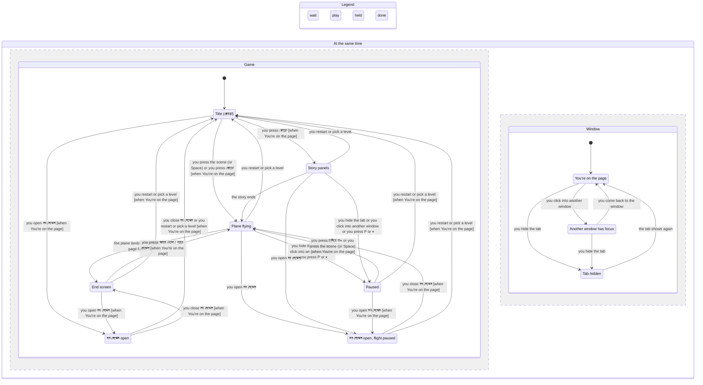

# কাগজের উড়োজাহাজ: statechart

**After the rewrite (Nov 2026)** the game is a paper-plane glide game: throw, feather the nose, land on the red ring. Its machine lives in `tools/kagojer-urojahaj/lib/session.ts` (pure), driven by `components/flight-game.tsx`. The model `Plane.tla` (with `Plane.cfg` and `view.ts`) now mirrors that code: `start`, `storyDone`, `pause`, `resume`, `away`, `back`, `press`, `finish`, `again`, `reset`, `pick`, `cheerMayPlay` and `windStep`, plus the component's `begin`, `letGo`, the pointer and key handlers, the blur and visibility effect, `openList`/`closeList` and `finishRun`.

Run: `after-fix/report.md` and `after-fix/chart.mmd`. TLC reached 228 states and 1,158 steps. The chart has 10 states and 26 arrows. **Every rule holds:** TypeOK, NoProgressWhileAway, InputReleasedWhenAway, PlaneMovesOnlyWhenHeld, FocusTapIsNotAMove, PausedWhenHidden, PausedWhenBlurred, ChoiceFreezesPlay, LoopOnlyWhenMeaningful, LoopComesBack, NoCheerAfterLeaving and NoDeadlock.

## After the fix
| Rule | In plain words |
|---|---|
| NoProgressWhileAway | The plane flies only while you are on the page. |
| InputReleasedWhenAway | After you click away, the game doesn't think you are still holding. |
| PlaneMovesOnlyWhenHeld | The nose goes up only while a finger or key, pressed during the flight, is really down. |
| FocusTapIsNotAMove | The tap that brings you back (or a press on any other screen) never lifts the nose. |
| PausedWhenHidden / PausedWhenBlurred | A flight or the story is paused while the tab is hidden or another window has focus. |
| ChoiceFreezesPlay | While সব লেভেল is open, nothing flies. |
| LoopOnlyWhenMeaningful / LoopComesBack | The wind is heard exactly while the plane flies in front of you with sound on. |
| NoCheerAfterLeaving | A celebration is heard only on its own end screen. |

### How each bug was fixed, and its test (`tools/kagojer-urojahaj/tests/session.test.ts`)
1. **Plane steered on its own after alt-tab** (PlaneMovesOnlyWhenHeld, InputReleasedWhenAway): the game listens for blur and hide and calls `letGo()` (finger, keys and `session.held`), and `press()` counts a hold only while flying. Test: "bug 1 · PlaneMovesOnlyWhenHeld / InputReleasedWhenAway".
2. **Wind kept blowing in another window** (LoopOnlyWhenMeaningful): blur stops the wind, and the step's `windStep` starts a fresh loop only while `moving()`, never a muted stub. Test: "bug 2 · LoopOnlyWhenMeaningful".
3. **No চালিয়ে যাও after coming back** (PausedWhenBlurred): blur pauses through `away()`, and the shared player's menu is the pause; focus alone never resumes, and a 0.45 s breath follows চালিয়ে যাও. Test: "bug 3 · PausedWhenBlurred".
Also replayed: the tap back only resumes, the list and story freeze play, result keys need a fresh press, celebrations stay on their own card, and a friend's far-ahead flight opens nothing in between.



## Live check (Orca, `/kagojer-urojahaj`, Pixel 9)
Driven through the page's own loop (`window.__ku.run`) with trusted-shape pointer events, because Orca throttles frames in a pane that isn't showing:
- a press held through a synthetic window `blur`: `session.held` true → false, phase `flying` → `paused`, and the wind loop stopped (live loops 1 → 0, counted by wrapping `AudioBufferSourceNode.prototype.start/stop`; the dev server keeps audio suspended, so nothing is heard);
- 60 stepped frames while away moved the flight clock by 0 s;
- `focus`: still `paused`. চালিয়ে যাও resumed with `held` false while the finger from before the blur was still down;
- a new press held the nose (`game.a` −0.29 → +0.35 in 30 steps) and the wind loop came back (live loops 0 → 1).
---

# Before the rewrite


Model: `Plane.tla`, `Plane.cfg` and `view.ts`. It mirrors `tools/kagojer-urojahaj/components/plane-game.tsx`: `go`, `start`/`play`/`again`/`proceed`, `finish` and its `later()` cheer, the keydown/keyup effect, `onDown`/`onMove`/`onUp`, `holdDown`/`holdUp`, the `visibilitychange` effect, the `[paused]` effect, `startWind`/`stopWind` and the `SoundToggle` `onChange`. It also mirrors `useGameLoop` in `shared/game-kit.ts`. That is the **working copy**: blur cancels the frame and sets `away`, focus clears it, and a remount starts with `away = false`.
Run: `before-fix/report.md` and `before-fix/chart.mmd`. TLC found 72 states. The chart has 15 states and 33 arrows.

## Systems modelled
- **Play phase:** first screen (উড়াও) → wave in play → result (cleared or soaked), with "paused" on top.
- **Pause and focus:** tab visible or hidden, window focused or blurred, `away` in `useGameLoop`, and pause and resume (P, Esc, থামাও/চালাও, চালিয়ে যাও, Space, a tap on the sky, ◀ ▶).
- **Input:** `held` is what the game believes (`game.steer` from ← → A D or ◀ ▶, or `drag.current` from the canvas). `hand` is whether a key or finger is really down. Keyup, pointerup and pointercancel reach the page only while it has focus. Hide and pause clear `steer`. Hide also clears the drag.
- **Sound:** the wind loop (`none`, a silent `stub`, or `real`) and the site-wide switch.
- **Time:** the cheer that `finish` queues with `later(700 + 260 × stars)`, and the clearing of timers in `start`.
- **Not modelled:** saved stars (`useLevels.record` keeps the max); friend links (`start(shared.seed, shared.level)`; `again()` keeps the friend's seed); the `later(400, thunder)` on storm levels and `later(120/240)` after a storm pops (one-shot sounds under 0.4 s); a stray tap past the result. Space does nothing during play, and on a Pixel 9 the result buttons sit at y=952, well below ◀ ▶ at y=719, so a held arrow tap can't land on them.

## Rules (each is an INVARIANT)
| Rule | In plain words | Result |
|---|---|---|
| NoProgressWhileAway | The sky moves only while you are on the page. | holds |
| InputReleasedWhenAway | After you click away, the game doesn't think you are still steering. | **breaks** |
| PlaneMovesOnlyWhenHeld | The plane slides only while you really hold a side or drag. | **breaks** |
| PausedWhenHidden | A wave in play is paused while the tab is hidden. | holds |
| PausedWhenBlurred | A wave in play is paused while another window has focus. | **breaks** |
| LoopOnlyWhenMeaningful | The wind is heard only while the wave flies in front of you. | **breaks** |
| LoopComesBack | With sound on and the wave flying, the wind is playing. | holds |
| NoCheerAfterLeaving | The cheer for a cleared wave is heard only on that wave's result. | holds |
| NoDeadlock | You can always do something. | holds |

## Bugs
The live replays ran in Orca on `/kagojer-urojahaj`, level 1. Each started with a trusted click on "উড়াও". State was read from the component's `game` ref through the React fiber. Audio was counted by wrapping `AudioBufferSourceNode.prototype.start/stop`.

### 1. PlaneMovesOnlyWhenHeld and InputReleasedWhenAway: "I alt-tabbed while holding ←, and when I came back the plane flew into the wall on its own."
- **Path** (report, PlaneMovesOnlyWhenHeld): 1 you press উড়াও, 2 you hold a side, 3 you click into another window, 4 you let go (the keyup is lost), 5 you come back to the window. InputReleasedWhenAway breaks at step 3 of the same path.
- **Cause:** nothing in the game listens for blur. `useGameLoop` only freezes the frame, and `game.steer` (or `drag.current`) stays set. After a mouse drag, plain hovering over the canvas keeps moving the plane, because `onMove` matches pointer id 1.
- **Live replay:** ← held for 0.3 s took `px` from 50 to 32 (`steer -1`). After the blur, `px` stayed at 32 and the clock at 1.63 for 2 s. After focus with **no key held**, `px` was 24.8 at +0.15 s and **6 (the left edge)** at +1.15 s, with `steer` still −1.
- **Fix (shared pattern, game code):** on blur, do what `onVisibility` does: `drag.current = null; steer(game.current, 0)`, and pause. Put it in the shared away handler (see bug 3).

### 2. LoopOnlyWhenMeaningful: "I clicked into another window and the wind kept blowing."
- **Path** (report, LoopOnlyWhenMeaningful): 1 you press উড়াও (the wind opens), 2 you click into another window.
- **Cause:** the wind stops only on pause, on finish and in `start`. Blur does none of them.
- **Live replay:** 1 loop source started on উড়াও. During the 2 s away, there were **0 loop stops**, and `wind.current` was still set.
- **Fix (shared):** stop loops on blur. Pausing on blur does it here, because the `[paused]` effect already calls `stopWind()`.

### 3. PausedWhenBlurred: "I came back to the window and the wave was already moving. I never got a চালিয়ে যাও."
- **Path** (report, PausedWhenBlurred): 1 you press উড়াও, 2 you click into another window.
- **Cause:** the loop restarts on focus by itself. The game already has a pause (`setPaused`), but only P, Esc, থামাও and hide call it.
- **Live replay:** in the same run as bug 1, the clock moved again 0.15 s after focus (1.63 → 1.73), and no `.ku-resume` button showed at any point.
- **Fix (shared):** call the game's own pause on blur, as `onVisibility` does on hide. A shared `useAway(onAway)` hook (or an `onAway` option on `useGameLoop`) would give all three of this batch the same behaviour.

## Quality-bar gaps (played end to end in Orca: level 1 by an autopilot that steered with ← →, cleared with 2 stars, 62 points, clouds 5/7)
1. **Words above the game:** a kicker, an H1 and a two-line lead sit above the sky. On a Pixel 9, "উড়াও" is at y≈719 of 923, under the canvas (`.shots/kagojer-urojahaj-sc-first.png`). The plane itself isn't the start action, though a tap on the sky also launches.
2. **The first screen line covers the middle:** the level note ("হালকা মেঘ, একটা কাগজের বলেই ফাটে।") sits in a box in the centre of the sky.
3. **Pause misses blur** (bugs 1–3), and the pause isn't the shared menu. It is a single "চালিয়ে যাও" button.
4. **Choices:** "পরের লেভেল" doesn't say what's new on the next level. The star rules are a line of text, "★ পার হলে · ★ ৯টা মেঘ ফাটালে · ★ একবারও না ভিজলে", and don't explain themselves at the choice.
5. **HUD:** good. Points top-left, clouds top-centre, the dry boxes top-right. The combo flash is the only thing mid-sky.
6. **Danger:** a wet hit shakes the stage and empties a box. There is no edge glow at the last dry box.
7. **Ending:** real stats (clouds 5/7, sun 0, never wet), a near-miss line ("আর ২টা মেঘ ফাটালে আরেকটা তারা।") and the phone's best. Good (`.shots/kagojer-urojahaj-sc-clear.png`). The wave ended at 19 s of its 26 s length once nothing was pending. That is fine, but there is no "boss" beat on level 1.
8. **Sound:** the pop, burst, crack, sun chime, wet thud, thunder, birdsong and the wind loop are rich and meaningful. There is no music. The wind leaks on blur (bug 2).

Screenshots: `.shots/kagojer-urojahaj-sc-first.png` (first screen, Pixel 9), `-play.png` (desktop: the end of a wave, the sky with the result under it), `-clear.png` (the result, 2 stars).

## Regenerate (after the rewrite)
```sh
scripts/statechart.sh ai_docs/statecharts/kagojer-urojahaj/Plane.tla --view ai_docs/statecharts/kagojer-urojahaj/view.ts --out ai_docs/statecharts/kagojer-urojahaj/after-fix
rm ai_docs/statecharts/kagojer-urojahaj/after-fix/tlc*.out
```
