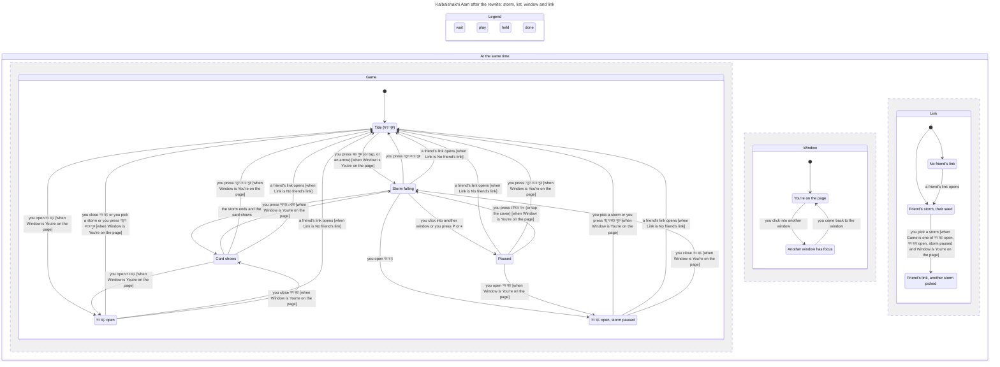

# কালবৈশাখী আম: statechart

## After the rewrite (`after-fix/`)
The spec `Storm.tla` now mirrors the rewritten game:
- `components/storm-game.tsx` (begin, load, pause, resume, the list, finishRun, again, the key, pointer, blur, focus, visibility and hashchange handlers);
- `lib/session.ts`, the pure phase machine the component runs (`start`, `pause`, `resume`, `away`, `back`, `finish`, `again`, `reset`, `pick`, `cheerMayPlay`, `windStep`);
- `lib/progress.ts`, your own unlock (`afterClear`, `playable`).

It runs twice:
- **Full check** (`Full = TRUE`: three storms, a hidden tab, Enter held through the end): TLC reached 3,840 states (`after-fix/report-full.md`).
- **Chart run** (`Full = FALSE`, as committed): 168 states; the chart has 11 states and 25 arrows (`after-fix/report.md`, `after-fix/chart.mmd`). The wind, the hand and the celebration are checked as rules but not drawn, because each follows the game phase.

**All 11 rules hold in both runs, and so does NoDeadlock.** A mutation check put the old behaviours back into a copy of the spec (a blur that doesn't pause, a held Enter that takes the card's choice, a friend's clear that opens every storm). PausedWhenBlurred, PausedWhenHidden, WindComesBack, ChoiceFreezesPlay, CelebrationOnItsOwnCard, HeldKeyNeverSkips and OpenLevelsAreEarned then broke, so none of them is vacuous.

| Rule | In plain words | After |
|---|---|---|
| PausedWhenHidden, PausedWhenBlurred | Hiding the tab or clicking into another window pauses a falling storm. | hold |
| InputReleasedWhenAway | Once you leave the window, no arrow or finger counts as held. | holds |
| ChoiceFreezesPlay (new) | While সব ঝড় is open, the storm is still. | holds |
| WindOnlyInTheStorm | The wind blows only while a storm is falling on screen with sound on. | holds |
| WindComesBack | Whenever a storm falls on screen with sound on, the wind blows, even after sound off and on. | holds |
| CelebrationOnItsOwnCard | Stars' notes, confetti or the lose sound play only on their own card. | holds |
| ReplayIsExact | When the friend's storm is on screen, their seed is what falls. | holds |
| HeldKeyNeverSkips (new) | An Enter held from before the card never takes its choice. | holds |
| OpenLevelsAreEarned (new) | Every storm below your unlock is one you cleared yourself. | holds |



### The bugs, fixed, with their tests (`tools/kalbaishakhi-aam/tests/session.test.ts`)
1. **PausedWhenBlurred + InputReleasedWhenAway:** the game listens to window `blur` itself (and the player's pause sends one): `stopInput()`, `away()` pauses, `stopWind()`. Focus coming back never resumes by itself; a tap on the cover only resumes. Test: *bug 1 · PausedWhenBlurred*. Live in Orca (storm 3, a friend's link): holding ← at t = 5.08 s, `keys −1`, 1 wind loop → blur: paused, `keys 0`, 0 loops → 2 s in the other window and 120 forced steps: still 5.08 s → focus with no keyup: still paused at 5.08 s, `keys 0`.
2. **WindComesBack:** every step asks `windStep(live, moving, soundOn())`, so a loop made while muted (a silent stub) is replaced as soon as sound returns. Test: *bug 2 · WindComesBack*. Live: storm falling, 1 live looping source → sound off: 0 → sound on: 1 within two steps → the card: 0.
3. **WindOnlyInTheStorm:** opening সব ঝড় pauses the storm and stops the wind; picking a storm goes through `load()`, which stops the wind, input and timers. Test: *bug 3*. Live: the storm badge mid-storm → paused, 0 loops, t 1.83 s → 1.83 s over 60 steps; picking a storm → its title, 0 loops.
4. **CelebrationOnItsOwnCard:** every celebration is a `later()` timer that checks `cheerMayPlay(session, run)`; the run number changes on আবার খেলো, a pick, a link and নতুন করে শুরু, and all timers are cleared there and on unmount. Test: *bug 4*. Live: storm 2 won (27/28), আবার খেলো at 0.72 s (after the guard, before the 1 s fanfare) → in the next 1.4 s, 0 oscillators started by the old card and 0 confetti canvases.
5. **ReplayIsExact:** a friend's link opened mid-storm calls `load(their storm, their seed)`, which stops the storm and shows their title. Test: *bug 5*. Live: storm falling with 1 wind loop → `location.hash = 's=777&t=0&a=0&w=2'` → the title of ঝড় ২ · দমকা হাওয়া, 0 loops.
- **Also fixed:** the end screen takes only a fresh Enter after a 0.7 s guard (*HeldKeyNeverSkips*); a friend's far-ahead storm records stars but opens nothing in between (*OpenLevelsAreEarned*, `ektukhani-unlock-kalbaishakhi-aam`); P calls the player's `requestPause()`; game keys are ignored while paused; clicked buttons drop focus.

### Quality-bar gaps, closed
1. **First screen:** the start is a code-drawn ডালা heaped with mangoes labelled ঝড় শুরু, with the storm, its one new thing, the জান chips and the targets small under it.
2. **Pause:** the shared player's menu, on P, Esc, ⏸, blur and hide; the game's own toggles are gone.
3. **Choices:** সব ঝড় is a pausing sheet, numbered 1–9, 0, -, =, one line of real effect per storm, এটা খেলো on the recommended one.
4. **Danger:** the edge glows orange on the last জান, pulses red on a hit, warns at the bottom corner when a hazard is about to land within reach, and shows chevrons for the wind and ice-blue for a hail sweep.
5. **HUD:** corners only: the storm badge top-left, the clock or the finale's named bar top-centre, points, জান and the streak top-right, the catch line along the top edge.
6. **Sound:** the wind loop works (bugs 2, 3); each world has its three-note call after the thunder.
7. **Pacing:** storm 1 is 10 s of mangoes only; each storm adds one thing; each world ends in a named storm with its own move.
8. **End:** the stats count up, the buttons wait 0.7 s, and the stars chime only on their own card.

### Regenerate
```sh
D=ai_docs/statecharts/kalbaishakhi-aam
# the drawn chart: Storm.cfg as committed (Full = FALSE)
scripts/statechart.sh $D/Storm.tla --view $D/view.ts --out $D/after-fix-new
# the full check: set CONSTANT Full = TRUE in Storm.cfg, run into another folder, then set it back
rm $D/after-fix-new/tlc*.out
```
The `before-fix/` output came from the original spec, which is in git history (before this rewrite).

## Before the rewrite (the original analysis)

Model: `Storm.tla` / `Storm.cfg`, view `view.ts`, output `before-fix/` (`report.md`, `chart.mmd`).
Mirrors `tools/kalbaishakhi-aam/components/mango-game.tsx`, plus `shared/game-sound.ts` (`loop()`, `setSoundOn()`) and `shared/game-kit.ts` (`useGameLoop` at commit a5fb4f1: stops on a hidden tab, not on blur). Live replays ran 09:15–09:22 today.
TLC: 276 states, 1322 steps. The chart draws 19 states and 44 arrows as parallel regions.

### Systems modelled
| Region | Values | Code |
|---|---|---|
| Game | Ready screen, Storm falling, Paused, Card shows | `phase`, `start()`, `pause()`, `resume()`, `finish()`, `choose()` |
| Window | on the page, another window has focus, tab hidden | `visibilitychange` → `pause()`; **no `blur` listener** |
| Hand | holding ← / → (or a thumb held on one side), hands off | `input.current.keys` / `mode 3`, keyup, `stopInput()` |
| Wind | blowing, quiet | `wind.current = loop("wind")`, `startWind()`, `stopWind()` |
| Sound | on, off | the site-wide `SoundToggle` (off stops every loop, on starts none) |
| Celebration | queued, nothing queued | the `window.setTimeout` in `finish()` (0.25–1.1 s, never cleared) |
| Link | none, friend's storm + seed, another storm, bar says friend's storm while your own storm falls | `hashchange` → `readFriend()`, `choose()`, `start()`'s `friendFits` |

Left out: the storm's physics (pure and covered by `tests/storm.test.ts`), stars and the level store (`recordLevel` keeps the max, so stars never drop and unlocks never shrink; covered by `tests/stages.test.ts`), the card canvas and share bar. The storm list (`সব ঝড়`, a `<details>` below the yard) is modelled as "you can pick a storm on any screen"; opening it without picking is not modelled (it changes nothing in the game, which is itself a gap, see below).

### Rules (plain words)
- **PausedWhenHidden** (holds): the storm never falls while the tab is hidden.
- **PausedWhenBlurred** (breaks): the storm never falls while another window has focus.
- **InputReleasedWhenAway** (breaks): once you leave the window, the ডালা no longer counts ← / → as held.
- **WindOnlyInTheStorm** (breaks): the wind blows only while a storm is falling, on screen, with sound on.
- **WindComesBack** (breaks): whenever a storm is falling on screen with sound on, the wind blows.
- **CelebrationOnItsOwnCard** (breaks): stars' notes, confetti or the lose sound only play while their own card is showing.
- **ReplayIsExact** (breaks): when the bar says you're in the friend's storm, the friend's storm is what's falling.

### Bugs
#### 1. PausedWhenBlurred + InputReleasedWhenAway: "I held ←, clicked another window, and the ডালা kept sliding and the storm kept falling."
Shared bug (same as antenna's DialStillWhileAway; dudh and jhalmuri have the blur half too).
- Path (report): ready → you hold ← (storm starts) → you click into another window. The storm keeps falling and `keys` stays −1.
- Live replay (Orca, my own tab; `keydown ArrowLeft` on `window`, then `blur`, no keyup):

  | step | phase | storm clock | ডালা x | keys |
  |---|---|---|---|---|
  | holding ← | playing | 1.33 s | 150 | −1 |
  | blur | playing | 1.33 s | 150 | −1 |
  | 2 s in the other window | playing | 1.55 s | 85 | −1 |
  | back, 1 s, no keyup | playing | 1.65 s | 55 | −1 |
  | a fresh tap of → | playing | 1.75 s | 55 | 0 |

  The storm never paused and the ডালা kept sliding to the wall; it stays pinned until you press and release that key again. (The Orca tab was in the background, so frames were throttled: 0.3 storm-seconds per 3 s of wall time; in a foreground tab the storm runs at full speed.)
- Fix (shared): in the shared player or `useGameLoop`, listen for `window` `blur` and pause like `visibilitychange` does (`pauseRef.current()`, which already calls `stopInput()` and `stopWind()`). Inside the game, add `window.addEventListener("blur", () => pauseRef.current())` next to the `visibilitychange` listener. Note: the in-progress shared `useGameLoop` change (09:36 today, uncommitted) stops frames on blur, which stops the storm, but leaves `input.keys = −1` and the wind loop on, so on focus the ডালা slides again on its own; the game still needs its own blur → `pause()`.

#### 2. WindComesBack: "I turned sound off and on again mid-storm, and the wind never came back."
Shared bug (same as antenna's StaticWhileSearching; dudh's hum too).
- Path (report): sound off → শুরু করো (wind loop is a silent stub) → sound on. The model's other path: storm falling → sound off (`stopLoops()`) → sound on.
- Live replay: started with sound on → **1** live looped noise source; sound off → **0**; sound on → **0**; 2 s later → **0**. `wind.current` still holds the stopped handle, so `set()` does nothing.
- Fix (shared): `<SoundToggle onChange={on => on && phase === "playing" && startWind()} />`, or a `loop()` in the kit that re-creates itself when sound comes back on.

#### 3. WindOnlyInTheStorm: "I picked a storm from সব ঝড় mid-storm and the wind kept howling on the ready screen."
Game-specific (`choose()` doesn't call `stopWind()`).
- Path (report): শুরু করো → you pick a storm from সব ঝড় → Ready screen, wind blowing.
- Live replay: storm 1 falling, 1 live wind loop → picked ঝড় ১ from the list → phase `ready`, **1** live wind loop; 3 s later still **1**. It stays until the next শুরু করো replaces it.
- Fix: in `choose()`, call `stopInput()` and `stopWind()` (and clear the celebration timer, bug 4).

#### 4. CelebrationOnItsOwnCard: "I pressed পরের ঝড় straight away, and a second later the win fanfare and confetti burst over my new storm."
Shared pattern (dudh and jhalmuri have the same un-cleared `setTimeout`).
- Path (report): hold ← → the storm ends and the card shows (celebration queued for 1.1 s) → you press শুরু করো or আবার খেলো → Storm falling with the celebration still queued.
- Live replay (storm clock moved to 44.9 s to reach the card quickly): card at +0 ms (3 stars, new record) → pressed পরের ঝড় at +266 ms → ready → শুরু করো → storm 2 falling; at **+1088 ms** four oscillators started (`sfx.win`) and the confetti canvas was added at **+1089 ms**, over storm 2.
- Fix: keep the timer id in a ref; clear it in `start()`, `choose()`, on hide and on unmount. Better, a shared `useLater()` in the game kit that every game uses for celebrations.

#### 5. ReplayIsExact: "I opened Rafi's link while a storm was on; the bar switched to ঝড় ৪ but my own storm kept falling."
Game-specific, minor.
- Path (report): শুরু করো → a friend's link opens → Storm falling, bar says the friend's storm.
- Live replay: storm 2 (seed 760074619) falling → `location.hash = "s=12345&t=50&a=10&l=4&n=Rafi"` → bar `ঝড় ৪ · কালবৈশাখী`, banner "Rafi ৫০ পয়েন্ট করেছে…", still storm 2 with seed 760074619 (and still after pausing). The card at the end would compare against Rafi only if the stages matched.
- Fix: in `readFriend()`, when a round is on, pause and go to the ready screen of the friend's storm (or keep `level` unchanged until the round ends).

### Quality-bar gaps (played end to end in Orca, Pixel 9; screenshots `.shots/kalbaishakhi-aam-ready.png`, `-play.png`, `-card.png`)
1. **First screen:** the start action is a plain শুরু করো button inside a dark legend panel over the yard, not the game's own art (the ডালা or a mango); the panel covers the middle of the scene.
2. **Pause:** no real pause menu. "খেলা থেমে আছে" + চালিয়ে যাও only: no নতুন করে শুরু, কীভাবে খেলবে, শব্দ, সব ঝড়. It doesn't pause on blur (bug 1).
3. **Choices:** the storm list is a `<details>` below the page: unnumbered, each storm has only a name (দমকা হাওয়া, কালবৈশাখী), no one-line real effect, no default, and opening it doesn't pause a storm.
4. **Danger:** losing the last heart has no edge glow or vignette; lives are hearts at the top centre, nothing changes when one is left.
5. **HUD:** the streak label (টানা ৬১টা) and `+১০` floats sit in the middle of the canopy, over falling mangoes.
6. **Sound:** the wind is the only loop and it breaks (bugs 2, 3); no short tune, nothing changes with the storm number.
7. **Pacing:** storm 1 brings no twigs and is a long 45 s of one idea; twigs arrive in storm 2 and gusts strengthen after that. The last storm (বোশেখের শেষ ঝড়) is named but has no "boss" moment beyond more of the same.
8. **End:** good: real stats, stars, near-miss line, mango-tally milestone, personal card. The card's আবার খেলো / পরের ঝড় buttons respond immediately with no guard, which is what lets bug 4 happen.

### Regenerate (the original spec, from git history)
```sh
scripts/statechart.sh ai_docs/statecharts/kalbaishakhi-aam/Storm.tla --view ai_docs/statecharts/kalbaishakhi-aam/view.ts --out ai_docs/statecharts/kalbaishakhi-aam/<new-folder>
```
After the fix, update the spec to the fixed code and run into `after-fix/`; every rule must hold.
