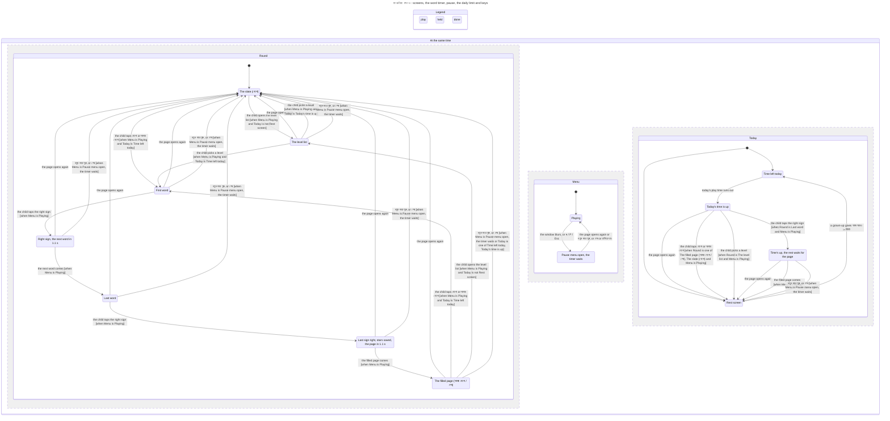

# কার-চিহ্ন বসাও: statechart

The game was rewritten on 2026-11-04 (design: `ai_docs/game-dev/rewrites/kar-chinho.md`). The model now has two parts, so each chart stays readable:

| Spec | What it covers | Mirrors | TLC |
|---|---|---|---|
| `KarChinho.tla` / `.cfg`, view `view.ts` | the screens (slate, level list, the round, the filled page), the one pending timer (next word / end screen), the player's pause, coming back from away, a key held through the last word, the daily limit and the rest screen | `tools/kar-chinho/lib/session.ts`, `components/game.tsx` (`begin`, `pick`, `fire`, `useGamePlayer`), `shared/kids-kit.tsx` (`useKidsSession`) | 71 states, 298 steps |
| `KarChinhoGates.tla` / `.cfg`, view `view-gates.ts` | who has the phone, the share gate on the slate, the rest screen's gate | `components/game.tsx` (`<ParentGate key={gateKey}>`, the outside-tap listener), `shared/kids-kit.tsx` (`ParentGate`, `RestScreen`) | 96 states, 536 steps |

- `before-fix/` holds the run on the old code, and the old spec itself (`before-fix/KarChinho.tla`, `.cfg`, `view.ts`).
- `after-fix/` and `after-fix-gates/` are runs on the rewritten code. **Every rule holds.**
- **Model check (mutations, run in a scratch copy):** putting back the old behaviours breaks the rules at once. Recording the stars only when the end screen comes breaks **EveryFinishCounts** in 4 steps (খেলো → right → next word → right on the last word, then leave). Dropping `atBreak()` from `begin()` breaks **NoNewRoundPastLimit** in 2 steps. Letting the timer run under the menu breaks **NothingMovesUnderTheMenu** in 4 steps.

## Rules (plain words), all holding after the fix
**KarChinho.tla**
- **RestOnlyAtBreak:** the rest screen comes only between rounds, never over a word. If the limit passes on the last word, the rest waits for the filled page.
- **NoNewRoundPastLimit:** once today's time is up, খেলো, আবার খেলো and a level from the list show the rest screen, not a round. A reload past the limit opens on the rest screen.
- **EveryFinishCounts:** once the last word is right, its stars are saved and the limit checked in that same tap, whatever the hand does next.
- **NothingMovesUnderTheMenu:** the next word and the filled page wait while the pause menu is open; চালিয়ে যাও gives them back after a 0.5 s breath.
- **ChoiceFreezesPlay:** the level list opens only from the slate or the filled page, so no word is waiting under it.
- **ResultNeedsFreshPress:** Enter or Space held through the last word never starts the next round.

**KarChinhoGates.tla**
- **GateNeedsAnAdult:** only a grown-up opens either gate (kids-kit: a two-digit sum checked after both digits, a wrong one rests the hold).
- **GateShutOutsideTheTitle:** the share gate lives on the slate only. Any touch on the game outside it, starting a round, its one action or 20 s shut it.
- **RestGateOnlyOnTheRestScreen** and **OnlyParentsGiveMoreTime:** আজ আরও ১০ মিনিট is reachable only through a gate a grown-up opened.
- **RestOnlyAtBreak**, again from the gate's side.

**Rules replaced, and why.** The old **GateClosesWhenTheParentHandsBack** and **NoShareForKids** talk about the moment the phone changes hands, which no code can see. They are replaced by what the code does guarantee: the child can't open a gate, and an open gate shuts at its one action, the next touch outside it, a round's start, 20 s, or the tab hiding. What remains: a parent who opens বড়দের জন্য and hands the phone back within 20 s without using it leaves one button reachable. That button sends only the tool's plain address to the phone's own share sheet, or opens the print sheet. A kit-level fix (a hold on the gate's action buttons too) would close it for every kids' game; it's in the rewrite report.
- **SilentWhenMuted** is gone: there's no voice anywhere on the site now (`speak()` is a no-op), and the game makes no speech calls at all.

## The bugs, and how each was fixed
| # | Bug (the reader's sentence) | Fix | Node test | Live check after the fix (Orca, own tab, 412 × 860) |
|---|---|---|---|---|
| 6 | **EveryFinishCounts:** "she got all ten words, tapped the level button, and the stars never came." | `pick()` records the stars and calls `atBreak()` in the tap that solves the last word (`session.solved`); only the filled page waits 1.1 s. The level button is gone from play; leaving is through the player's menu, and the list opens only from the slate or the page. | `session.test.ts` › bug 6, EveryFinishCounts | Level ৩, nine words right, the tenth right, ⏸ → নতুন করে শুরু **275 ms later**: `ektukhani-levels-kar-chinho` = `{"3":3}`, and the screen stayed on the slate 2 s later. |
| 4 | **NoNewRoundPastLimit:** "the rest screen came, so she opened কার-চিহ্ন again and got a whole new round." | `begin()` asks `kids.atBreak()` first and starts nothing past the limit. The kit opens on the rest screen past the limit. The rest screen shows on every screen but play. | `session.test.ts` › bug 4, NoNewRoundPastLimit; › RestOnlyAtBreak | Today's time set past the limit in my tab (saved first, restored after): খেলো on the slate → the rest screen, the round counter unchanged (serial 1), the page behind `inert`. |
| 5 | **SilentWhenMuted:** "I turned the sound off and it still read every word out loud." | No voice anywhere (site rule): the game has no `speak`, `SpeakButton` or `speechSynthesis`. Each cue is a picture, a hop or a sound effect. | `session.test.ts` › bug 5, SilentWhenMuted | Source check only. |
| 1–3 | **GateNeedsAnAdult / the gate left open / the child gives herself time** | Kit: the two-digit sum, one action, 20 s, auto-repeat ignored. Game: the share gate shuts on the next touch outside it (the `ParentGate` key is bumped) and unmounts when a round starts. | `session.test.ts` › bugs 1–3, the parent gate | Not replayed live after the fix; the kit's own tests cover the gate. |
| — | **Pause on blur** (shared pattern): the 1.1 s timer kept running under the menu. | `onPause` stops the pending timer; `onResume` re-arms it after 0.5 s. | › pause freezes the next-word and end timers | Blur after a right sign: still word ১ 2 s later; চালিয়ে যাও → the next word **521 ms** later. |
| — | **The first tap back is not a move** (shared pattern) | `session.blur` arms a swallow; the next tile tap only wakes the game, unless the player's menu took it. | › the tap that brings focus back is not a move | — |
| — | **Result keys need a fresh press**, **Enter goes to the game** (shared patterns) | Keys at `window` with `preventDefault`; the page takes Enter only from a keydown after it appeared, never a repeat; buttons blur after a click. | › result keys need a fresh press; › Enter and Space go to the game | Enter on the slate started the round; `1` tapped tile ১; P opened the player's menu. |

## The chart (after the fix)

The gates' chart is `after-fix-gates/chart.mmd`.

## Regenerate
```sh
scripts/statechart.sh ai_docs/statecharts/kar-chinho/KarChinho.tla --view ai_docs/statecharts/kar-chinho/view.ts --out ai_docs/statecharts/kar-chinho/after-fix
scripts/statechart.sh ai_docs/statecharts/kar-chinho/KarChinhoGates.tla --view ai_docs/statecharts/kar-chinho/view-gates.ts --out ai_docs/statecharts/kar-chinho/after-fix-gates
rm ai_docs/statecharts/kar-chinho/after-fix*/tlc.out
```
Use a fresh `--out` folder each run.

---

## The bugs found before the rewrite (as replayed then)

Replays ran in Orca (my own tab, Pixel 9) by clicking the real tiles and buttons, and reading the dots, the overlays and localStorage. Today's kids' time was already past the 15-minute default (900 s) when I started: 1,300 s, rising to 3,000+ s because other agents' kids' tabs tick the same shared counter. That made every rest-screen path reachable without faking anything. `speechSynthesis.speak` was stubbed to record calls (the phone's Bangla voice is Piya, bn-IN, local), so nothing was spoken.

### 1. GateNeedsAnAdult: "my four-year-old got through the বড়দের জন্য gate by mashing the numbers" (shared, kids-kit)
- **Path (1 step):** the child holds বড়দের জন্য and mashes the pad: *share gate opened by the child*.
- **Why:** `ParentGate.press()` keeps the last two digits and opens as soon as `Number(answer)` equals the sum, so "7", "07" and a "…07" run all count. Only a wrong *two-digit* run clears it, and the child can try forever with no lockout. Sums of 9 or less (10 of the 49 pairs) open on a single right digit.
- **Live:** 12 trials, each a 2 s hold, then random pad taps until it opened. **12 of 12 opened**, after 3, 23, 32, 76, 84, 92, 96, 150, 162, 234, 242 and 244 taps. A node simulation of the same `press()` rule (200,000 runs, random sums 3–9 + 3–9) gives a median of 94 taps, a mean of 163, 28% open within 30 taps and 49% within 90. At three taps a second, that's about half a minute.
- **Fix (kit):** ask for a sum of 10 or more (always two digits) and check only after both digits. A wrong answer closes the gate back to the 2 s hold, and three wrong holds lock it for a minute. Add a node test that mashes 10,000 times and expects almost no openings.
- **Also from reading the code (not replayed):** holding Enter or Space on the gate button fires `start()` on every key repeat, and `stop()` clears only the last timer. A half-second key hold still opens the question about 2 s later.

### 2. GateClosesWhenTheParentHandsBack (and NoShareForKids): "I shared the link and gave the phone back; the share button stayed in front of her" (shared, kids-kit)
- **Path (3 steps):** a parent takes the phone → opens বড়দের জন্য → the child takes it back: *share gate opened by a parent, the child has the phone*. NoShareForKids breaks on this path and on bug 1's.
- **Why:** `ParentGate`'s `open` stage lives until someone presses বন্ধ করো or the page reloads. Nothing closes it after its one action, on a new round, or after a while.
- **Live:** the parent opened the gate (correct sum) → আবার খেলো → three words solved. "খেলাটার লিংক পাঠাও" was **still showing** under the game. Screenshot: `.shots/kar-chinho-share-gate-left-open.png`.
- **Fix (kit):** close the gate after its action runs, on the next tap outside it, when a round starts, or after 30 s, whichever comes first.

### 3. OnlyParentsGiveMoreTime: "I set the daily limit, handed the phone back, and she gave herself ten more minutes" (shared, kids-kit)
- **Path (6 steps):** time runs out → the last word → the rest screen → the gate opens (by a parent choosing a limit, or by bug 1) → the child has the phone: *rest gate open*.
- **Why:** on the rest screen, choosing a daily limit (`choose`) only writes the limit. The gate stays open with আজ আরও ১০ মিনিট in it.
- **Live:** rest screen up (`.shots/kar-chinho-rest-screen.png`). The parent held the gate and answered "আট আর নয়" = ১৭, then tapped ১৫ মিনিট. The gate stayed open with আজ আরও ১০ মিনিট, ১০/১৫/৩০ মিনিট and সীমা নেই, and was **still open 15 s later**. The "child's" tap on আজ আরও ১০ মিনিট removed the rest screen, and today's time went from 3,890 s to 3,400 s.
- **Fix (kit):** choosing a limit closes the gate. If the new limit is above today's time (or is সীমা নেই), it also ends the rest screen.
- **Related (kit, seen live):** after extend, today's time was still 3,400 s against a 900 s limit. So "আরও ১০ মিনিট" buys exactly one more round, and the next `atBreak()` rests again. `extend` should set the time to `limit − 10 min` when it is further over than that.

### 4. NoNewRoundPastLimit: "the rest screen came, so she opened কার-চিহ্ন again and got a whole new round" (shared, kids-kit + every kids' game)
- **Path (2 steps):** today's time runs out → the page opens again (a reload, or the game from the kids' hub): *first word, started after today's time ran out*. Picking a level from the level button mid-round does the same.
- **Why:** `useKidsSession` starts with `resting = false` and checks only when a game calls `atBreak()`, which every game does only at a round's end. Each page open, and each round started from the picker, gets one full round past the limit. Going from game to game, the limit never stops play.
- **Live:** the page opened at **3,540 s** (limit 900 s) with the first word ready and no rest screen. After the level picker, a full 10-word round started at **3,670 s**. The rest screen came only at its end (3,780 s), and correctly so: RestOnlyAtBreak holds.
- **Fix (kit):** `useKidsSession` sets `resting` on mount when today's limit has passed, and games call `atBreak()` from `start()` as well as `finish()`. That's a natural break too, before any word is shown. Add a node test: over the limit, a fresh session is resting.

### 5. SilentWhenMuted: "I turned the sound off and it still read every word out loud" (shared, kids-kit `speak`)
- **Path (2 steps):** the child turns sound off → taps the right sign: *sound off, the phone says the word*.
- **Why:** `speak()` never reads `soundOn()`, and `tap()` calls `speak(item.word)` on every right answer. The brief says every game works fully silent ("some families avoid music, children play in shared rooms").
- **Live:** turned 🔊 off (`ektukhani-sound` = 0), then played a full round: **10 `speak()` calls with sound off**: হাতি, ছাতা, কলা, মাছ, বাঘ, জাহাজ, থালা, পানি, ডাব, ধান.
- **Fix (kit):** `speak()` returns early when `!soundOn()`. `SpeakButton`, an explicit tap, may pass `{ force: true }`.

### 6. EveryFinishCounts: "she got all ten words, tapped the level button, and the stars never came" (game-specific)
- **Path (4 steps):** right sign → next word → right sign on the last word → the child taps the level button within 1.1 s: *level picker, the finished round was never counted*.
- **Why:** `finish()` (record stars, `sfx.win`, `atBreak()`) runs from the 1.1 s `later()`. The level button calls `clearTimers()` first, which kills it. That also skips the daily-limit check (bug 4's door).
- **Live:** nine words solved, the tenth solved (all ten dots "got"), then the level button **300 ms later** → picker. `ektukhani-levels-kar-chinho` stayed **null**, there was no end screen, and there was no rest screen even though today's time was 3,610 s.
- **Fix:** record the stars and call `atBreak()` synchronously on the last right tap, and delay only the end screen. Or have the level button flush a pending finish before `clearTimers()`.

### Rules that hold
- **RestOnlyAtBreak:** the rest screen appeared only on the end screen, never over a word (replay 4).
- No `/api/*` request in the resource timing after play, and the share link goes out only through `navigator.share` or the clipboard (behind the gate). The card has no name.
