# কী হবে বলো তো?: statechart

Two runs: the **before** run on the old code (3 rules hold, 5 break; written up in full below), and the **after** run on the rewrite (every rule holds).

## After the rewrite (2026-11-05, branch `games-to-the-bar`)
Spec `KiHobe.tla` (+ `KiHobe.cfg` for 2 experiments a round, `KiHobeChart.cfg` for 1), view `view.ts`, output `after-fix/`.
It mirrors `tools/ki-hobe/lib/round.ts`, `lib/session.ts`, `lib/finish.ts`, `components/game.tsx` and `components/art.tsx`, with the kit's `silenceScheduled()` on mute, its modal `RestScreen` and its one-action `ParentGate`.
- **Full check:** 1,584 states, 2 experiments a round. **Chart run:** 450 states and 2,032 steps; the chart draws 30 states and 85 arrows (`after-fix/chart.mmd`). The full report is `after-fix/report-2-questions.md`.
- **All 16 rules hold:** TypeOK, NoDeadlock, NoProgressWhileAway, SilentWhenMuted, NoDoubleResult, RestOnlyAtBreak, BehindRestNothingMoves, NoNewRoundPastLimit, RestAtTheBreak, WonIsRecorded, ResultMatchesPlay, StarsNeverDrop, FirstTapBackIsNotAMove, ParentGate, NoNetwork, NoChildData, NoReadingNeeded.
- **New rules:** BehindRestNothingMoves (nothing behind the rest screen moves), NoNewRoundPastLimit, RestAtTheBreak, WonIsRecorded, ResultMatchesPlay, StarsNeverDrop, FirstTapBackIsNotAMove.
- **One more gap, found by the model:** RestAtTheBreak first broke: today's time could run out during the last experiment, and the rest screen then waited for the next one-second check on the end screen. The fix is in `game.tsx` `next()`: `toEnd()` now calls `atBreak()` at once (live check: the rest screen is up on the end screen with the stage inert).

### Each bug, the fix, the test and the live check (Orca, 2026-11-05)
| Bug | Fix | Node test (`tools/ki-hobe/tests/session.test.ts`) | Live replay |
|---|---|---|---|
| 1 NoProgressWhileAway | The scene is paused by CSS whenever `data-run="paused"` (window blur, hidden tab, the player's menu), its clock is a CSS animation, an end that arrives anyway sets `waiting`; `settleWaiting()` shows the answer on return. আবার দেখো replays. | `bug 1, NoProgressWhileAway…`, `bug 1, the pause menu holds…`, `bug 1, the experiment can be watched again…` | Dispatched `blur` 1 s after a guess: 13 animations `paused` at 1,082 ms, still 1,082 ms 3 s later, step still `watch`, sound starts 7 → 7; on `focus` they ran on and the answer showed. The replay button gave 5 new sound starts and the answer again. |
| 2 SilentWhenMuted | The kit cuts scheduled notes on mute. The game schedules nothing: `lib/sound.ts` has no timers, scene sounds fire from `onAnimationStart`. | `bug 2, SilentWhenMuted…` | Guess, mute after 0.3 s: 5 oscillator/buffer starts before, still 5 after 4.5 s while the experiment ran to its answer. |
| 3 RestOnlyAtBreak | `restShows()` only off the play screen; the kit's `RestScreen` is a modal; `atBreak()` at round start, at the last guess and at the end screen. | `bug 3, RestOnlyAtBreak…` | Limit passed at the last guess: no rest screen at the guess or during the answer; at the end screen `.kk-rest` was up, Enter and a click on আবার খেলো behind it left the screen on `end`, the stage was inert. |
| 4 ParentGate | The share link is only inside `ShowParent`, behind `ParentGate`; the kit's gate shuts after one action. | `bug 4, ParentGate…` | The end screen has no share button; the card shows খেলাটার লিংক as a held-down gate button. |
| 5 NoReadingNeeded | Picture end buttons (128×112), picture answer buttons (112×96), picture world tiles and level chip, picture guesses. | `bug 5, NoReadingNeeded…` | `.ki-big` measured 128×112 each. |

### The chart (`after-fix/chart.mmd`, one experiment a round)

```mermaid
stateDiagram-v2
  state "Legend" as legend {
    lg0: play
    lg1: rest
    lg2: done
  }
  class lg0 teal
  class lg1 yellow
  class lg2 blue
  state "Game Title: the pond, the worlds" as s0 {
    state "Pause Playing" as s1 {
      s2: Today Time left today
      s3: Today Today's time used up
      s4: Today Rest screen up
    }
    state "Pause Away, next tap only wakes" as s5 {
      s6: Today Time left today
      s7: Today Today's time used up
      s8: Today Rest screen up
    }
  }
  state "Game Guess what will happen (pictures)" as s9 {
    state "Pause Playing" as s10 {
      s11: Today Time left today
      s12: Today Today's time used up
    }
    state "Pause Away, next tap only wakes" as s13 {
      s14: Today Time left today
      s15: Today Today's time used up
    }
    state "Pause Pause menu" as s16 {
      s17: Today Time left today
      s18: Today Today's time used up
    }
  }
  state "Game The experiment plays" as s19 {
    state "Pause Playing" as s20 {
      s21: Today Time left today
      s22: Today Today's time used up
    }
    state "Pause Away, next tap only wakes" as s23 {
      s24: Today Time left today
      s25: Today Today's time used up
    }
    state "Pause Pause menu" as s26 {
      s27: Today Time left today
      s28: Today Today's time used up
    }
  }
  state "Game What happened: tick, আব#2494;র দ#2503;খ#2507;, #8594;, ক#2503;ন?" as s29 {
    state "Pause Playing" as s30 {
      s31: Today Time left today
      s32: Today Today's time used up
    }
    state "Pause Away, next tap only wakes" as s33 {
      s34: Today Time left today
      s35: Today Today's time used up
    }
    state "Pause Pause menu" as s36 {
      s37: Today Time left today
      s38: Today Today's time used up
    }
  }
  state "Game Round done: আব#2494;র খ#2503;ল#2507; / শ#2503;ষ (pictures)" as s39 {
    state "Pause Playing" as s40 {
      s41: Today Time left today
      s42: Today Today's time used up
      s43: Today Rest screen up
    }
    state "Pause Away, next tap only wakes" as s44 {
      s45: Today Time left today
      s46: Today Today's time used up
      s47: Today Rest screen up
    }
  }
  [*] --> s2
  s2 --> s11: you tap খ#2503;ল#2507; or আব#2494;র খ#2503;ল#2507; (the limit is checked)
  s2 --> s6: you switch to another app or window
  s2 --> s3: today's minutes run out
  s11 --> s12: today's minutes run out
  s11 --> s21: you tap a guess (on the last one the stars are saved)
  s11 --> s14: you switch to another app or window
  s11 --> s17: you open the pause menu
  s6 --> s2: you come back
  s6 --> s7: today's minutes run out
  s3 --> s7: you switch to another app or window
  s3 --> s4: the one-second check at a break or you tap খ#2503;ল#2507; or আব#2494;র খ#2503;ল#2507; (the limit is checked)
  s12 --> s22: you tap a guess (on the last one the stars are saved)
  s12 --> s15: you switch to another app or window
  s12 --> s18: you open the pause menu
  s7 --> s3: you come back
  s7 --> s8: the one-second check at a break
  s4 --> s2: a parent gives ten more minutes
  s4 --> s8: you switch to another app or window
  s21 --> s31: the experiment ends and the answer shows or you're back: the answer shows
  s21 --> s22: today's minutes run out
  s21 --> s24: you switch to another app or window
  s21 --> s27: you open the pause menu
  s14 --> s15: today's minutes run out
  s14 --> s17: you open the pause menu
  s17 --> s2: you pick সব ল#2503;ভ#2503;ল or নত#2497;ন কর#2503; শ#2497;র#2497;
  s17 --> s11: you tap চ#2494;ল#2495;য#2492;#2503; য#2494;ও
  s17 --> s18: today's minutes run out
  s8 --> s6: a parent gives ten more minutes
  s8 --> s4: you come back
  s31 --> s21: you tap আব#2494;র দ#2503;খ#2507;
  s31 --> s32: today's minutes run out
  s31 --> s41: you tap #8594;
  s31 --> s34: you switch to another app or window
  s31 --> s37: you open the pause menu
  s22 --> s32: the experiment ends and the answer shows or you're back: the answer shows
  s22 --> s25: you switch to another app or window
  s22 --> s28: you open the pause menu
  s14 --> s11: you tap once after coming back: it only wakes the game
  s15 --> s18: you open the pause menu
  s24 --> s25: today's minutes run out
  s24 --> s27: you open the pause menu
  s18 --> s3: you pick সব ল#2503;ভ#2503;ল or নত#2497;ন কর#2503; শ#2497;র#2497;
  s18 --> s12: you tap চ#2494;ল#2495;য#2492;#2503; য#2494;ও
  s27 --> s21: you tap চ#2494;ল#2495;য#2492;#2503; য#2494;ও
  s27 --> s2: you pick সব ল#2503;ভ#2503;ল or নত#2497;ন কর#2503; শ#2497;র#2497;
  s27 --> s28: today's minutes run out
  s32 --> s22: you tap আব#2494;র দ#2503;খ#2507;
  s32 --> s43: you tap #8594;
  s32 --> s35: you switch to another app or window
  s32 --> s38: you open the pause menu
  s41 --> s2: you tap শ#2503;ষ
  s41 --> s11: you tap খ#2503;ল#2507; or আব#2494;র খ#2503;ল#2507; (the limit is checked)
  s41 --> s45: you switch to another app or window
  s41 --> s42: today's minutes run out
  s15 --> s12: you tap once after coming back: it only wakes the game
  s34 --> s35: today's minutes run out
  s34 --> s37: you open the pause menu
  s24 --> s21: you tap once after coming back: it only wakes the game
  s24 --> s34: the experiment ends and the answer shows or you're back: the answer shows
  s25 --> s28: you open the pause menu
  s37 --> s31: you tap চ#2494;ল#2495;য#2492;#2503; য#2494;ও
  s37 --> s2: you pick সব ল#2503;ভ#2503;ল or নত#2497;ন কর#2503; শ#2497;র#2497;
  s37 --> s38: today's minutes run out
  s28 --> s22: you tap চ#2494;ল#2495;য#2492;#2503; য#2494;ও
  s28 --> s3: you pick সব ল#2503;ভ#2503;ল or নত#2497;ন কর#2503; শ#2497;র#2497;
  s28 --> s4: you pick সব ল#2503;ভ#2503;ল or নত#2497;ন কর#2503; শ#2497;র#2497;
  s45 --> s41: you come back
  s45 --> s46: today's minutes run out
  s42 --> s43: the one-second check at a break or you tap খ#2503;ল#2507; or আব#2494;র খ#2503;ল#2507; (the limit is checked)
  s42 --> s3: you tap শ#2503;ষ
  s42 --> s46: you switch to another app or window
  s43 --> s41: a parent gives ten more minutes
  s43 --> s47: you switch to another app or window
  s34 --> s31: you tap once after coming back: it only wakes the game
  s35 --> s38: you open the pause menu
  s25 --> s22: you tap once after coming back: it only wakes the game
  s25 --> s35: the experiment ends and the answer shows or you're back: the answer shows
  s38 --> s32: you tap চ#2494;ল#2495;য#2492;#2503; য#2494;ও
  s38 --> s3: you pick সব ল#2503;ভ#2503;ল or নত#2497;ন কর#2503; শ#2497;র#2497;
  s38 --> s4: you pick সব ল#2503;ভ#2503;ল or নত#2497;ন কর#2503; শ#2497;র#2497;
  s46 --> s42: you come back
  s46 --> s47: the one-second check at a break
  s47 --> s45: a parent gives ten more minutes
  s47 --> s43: you come back
  s35 --> s32: you tap once after coming back: it only wakes the game
  class s2 teal
  class s3 teal
  class s4 yellow
  class s6 teal
  class s7 teal
  class s8 yellow
  class s11 teal
  class s12 teal
  class s14 teal
  class s15 teal
  class s17 teal
  class s18 teal
  class s21 teal
  class s22 teal
  class s24 teal
  class s25 teal
  class s27 teal
  class s28 teal
  class s31 teal
  class s32 teal
  class s34 teal
  class s35 teal
  class s37 teal
  class s38 teal
  class s41 blue
  class s42 blue
  class s43 yellow
  class s45 blue
  class s46 blue
  class s47 yellow
```


Regenerate:
```sh
scripts/statechart.sh ai_docs/statecharts/ki-hobe/KiHobe.tla --view ai_docs/statecharts/ki-hobe/view.ts --out ai_docs/statecharts/ki-hobe/full   # 2 experiments, every rule
scripts/statechart.sh ai_docs/statecharts/ki-hobe/KiHobe.tla --config ai_docs/statecharts/ki-hobe/KiHobeChart.cfg --view ai_docs/statecharts/ki-hobe/view.ts --out ai_docs/statecharts/ki-hobe/chart
rm -f ai_docs/statecharts/ki-hobe/*/tlc*.out
```

---

# Before the rewrite (2026-11-04)
The old spec, config and view are in `before-fix/spec/`. Regenerate with `scripts/statechart.sh ai_docs/statecharts/ki-hobe/before-fix/spec/KiHobe.tla --view ai_docs/statecharts/ki-hobe/before-fix/spec/view.ts --out <new folder>`.


Spec `before-fix/spec/KiHobe.tla` / `KiHobe.cfg`, view `view.ts`, output `before-fix/` (`report.md`, `chart.mmd`).
It mirrors the code as it stood on 2026-11-04 (branch `games-to-the-bar`):
- `tools/ki-hobe/components/ki-hobe-game.tsx`: `choose`, the `SCENE_MS` reveal timer, `sceneSound`, `goNext`, `restart`, the end and closed screens, the সব ধাপ drawer and the ParentGate.
- `tools/ki-hobe/lib/game.ts`: `predict`, `next` and `done`.
- `shared/game-sound.ts`: `tone()` and `hiss()` schedule notes ahead on the audio clock, and `setSoundOn(false)` runs only `stopLoops()`.
- `shared/kids-kit.tsx`: `useKidsSession`, `RestScreen` and `ParentGate`.

TLC reached 416 states and 1768 steps. The chart has 17 states and 29 arrows. **3 rules hold and 5 break** (TypeOK and NoDeadlock also hold). All 5 broken rules reproduced live in Orca between 10:04 and 10:08 (+06) on 2026-11-04.

## Systems modelled
- **Play phase:** guess → the experiment plays (the CSS scene plus the reveal timer, 2.4–4.4 s) → what happened and why → the end screen → the closed screen (আজকের পরীক্ষাগার বন্ধ). One question stands for the round's 4–5.
- **Away:** one flag for a hidden tab or another window. The code handles neither.
- **Sound:** the site-wide switch, and a scene note scheduled ahead on the audio clock (the pond splash at +0.75 s, the phone ring at +0.2 s and +1.2 s, the magnet click at +0.55 s).
- **Kids' daily limit:** `atBreak()` in `goNext` after the last question, RestScreen, and extend.
- **Parent gate:** who holds the phone.
- **Results and storage:** `levels.record` once a round, and nothing sent.
- **Reading:** the choices on each screen, and whether each has a picture.

Not modelled: levels and stars (shared `recordLevel` keeps the max, and finishing always gives ≥1 star, so পরের ধাপ only opens unlocked levels), the quiet ease to two choices, slow mode, and the `#og` card. The answer happens on `pointerdown`, which the model treats as a tap.

## Rules, in plain words
| Rule | In plain words | Result |
|---|---|---|
| NoProgressWhileAway (property) | The experiment doesn't run out while you're away. | **breaks** |
| SilentWhenMuted | With sound off, no note is left waiting to play. | **breaks** |
| NoDoubleResult | A round is recorded once. | holds |
| RestOnlyAtBreak | The rest screen appears only between rounds. | **breaks** |
| ParentGate | The share link is on screen only while a grown-up holds the phone. | **breaks** |
| NoNetwork | Nothing is sent. | holds |
| NoChildData | Only progress (stars per ধাপ) is stored. | holds |
| NoReadingNeeded | Where a screen offers two or more choices, each has a picture. The game is for ages 5–10, so this applies to the 5-year-olds. | **breaks** |
| TypeOK, NoDeadlock | | hold |

## Bugs

### 1. NoProgressWhileAway: "I tapped my guess, Ammu called me, and when I came back the experiment was already over. I only saw the answer."
- **Path (report):** 1 you tap a guess → 2 you switch to another app or window → 3 the experiment ends and the answer shows, while you're away.
- **Live replay (10:05):** I tapped a guess on "একই উঁচু থেকে পাথর আর পালক ছাড়লে কোনটা আগে মাটিতে পড়বে?" and then dispatched a window `blur`. A hide couldn't be replayed: Orca pins `document.hidden` ("Cannot redefine property: hidden"), and the game has no `visibilitychange` or `blur` handler (grep), so a hide changes nothing either. 4.6 s later, still away, the answer showed ("যা ভেবেছিলে, তা-ই হলো।"). Of the scene's 3 animations, 2 were **finished**, 1 was running and **0 were paused**. Nothing lets you watch it again.
- **Fix:** pause while away. Set a `data-away` attribute that sets `animation-play-state: paused` on the scene, and hold the reveal timer (keep the remaining ms). Or add "আবার দেখো", which replays the scene by bumping the SceneView key. **Game-specific.** The shared game player's blur and hide pause covers it if ki-hobe moves onto it.

### 2. SilentWhenMuted: "I turned the sound off right after I guessed, and the magnet still clicked."
- **Path (report):** 1 you tap a guess (a note is scheduled) → 2 you turn sound off: "Sound off, a note still coming".
- **Live replay (10:04):** I instrumented `start` and `stop` on `AudioScheduledSourceNode`, `AudioBufferSourceNode` and `OscillatorNode`. On "চুম্বক কাছে আনলে কোনটা লেগে যাবে?" the guess scheduled an oscillator at audio time **6.454 s**, scheduled at 5.904 s (+0.55 s). I turned sound off 30 ms after the guess. The only `stop()` on that note was its own, at 6.534 s, so nothing cut it. It sounds about 0.52 s after you mute.
- **Fix:** in `shared/game-sound.ts`, make `setSoundOn(false)` call `silenceScheduled()` as well as `stopLoops()`. **Shared:** it affects every scheduled tail, including dinosaur's two-note hum (+0.22 s), `sfx.win` and every `tone(..., delay)` in other games.

### 3. RestOnlyAtBreak: "The rest screen was up, but a new question had started behind it."
- **Path (report, 5 steps):** today's minutes run out → you tap a guess → the answer shows → you tap শেষ under the last answer (RestScreen up) → you press Tab and Enter behind the rest screen: "Guess what will happen", with "Rest screen up".
- **Live replay (10:07):** I set the kids timer to 99999 s in-tab only (reads patched, writes swallowed) and finished a round, and `.kk-rest` showed. Then I focused আবার খেলো behind it and sent a trusted Enter. A new round started with 2 choices ("উঠানে একটা খুঁটি। কখন তার ছায়া বেশি লম্বা হবে?"), with `.kk-rest` still up.
- **Fix:** RestScreen as a real modal (`<dialog>.showModal()` or `inert` on the game), in kids-kit. **Shared.**

### 4. ParentGate: "The share button stayed out after Abbu gave the phone back."
- **Path (report):** 1 a parent opens বড়দের জন্য → 2 you tap a guess: "Gate open, child holding".
- **Live replay (10:08):** I passed the gate ("পাঁচ আর সাত যোগ করলে কত?" → ১২) and played a full 5-question round (17 s). খেলাটার লিংক পাঠাও was still showing on the end screen.
- **Fix:** ParentGate closes itself after one action, a timeout, or the next outside tap. **Shared.**

### 5. NoReadingNeeded: "At the end there are four buttons, and they are all words."
- **Path (report, 3 steps):** a guess → the answer → শেষ: the end screen.
- **Live check (10:06):** আবার খেলো (72 px), শেষ (72 px), পরের ধাপ: আকাশ আর শব্দ (a **44 px** text link) and আব্বু-আম্মুকে দেখাও (64 px). None has a picture (`.shots/ki-hobe-sc-end.png`). The পরের ধাপ link is also below the brief's 72 px target for ages 6–8.
- **Fix:** picture end actions (a shared `<KidsEndActions>`), with পরের ধাপ as a full-size button that shows the next ধাপ's picture. **Shared pattern.**

### Checked and holding
- **NoNetwork (live, 10:08):** zero resource entries after `load` through the gate and a full round.
- **NoDoubleResult:** `goNext` records only when `done(moved)`, and the button unmounts with `revealed = false`.

## Quality-bar gaps (game-quality-bar + kids brief)
1. **The answer screen is a wall of text (§ "one line at a time"):** after each experiment, four paragraphs (match line, result, why, বাসায় করে দেখো) sit above পরেরটা. Show the match line and one result line, and fold the rest under "কেন?".
2. **The question needs reading (brief §4):** for a 5-year-old the ask is text. `SpeakButton` appears only when the phone has a Bangla voice (Orca has Piya, bn-IN; many cheap phones have none). The scene shows the setup, which helps.
3. **No replay of the experiment:** the scene is the lesson. An "আবার দেখো" button would cover a missed scene (bug 1) and curiosity alike.
4. **End screen:** text-only actions, and the 44 px পরের ধাপ link (bug 5).
5. **Pause (§7):** none, and no blur or hide handling.
6. **Sound (§11):** good per-scene sounds (splash, ring, click, whoosh) and a soft two-tone for a miss, and it is fully playable muted. There's no signature sound. Scheduled notes survive mute (bug 2).
7. **Pacing (§9):** each ধাপ is a topic set (pond and sun; falling, shadow and seeds; sky and sound; then a mix), so one new idea per ধাপ holds. A round takes about 1–2 minutes, which fits. Nothing marks the mix ধাপ as the "big" one.
8. **First screen (§1):** the scene and 2–3 picture choices with a ghost finger, good. On desktop the play box is a narrow column under a long hero.

## Screenshots
- `.shots/ki-hobe-sc-first.png`: Pixel 9, a question with its picture choices.
- `.shots/ki-hobe-sc-end.png`: desktop, the end screen with four text-only actions.

