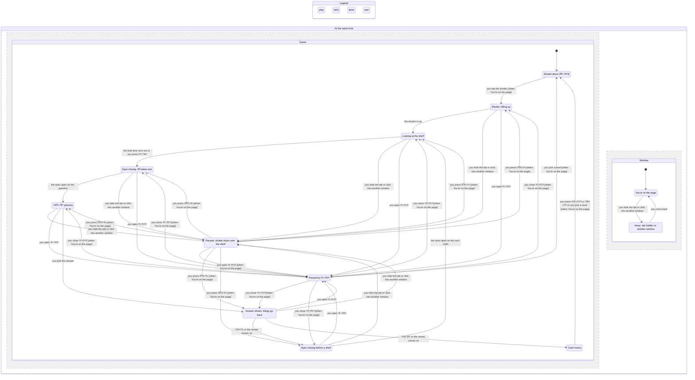

# কোনটা নেই? statechart

## After the rewrite (`after-fix/`)
The spec now mirrors `tools/konta-nei/lib/session.ts` (one pausable phase clock: ready → opening → look → closing → ask → reveal → blink → … → over, with `why` = away or sheet) and `components/shop-game.tsx` (the listeners, `syncHum` after every commit and on the sound switch, `finalize`, the key handler). TLC reaches 232 states; the chart draws 12 states and 37 arrows. The sound switch and a held Enter are checked by the rules but hidden from the drawing, because they change nothing it shows.

| Rule | Says | Result |
|---|---|---|
| PausedWhenHidden | When the tab is hidden, the look time, the eyelids, the reveal's pause and the answer clock are stopped. | holds |
| PausedWhenBlurred | When you click into another window, they stop too. | holds |
| AwayTimeNeverCharged | The answer clock runs only while you are on the page. | holds |
| NothingUnderThePause | Paused, nothing counts and no pick is taken (the shutter covers the shelf and the pictures). | holds |
| HumOnlyWhileLooking | The hum plays only while the shelf shows and its time counts: never on the question, the blink, paused, hidden or muted. | holds |
| HumComesBack | While a look counts down with sound on, the hum plays (turning sound back on restores it). | holds |
| LevelPickerFreezesPlay | While সব লেভেল is open, nothing counts down. | holds |
| NoDoubleResult | A level is saved once. | holds |
| MemoMeansSaved | The cash memo shows only after the last shelf was answered and saved. | holds |
| ResultNeedsFreshPress | A key held through the end never skips the memo. | holds |

### The five bugs, fixed
1. **PausedWhenHidden:** the blink after পরের তাক is a phase on the paused clock, so a hidden tab freezes it. Test `bug 1 · PausedWhenHidden` (rewrite.test.ts). Live (Orca, Pixel 9): answered, পরের তাক, blur 50 ms later → phase `blink`, shutter down; 3 s later still `blink`, lids frozen at 0.03.
2. **PausedWhenBlurred:** the game listens to `blur` and the player's `onPause`; both run `pauseFor("away")`. Test `bug 2 · PausedWhenBlurred`. Live: look at ৪ → blur → the player's menu up, shutter down, 4 s later still ৪; চালিয়ে যাও → ৪, then ৩ after 1.2 s (the 0.6 s breath, nothing lost or gained).
3. **AwayTimeNeverCharged:** `pause` banks the clock only while it runs, and a second hide changes nothing. Test `bug 3 · AwayTimeNeverCharged` (hide → show → hide → resume → answer costs the same ms as answering straight away).
4. **HumOnlyWhileLooking:** the hum follows `session.looking` (phase `look` and running), never the raw phase; the eyes closing is its own phase. Test `bug 4 · HumOnlyWhileLooking`. Live (sawtooth oscillators counted): look 1 → মনে আছে → eyes closing → menu, sound off, sound on, resume → 0; on the question 0.
5. **LevelPickerFreezesPlay:** opening সব লেভেল runs `pause("sheet")`, which an away-resume cannot end. Test `bug 5 · LevelPickerFreezesPlay`. Live: look at ৪, open the sheet, hum 1 → 0, 3 s later still ৪; close → hum 1, ৪.

The quality-bar gaps are closed too: the player's pause menu, a pause that covers the shelf and the pictures, the player fills the stage (no text above the play area), the shutter as the start action, the amber edge in the last 3 s, named finales with a boss bar and two things gone, a world ident, and the cash memo with real stats. Old links replay exactly (`lib/legacy.ts`, pinned by a checksum test).



## Before the rewrite (`before-fix/`)
Spec (then): `KontaNei.tla` / `KontaNei.cfg` / `view.ts`, mirrored from `tools/konta-nei/components/konta-game.tsx` and `shared/game-sound.ts`. Output: `before-fix/report.md` and `before-fix/chart.mmd`. TLC reached 444 states. The chart draws 20 states and 31 arrows. It hides one step, "you pick a level" (the ‹ › arrows or a level from the list), because that step resets to "Shutter down" from every state.

## Systems modelled
- **Play phase:** shutter down (ready) → looking → eyes closing → কোনটা নেই? choices → answer shown → … → level card. The model has 2 shelves per level (the game has 3). The last answer leads to the card and the save.
- **Eyelid timers:** every `closeEyes()` is a 380 ms `setTimeout` in flight. The model has three: after the look time (to the question), after পরের তাক (to the next shelf), and after আবার খেলো / পরের লেভেল (to a new level).
- **Pause and focus:** tab visible or hidden, window focused or blurred, the চালিয়ে যাও note on the shutter.
- **Time:** the look timer (`startLook`'s timeouts) and the answer clock (`askStart` / `askSpent`), including whether `askStart` has already been added into `askSpent`.
- **Sound:** the `hum` loop and the site-wide switch (`stopLoops()` on off; on → `startHum` if phase is look and not paused).
- **Choices:** the সব লেভেল drawer (open or shut) and level picking.
- **Saved progress:** the `[done]` effect saves once per `level:seed` (`finished.current`).

Not modelled: held input (the game has none; answers are single taps or keys 1–6). Star values and unlocks are not modelled either, because `levels.record` uses `shared/game-core` `recordLevel` (it keeps the higher), and `shared/tests/game-kit.test.ts` unit-tests it. Link parsing is pure and covered by `tools/konta-nei/tests`. A link only calls `goTo(level, seed)`.

## Rules in plain words
| Rule | Says | Result |
|---|---|---|
| PausedWhenHidden | When the tab is hidden, the look timer and the answer clock are stopped. | **breaks** |
| PausedWhenBlurred | When you click into another window, they stop too. | **breaks** |
| AwayTimeNeverCharged | Time you spend away never counts against your answer's speed. | **breaks** |
| HumOnlyWhileLooking | The hum plays only while the shelf is shown and counting down: never on the question, hidden, paused or muted. | **breaks** |
| HumComesBack | While the shelf counts down on screen with sound on, the hum plays (turning sound back on restores it). | holds |
| LevelPickerFreezesPlay | While the level list is open, the shelf doesn't count down. | **breaks** |
| NoDoubleResult | A level is saved once. | holds |

## Bugs
### 1. PausedWhenHidden (also breaks HumOnlyWhileLooking): game-specific
- **The player's version:** "I pressed পরের তাক and switched tabs. When I came back, the shelf I was supposed to remember had already gone by, and the question was waiting."
- **Path (report):** start → look time ends → eyes open → answer → পরের তাক → **hide the tab** → the eyes open on a new shelf *while hidden* (step 7). The look timer and the hum start in the background.
- **Why:** the `visibilitychange` handler acts only when `phaseRef.current` is `look` or `ask`. During the 380 ms blink after পরের তাক (and after আবার খেলো / পরের লেভেল) the phase is still `reveal` / `over`, so nothing pauses. The blink's timer then runs `startLook()` on the hidden page.
- **Live replay:** headless Chrome via CDP, level 1, 5 s look. Orca can't do this one; see the replay note below.
  - Shelf 1 answered. Clicked পরের তাক, hid the tab 50 ms later. phase `reveal`, hum 0.
  - +1.0 s hidden: phase `look`, "দেখে রাখো… ৫", **hum 1** (a sawtooth loop started on a hidden tab).
  - +3.0 s hidden: "দেখে রাখো… ৩", hum 1.
  - +6.5 s hidden: phase `ask`, "কোনটা নেই?", hum 0.
  - Tab shown again: phase `ask`, **not paused**. The whole look happened while you were away.
- **Fix:** pause by "is a round running", not by phase. On hide, `stopAll()` whenever a blink timer is pending too, and on resume start the shelf that was coming. Simpler: make `startLook` refuse to run while `document.hidden`, and set `paused` so the resume button starts it.

### 2. PausedWhenBlurred: shared
- **The player's version:** "I clicked on another window for a moment and the look time ran out without me."
- **Path:** start → click into another window (2 steps).
- **Why:** no `blur` / `focus` listener. Only `visibilitychange` pauses.
- **Live replay (Orca):** level 1. শুরু করো → `blur`. The page went on: "দেখে রাখো… ৫" → +2 s "৩" → +4 s "১" → +6 s phase `ask`. The hum stayed on (1) the whole time. A blur during the question also charges the time to the speed score.
- **Fix:** a shared away-pause hook in `shared/game-kit.ts` (blur + hide → pause, stop loops). This game would use it in place of its own `visibilitychange` effect.

### 3. AwayTimeNeverCharged: game-specific
- **The player's version:** "I left during the question, came back, left again before pressing চালিয়ে যাও, and my quick answer scored like a slow one."
- **Path:** start → look ends → eyes open on the question → hide → show (don't resume) → hide again (6 steps).
- **Why:** each hide in `ask` runs `askSpent += now − askStart`. `askStart` only moves on resume, so a second hide while still paused adds the whole first absence, and the time since, again.
- **Live replay:** headless Chrome, level 1, three right answers each ~0.1 s after the choices appear.
  - Control run: **score ৪৪৭**.
  - Bug run, shelf 3: hide 0.5 s → show → wait 7 s (paused) → hide 0.5 s → show → চালিয়ে যাও → answer at once. **Score ৩৯৮.** Shelf 3 lost its full 49-point speed bonus: about 8 s of paused time was charged.
- **Fix:** on hide, add to `askSpent` only when not already paused (or set `askStart = now` after banking). Add a node test: hide → show → hide → resume → answer gives the same ms as answering straight away.

### 4. HumOnlyWhileLooking (the hum on the question): game-specific
- **The player's version:** "I switched the sound off and on just as the eyes closed, and a hum droned all through the question."
- **Path:** sound off → start → look time ends (eyes closing) → sound on (4 steps). Also reachable from sound on: start → look ends → sound off → sound on.
- **Why:** SoundToggle's `onChange` restarts the hum when `phase === "look" && !paused`. During the 380 ms blink the phase is still `look`, but the look is over. Nothing stops that hum until the next `stopAll()`.
- **Live replay (Orca):** level 1. During look, hum 1. Eyes closing: hum 0. Sound off, then on: hum 1 (phase still `look`, lids shut). +0.8 s: phase `ask`, **hum 1**. +3.8 s on the question: **hum 1**.
- **Fix:** keep a `looking` ref that the look-timer callback clears, and test that rather than `phase`. Or stop the hum in `closeEyes` and only start it from `startLook`.

### 5. LevelPickerFreezesPlay: shared
- **The player's version:** "I opened সব লেভেল to see my stars and the shelf counted down behind it."
- **Path:** open সব লেভেল → শুরু করো (2 steps), or start → open the list.
- **Live replay (Orca):** start, then open the list: "দেখে রাখো… ৫" → +2 s "৩" → +4 s "১" → +6 s `ask`, with the list open the whole time.
- **Fix:** shared. Opening the level drawer pauses a running round (or the drawer lives only on the shutter and the card). The same `<details>` + `LevelGrid` pattern is in every leveled game.

### How the replays were run
- **Orca** (`orca eval`, page `52ad65a7…`): bugs 2, 4 and 5, with synthetic `blur`, real clicks through `el.click()`, and `OscillatorNode.prototype.start/stop` instrumented to count live sawtooth (hum) oscillators.
- **Headless Chrome:** bugs 1 and 3. Orca's browser can't simulate a hidden tab. It injects `document.hidden` and `visibilityState` as non-configurable own getters that always say "visible", in frames too. So `Object.defineProperty` throws "Cannot redefine property: hidden", and a real background tab still reports visible. Those two replays ran with the same in-page script in headless Chrome over CDP, where the play-test skill's `defineProperty` trick works. The script is the scratch `cdp/eval.mjs`, a copy of `scripts/shot.mjs`'s launcher that only evaluates.

## Quality-bar gaps (one full run of level 1 in Orca, Pixel 9)
1. **No real pause.** There's no pause button, no P or Esc, and no pause on blur. Pause exists only as the tab-hide shutter note. The bar wants চালিয়ে যাও / নতুন করে শুরু / কীভাবে খেলবে / শব্দ / ধীরে খেলো / সব লেভেল.
2. **A pause on the question buys thinking time.** The clock stops and the choices stay visible under the shutter. Hide the tab, think, come back, and the speed bonus is intact.
3. **Text above the play area.** The H1 and lead sit above the shop, and the stage starts at y≈223 on a 923 px phone. On 2-row levels (6 choices) the choices (y≈663+) are close to the fold.
4. **The start action is a plain button** (শুরু করো on a white note) on the shutter, not the game's own art (for example, rolling the tin shutter up).
5. **No danger at the edges.** The last 3 s only tick and the hum rises. There's no edge glow on the timer, and the thin bar under the level row is the only visual cue.
6. **No world finale.** World changes (move at 11, swap at 21) arrive with the same screen. There is no "boss" shelf at 10, 20 or 30, and no intro for the new twist beyond one small hint line during the question.
7. **No music.** The sounds are good (ding that climbs with the streak, soft wrong, blink, shutter, hum, ticks), but there's no stage tune.
8. **The end screen is fine** (real score, stars, near-miss line, পরের লেভেল is primary, personal card). But the friend's score is only the friend's claim, because it isn't re-checked: the game is real-time.

Screenshots: `.shots/konta-nei-first-screen.png` (shutter and start), `.shots/konta-nei-look.png` (looking), `.shots/konta-nei-ask.png` (the gap, মামা turned), `.shots/konta-nei-reveal.png` (the right slot ringed), `.shots/konta-nei-over.png` (3 ✓ pips after the level). The card's text was read from the DOM, because Orca's phone screenshot after a scroll came out blank.

## Regenerate
The spec in this folder is the after-fix one; the before-fix spec is in git history.
```sh
scripts/statechart.sh ai_docs/statecharts/konta-nei/KontaNei.tla --view ai_docs/statecharts/konta-nei/view.ts --out ai_docs/statecharts/konta-nei/<new-folder>
rm ai_docs/statecharts/konta-nei/<new-folder>/tlc*.out
```
