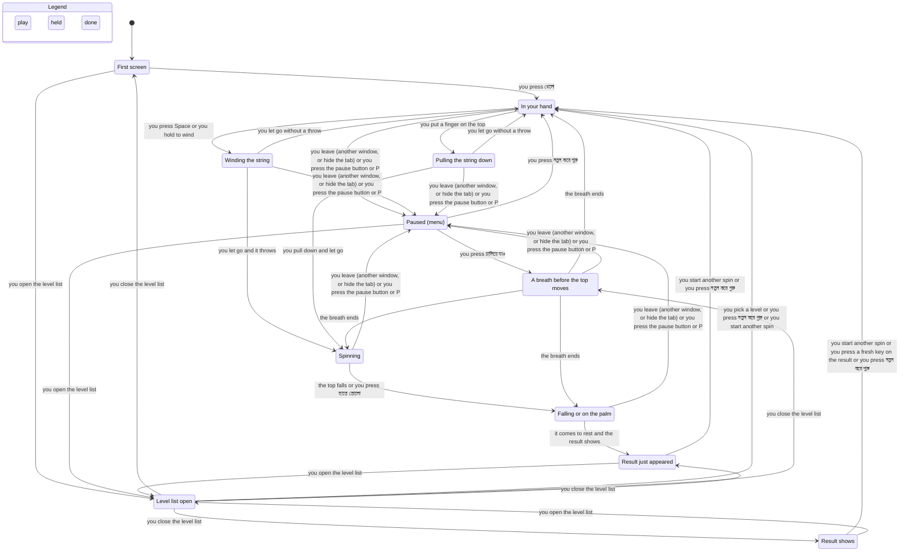

# লাটিম statechart

**Before the rewrite:** the model is `before-fix/Latim.tla` (with its `.cfg` and `view.ts`), mirroring the old `tools/latim/components/latim-game.tsx`. Its report and chart are in `before-fix/`. **After the rewrite** is the section "After the rewrite (`after-fix/`)" at the end: `Latim.tla`, `Latim.cfg` and `view.ts` at the top of this folder now mirror the new code, and every rule holds.

## Before the rewrite

Spec: `Latim.tla` / `Latim.cfg` / `view.ts`. They mirror `tools/latim/components/latim-game.tsx`, `shared/game-kit.ts` (`useGameLoop`) and `shared/game-sound.ts` (`loop()`). Output: `before-fix/report.md` and `before-fix/chart.mmd`. TLC reached 120 states, and the chart draws 22 states and 51 arrows.

The page is **not** in the shared game player (`tools/latim/page.tsx` uses `PageFrame` directly). Commit 6775639 landed during this run and changed the shared loop: `useGameLoop` now freezes on window blur and restarts on focus. The model mirrors that new code, so the clock no longer runs while you're away. The game itself still doesn't pause, stop its hum or drop your hand.

## Systems modelled
- **Play phase:** in the hand (`ready`) → spinning → spinning slowly (হাতে তোলো shows, `canPick`) → coming to rest (`settle`) → card (`over`). The model uses one level; levels only feed `start()`.
- **Pause and focus:** the tab is visible or hidden, and the window is focused or blurred. Pause comes from থামাও, P or Esc (only while spinning) and from tab hide. Resume comes from চালিয়ে যাও, Space or a tap.
- **Input (the hand):** hold-to-wind (Space/Enter or the main button, `hold.current.active`) and a pull on the canvas (`swipe.current`), plus what releases each.
- **Time:** `useGameLoop` with blur/hide freezing, and the cheer `setTimeout` (`later()` in `finish()`). `start()` clears the cheer timer.
- **Sound:** the `hum` loop and the game's own SoundToggle. Off runs `stopLoops`. On runs `startHum()` if spinning and not paused. The `[paused]` effect stops the hum and starts it again.
- **Choices:** the সব লেভেল আর পদক drawer, picking a level, and আবার খেলো / পরের লেভেল.
- **Saved progress:** `finish()` is guarded by `done.current` (`saves`). Stars use `useLevels.record`, which keeps the higher value (unit-tested in shared). Badges are a union.

Not modelled: the friend link. `parseCard` → `start(seed, level)` is a plain fresh round, and the seed replay is covered by `tools/latim/tests`.

## Rules in plain words
| Rule | Says | Result |
|---|---|---|
| PausedWhenHidden | Hide the tab while it spins and the game is paused when you come back. | holds |
| PausedWhenBlurred | Click into another window while it spins and the game is paused (চালিয়ে যাও waits) when you come back. | **breaks** |
| NoProgressWhileAway (property) | The spin, the fall and the coming-to-rest only move while you're on the page. | holds (since 6775639) |
| InputReleasedWhenAway | After a blur or hide, no hold or pull is still counted. | **breaks** |
| HumOnlyWhileSpinning | The hum plays only while the top spins on screen, unpaused, focused and with sound on. | **breaks** |
| HumComesBack | Spinning, unpaused, visible, sound on → the hum plays (turning sound back on restores it). | holds |
| NothingMovesWhilePaused | While paused, the round stays where it was. | **breaks** |
| LevelPickerFreezesPlay | With the level list open, the top doesn't spin on. | **breaks** |
| NoDoubleResult | A round is saved once. | holds |
| CheerOnlyOnTheCard | The win sound and confetti only fire on the card. | holds (`start()` clears timers) |

## Bugs
### 1. InputReleasedWhenAway (hold survives a blur): game-specific
- **The player's version:** "I was holding Space to wind, clicked my other window, came back with my hands off, and the bar kept winding and ticking by itself."
- **Path:** hold to wind → click into another window (2 steps).
- **Why:** only `visibilitychange` clears `hold.current.active`. There is no blur handler, and keyup goes to the other window. After 6775639 the loop freezes while you're away, but on focus it restarts with the hold still active.
- **Live replay (headless Chrome over CDP, see the note below):** Space down for 0.4 s → blur 2 s (held 0.00 s, frozen) → focus, hands off: **held 1.48 s, 9 meter ticks** → +1.5 s: **held 2.98 s, 18 ticks**. Pressing Space again did nothing (`beginHold` returns while active). Releasing it threw the top with power `windPower(3.03 s)`, a random point on the ping-pong.
- **The pull too:** a finger on the top, then the tab hidden for 1.5 s and shown again: `swipe.current` was still in flight (2 samples). One move and a lift then threw at **power 1.00, straight 1.00**, from a pull that started before you left. The hide handler clears the hold but not the pull.
- **Fix:** on blur and hide, clear `hold.current`, `swipe.current` and `scene.drag`, and reset the meter. Moving to the shared player covers it (the player sends blur and `pointercancel` on pause).

### 2. PausedWhenBlurred + HumOnlyWhileSpinning: shared
- **The player's version:** "I clicked my chat window. The top froze mid-spin and the hum kept droning at one pitch. When I clicked back, the top was spinning straight away, and that click knocked it."
- **Path:** throw → click into another window (3 steps).
- **Why:** the game has no blur listener. `useGameLoop` now freezes the clock, but `paused` stays false and the hum keeps sounding. On focus, play resumes at once, and the click that brings you back is a pointerdown on the canvas, so `tapNudge()` runs.
- **Live replay (CDP):** spinning at t 1.28 s, wobble 0.13, hum 1 → blur 3 s: **t 1.28 s, hum 1** (the loop sounding while frozen) → click back on the top: **nudges 0 → 1**, wobble 0.13 → 0.11 (this click happened to be an "ok" tap; one at mid-sway is a miss, +0.12 wobble).
- **Fix:** shared. Move লাটিম into `GamePage` / `useGamePlayer`. The player opens its pause menu on blur, so the hum stops through the `[paused]` effect, and the click lands on চালিয়ে যাও, not the top. Without the player, pause on blur the same way the hide handler does.

### 3. NothingMovesWhilePaused (pick up while paused): game-specific
- **The player's version:** "I paused when হাতে তোলো came up, then pressed হাতে তোলো anyway. It counted while the game was paused."
- **Path:** throw → the spin slows → থামাও → হাতে তোলো (5 steps).
- **Why:** the button renders on `pickable && view === "spin"` and its `onPointerDown` calls `tryPick()` with no `paused` check (the ↑/H key does check).
- **Live replay (Orca):** level 1, nudging at the lean's edge. হাতে তোলো showed at t 16.90 s (ω 0.32, wobble 0.09) → থামাও (hum 1 → 0, t held at 16.90 s for 1 s) → pointerdown on হাতে তোলো: **phase `palm`, still paused**, and the line still said "থামানো আছে". After চালিয়ে যাও the palm animation ran and the card showed 3 stars, "২১.৯ সেকেন্ড (হাতে তুলে +৫)".
- **Fix:** hide the pick button while paused, or return early in `tryPick` when paused.

### 4. LevelPickerFreezesPlay: shared
- **The player's version:** "I opened সব লেভেল আর পদক to look at my badges, and the top spun on and fell behind the list."
- **Path:** throw → open the list (3 steps).
- **Live replay (Orca):** thrown, list opened at t 0.08 s → +1.5 s t 0.67 → +3 s t 2.12 → +6 s t 4.98 s. The hum stayed on and wobble grew 0.08 → 0.17. Later, t 15.07 s with the list still open.
- **Fix:** shared. The level list belongs in the player's pause menu (সব লেভেল), so opening it pauses. If it stays inline, opening it during a spin should pause.

### How the replays were run
- **Orca** (page `b2a5ccad…`, Pixel 9): bugs 3 and 4. Game state was read through the React fiber (`game`, `hold` refs). Real `.click()` and `PointerEvent`s were used, and `OscillatorNode.prototype.start/stop` was counted for the sawtooth hum.
- **Headless Chrome over CDP** (a scratch copy of `scripts/shot.mjs`'s launcher with a throwaway profile): bugs 1 and 2. Orca's browser can't stand in here for two reasons. First, it pins `document.hidden` to false. Second, a measured fact: a window `blur` event, even a synthetic one, cuts Orca's own rAF to about 2 fps (16 frames/s → 2 after `blur`, against 15 after a dummy event), which would blur any frame-based count. Synthetic pointers needed a no-op `setPointerCapture` shim (the real one throws for a pointer that doesn't exist).

## Quality-bar gaps (one run of level 1 in Orca, Pixel 9)
1. **No real pause menu.** There's an inline থামাও / P / Esc only while spinning, a pause on hide, and nothing on blur. The game isn't in the shared player, so it has no কীভাবে খেলবে, সব লেভেল or ধীরে খেলো in a menu, and the সব লেভেল drawer sits under the game.
2. **Text above the play area.** The kicker, the H1, a two-line lead and the level line push the stage to y≈262 on a 923 px phone. The throw button and hint sit near the fold.
3. **The first screen is good:** the top itself, with a dashed "নিচে টানো" arrow, is the start action, and level 1 clears at 4 s, inside the first 10 seconds.
4. **No danger at the edges.** Wobble shows only through the drawn lean and the dot. Near a fall there's no edge glow or vignette.
5. **The হাতে তোলো offer** is a real-time gamble (that's fine), but it's also live while paused (bug 3) and it has no "recommended" hint about the wobble threshold beyond the line text.
6. **Pacing:** 9 levels on 3 surfaces add one thing each until level 9, which adds ridges, leaves and gusts at once. There's no named finale per surface.
7. **Sound:** the clack-and-rattle, the pebble tick, the tin tonk, the whoosh, the hum loop, the wind ticks and the combo chimes are good. There's no stage tune.
8. **The end screen is good:** real seconds, the palm bonus, the near-miss line ("আর … সেকেন্ড হলেই …"), badges, পরের লেভেল as the primary action, and a personal card. The friend's time is their phone's claim.

Screenshots: `.shots/latim-first-screen.png` (the top in the hand with the pull arrow), `.shots/latim-over.png` (the top on the palm after a pick; the card text was read from the DOM because Orca's phone shot after a scroll comes out blank).

---

## After the rewrite (`after-fix/`)

The page now lives in the shared game player (`GamePage`, `useGamePlayer({ onPause, onResume, onRestart, onLevels })`). The model is rewritten to mirror `tools/latim/lib/session.ts`, `lib/top.ts` and `components/game.tsx`. TLC reached **224 states and 1,316 steps**; the chart draws 11 states and 31 arrows (`after-fix/chart.mmd`). **Every rule holds** (`after-fix/report.md`), and the model has teeth: removing the hand-release from `WindowBlurs` makes `InputReleasedWhenAway` and `HandOnlyWhileTicking` break at once.

### What changed in the code, per bug
| Bug | Fix | Node test (`tools/latim/tests/session.test.ts`) | Live check |
|---|---|---|---|
| 1. InputReleasedWhenAway | Every way of leaving (blur, hide, the player's menu, the level list) runs `away()`, which calls `releaseInput()` (drops the wind-up, nothing is thrown), forgets the pull and clears the held key. A keyup that lands later finds nothing held. | `statechart InputReleasedWhenAway (bug 1)` (two tests) | Orca, see below |
| 2. PausedWhenBlurred + HumOnlyWhileSpinning | The player pauses on blur; `session.ts` derives the hum from `ticking && sound && spinning`, so it stops the moment the page stops stepping and comes back with a fresh loop. The click that brings the window back only wakes it (`engaged()`), and a breath of 36 steps follows. | `PausedWhenBlurred + HumOnlyWhileSpinning (bug 2)`, `HumOnlyWhileSpinning`, `HumComesBack` | Orca |
| 3. NothingMovesWhilePaused | `tryLift()` and the lift button check `S.canTap()`; the player's `inert` menu also covers the button. | `NothingMovesWhilePaused (bug 3)` | Orca |
| 4. LevelPickerFreezesPlay | সব লেভেল is in the player's menu (`onLevels`) and every list opening goes through `S.openSheet`, which stops the round. | `LevelPickerFreezesPlay (bug 4)` | Orca |

New rules the rewrite added to the model: `HeldKeyActsOnce`, `ResultStaysUntilYouChoose` (Space or Enter held through the end never skips the result or starts the next run), `HandOnlyWhileTicking`, `BreathAfterAway`, `NeverAStub` (a hum made while muted is never kept), `CelebrationOnlyOnResult` and `NoDoubleResult`.

### Rules in plain words
| Rule | Says | Result |
|---|---|---|
| PausedWhenHidden / PausedWhenBlurred | Leave the page while a spin is on and the game is paused (the menu is up) when you come back. | holds |
| NoProgressWhileAway | The spin, the fall and the winding only move while you are on the page, past the breath. | holds |
| InputReleasedWhenAway | After a blur, hide, menu or list, no hold, pull or key is still counted. | holds |
| HandOnlyWhileTicking | Nothing is wound or pulled unless the page is stepping. | holds |
| NothingMovesWhilePaused | হাতে তোলো does nothing under the menu. | holds |
| HumOnlyWhileSpinning | The hum plays only while the top spins on screen, unpaused, focused, with sound on. | holds |
| HumComesBack / NeverAStub | Spinning, unpaused, visible, sound on: the hum plays, as a real loop. | holds |
| LevelPickerFreezesPlay | With the level list open nothing moves. | holds |
| HeldKeyActsOnce / ResultStaysUntilYouChoose | A held key winds or nudges once and never skips the result. | holds |
| NoDoubleResult / CelebrationOnlyOnResult | A spin is saved once; the win sound and confetti only fire on the result. | holds |
| BreathAfterAway / PauseOnlyMidRound | After time away the top waits a breath before it moves again. | holds |

### The chart


### Quality-bar gaps closed
1. **A real pause menu:** the shared player's (চালিয়ে যাও, নতুন করে শুরু, কীভাবে খেলবে, শব্দ, ধীরে খেলো, সব লেভেল). P calls `requestPause()`.
2. **No text above the stage:** the page is `GamePage`; the stage fills the player on a phone (portrait, no scroll).
3. **Danger at the edges:** the stage border warms with the wobble (amber from 0.55, red and pulsing from 0.8) and glows green-gold when lifting is safe; steady borders in ধীরে খেলো. Things about to land have pointers at the edge they come from.
4. **Pacing:** 12 levels, three places of four; each adds one thing and each place ends in a named finale (মুরগির দৌড়, ঝাড়ুর টান, কালবৈশাখী).
5. **Sound and the end screen:** per-sound pictures, the tune per place, and an end screen that counts up real stats.

### How the after-fix bugs were replayed live (Orca)
Run in Orca (a tab of its own, desktop width; a synthetic window `blur` and `focus` stand in for clicking away, because Orca pins `document.hidden`; `window.__latim` is a dev-only hook). The same four bugs, with the same steps as before the rewrite:

1. **InputReleasedWhenAway.** Hold the pad (held 0.50 s, winding) → blur: the menu is up, `winding false`, `held 0` → 1.5 s away: `held 0` → focus, hands off, 1.5 s: `held 0`, phase still in the hand → pointerup: nothing thrown. Before: held 1.48 s after coming back, 9 ticks, a random-power throw on release.
2. **PausedWhenBlurred + HumOnlyWhileSpinning.** Throw (`hum true`, t 1.23 s) → blur: `hum false`, paused → 2 s away: t 1.23 s (frozen) → focus (still paused, hum off) → চালিয়ে যাও: t runs on (2.03 s), `hum true`, **nudges 0**. Before: the hum droned on at t 1.28 s and the click back knocked the top (nudges 0 → 1).
3. **NothingMovesWhilePaused.** Spin slowly (lifting open, button shown) → blur → pointerdown on হাতে তোলো and the H key: phase stays spinning, bonus 0, t unchanged. Before: phase `palm` while paused.
4. **LevelPickerFreezesPlay.** Menu → সব লেভেল while spinning: the list opens, 2 s later t moved **0.00 s**, hum off; closing it: a breath, then t runs (0.58 s in 1.2 s). Before: t 0.08 s → 4.98 s behind the list.

Also checked live: নতুন করে শুরু (same level, a fresh seed, back in the hand, menu shut), old and new friend links (`l=7` without `v` opens level 9 with the friend's banner and an unchanged re-serialised link; an invalid hash opens nothing), `&og=1` finished end screen with the card, no console errors or warnings, and no sideways scroll at 320 px.

## Regenerate
```sh
scripts/statechart.sh ai_docs/statecharts/latim/Latim.tla --view ai_docs/statecharts/latim/view.ts --out ai_docs/statecharts/latim/<new-folder>
rm ai_docs/statecharts/latim/<new-folder>/tlc*.out
```
