# মার্বেল-সিঁড়ি: statechart

## After the rewrite (`after-fix/`)
The spec `Marble.tla` now mirrors the rewritten game:
- `components/marble.tsx`: begin, load, pause, resume, the floor list, finishRun, again, the `useGamePlayer` handlers (onPause opens `menu`, onResume closes it), the key, pointer, blur, focus, visibility and hashchange handlers, and the step's `humStep`;
- `lib/session.ts`, the pure phase machine the component runs (`start`, `pause`, `resume`, `away`, `back`, `finish`, `again`, `reset`, `pick`, `menu`, `cheerMayPlay`, `humStep`);
- `lib/hands.ts`, what counts as held (`press`, `lift`, `release`, `direction`);
- `lib/progress.ts`, your own unlock (`afterClear`, `playable`).

It runs twice:
- **Full check** (`MarbleFull.cfg`: two floors, the hand on a key or finger, a hidden tab, Enter held through the end, পরের তলা): TLC reached 5,298 states (`after-fix/report-full.md`).
- **Chart run** (`Marble.cfg`, `Full = FALSE`): 134 states; the chart has 12 states and 28 arrows (`after-fix/report.md`, `after-fix/chart.mmd`). The hand, the hum and the celebration are checked as rules but not drawn, because each follows the game phase.

**All 14 rules hold in both runs, and so does NoDeadlock.** A mutation check put the old behaviours back into a copy of the spec: a blur that neither releases nor pauses, a celebration that ignores the menu and the window, `??=` keeping the muted stub. PausedWhenBlurred, InputReleasedWhenAway, MarbleRollsOnlyWhenHeld, LoopOnlyWhenMeaningful, LoopComesBack and NoChimeAfterLeaving then broke, so none of them is vacuous. NoProgressWhileAway holds by construction: the stairs move only inside `moving()`, which needs the window.

| Rule | In plain words | After |
|---|---|---|
| NoProgressWhileAway | The stairs move only while you are on the page. | holds |
| InputReleasedWhenAway | After you click away, the game doesn't think you still hold a side. | holds (was broken) |
| MarbleRollsOnlyWhenHeld | The marble is pushed sideways only while you really hold a side. | holds (was broken) |
| PausedWhenHidden, PausedWhenBlurred | Hiding the tab or clicking into another window pauses a rolling floor. | hold (blurred was broken) |
| MenuFreezesPlay (new) | While the player's pause menu is open, nothing rolls. | holds |
| ChoiceFreezesPlay (new) | While সব তলা is open, nothing rolls. | holds |
| LoopOnlyWhenMeaningful | The roll hum is heard only while the marble rolls in front of you. | holds (was broken) |
| LoopComesBack | With sound on and the stairs moving, the hum plays, even after sound off and on. | holds (was broken) |
| NoChimeAfterLeaving | A floor's fanfare plays only on its own end screen: not under the pause menu, not after আবার or a new floor. | holds (was broken) |
| ReplayIsExact (new) | When the friend's floor is on screen, their seed is what you roll down. | holds |
| HeldKeyNeverSkips (new) | An Enter held from before the end screen never takes its choice. | holds |
| OpenLevelsAreEarned (new) | Every floor below your unlock is one you cleared yourself. | holds |

```mermaid
---
title: "Marble Sinri after the rewrite: floor, menu, list, window and link"
---
stateDiagram-v2
  direction LR
  state "Legend" as legend {
    lg0: wait
    lg1: play
    lg2: held
    lg3: done
  }
  class lg0 blue
  class lg1 teal
  class lg2 yellow
  class lg3 blue
  state "At the same time" as all {
    state "Game" as r0 {
      s0: Title (গড#2492;#2494;ও)
      s1: Marble rolling
      s2: সব তল#2494; open
      s3: Card shows
      s4: Paused
      s5: সব তল#2494; open, floor paused
      [*] --> s0
      s0 --> s1: you press গড#2492;#2494;ও (or an arrow, or Space) [when Window is You're on the page and Menu is No menu]
      s0 --> s2: you open সব তল#2494; [when Window is You're on the page and Menu is No menu]
      s1 --> s0: a friend's link opens [when Link is No friend's link]
      s1 --> s3: the floor ends and the card shows
      s1 --> s4: you click into another window or you press P or #9208;
      s1 --> s5: you open সব তল#2494;
      s2 --> s0: you close সব তল#2494; or you pick a floor [when Window is You're on the page and Menu is No menu]
      s2 --> s0: a friend's link opens [when Link is No friend's link]
      s3 --> s0: a friend's link opens [when Link is No friend's link]
      s3 --> s1: you press আব#2494;র [when Window is You're on the page and Menu is No menu]
      s3 --> s2: you open সব তল#2494; [when Window is You're on the page and Menu is No menu]
      s4 --> s0: a friend's link opens [when Link is No friend's link]
      s5 --> s0: you pick a floor [when Window is You're on the page and Menu is No menu]
      s5 --> s0: a friend's link opens [when Link is No friend's link]
      s5 --> s1: you close সব তল#2494; [when Window is You're on the page and Menu is No menu]
      s4 --> s0: you press নত#2497;ন কর#2503; শ#2497;র#2497; [when Menu is Pause menu open]
      s4 --> s1: you press চ#2494;ল#2495;য#2492;#2503; য#2494;ও [when Menu is Pause menu open]
      s2 --> s0: you press নত#2497;ন কর#2503; শ#2497;র#2497; [when Menu is Pause menu open]
      s2 --> s3: you close সব তল#2494; [when Window is You're on the page and Menu is No menu]
      s3 --> s0: you press নত#2497;ন কর#2503; শ#2497;র#2497; [when Menu is Pause menu open]
      s4 --> s1: you tap the board to go on [when Window is You're on the page and Menu is No menu]
      s5 --> s0: you press নত#2497;ন কর#2503; শ#2497;র#2497; [when Menu is Pause menu open]
    }
    --
    state "Window" as r1 {
      s6: You're on the page
      s7: Another window has focus
      [*] --> s6
      s6 --> s7: you click into another window
      s7 --> s6: you come back to the window
      s7 --> s6: you press চ#2494;ল#2495;য#2492;#2503; য#2494;ও or you press নত#2497;ন কর#2503; শ#2497;র#2497; [when Menu is Pause menu open]
    }
    --
    state "Menu" as r2 {
      s8: No menu
      s9: Pause menu open
      [*] --> s8
      s8 --> s9: you press P or #9208; [when Window is You're on the page]
      s9 --> s8: you press চ#2494;ল#2495;য#2492;#2503; য#2494;ও or you press নত#2497;ন কর#2503; শ#2497;র#2497;
    }
    --
    state "Link" as r3 {
      s10: No friend's link
      s11: Friend's floor on screen
      [*] --> s10
      [*] --> s11
      s10 --> s11: a friend's link opens
    }
  }
  class s1 teal
  class s3 blue
  class s4 yellow
  class s5 yellow
```



### The five bugs, fixed, each with a node test and a live replay in Orca
Live numbers were read from the component's refs through the dev hook `window.__ms`, with `OscillatorNode.prototype.start/stop` and `AudioParam.setValueAtTime` counted. The dev server keeps audio suspended, so sound was proven by counting, never by ear.
1. **MarbleRollsOnlyWhenHeld, InputReleasedWhenAway** (`tests/session.test.ts` "bug 1"). The blur handler calls `release()` (`lib/hands.ts`) and `away()`. Live: → held 0.25 s (x 191.9, vx 158, 1 side held), blur: 0 sides held, x and the clock unchanged for 2 s. After চালিয়ে যাও with no key down: 0 sides held, the marble rolled 12.2 units on its own momentum and stopped (vx 0).
2. **LoopOnlyWhenMeaningful** ("bug 2"). The hum follows `humStep` every step and stops on blur. Live: 1 hum stop at the blur, none running while away.
3. **PausedWhenBlurred** ("bug 3"). Blur pauses through `away()`; focus only clears the flag. Live: phase `paused` after the blur, still `paused` after focus, `playing` only after চালিয়ে যাও, then a 0.5 s breath.
4. **LoopComesBack** ("bug 4"). No `??=`: a muted start makes a stub, and `humStep` starts a fresh loop once sound is on. Live: sound off in the menu, start: 0 hum loops; sound on, চালিয়ে যাও: 1 hum loop within 1.2 s.
5. **NoChimeAfterLeaving** ("bug 5"). Every celebration goes through `later()` (cleared on load, begin, again and unmount) and plays only if `cheerMayPlay`: its own run's end screen, the list and the player's menu closed, the window ours. Live: floor 1 at ★★★, the pause menu opened at once: 0 fanfare notes in 2.6 s; the same without the pause: 1.

### Quality-bar gaps, closed
- **The last floor ends:** 12 floors in 3 worlds, each a fixed number of steps down to a full-width landing. Floor 12, গলির গর্ত, ends in the alley: the marble rolls into the friends' hole and the building is done.
- **No toasts:** a hurt is an edge pulse, a shake, a "−১" by the chances and its sound. A pick is a small "+১" by the marble. A clear is the end screen. Nothing covers the top centre except a finale's named bar.
- **Choices are screens:** সব তলা is a numbered, pausing sheet with এটা খেলো. The end screen has numbered choices (১ পরের তলা, marked এটাই ভালো). The marble colours sit on the title, and a newly opened colour is shown and equipped on the end screen.
- **Danger at the edge:** the red wash under the awning, an orange border on the last chance (steady in ধীরে খেলো), a red pulse on a loss, gust chevrons, and the awning flashing amber before a surge.
- **The shared player:** `GamePage`, immersive on a phone, P → `requestPause`, and no in-game sound or slow toggles.

## Regenerate
```sh
scripts/statechart.sh ai_docs/statecharts/marble-sinri/Marble.tla --view ai_docs/statecharts/marble-sinri/view.ts --out ai_docs/statecharts/marble-sinri/after-fix
rm ai_docs/statecharts/marble-sinri/after-fix/tlc*.out
# the full check: copy Marble.tla and view.ts next to MarbleFull.cfg renamed Marble.cfg, and run the same command into a scratch folder
```

---

# Before the rewrite

The model of the old game was `Marble.tla` before this rewrite (its run is kept in `before-fix/`). It mirrors `tools/marble-sinri/components/marble-game.tsx`: `begin`, `newGame`/`again`, `finish`, `clearedStage` and its `window.setTimeout(sfx.levelUp, 900)`, `tick`, `press`/`lift`/`release`, `keys.down`/`keys.up`, `onBoardDown`/`onUp`, `holdButton`, the `visibilitychange` handler `hide`, the `[view, paused]` hum effect and the `SoundToggle` `onChange`. It also mirrors `useGameLoop` in `shared/game-kit.ts`. That is the **working copy**: blur cancels the frame and sets `away`, focus clears it, and a remount starts with `away = false`.
Run: `before-fix/report.md` and `before-fix/chart.mmd`. TLC found 336 states. The chart has 18 states and 37 arrows.

## Systems modelled
- **Play phase:** first screen → marble rolling → result (the last chance lost), with "paused" on top. Respawn waits (0.7 s) are inside "rolling".
- **Pause and focus:** tab visible or hidden, window focused or blurred, `away` in `useGameLoop`, and pause and resume (P, Esc, থামাও/চালাও, চালিয়ে যাও, Space, a side).
- **Input:** `held` is what the game believes (`held.current.sides`). `hand` is whether a key or finger is really down. Keyup, pointerup, pointercancel and lost capture reach the page only while it has focus. `hide` and `finish` call `release()`. Pause keeps sides held, which is right, because keyup still arrives while paused.
- **Sound:** the roll hum (`none`, a silent `stub`, or `real`). It is opened with `hum.current ??= rollHum()` in `begin`, in the hum effect and in the `SoundToggle` `onChange`. The site-wide switch is modelled too.
- **Time:** the three-star chime, `window.setTimeout(sfx.levelUp, 900)` in `clearedStage`. It is never cleared.
- **Not modelled:** saved stars and colours (`useLevels.record` keeps the max; the colour falls back to 0 when not open); friend links (`newGame(shared.stage, shared.seed)`; `again()` keeps the friend's seed); the toast timer (`newGame` clears it); the 150 ms `sfx.good` after a refill; a stray tap past the result (Space does nothing during play, and see the geometry note in the gaps).

## Rules (each is an INVARIANT)
| Rule | In plain words | Result |
|---|---|---|
| NoProgressWhileAway | The stairs move only while you are on the page. | holds |
| InputReleasedWhenAway | After you click away, the game doesn't think you still hold a side. | **breaks** |
| MarbleRollsOnlyWhenHeld | The marble rolls sideways only while you really hold a side. | **breaks** |
| PausedWhenHidden | A run in play is paused while the tab is hidden. | holds |
| PausedWhenBlurred | A run in play is paused while another window has focus. | **breaks** |
| LoopOnlyWhenMeaningful | The roll hum is heard only while the marble rolls in front of you. | **breaks** |
| LoopComesBack | With sound on and the run going, the hum plays. | **breaks** |
| NoChimeAfterLeaving | The floor-cleared chime plays only while that run is still going in front of you. | **breaks** |
| NoDeadlock | You can always do something. | holds |

## Bugs
The live replays ran in Orca on `/marble-sinri`. State was read from the component's `run`, `held` and `hum` refs through the React fiber. Loop starts were counted by wrapping `OscillatorNode.prototype.start/stop`; the hum is the only oscillator started with no time. The chime was found by logging `AudioParam.setValueAtTime(784)`, the first note of `sfx.levelUp`.

### 1. MarbleRollsOnlyWhenHeld and InputReleasedWhenAway: "I alt-tabbed while holding →, and when I came back the marble rolled off the ledge on its own."
- **Path** (report, MarbleRollsOnlyWhenHeld): 1 you hold a side, 2 you click into another window, 3 you let go (the keyup is lost), 4 you come back to the window. InputReleasedWhenAway breaks at step 2.
- **Cause:** `release()` runs on hide and in `finish`, never on blur. `useGameLoop` only freezes the frame, so `held.current.sides` keeps the key.
- **Live replay:** → held for 0.2 s took `x` from 167.3 to 195.8. After the blur, `x` stayed at 195.8 and the clock at 1.07 for 2 s, with 1 side still held. After focus with **no key held**, `x` was 214.8 at +0.15 s and **332** at +0.75 s. The marble rolled right across the board.
- **Fix (shared pattern, game code):** on blur, call `release()` and pause, as `hide` does. Use the shared away handler (bug 3).

### 2. LoopOnlyWhenMeaningful: "I clicked into another window and the marble's hum kept droning."
- **Path** (report, LoopOnlyWhenMeaningful): 1 you hold a side (the hum opens), 2 you click into another window.
- **Cause:** the hum effect runs on `[view, paused]`. Blur changes neither, so `stopHum()` never runs.
- **Live replay:** in the same run, 1 hum loop started, and there were **0 stops** during the 2 s away.
- **Fix (shared):** stop loops on blur. Pausing on blur does it here, because the hum effect stops the hum when paused.

### 3. PausedWhenBlurred: "I came back to the window and the stairs were already rising. There was no pause screen."
- **Path** (report, PausedWhenBlurred): 1 you hold a side, 2 you click into another window.
- **Cause:** `useGameLoop` restarts on focus by itself. The game's own pause (`setPaused`) is called only by P, Esc, থামাও and hide.
- **Live replay:** in the same run, the clock moved again at once after focus (1.07 → 1.17 in 0.15 s), and `.ms-overlay` never showed.
- **Fix (shared):** call the game's pause on blur. A shared `useAway(onAway)` hook (or an `onAway` option on `useGameLoop`) would give badminton, the plane and the marble the same behaviour.

### 4. LoopComesBack: "I turned sound off, started, turned it back on, and the marble rolled in silence."
- **Path** (report, LoopComesBack): 1 you turn sound off, 2 you hold a side (the run starts), 3 you turn sound on.
- **Cause:** with sound off, `begin()` runs `hum.current ??= rollHum()`, and `rollHum()` wraps `loop()`, which returns a silent stub. On sound on, `onChange` runs `hum.current ??= rollHum()` again, and `??=` keeps the stub. This is the "muted loop stub" pattern in `ai_docs/prompts/game-rewrite.md`.
- **Live replay:** sound off ("শব্দ বন্ধ"): 0 hum loops. Run started: a hum object exists, 0 loops. Sound on ("শব্দ চালু"), then 1.2 s of rolling with ← held: **still 0 loops**. A pause and resume brought it back (1 loop), because pause nulls the stub.
- **Fix (game):** in `onChange`, on sound on, `stopHum(); hum.current = rollHum()` while playing. Never restore a loop with `??=`. Or keep `null` while muted: only call `rollHum()` when `soundOn()`.

### 5. NoChimeAfterLeaving: "I cleared a floor and pressed pause, and the fanfare played on the pause screen."
- **Path** (report, NoChimeAfterLeaving): 1 you hold a side, 2 you clear a floor without a fall, 3 you lose the last chance, 4 the chime plays on the result. Pause, hide and "play again" within 0.9 s do the same.
- **Cause:** `clearedStage` runs `window.setTimeout(sfx.levelUp, 900)` for a three-star floor. The id isn't kept, so nothing clears it on pause, finish or newGame.
- **Live replay:** to reach a floor's end fast, every ledge row was shifted by 19, so the next landing is row 20. "ছাদ পার ★★★ নতুন মার্বেল: আকাশি" appeared with 0 hits, and থামাও was pressed **211 ms** later. The level-up fanfare's first note started **890 ms after the clear**, on the "খেলা থেমে আছে।" overlay.
- **Fix (shared pattern):** keep celebration timers in a list and clear them in `newGame`, pause, `finish` and on unmount, as the plane's `later()` and `timers` do. Better, add a shared `useTimers()` to `shared/game-kit.ts` so no game uses a bare `setTimeout` for a sound. The 150 ms `sfx.good` after a refill has the same shape.

## Quality-bar gaps (played end to end in Orca on a Pixel 9: an autopilot run from চিলেকোঠা, 13 steps and 4 marbles, three chances lost to the top stripe)
1. **Words above the game:** the H1 ("মার্বেলটা কত ধাপ নামাতে পারবে?") and the HUD line sit above the board. The first screen is good otherwise: the board shows "◀ চেপে ধরো / চেপে ধরো ▶" on its two halves, and holding either half starts (`.shots/marble-sinri-sc-first.png`).
2. **Banners over the play area:** the hurt and floor toasts ("ওপরে ঠেকে গেল। আর ১টা সুযোগ", "ছাদ পার ★★★") are a dark box at the top centre, right under the danger stripe where the marble is in trouble (`.shots/marble-sinri-sc-play.png`).
3. **Pause misses blur** (bugs 1–3), and it is a single "চালিয়ে যাও", not the shared menu.
4. **No ending:** the last floor (গলি) never ends, and no named last beat ("boss") closes the building. The bar wants a moment at the end of a world.
5. **Choices:** the start floor is picked for you (the first floor without three stars) and announced in one line. The floor grid and the unlocked marble colours sit in a closed drawer, so the colour reward ("নতুন মার্বেল: আকাশি") has nowhere to be used right away.
6. **Danger:** good. A warning stripe fades in at the top edge as the marble nears it, and the chances show as three dots top-right. There is no glow on the last chance.
7. **Ending:** real stats (13 steps, 4 marbles), the floor reached, a near-miss line ("আর ৭ ধাপ নামলে চিলেকোঠা পার।") and the stars per cleared floor (`.shots/marble-sinri-sc-over.png`). On a Pixel 9, "আরেকবার" sits at y=845, below the pads at y=742, so a held pad tap can't land on it.
8. **Sound:** the landing click, the climbing glass ting (the signature), the cactus "উফ" and the roll hum all mean something. There is no music, the hum can go missing (bug 4) and the fanfare can outlive its floor (bug 5).

Screenshots: `.shots/marble-sinri-sc-first.png` (first screen, Pixel 9), `-play.png` (a hurt toast over the play area), `-over.png` (the result).

