# মনের রং: statechart

The game was rewritten as a feelings picture-book (`ai_docs/game-dev/rewrites/moner-rong.md`). The specs mirror the new code:
- `MonerRong.tla` / `.cfg` / `view.ts`: the screens, a round of pictures, the player's pause menu, pause and focus, the settle time, saved stars and the parents' card, and the daily limit with its rest screen. Mirrors `tools/moner-rong/lib/session.ts`, `lib/round.ts`, `lib/finish.ts` and `components/game.tsx`. TLC (MaxPlays = 1): 394 states, 30 chart states and 89 arrows, every rule holds. Chart: `after-fix/chart.mmd`. `MonerRongTwice.cfg` runs the same spec with MaxPlays = 2 (stars 0..2, card 0..4): 2,000+ states, every rule holds, no chart.
- `MonerRongKids.tla` / `.cfg` / `view-kids.ts`: the kids' rules (limit, parent gate, sharing, voice, the phone's launch card). 144 states, every rule holds. Chart: `after-fix-kids/chart.mmd`.
- `before-fix/`: the run of the spec before the rewrite (that spec is in git history). The findings are below.

The parent gate's own timing rules (full hold, key repeat, random taps) are the shared kit's; they were replayed and fixed in `shared/kids-kit.tsx` and are modelled in the juktoborno spec.

## Rules in plain words (after the fix)
| Rule | Plain words | Result |
|---|---|---|
| WonIsRecorded, EndFollowsARecordedRound | A round is recorded at the tap that finishes its last picture; the end screen only follows a recorded round. | holds |
| StarsMatchPlays, CardMatchesPlays | Stars are the times a level was played through; the parents' card counts the pictures of exactly those rounds. | holds |
| StarsNeverDrop | Stars and card pictures never go down. | holds |
| RestOnlyAtBreak, RestAtTheBreak | The rest screen never covers a picture in play; past the limit every other screen shows it. | holds |
| NoNewRoundPastLimit | খেলো and আবার খেলো past the limit show the rest screen instead of a round. | holds |
| NothingChosenWhenItCannotCount | No face or kind picture is chosen under the pause menu, away, as the first tap back, or inside the 350 ms settle time. | holds |
| PausedOrWakingWhenAway | A round in play while the window is away is paused by the menu or waiting for a wake tap. | holds |
| NoVoice, NoShareForKids, NoChildDataLeaves, OnlyParentsGiveMoreTime | Kids' rules. | holds |
| End buttons are pictures at least 96 px | AgainIcon and DoneIcon at 112 px, → at 104 × 96 | tests/session.test.ts |

## Chart (after the fix)

```mermaid
---
title: "Moner Rong: the picture book, pause and focus, the stars and the daily limit"
---
stateDiagram-v2
  state "Legend" as legend {
    lg0: play
    lg1: held
    lg2: done
  }
  class lg0 teal
  class lg1 yellow
  class lg2 blue
  state "Game Title or level list" as s0 {
    state "Pause Playing" as s1 {
      state "Saved 0 played, 0 stars, 0 pictures on the card" as s2 {
        s3: Today No rest screen
        s4: Today Rest screen (আজ এট#2497;ক#2497;ই)
      }
      state "Saved 1 played, 1 stars, 2 pictures on the card" as s5 {
        s6: Today No rest screen
        s7: Today Rest screen (আজ এট#2497;ক#2497;ই)
      }
    }
    state "Pause Away, next tap only wakes" as s8 {
      state "Saved 0 played, 0 stars, 0 pictures on the card" as s9 {
        s10: Today No rest screen
        s11: Today Rest screen (আজ এট#2497;ক#2497;ই)
      }
      state "Saved 1 played, 1 stars, 2 pictures on the card" as s12 {
        s13: Today No rest screen
        s14: Today Rest screen (আজ এট#2497;ক#2497;ই)
      }
    }
    state "Pause Pause menu" as s15 {
      state "Saved 0 played, 0 stars, 0 pictures on the card" as s16 {
        s17: Today No rest screen
        s18: Today Rest screen (আজ এট#2497;ক#2497;ই)
      }
      state "Saved 1 played, 1 stars, 2 pictures on the card" as s19 {
        s20: Today No rest screen
        s21: Today Rest screen (আজ এট#2497;ক#2497;ই)
      }
    }
  }
  state "Game Picture 1: a grey ?, faces on offer" as s22 {
    state "Pause Playing" as s23 {
      state "Saved 0 played, 0 stars, 0 pictures on the card" as s24 {
        s25: Today No rest screen
      }
    }
    state "Pause Pause menu" as s26 {
      state "Saved 0 played, 0 stars, 0 pictures on the card" as s27 {
        s28: Today No rest screen
      }
    }
  }
  state "Game Picture 1: the colour is filled, two kind things" as s29 {
    state "Pause Playing" as s30 {
      state "Saved 0 played, 0 stars, 0 pictures on the card" as s31 {
        s32: Today No rest screen
      }
    }
    state "Pause Pause menu" as s33 {
      state "Saved 0 played, 0 stars, 0 pictures on the card" as s34 {
        s35: Today No rest screen
      }
    }
  }
  state "Game Picture 1: settled, #8594; shows" as s36 {
    state "Pause Playing" as s37 {
      state "Saved 0 played, 0 stars, 0 pictures on the card" as s38 {
        s39: Today No rest screen
      }
    }
    state "Pause Pause menu" as s40 {
      state "Saved 0 played, 0 stars, 0 pictures on the card" as s41 {
        s42: Today No rest screen
      }
    }
  }
  state "Game Picture 2: a grey ?, faces on offer" as s43 {
    state "Pause Playing" as s44 {
      state "Saved 0 played, 0 stars, 0 pictures on the card" as s45 {
        s46: Today No rest screen
      }
    }
    state "Pause Pause menu" as s47 {
      state "Saved 0 played, 0 stars, 0 pictures on the card" as s48 {
        s49: Today No rest screen
      }
    }
  }
  state "Game Picture 2: the colour is filled, two kind things" as s50 {
    state "Pause Playing" as s51 {
      state "Saved 0 played, 0 stars, 0 pictures on the card" as s52 {
        s53: Today No rest screen
      }
    }
    state "Pause Pause menu" as s54 {
      state "Saved 0 played, 0 stars, 0 pictures on the card" as s55 {
        s56: Today No rest screen
      }
    }
  }
  state "Game Last picture won and recorded, #8594; shows" as s57 {
    state "Pause Playing" as s58 {
      state "Saved 1 played, 1 stars, 2 pictures on the card" as s59 {
        s60: Today No rest screen
        s61: Today Rest screen (আজ এট#2497;ক#2497;ই)
      }
    }
    state "Pause Pause menu" as s62 {
      state "Saved 1 played, 1 stars, 2 pictures on the card" as s63 {
        s64: Today No rest screen
        s65: Today Rest screen (আজ এট#2497;ক#2497;ই)
      }
    }
  }
  state "Game End screen" as s66 {
    state "Pause Playing" as s67 {
      state "Saved 1 played, 1 stars, 2 pictures on the card" as s68 {
        s69: Today No rest screen
        s70: Today Rest screen (আজ এট#2497;ক#2497;ই)
      }
    }
    state "Pause Pause menu" as s71 {
      state "Saved 1 played, 1 stars, 2 pictures on the card" as s72 {
        s73: Today No rest screen
        s74: Today Rest screen (আজ এট#2497;ক#2497;ই)
      }
    }
  }
  [*] --> s3
  s3 --> s10: the window or tab goes away
  s3 --> s25: খ#2503;ল#2507; or আব#2494;র খ#2503;ল#2507;
  s3 --> s4: today's play time runs out
  s3 --> s17: #9208; or P or the window or tab goes away
  s10 --> s3: the page opens again or the window is back
  s10 --> s11: today's play time runs out
  s25 --> s28: #9208; or P or the window or tab goes away
  s4 --> s3: a parent gives ১০ ম#2495;ন#2495;ট more
  s4 --> s11: the window or tab goes away
  s17 --> s3: the page opens again or নত#2497;ন কর#2503; শ#2497;র#2497; or চ#2494;ল#2495;য#2492;#2503; য#2494;ও
  s17 --> s18: today's play time runs out
  s25 --> s32: the child taps the face that fits
  s11 --> s10: a parent gives ১০ ম#2495;ন#2495;ট more
  s11 --> s4: the page opens again or the window is back
  s28 --> s25: চ#2494;ল#2495;য#2492;#2503; য#2494;ও
  s28 --> s3: নত#2497;ন কর#2503; শ#2497;র#2497; or সব ল#2503;ভ#2503;ল in the pause menu
  s18 --> s4: the page opens again or নত#2497;ন কর#2503; শ#2497;র#2497; or চ#2494;ল#2495;য#2492;#2503; য#2494;ও
  s18 --> s17: a parent gives ১০ ম#2495;ন#2495;ট more
  s32 --> s35: #9208; or P or the window or tab goes away
  s4 --> s18: the window or tab goes away
  s28 --> s4: নত#2497;ন কর#2503; শ#2497;র#2497; or সব ল#2503;ভ#2503;ল in the pause menu
  s32 --> s39: the child taps a kind picture
  s35 --> s32: চ#2494;ল#2495;য#2492;#2503; য#2494;ও
  s35 --> s3: সব ল#2503;ভ#2503;ল in the pause menu or নত#2497;ন কর#2503; শ#2497;র#2497;
  s39 --> s42: #9208; or P or the window or tab goes away
  s35 --> s4: সব ল#2503;ভ#2503;ল in the pause menu or নত#2497;ন কর#2503; শ#2497;র#2497;
  s39 --> s46: the child presses #8594;
  s42 --> s39: চ#2494;ল#2495;য#2492;#2503; য#2494;ও
  s42 --> s3: সব ল#2503;ভ#2503;ল in the pause menu or নত#2497;ন কর#2503; শ#2497;র#2497;
  s46 --> s49: #9208; or P or the window or tab goes away
  s42 --> s4: সব ল#2503;ভ#2503;ল in the pause menu or নত#2497;ন কর#2503; শ#2497;র#2497;
  s46 --> s53: the child taps the face that fits
  s49 --> s46: চ#2494;ল#2495;য#2492;#2503; য#2494;ও
  s49 --> s3: সব ল#2503;ভ#2503;ল in the pause menu or নত#2497;ন কর#2503; শ#2497;র#2497;
  s53 --> s56: #9208; or P or the window or tab goes away
  s49 --> s4: সব ল#2503;ভ#2503;ল in the pause menu or নত#2497;ন কর#2503; শ#2497;র#2497;
  s53 --> s60: the child taps a kind picture
  s56 --> s53: চ#2494;ল#2495;য#2492;#2503; য#2494;ও
  s56 --> s3: সব ল#2503;ভ#2503;ল in the pause menu or নত#2497;ন কর#2503; শ#2497;র#2497;
  s53 --> s61: the child taps a kind picture
  s60 --> s6: the page opens again
  s60 --> s64: #9208; or P or the window or tab goes away
  s56 --> s4: সব ল#2503;ভ#2503;ল in the pause menu or নত#2497;ন কর#2503; শ#2497;র#2497;
  s6 --> s13: the window or tab goes away
  s6 --> s7: today's play time runs out
  s6 --> s20: #9208; or P or the window or tab goes away
  s60 --> s69: the child presses #8594;
  s61 --> s60: a parent gives ১০ ম#2495;ন#2495;ট more
  s61 --> s65: #9208; or P or the window or tab goes away
  s64 --> s60: চ#2494;ল#2495;য#2492;#2503; য#2494;ও
  s64 --> s6: the page opens again or সব ল#2503;ভ#2503;ল in the pause menu or নত#2497;ন কর#2503; শ#2497;র#2497;
  s13 --> s6: the page opens again or the window is back
  s13 --> s14: today's play time runs out
  s69 --> s6: the page opens again or সব ল#2503;ভ#2503;ল or শ#2503;ষ
  s69 --> s70: today's play time runs out
  s69 --> s73: the window or tab goes away or #9208; or P
  s7 --> s6: a parent gives ১০ ম#2495;ন#2495;ট more
  s7 --> s14: the window or tab goes away
  s20 --> s6: the page opens again or নত#2497;ন কর#2503; শ#2497;র#2497; or চ#2494;ল#2495;য#2492;#2503; য#2494;ও
  s20 --> s21: today's play time runs out
  s65 --> s61: চ#2494;ল#2495;য#2492;#2503; য#2494;ও
  s65 --> s64: a parent gives ১০ ম#2495;ন#2495;ট more
  s14 --> s13: a parent gives ১০ ম#2495;ন#2495;ট more
  s14 --> s7: the page opens again or the window is back
  s70 --> s69: a parent gives ১০ ম#2495;ন#2495;ট more
  s70 --> s7: the page opens again
  s70 --> s74: the window or tab goes away
  s7 --> s21: the window or tab goes away
  s73 --> s6: the page opens again or নত#2497;ন কর#2503; শ#2497;র#2497;
  s73 --> s74: today's play time runs out
  s73 --> s69: চ#2494;ল#2495;য#2492;#2503; য#2494;ও
  s21 --> s7: the page opens again or নত#2497;ন কর#2503; শ#2497;র#2497; or চ#2494;ল#2495;য#2492;#2503; য#2494;ও
  s21 --> s20: a parent gives ১০ ম#2495;ন#2495;ট more
  s74 --> s7: the page opens again or নত#2497;ন কর#2503; শ#2497;র#2497;
  s74 --> s73: a parent gives ১০ ম#2495;ন#2495;ট more
  s74 --> s70: চ#2494;ল#2495;য#2492;#2503; য#2494;ও
  s22 --> s3: the page opens again
  s22 --> s4: the page opens again
  s29 --> s3: the page opens again
  s29 --> s4: the page opens again
  s36 --> s3: the page opens again
  s36 --> s4: the page opens again
  s43 --> s3: the page opens again
  s43 --> s4: the page opens again
  s50 --> s3: the page opens again
  s50 --> s4: the page opens again
  s57 --> s7: the page opens again
  s58 --> s70: the child presses #8594;
  s62 --> s7: সব ল#2503;ভ#2503;ল in the pause menu or নত#2497;ন কর#2503; শ#2497;র#2497;
  class s3 blue
  class s4 yellow
  class s6 blue
  class s7 yellow
  class s10 blue
  class s11 yellow
  class s13 blue
  class s14 yellow
  class s17 blue
  class s18 yellow
  class s20 blue
  class s21 yellow
  class s25 teal
  class s28 teal
  class s32 teal
  class s35 teal
  class s39 teal
  class s42 teal
  class s46 teal
  class s49 teal
  class s53 teal
  class s56 teal
  class s60 teal
  class s61 yellow
  class s64 teal
  class s65 yellow
  class s69 blue
  class s70 yellow
  class s73 blue
  class s74 yellow
```


## Bugs found before the rewrite, and what fixed them

### 1. NoDoubleResult and StarsMatchPlays (game: `moner-game.tsx`)
- **Player's sentence:** "We played the set once, but it shows three stars, and the card for my parents says 9 pictures."
- **Path (report):** face → kind → পরের ছবি → face → kind → ধাপ শেষ → Tab to the hidden ধাপ শেষ → Enter.
- **Why:**
  - `nextScene()` returns null on the last scene, so `round` never changes.
  - The ধাপ শেষ button stays under the card.
  - `press()` runs on `click` with `detail === 0`, which is what keyboard Enter sends.
  - So `onNext()` records `practised()` again, adds the set to today's card again, plays the win again and calls `atBreak()` again.
- **Live replay (10:04):** one play-through of set 1 (3 scenes), then 3 Enters on the focused hidden ধাপ শেষ. `ektukhani-levels-moner-rong` went `{"1":1}` → `{"1":2}` → `{"1":3}`, and the card's stars went ১ → ২ → ৩. Win fanfares (523 Hz) counted 1, 2, 3. The আব্বু-আম্মুকে দেখাও card then read "আজ ৯টা ছবিতে মনের রং চেনা হলো।" for 3 scenes (`.shots/moner-rong-showparent-tripled.png`).
- **Fix:**
  - Guard `onNext()` with the phase (`phase !== "play"` → return).
  - Hide the step's buttons once the phase is `end`, or put `inert` under the card.
  - (game)

### 2. VoiceOnlyWithSound (shared: `speak` / `setSoundOn`)
- **Player's sentence:** "I turned sound off, and it still read the line aloud."
- **Path:** you tap a face that fits → you turn sound off. The line keeps playing.
- **Live replay (10:05, old `speak()`):** sound off, then tap খুশি. `speak("নুসরাত খুশি।")` was called with sound "0", and `speechSynthesis.speaking` was true.
- **Since 10:12:** muting first is fixed (checked on juktoborno at 16:40: 0 utterances). Muting during a line still lets it finish (`speaking` true 150 ms after the mute).
- **Fix:** `speechSynthesis.cancel()` on sound off (shared).

### 3. NoReadingNeeded (game, and shared with every kids' end card)
- **Player's sentence:** "My 4-year-old can't tell আবার খেলো from শেষ."
- **Path:** a set to the end → the card.
- **Live check (10:10):** the card's buttons are "আবার খেলো" (72 px), "শেষ" (72 px) and "পরের ধাপ: রাগ" (49 px, under the 96 px target for ages 3–5), with 0 svg or img. The play screens do give picture cues: faces with words, icons on kind choices, and an arrow plus a ghost finger after 7 s on পরের ছবি.
- **Fix:** icon plus word buttons (↻ আবার খেলো, ✓ শেষ, → পরের ধাপ) at 96 px, and a 🔈 on the end line when a voice exists (shared kids' end card).

### 4. RestOnlyAtBreak (shared: `RestScreen`)
- **Player's sentence:** "The rest screen came up, but Enter started a new set under it."
- **Live replay (10:11, real shared limit, `ektukhani-kids-time` 5350 s against a 15-minute limit):** the set ended and the rest screen showed. Focus on আবার খেলো (set by script; the Tab route is shown in juktoborno) and a trusted Enter started a new set under it: `.kk-rest` still shown, faces খুশি / মন খারাপ / রাগ live, dots `now,,`.
- **Fix:** `inert` and a focus trap (shared).

### 5–6. GateNeedsAFullHold and ChildCannotOpenGate (shared: `ParentGate`)
The component is the same as in juktoborno, replayed there. Enter auto-repeat opened the question after a 0.7 s hold. Random taps opened 10 of 10 gates, in 11–462 taps. A simulation opens 28 % of gates within 30 taps.

### 7. NoWayOutWithoutGate (shared: `PageFrame`)
- **Live (10:03):** related tools: `/amar-chhotobela`, `/sat-tukro`, `/nirapode-thaki`, `/gune-dekhi`, `/tools`. Also the header search input and গেম / কুইজ / টুলস. There are no off-site links.
- **Fix:** a kids' frame (shared).

## Fixes and their tests
| Bug | Fixed in | Node test |
|---|---|---|
| 1 NoDoubleResult, StarsMatchPlays | `lib/session.ts won()` (once per round), `lib/finish.ts finishRound()`; no hidden button remains | `bug 1, NoDoubleResult…`, `bug 1, StarsMatchPlays…` |
| 2 VoiceOnlyWithSound | no voice at all: `speak`, `SpeakButton` and `speechSynthesis` removed | `the tool never touches the network, never speaks…` |
| 3 NoReadingNeeded | picture end buttons, 112 px; → 104 × 96 | `bug 3, NoReadingNeeded…` |
| 4 RestOnlyAtBreak | the kit's modal rest screen; the game calls `atBreak()` at round start and at the winning tap, and when leaving a round by the menu | `bug 4, NoNewRoundPastLimit…`, `bug 4, RestOnlyAtBreak…` |
| 5–7 gate and ways out | the shared kit and kids' `GamePage` frame | shared |
| New: a double tap skipped a picture | `SETTLE_MS` after each step | `a double tap never skips a picture…` |
| New (found by the new model): leaving a round through the pause menu's সব লেভেল past the limit showed no rest screen for a second | `onLevels` and `onRestart` call `atBreak()` at once | model rule RestAtTheBreak |

## Live replays in Orca (Pixel 9, 2026-11-05)
- **Round recorded once:** a round of level 1 with the limit passed mid-play: no rest screen during play or at the win, rest screen at the end, three Enter presses on it started nothing. Stars went `{"1":2}` to `{"1":3}`, once.
- **Pause:** blur opened the player's menu; a tap on the face under it changed nothing (step stayed "name"); চালিয়ে যাও then a tap named the feeling; P opened the menu; সব লেভেল opened the list with nothing recorded.
- **Old stars move once:** `{1:3,2:2,3:1,4:2,5:1,6:3}` became `{"1":3,"2":2,"4":1,"5":2,"7":1,"8":3}` and stayed after a reload.
- **Played end to end:** levels 1, 2, 3, 4, 6, 7, 8, 9 with an autopilot that missed first on every picture: 8 end screens, no console errors.

## Regenerate
```sh
scripts/statechart.sh ai_docs/statecharts/moner-rong/MonerRong.tla --view ai_docs/statecharts/moner-rong/view.ts --out ai_docs/statecharts/moner-rong/after-fix
scripts/statechart.sh ai_docs/statecharts/moner-rong/MonerRongKids.tla --view ai_docs/statecharts/moner-rong/view-kids.ts --out ai_docs/statecharts/moner-rong/after-fix-kids
```
For the two-play run, copy the spec with `MonerRongTwice.cfg` as its cfg.
