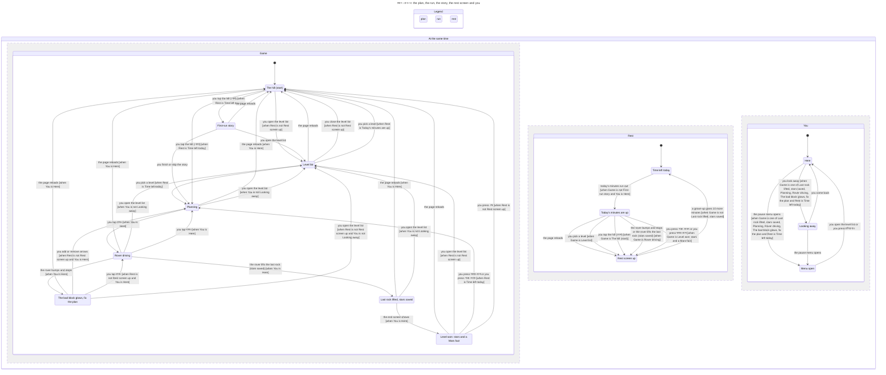

# মঙ্গলে রোভার: statechart

Kids' game (ছোটদের জন্য, ages 6–11). The game was rewritten on 2026-11-05 (design: `ai_docs/game-dev/rewrites/mongole-rover.md`). The first model and its run on the old code are kept in `before-fix/` (`Rover.tla`, `Rover.cfg`, `view.ts`, `report.md`, `chart.mmd`); the old README's two broken rules, the bugs and the live replays are summarised below.

| Spec | What it covers | Mirrors | TLC |
|---|---|---|---|
| `Rover.tla` / `Rover.cfg`, view `view.ts` | the screens (hill, story, level list, plan, run, end screen), a plan and its run on a live clock, চালাও and the separate থামাও, the first-run story, the player's menu, a look-away and the first tap back, the daily limit and the rest screen | `tools/mongole-rover/lib/session.ts`, `lib/run.hot.ts`, `components/game.tsx` (`begin`, `go`, `halt`, `step`, `lift`, `finish`, `useGamePlayer`), `shared/kids-kit.tsx` (`useKidsSession`, `RestScreen`) | 484 states, 1,857 steps; the chart draws 14 states and 41 arrows |

The shared parent gate is modelled once, in `../chhaya-melao/KidsGate.tla`.

**Results (`after-fix/`): all 15 rules hold** (TypeOK, NoDeadlock, and the two action properties count). The chart is `after-fix/chart.mmd` (also below).

**Model check (mutations, in a scratch copy):** putting the old behaviour back breaks the rule at once. Letting the rover move without the live check breaks **NoProgressWhileAway** in 6 steps; dropping both the guard and the "rover has moved" condition from থামাও breaks **OneTapOneRun** in 5; letting the waking tap edit the plan breaks **WakeTapIsNotAMove** in 5.

## Systems modelled
- **Screens:** hill → (story, first run only) → plan → run → won, plus the level list from anywhere. A level that opens past the limit changes nothing but the rest screen.
- **Run:** the clock moves only while `Live` (run screen, menu closed, child here). It ends in the last rock lifted (stars saved and `atBreak()` asked right there), then the end screen after a short beat; or in a bump (back to planning, and `atBreak()`).
- **Stop:** থামাও is its own button over the pad's place. It works only when the 450 ms guard has passed **and** the rover has made its first move.
- **Away and the menu:** one variable, `hand` (here, away, menu). Blur arms a swallow: the first tap back only wakes the game.
- **Kids' limit:** the rest screen shows at a break only (a level opening, the end screen, a missed run), never over the rover driving; a limit passing at the last rock waits for the end screen.
- **Not modelled (pure functions with node tests):** the loop block's counts, the hint path after 3 misses, the result keys (`freshKey`), the arrow-key map.

## Rules, in plain words
| Rule | In plain words | Result |
|---|---|---|
| NoProgressWhileAway | The rover doesn't drive, lift a rock or win while you look away or the menu is open. | holds (**broke on the old code**) |
| OneTapOneRun | One tap on চালাও is one run: a quick second tap, or Enter, never cancels it before the rover moved. | holds (**broke on the old code**) |
| WakeTapIsNotAMove | The tap that brings focus back never adds a block, runs or stops. | holds |
| NoDoubleResult / EveryFinishCounts / ResultMatchesPlay | A level is won and recorded once; the end screen never shows without its stars saved, and they are the plan's stars. | hold |
| RestOnlyAtBreak / NoNewRoundPastLimit / RestStaysUntilAGrownUp | The rest screen is never over the rover driving; past the limit no level or run starts until a grown-up gives time. | hold |
| ChoiceFreezesPlay | The level list freezes play. | holds |
| NoNetwork / NoChildData | Nothing is sent; only stars, play time and the story flag are written. | hold |
| StarsNeverDrop | Best stars only go up. | holds |
`UnlockNeverShrinks` is gone: every level is open. **NoReadingNeeded** and the picture end buttons are checked by node tests (`tests/session.test.ts`).

## The bugs, and how each was fixed
| # | Bug (the reader's sentence) | Fix | Node test | Live check after the fix (Orca) |
|---|---|---|---|---|
| 1 | **"I tapped চালাও twice, like I always do, and the rover didn't move"** (OneTapOneRun). চালাও and থামাও were one JSX ternary, so React kept one `<button>` under the finger and in focus. | থামাও is its own element (`key="stop"`), over the pad's place, never under the finger on চালাও. চালাও stays, disabled. It is ignored for 450 ms **and** until the rover has moved. A held Enter or Space during a run is swallowed; Backspace stops (not a repeat). | `session.test.ts` › OneTapOneRun | Level 1: → then চালাও; 150 ms later `.mr-stop` existed and **was not** `.mr-go`; a click on it and a second pointerdown on চালাও changed nothing (`screen` still `run`); the run won and `{"1":3}` was saved. |
| 2 | **"I picked up my mum's call; when I came back the level was done"** (NoProgressWhileAway). | The run is a clock (`lib/run.hot.ts`) driven by one frame loop that stops while the session isn't live (blur, hide, the player's menu), and gives a 350 ms breath after coming back. The last rock is recorded and the end screen shows only on the live clock. | `session.test.ts` › NoProgressWhileAway; `run.test.ts` | Level 12, → … then blur at once: after 6 s away the clock stood at **−300 ms**, 0 steps, the rover at `translate(0%, 500%)`; `focus` → step 1 within 0.8 s, then the run went on. With P (the player's menu) the clock held at −17 ms through 4 s. |
| 3 | **No intro story** (quality bar §3). | Three panels (picture + one line), a tap shows the next, a 0.6 s hold on the corner button skips; first run only (`ektukhani-intro-mongole-rover`; a phone that already has stars never sees it). | `session.test.ts` › the story | `.shots/mongole-rover-story1.png` |
| 4 | **No arrow keys on a desktop.** | ↑ ← ↓ → add arrows, R আরেক বার, Backspace removes, Enter or Space runs (on a focused control Enter does that control), P pauses through the player. Keys at `window`, no auto-repeat, ignored under the menu. | › arrow keys | Autopilot played all 12 levels by key presses only. |
| 5 | **The rest screen came only after a win.** | `atBreak()` also runs when a level opens and after a missed run. | › RestOnlyAtBreak | — |
| 6 | **No named finale, no pause menu list, words-only end buttons, 44 px pill buttons.** | Four worlds with named finales; `onLevels` opens the pausing list; end buttons are pictures (112 px, and a 96 px tall পরের লেভেল); no sound or slow pill (the player's menu has them). | › kids' rules; `levels.test.ts` | Pause menu → সব লেভেল opened the list (12 cards). |
| — | **Found by the new model:** the first draft let the 450 ms guard alone protect থামাও, but wall time keeps passing while the clock is held (the menu, a look-away), so a stop right after চালাও could still cancel before the rover moved. Added "the rover has moved". | `S.stepped()` | `session.test.ts` › OneTapOneRun | — |
| — | **Found by the new model:** a level opening past the limit (পরের লেভেল on the end screen) cleared the result and the board before the rest check, so the end screen went blank under the rest screen. The reset now follows `S.begin()`. | `begin()` | › a level opening past the limit | — |
| — | **Shared patterns** | No `location.hash` or history; no `setTimeout` in the game; the story's hold timer is cleared on release, pause, blur and unmount; sound scheduled with `tone(…, delay)` so the player's pause cuts it; no voice. | › kids' rules | — |

## Regenerate
```sh
scripts/statechart.sh ai_docs/statecharts/mongole-rover/Rover.tla --view ai_docs/statecharts/mongole-rover/view.ts --out ai_docs/statecharts/mongole-rover/after-fix
rm -f ai_docs/statecharts/mongole-rover/after-fix/tlc*.out
```
The `--out` folder must be new or empty. `Rover.cfg` has `CONSTRAINT Explore`, which stops past a broken history rule and keeps the chart small: plans are empty, bad or the shortest, level 2 only as a fresh level, looking away and the menu only while planning or driving, the daily limit only on level 1 after the story.

## The chart (after the fix)

