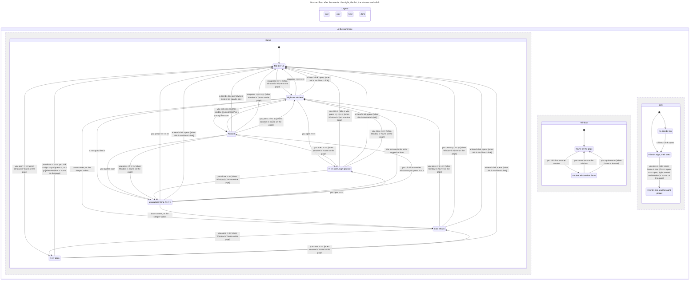

# মশার রাত: statechart

## After the rewrite (`after-fix/`)
The spec `Moshar.tla` now mirrors the rewritten game:
- `components/night-game.tsx` (begin, load, pause, resume, openList, closeList, finishRun, again, swingAt, steerLoops, the key, pointer, blur, focus, visibility and hashchange handlers);
- `lib/session.ts`, the pure phase machine the component runs (`start`, `pause`, `resume`, `away`, `back`, `finish`, `again`, `choiceOk`, `reset`, `pick`, `cheerMayPlay`, `canSwing`, `moving`, `loopStep`);
- `lib/progress.ts`, your own unlock (`afterClear`, `playable`).

It runs twice:
- **Full check** (`Full = TRUE`: three nights, a hidden tab, Enter held through the end): TLC reached 5,568 states (`after-fix/report-full.md`).
- **Chart run** (`Full = FALSE`, as committed): 240 states; the chart has 12 states and 37 arrows (`after-fix/report.md`, `after-fix/chart.mmd`). The whine, the hand and the celebration are checked as rules but not drawn, because each follows the game phase.

**All 15 rules hold in both runs, and so do NoDeadlock and the StarsNeverDrop property.** A mutation check put old behaviours back into copies of the spec: a blur that doesn't pause (PausedWhenBlurred and LoopComesBack break), a tap on the pause that swings (FirstTapOnlyResumes breaks), a resume that forgets the whine (LoopComesBack breaks), and a friend's clear that opens every night (OpenLevelsAreEarned breaks). None of them is vacuous.

| Rule | In plain words | After |
|---|---|---|
| PausedWhenHidden, PausedWhenBlurred | Hiding the tab or clicking into another window pauses the night. | hold |
| InputReleasedWhenAway | Once you leave the window, no arrow counts as held. | holds |
| ChoiceFreezesPlay | While সব রাত is open, the night is still. | holds |
| LoopOnlyWhenMeaningful | The পিন-পিন (and a boss's drone) plays only while a mosquito flies on a focused, visible page with sound on. | holds |
| LoopComesBack | Whenever a mosquito flies on screen with sound on, the whine plays, after a pause or sound off and on too. | holds |
| NoWhineOnTheCard | No whine on the title or the card. | holds |
| NoDoubleResult | A night ends once: stars, the dawn sound and confetti happen once. | holds |
| CelebrationOnItsOwnCard | The stars' notes, confetti or the lose sound play only on their own card. | holds |
| ReplayIsExact | When the friend's night is on, their seed is what flies. | holds |
| HeldKeyNeverSkips (new) | An Enter held from before the card never takes its choice. | holds |
| FirstTapOnlyResumes (new) | The tap that brings you back resumes; it never swings the bat. | holds |
| OpenLevelsAreEarned (new) | Every night below your unlock is one you cleared yourself. | holds |
| StarsNeverDrop (property) | Cleared nights stay cleared. | holds |



### The bugs, fixed, with their tests (`tools/moshar-raat/tests/session.test.ts` unless named)
1. **PausedWhenBlurred + LoopOnlyWhenMeaningful** ("the whine plays on in another window and play comes back with no pause screen"): the game listens to window `blur` itself (and the player's pause sends one): `stopInput()`, `away()` pauses, `stopLoops()`. Focus never resumes by itself; the player's menu (or our own cover outside the player) does. Every step asks `loopStep(live, wanted, soundOn())`, so the whine is made anew whenever it is wanted again. Test: *bug 1 · PausedWhenBlurred + LoopOnlyWhenMeaningful*. **Live in Orca** (Pixel 9, রাত ১, sound counted by wrapping `OscillatorNode.start`, audio suspended by the dev server): t = 2.79 s, 1 whine loop live → `blur` → phase `paused`, the player's menu open, whine off → 300 forced steps: the clock still at the same t → `focus`: still `paused` → চালিয়ে যাও → `playing`, a second whine loop started.
2. **LoopComesBack:** a loop made while muted is a silent stub; `loopStep` never keeps it (`??=` is gone). Test: *LoopComesBack*.
3. **The frozen pops behind the card** (seen while playing): the loop keeps running on the card, so the last pops and sparks finish behind it, and the room breathes.
4. **Scrolling away resumed with no warning:** the player pauses on scroll-off and the game has no own in-view freeze any more.
- **Also fixed:** P calls the player's `requestPause()`; game keys are ignored while paused; arrows are held (300 units/s) and released on blur; the end screen takes only a fresh key after a 0.7 s guard (*HeldKeyNeverSkips*; live: an Enter dispatched the moment রাত ১ ended left the card up, a fresh one 1.3 s later went to রাত ২); celebration timers carry their run (*NoDoubleResult and CelebrationOnItsOwnCard*); a friend's far-ahead night records stars but opens nothing (*OpenLevelsAreEarned*, `ektukhani-unlock-moshar-raat`); clicked buttons drop focus.

### Quality-bar gaps, closed
1. **First screen:** the start is the code-drawn electric bat, mesh crackling, labelled রাত শুরু; the night, its one new thing, the mode chips and the targets are small under it.
2. **Pause:** the shared player's menu on P, Esc, ⏸, blur and hide; the game's own toggles are gone.
3. **Danger at the edges:** one bite left glows the whole edge orange (steady in ধীরে খেলো); a bite or slap pulses red; a diver near the pillow warms the bottom edge and rings the pillow; arrivals get a chevron at the window, door or vent.
4. **HUD:** the seconds to dawn (or the boss's name and pips) top-centre, মশা n/N and bite drops top-right, the dawn line along the top, the streak under it.
5. **Ending:** heading, stars, counted-up stats (মশা, কামড়, টানা সেরা, এক চাপে সেরা), the near-miss line, numbered choices.
6. **First win:** রাত ১ is 10 s; the casual bot wins it in about 7 s.
7. **Keyboard:** held arrows move the ring smoothly; Space swings.
8. **Sound:** the whine's pitch and loudness follow the nearest mosquito; a boss drone; a rooster and birds at dawn.
9. **Story:** three panels on the first run, tap for the next, hold to skip.

### Regenerate
```sh
D=ai_docs/statecharts/moshar-raat
# the drawn chart: Moshar.cfg as committed (Full = FALSE)
scripts/statechart.sh $D/Moshar.tla --view $D/view.ts --out $D/after-fix-new
# the full check: set CONSTANT Full = TRUE in a copy of Moshar.cfg and run it into another folder
rm $D/after-fix-new/tlc*.out
```
The `before-fix/` output came from the original spec, which is in git history (before this rewrite).

## Before the rewrite (the original analysis)

Model: `Moshar.tla`, `Moshar.cfg`, `view.ts`. Report and chart: `before-fix/report.md`, `before-fix/chart.mmd`.
Code mirrored: `tools/moshar-raat/components/moshar-game.tsx`, `tools/moshar-raat/lib/night.ts` (step, swing), `tools/moshar-raat/lib/sound.ts` (whine), `shared/game-kit.ts` (useGameLoop), `shared/game-sound.ts` (loop, setSoundOn), `shared/game-ui.tsx` (SoundToggle).

TLC: 168 states. 2 rules break and 7 hold (counting NoDeadlock and the StarsNeverDrop property).

### Systems modelled
- **Play phase:** ready (lights on, শুরু করো) → play → won (dawn) or lost (the third bite). `results` counts how many times the night ended.
- **Pause and focus:** the tab is visible or hidden, the window is focused or blurred, and the room is on screen or scrolled away. Hide pauses. Scroll-away only makes `looping` false, which freezes the night and stops the whine. Blur only stops useGameLoop's rAF.
- **Time:** the night clock is `n.t += dt`, fed only by useGameLoop's fixed steps. It cannot run while the loop is stopped, so nothing advances while you're away (checked live: t stayed at 4.63 s through a 5 s blur).
- **Input:** taps and Space swing at once; the arrows nudge an aim ring one press at a time. Nothing is held.
- **Sound:** the whine loop `live.whine` is none, a stub (made while muted) or live, plus the site-wide switch. `tick()` recreates it with `??=` every 4th step.
- **Choices:** আবার খেলো / আরেকবার / Space on the lost card (`retry`, straight into play), পরের রাত / Space on the won card and the level grid (`startNight`, to ready).
- **Saved progress:** saved stars (0–2) on a won night.

### Rules
| Rule | In plain words | Result |
|---|---|---|
| PausedWhenHidden | Hiding the tab pauses the night. | holds |
| PausedWhenBlurred | Clicking into another window pauses the night. | **breaks** |
| LoopOnlyWhenMeaningful | The পিন-পিন plays only while mosquitoes fly on a focused, visible page with sound on. | **breaks** |
| LoopComesBack | While the night runs with sound on, the whine is never a silent stub. Turning sound on stops the stub, and the next tick makes a real loop. | holds |
| NoDoubleResult | A night ends once, so stars, confetti and the win sound happen once. `finish()` runs from `tick` and then phase ≠ play. | holds |
| NoWhineOnTheCard | No whine on the won or lost card. | holds |
| StarsNeverDrop (property) | Saved stars only go up. | holds |
| NoProgressWhileAway | The clock and the mosquitoes don't move while you're away. | holds by construction (dt-based), confirmed live |
| ReplayIsExact | A friend's link replays the same night and seed. An invalid link falls back. | checked live (below), not modelled |

### Bugs

#### 1. LoopOnlyWhenMeaningful / PausedWhenBlurred: "I clicked into another window and the mosquito kept whining in my ear, though nothing in the room moved. When I clicked back, the mosquitoes were already diving and there was no pause screen."
- **Path (report):** 0 lights on, waiting → 1 you tap শুরু করো → 2 a mosquito flies near (the whine starts) → 3 you click into another window.
- **Code:** useGameLoop's `blur` listener cancels the rAF, so `tick()` stops and the whine is frozen at its last loudness. `stopWhine()` runs on hide, on `!looping` (paused, not play, or out of view), on `finish` and on the sound switch, but `looping` doesn't include focus, so blur stops nothing. `live.paused` is never set on blur, so focus resumes the night at once.
- **Live replay (Orca, night 1, sound on):** click শুরু করো. At t=3.45 s two mosquitoes fly and the whine is live (1 loop started, 0 stopped). Then `window.dispatchEvent(new Event("blur"))` at t=4.63 s. Five seconds later: **t still 4.63 s, no overlay, and the whine loop still running** (0 loops stopped). Then `focus`, and one second later: t=5.62 s, 3 mosquitoes flying, `paused: false`. Play resumed the moment the window came back.
- **Fix:** on window `blur`, do what `hide` does: `stopWhine()` and, in play, `live.paused = true; setPaused(true)`. **Shared:** the same kit hook as roshi-tana and al-dhore-hati.

#### Seen while playing, not a rule
- When a night ends, the loop stops on the frame that ended it, so the canvas behind the card keeps the bat and the "টানা ৫ / টানা ৬" pops frozen in the room (see `.shots/moshar-raat-over.png`). Draw one clean frame in `finish()`, or let the pops finish.
- Scrolling the room away freezes the night without a pause overlay. Scrolling it back resumes at once. It holds no rule, but it's the same "resume with no warning" feel as bug 1.

#### ReplayIsExact, live
- `#s=777&t=5&l=2&b=1&n=Rafi`: the banner reads "Rafi রাত ২-এ ৫টা মশা মেরেছে।", with `night.seed` 777, level 2, and the first mosquito at 0.500 s, hover x 151.4.
- `#s=777&t=50&l=2&b=1` (zaps + bites > count): no banner, and a fresh night at the unlocked night (2).

### Quality-bar gaps (played end to end in Orca: night 1 with an autopilot that swings at the most dangerous mosquito every 450 ms through the real pointer handler, a 6/8 zap, 2-bite, 2★ dawn at 19 s; then night 2's start screen)
1. **First screen:** শুরু করো is a plain kit button on a dimmed room, not the game's own art (the bat, or the light switch). The news line ("আজ দরজা দিয়েও ঢুকবে।") is good, one new thing per night.
2. **Pause:** there is no pause button and no P/Esc. Only hiding the tab pauses (bug 1). The overlay is just চালিয়ে যাও.
3. **Danger at the edges:** at 2 of 3 bites nothing changes at the screen edge. "পিন-পিন" sits over the mosquito, and the status line under the room reads it out. Add an edge glow for a close dive and for the last bite.
4. **HUD:** good corners (মশা n/N, কামড় n/৩, the dawn bar along the top). But there is no seconds-to-dawn readout during play, and `toDawn` is shown only on the lost card.
5. **Ending:** the won card shows zaps, bites and stars. The best streak (`bestCombo`) is tracked but never shown. The frozen pops stay behind the card (above).
6. **First win:** the first zap comes within about 2 s, but a night lasts 20 s or more, so the first finished round comes after 20 s. Night 1 could be shorter (12–15 s) to land a first dawn sooner.
7. **Keyboard:** each arrow press moves the aim ring 12 units, and holding an arrow relies on key repeat. It's slow on a 360-unit room, so keyboard players can't keep up from night 5 on.
8. **Sound:** a good set (whine, crackle with per-hit ticks, swish, উঁহু, the switch), but the whine keeps going while you're away (bug 1). The win has no dawn cue, such as a rooster or morning birds.
9. **Story:** no intro panel (the power cut, the মশারি). It would suit the world and play once.

Screenshots: `.shots/moshar-raat-ready.png` (night 2's start overlay), `.shots/moshar-raat-over.png` (the night 1 won card, with frozen pops behind it). `.shots/moshar-raat-play.png` is the same frame as `-over`, because the background tab painted late.

### Regenerate (the original spec, from git history)
```sh
scripts/statechart.sh ai_docs/statecharts/moshar-raat/Moshar.tla --view ai_docs/statecharts/moshar-raat/view.ts --out ai_docs/statecharts/moshar-raat/<new-folder>
```
The chart hides "you pick a night". It is in the model and the rule checks.

Replay harness note: same as roshi-tana. rAF was swapped for a 60 Hz MessageChannel pump, state was read from the `live` object in React's hook list, and loops were counted by wrapping `OscillatorNode.start` (the whine is the only argument-less sawtooth start). `document.hidden` is pinned in Orca, so the hide path was checked against the code. Test data was removed afterwards.
