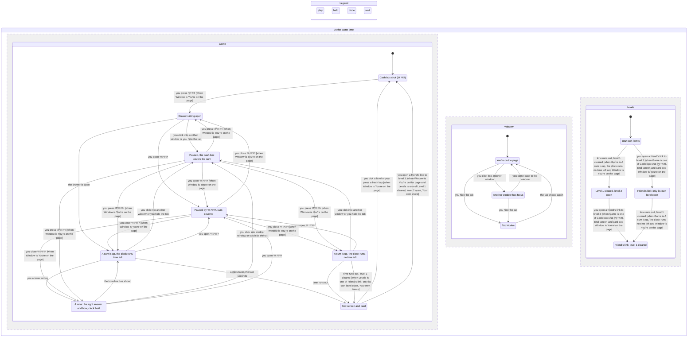

# মুখে মুখে হিসাব: statechart

## After the rewrite (`after-fix/`)
The spec mirrors `tools/mukhe-mukhe-hisab/lib/session.ts` (one round as a reducer: ready → opening → play ⇄ lesson → over, with `why` = away or sheet, and two pausable clocks), `lib/game.ts` (sums dealt lazily by `sumAt`), `lib/save.ts` (your own open level) and `components/hisab-play.tsx` (the listeners, `finalize`, the key handler). TLC reaches 335 states and 1506 steps; the chart draws 15 states and 35 arrows. Regenerated from scratch for this README: the chart is byte-for-byte `after-fix/chart.mmd`.

| Rule | Says | Result |
|---|---|---|
| ClockStillWhileAway | The 60 seconds never run while you are in another window or tab. | holds |
| PausedWhenHidden | Hiding the tab mid-round pauses it. | holds |
| PauseKeepsYourTime | A pause, even hidden twice, keeps every second you had. | holds |
| SumsOutlastTheClock | The round never runs out of sums before the clock does. | holds |
| LevelPickerFreezesPlay | While সব লেভেল is open, nothing counts down, and coming back from another window doesn't restart it. | holds |
| OnlyResumeEndsAPause | Only চালিয়ে যাও (or closing the sheet) ends the pause it belongs to. | holds |
| NoCheerAfterYouMoveOn | The win sound and confetti play only on that round's result. | holds |
| ResultNeedsFreshPress | A key held through the end never skips the result. | holds |
| LinkOpensOnlyItsLevel | A friend's link opens its own level, not the levels before it. | holds |
| SavedUnlockIsEarned | Level 2 opens only after you clear level 1 yourself. | holds |
| UnlockNeverShrinks, TypeOK, NoDeadlock | Unlocked levels never close; no stuck state. | holds |

### The bugs, fixed
1. **SumsOutlastTheClock (the crash after sum 120).** `makeQuestions` dealt 120 sums and the 121st answer read `questions[120].answer`. Sums now come from `sumAt(deck, index)`, which deals more from the same seeded stream when the round gets there; the first 120 of every level and seed are unchanged (pinned by a checksum), so old links replay. Test `bug 3 · SumsOutlastTheClock` answers every 16 ms frame for a whole minute on levels 1, 10, 14 and 30 and gets 7 times the old 120.
   - **Live (headless Chrome, real rAF, `scratchpad/mukhe-mukhe-hisab/fastbot.mjs`):** a bot answering correctly every frame for 70 s: level 1 **3584** answers, level 14 **3501**, level 30 **3481**, no console error, the end screen showed. Level 7 with a wrong answer every 9th: 171 answers, 152 right, no error. The old game broke at answer 120.
2. **ClockStillWhileAway.** The game listens to `blur` and the player's `onPause`; both run `pauseFor("away")`, which banks the clocks. Test `bug 1`. Live (Orca, Pixel 9): clock ৫৯, blur, 3 s later ৫৮, a second blur and `visibilitychange`, 5 s after the first ৫৮ (the old game read ৫৪), the sum hidden behind the cash box (চালিয়ে যাও), then a 0.6 s breath and ৫৭ a second later.
3. **PauseKeepsYourTime.** `pause` banks time only while a clock runs, so a second hide while paused changes nothing. Test `bug 2` (waits of 8 s and 62 s; the old game ended the round at ০সে.).
4. **LinkOpensOnlyItsLevel and SavedUnlockIsEarned.** Your own open level has its own key (`ektukhani-mukhe-mukhe-hisab-open`, migrated once from the old rule); a friend's far-ahead level records its stars and opens nothing between. Test `bug 4`. Live (Orca, empty storage): opened `#s=777&t=0&l=3&r=0`: সব লেভেল shows only levels 1 and 3 open; played level 3 to ৩ তারা; storage `{"3":3}` and open key `1` (the old game opened level 4).
5. **The card ticked sums you got wrong.** The link carries `k`, how the first six sums went; the card draws a tick, a cross with the right answer, or nothing. Old links draw no marks. Test `the card marks each of the first six sums as it really went`. Live: a round with one miss drew ✓ ✓ ✓ ✗ and two blank rows.
6. **Hiding while paused, the sheet, and the focus-back tap.** The sheet outranks an away-pause; answers count only after the breath (`at < s.since`). Tests `LevelPickerFreezesPlay`, `P pauses through the player's menu; Enter needs a fresh press…`.

Quality-bar gaps closed: the player's pause menu (P, Esc, ⏸, blur and hide) that covers the sum; numbered answers 1–4 on screen and on the keys (real key presses checked in Orca); the cash box is the start action and the biggest thing on the screen; amber edge for the last 10 s, red for the last 5; a miss shows the right answer and how, and the clock holds; three named finales with a boss bar; the end screen counts up real stats and shows the sums you missed.



To regenerate:
```sh
scripts/statechart.sh ai_docs/statecharts/mukhe-mukhe-hisab/Hisab.tla --view ai_docs/statecharts/mukhe-mukhe-hisab/view.ts --out <a new folder>
```

---

# Before the rewrite (kept for the record)

Model: `Hisab.tla`, `Hisab.cfg` and `view.ts`, mirrored from `tools/mukhe-mukhe-hisab/components/hisab-game.tsx`, plus `shared/game-core.ts` (`recordLevel`, `unlockedLevel`) and `shared/game-kit.ts` (`useLevels`).
Output: `before-fix/report.md` and `before-fix/chart.mmd`. TLC reached 468 states, and the chart draws 19 states and 41 arrows.

## Systems modelled
- **Round and clock.** The round waits for শুরু করো, then plays, pauses, ends with time's up, or breaks (the error page). Time is one abstract second.
  - `left` is what the game will still give you: `endAt − now` while the clock runs, `clock.remaining` while paused.
  - `owed` is a ghost: the time you should still have.
  - `stale` says `endAt` has slipped into the past while paused (wall time went on).
- **Pause and focus.** The window can be on the page, blurred, or the tab hidden. `hide()` checks only `phaseRef.current === "playing"`, not `paused`. The component has no blur listener.
- **Sums.** `makeQuestions` makes 120 sums (`QUESTIONS`), and the 120th answer moves `run.index` past the end.
- **Timers.** The cheer is queued with `later()`, which `goTo`'s `stopAll()` clears.
- **Choices.** `goTo` is reached from LevelGrid (open during play), আরেকবার, আবার খেলো, পরের লেভেল, Enter and the level arrows.
- **Links and saved progress.** A friend link to level 3 is read on load or on hashchange. Saved progress is `unl` (unlockedLevel) and `c1` (whether level 1 has stars). Levels 2 and 3 act alike here.

Answers are not modelled one by one, except the 120th; the stars are decided when time runs out. Wrong-answer feedback (the 800 ms `miss`) is cleared by `hide()` and `stopAll()`, and no rule reads it.

The chart hides two kinds of step, both of which reset the round: opening a link or starting a level during play.

## Rules, in plain words
| Rule | In plain words | Result |
|---|---|---|
| ClockStillWhileAway | The 60 seconds never run while you're in another window or tab (NoProgressWhileAway, PausedWhenBlurred). | **breaks** |
| PausedWhenHidden | Hiding the tab mid-round pauses it. | holds |
| PauseKeepsYourTime | A pause keeps every second you had. | **breaks** |
| SumsOutlastTheClock | The round never runs out of sums before the clock does. | **breaks** |
| NoCheerAfterYouMoveOn | The win sound and confetti play only on that round's result. | holds |
| LinkOpensOnlyItsLevel | A friend's link opens its own level, not the levels before it. | **breaks** (shared) |
| SavedUnlockIsEarned | The progress saved on this phone opens level 2 or 3 only after you clear level 1. | **breaks** (shared) |
| UnlockNeverShrinks | Unlocked levels never close again. | holds |

3 rules held and 5 broke. TypeOK and NoDeadlock also hold.

## Bugs

### 1. ClockStillWhileAway: "I clicked into another window and my 60 seconds kept running" (shared)
- **Path:** (0) Waiting for শুরু করো → (1) you press শুরু করো → (2) you click into another window. The round is still "Playing, time left".
- **Live replay (Orca, level 1):** 1.2 s after শুরু করো the timer read ৫৯সে. I dispatched `blur` and waited 5 s. It read **৫৪সে.** and no pause cover showed.
- **Fix:** Pause on `blur`, using the same code as `hide()`: save `clock.remaining`, `stopAll()`, `setMiss(null)`, `setPaused(true)`. The cover then hides the sum, so a blur never buys thinking time. Better still, use the shared `useAway()` hook suggested in bhimruler-chak's README.

### 2. PauseKeepsYourTime: "I hid the tab twice while paused, and when I came back my round ended at once" (game)
- **Path:** (0) Waiting → (1) you press শুরু করো → (2) you hide the tab, which pauses with time left → (3) the tab shows again → (4) you wait a while → (5) you hide the tab again while paused. The round now has no time left, though you had time when you paused.
- **Cause:** On the second hide, `phaseRef.current` is still "playing", so `hide()` recomputes `clock.remaining = endAt − now` from the stale `endAt`. All the time spent paused is subtracted.
- **Live replay (headless Chrome; see the note below):**
  - **Short wait:** 2.2 s after শুরু করো the timer read ৫৮সে. I hid the tab, and the pause cover showed চালিয়ে যাও. I showed the tab, waited **8 s**, then hid and showed it again. After চালিয়ে যাও it read **৪৯সে.** (8.5 s lost while paused), then ৪৮সে. a second later.
  - **Long wait:** the same steps with a **62 s** wait. After চালিয়ে যাও the timer read **০সে.**, and 600 ms later the result showed "০টা মিলেছে · ০ পয়েন্ট".
  - On a phone this is common: lock the screen, unlock it, look at the pause card, switch apps, come back.
- **Fix:** In `hide()`, return early when already paused (`if (pausedRef.current) return`). Or keep `remaining` as the source of truth while paused, and only `resume()` turns it back into an `endAt`.

### 3. SumsOutlastTheClock: "I answered fast and the page broke" (game)
- **Path:** (0) Waiting → (1) you press শুরু করো → (2) you answer the 120th sum. The page is broken ("কিছু একটা গড়বড় হয়ে গেছে").
- **Live replay (Orca, level 1):** An autopilot clicked the right choice every 60 ms. Right after **answer 120 (at 8 s)**, the game was replaced by the error page. The console showed `TypeError: Cannot read properties of undefined (reading 'answer')` in `<HisabGame>`, caught by the ErrorBoundaryHandler. Before that, an autopilot playing the friend link's level 3 broke the same way, twice.
- **Who hits it:**
  - 120 answers in 60 s is 2 a second. On the four-choice levels (1–10), keys 1–4 and wrong answers both move to the next sum, so a fast adult can get close.
  - In ধীরে খেলো (90 s) it takes only 1.33 a second.
- **Fix:** Generate sums lazily: `makeQuestions(level, seed, n)` is deterministic, so extend the list when `run.index` nears the end. Or set `QUESTIONS` to more than a human can answer in `SLOW_SECONDS` (for example 400). Either way, guard `shown` so that a missing sum ends the round, not the page. Add a node test that answers `QUESTIONS` times.

### 4. LinkOpensOnlyItsLevel and SavedUnlockIsEarned: "a friend's link to level 3 opened level 2, and after I cleared it, levels 2–4 stayed open for good" (shared; see bhimruler-chak)
- **Path:** (0) No friend link → (1) you open a friend's link to level 3, and levels 2–3 are open with level 1 not cleared → (2) you press শুরু করো → (3) a second passes → (4) time runs out with level 3 cleared. Levels 2–3 are then saved open, and level 1 was never cleared.
- **Live replay (Orca):** With empty storage, I opened `/mukhe-mukhe-hisab#s=777&t=0&l=3&r=0`. LevelGrid showed levels 1–3 open and level 4 locked. I played level 3 with an autopilot (one right answer per 1.5 s): 40 right, 3 stars, and storage `{"3":3}`. I reloaded without the hash. The game **opened on level 4**, and LevelGrid showed levels 1, 2, 3 (৩ তারা) and 4 open.
- **Fix:** Use the shared fix described in bhimruler-chak's README.

## Quality-bar gaps (from playing levels 1 and 3 end to end in Orca)
1. **Pause isn't a menu.** There is no pause button and no P or Esc. The pause cover appears only after the tab hides, and focus loss doesn't pause (bug 1).
2. **The card shows ticks you didn't earn.** `drawCard` writes the level's first 6 sums with the right answers and a red tick whatever you answered, even for "০টা হিসাব মেলালাম". A friend sees sums you got wrong ticked (ResultMatchesPlay in spirit).
3. **Choices aren't numbered on screen.** Keys 1–4 pick the four answers, but the buttons show no numbers. Only the `aria-label` has them.
4. **The first screen leads with words.** The H1 is a bazaar question ("৩ হালি ডিম, হালি ৪৫ টাকা। মোট কত?") and the lead sits above the game. The শুরু করো cover is good, but it is not the biggest thing on the page.
5. **Danger is weak.** The last 10 seconds only set `data-urgent` and play a tick from 5 s down. Nothing glows at the edge.
6. **No new moment inside a round.** Each level adds one idea (good), but within the 60 s nothing changes: no speed-up, no bonus sum, no last-10-seconds moment.
7. **ধীরে খেলো is locked during play** (fine), but the button only looks disabled and nothing says why.

What works: the timer bar and the seconds sit at the top, and the score sits in the page's corners. The result gives the exact near-miss ("আর Nটা মিললে…"). The friend link replays the same sums. The sounds are synthesized, with one signature (the cash-box ching).

Screenshots: `.shots/mukhe-mukhe-hisab-first-screen.png` (the start cover), `.shots/mukhe-mukhe-hisab-playing.png` (a four-choice sum) and `.shots/mukhe-mukhe-hisab-result.png` (the result and the card, whose ticks include sums answered wrong).

## How the replays were done
- In Orca, `blur` was dispatched on `window`. The autopilot read `.mh-line`, worked out the sum, and clicked the matching `.mh-choice`.
- Orca can't hide a tab. It pins `document.hidden` and `document.visibilityState` as non-configurable own getters that always say "visible", in every frame, so `hide()` returns early. Bug 2 needs a hidden tab, so it ran in headless Chrome over CDP, with `Object.defineProperty(document, 'hidden', …)` and `visibilitychange` events.
- I cleared the game's localStorage keys after each replay.

## Regenerate
```sh
scripts/statechart.sh ai_docs/statecharts/mukhe-mukhe-hisab/Hisab.tla --view ai_docs/statecharts/mukhe-mukhe-hisab/view.ts --out ai_docs/statecharts/mukhe-mukhe-hisab/after-fix
rm ai_docs/statecharts/mukhe-mukhe-hisab/after-fix/tlc.out
```
After the fix, every rule must hold.
