# নাম শিখি statechart

The game was rewritten as a picture-name book (`ai_docs/game-dev/rewrites/nam-shikhi.md`). The specs mirror the new code:
- `NamShikhi.tla` / `.cfg` / `view.ts`: the screens, a round of stickers, the player's pause menu, pause and focus, and the daily limit. It mirrors `tools/nam-shikhi/lib/session.ts`, `lib/book.ts` and `components/name-book.tsx`. TLC: 350 states, every rule holds. Chart: `after-fix/chart.mmd` (18 states, 69 arrows).
- `NamShikhiKids.tla` / `.cfg` / `view-kids.ts`: the kids' rules (the limit, the parent gate, sharing, voice, the phone's launch card). TLC: 144 states, every rule holds. Chart: `after-fix-kids/chart.mmd`.
- `before-fix/`: the run of the spec before the rewrite (that spec is in git history). Its findings are below.

## Chart (after the fix)

```mermaid
---
title: "Nam Shikhi: the name book, pause and focus, and the daily limit"
---
stateDiagram-v2
  state "Legend" as legend {
    lg0: play
    lg1: held
    lg2: done
  }
  class lg0 teal
  class lg1 yellow
  class lg2 blue
  state "Game Title or level list" as s0 {
    state "Pause Playing" as s1 {
      s2: Today No rest screen
      s3: Today Rest screen (আজ এট#2497;ক#2497;ই)
    }
    state "Pause Away, next tap only wakes" as s4 {
      s5: Today No rest screen
      s6: Today Rest screen (আজ এট#2497;ক#2497;ই)
    }
    state "Pause Pause menu" as s7 {
      s8: Today No rest screen
      s9: Today Rest screen (আজ এট#2497;ক#2497;ই)
    }
  }
  state "Game A card, stickers on offer" as s10 {
    state "Pause Playing" as s11 {
      s12: Today No rest screen
    }
    state "Pause Pause menu" as s13 {
      s14: Today No rest screen
    }
  }
  state "Game Sticker placed, #8594; shows" as s15 {
    state "Pause Playing" as s16 {
      s17: Today No rest screen
    }
    state "Pause Pause menu" as s18 {
      s19: Today No rest screen
    }
  }
  state "Game Page full and recorded, #8594; shows" as s20 {
    state "Pause Playing" as s21 {
      s22: Today No rest screen
      s23: Today Rest screen (আজ এট#2497;ক#2497;ই)
    }
    state "Pause Pause menu" as s24 {
      s25: Today No rest screen
      s26: Today Rest screen (আজ এট#2497;ক#2497;ই)
    }
  }
  state "Game End screen" as s27 {
    state "Pause Playing" as s28 {
      s29: Today No rest screen
      s30: Today Rest screen (আজ এট#2497;ক#2497;ই)
    }
    state "Pause Pause menu" as s31 {
      s32: Today No rest screen
      s33: Today Rest screen (আজ এট#2497;ক#2497;ই)
    }
  }
  [*] --> s2
  s2 --> s5: the window or tab goes away
  s2 --> s12: খ#2503;ল#2507; or আব#2494;র খ#2503;ল#2507;
  s2 --> s3: today's play time runs out
  s2 --> s8: #9208; or P or the window or tab goes away
  s5 --> s2: the page opens again or the window is back
  s5 --> s6: today's play time runs out
  s12 --> s2: a #35;p= link opens
  s12 --> s17: the child taps the right sticker
  s12 --> s14: #9208; or P or the window or tab goes away
  s3 --> s2: a parent gives ১০ ম#2495;ন#2495;ট more
  s3 --> s6: the window or tab goes away
  s8 --> s2: the page opens again or নত#2497;ন কর#2503; শ#2497;র#2497; or চ#2494;ল#2495;য#2492;#2503; য#2494;ও
  s8 --> s9: today's play time runs out
  s6 --> s5: a parent gives ১০ ম#2495;ন#2495;ট more
  s6 --> s3: the page opens again or the window is back
  s12 --> s3: a #35;p= link opens
  s17 --> s2: a #35;p= link opens
  s17 --> s12: the child presses #8594;
  s17 --> s19: #9208; or P or the window or tab goes away
  s14 --> s12: চ#2494;ল#2495;য#2492;#2503; য#2494;ও
  s14 --> s8: a #35;p= link opens
  s14 --> s2: নত#2497;ন কর#2503; শ#2497;র#2497;
  s9 --> s3: the page opens again or নত#2497;ন কর#2503; শ#2497;র#2497; or চ#2494;ল#2495;য#2492;#2503; য#2494;ও
  s9 --> s8: a parent gives ১০ ম#2495;ন#2495;ট more
  s3 --> s9: the window or tab goes away
  s12 --> s22: the child taps the right sticker
  s17 --> s3: a #35;p= link opens
  s14 --> s9: a #35;p= link opens
  s14 --> s3: নত#2497;ন কর#2503; শ#2497;র#2497;
  s19 --> s17: চ#2494;ল#2495;য#2492;#2503; য#2494;ও
  s19 --> s2: নত#2497;ন কর#2503; শ#2497;র#2497;
  s19 --> s8: a #35;p= link opens
  s22 --> s2: the page opens again or a #35;p= link opens
  s22 --> s29: the child presses #8594;
  s22 --> s25: #9208; or P or the window or tab goes away
  s12 --> s23: the child taps the right sticker
  s19 --> s3: নত#2497;ন কর#2503; শ#2497;র#2497;
  s19 --> s9: a #35;p= link opens
  s29 --> s2: the page opens again or a #35;p= link opens or সব ল#2503;ভ#2503;ল or শ#2503;ষ
  s29 --> s30: today's play time runs out
  s29 --> s32: the window or tab goes away or #9208; or P
  s23 --> s22: a parent gives ১০ ম#2495;ন#2495;ট more
  s23 --> s26: #9208; or P or the window or tab goes away
  s25 --> s2: the page opens again or নত#2497;ন কর#2503; শ#2497;র#2497;
  s25 --> s22: চ#2494;ল#2495;য#2492;#2503; য#2494;ও
  s25 --> s8: a #35;p= link opens
  s30 --> s3: the page opens again or a #35;p= link opens
  s30 --> s29: a parent gives ১০ ম#2495;ন#2495;ট more
  s30 --> s33: the window or tab goes away
  s29 --> s12: খ#2503;ল#2507; or আব#2494;র খ#2503;ল#2507;
  s32 --> s2: the page opens again or নত#2497;ন কর#2503; শ#2497;র#2497;
  s32 --> s8: a #35;p= link opens
  s32 --> s33: today's play time runs out
  s32 --> s29: চ#2494;ল#2495;য#2492;#2503; য#2494;ও
  s26 --> s23: চ#2494;ল#2495;য#2492;#2503; য#2494;ও
  s26 --> s25: a parent gives ১০ ম#2495;ন#2495;ট more
  s33 --> s3: the page opens again or নত#2497;ন কর#2503; শ#2497;র#2497;
  s33 --> s32: a parent gives ১০ ম#2495;ন#2495;ট more
  s33 --> s9: a #35;p= link opens
  s33 --> s30: চ#2494;ল#2495;য#2492;#2503; য#2494;ও
  s10 --> s2: the page opens again
  s10 --> s3: the page opens again
  s15 --> s2: the page opens again
  s15 --> s3: the page opens again
  s20 --> s3: the page opens again
  s21 --> s30: the child presses #8594;
  s21 --> s3: a #35;p= link opens
  s24 --> s3: নত#2497;ন কর#2503; শ#2497;র#2497;
  s24 --> s9: a #35;p= link opens
  class s2 blue
  class s3 yellow
  class s5 blue
  class s6 yellow
  class s8 blue
  class s9 yellow
  class s12 teal
  class s14 teal
  class s17 teal
  class s19 teal
  class s22 teal
  class s23 yellow
  class s25 teal
  class s26 yellow
  class s29 blue
  class s30 yellow
  class s32 blue
  class s33 yellow
```


## Rules in plain words (all hold after the fix)
| Rule | Plain words | Before | After |
|---|---|---|---|
| RestOnlyAtBreak | The rest screen never covers a card in progress. | holds | holds |
| NoNewRoundPastLimit | Once today's time is up, no new round starts without the rest screen first. | **breaks** | holds |
| RestAtTheBreak | Past today's limit, every screen but play shows the rest screen. | (new) | holds |
| WonIsRecorded, RecordedOnce, EndFollowsARecordedRound | The round is recorded at the tap that fills the page, once, and the end screen only follows that. | (new) | holds |
| NothingPlacedUnderTheMenu | No sticker is placed while the pause menu is open. | (new) | holds |
| FirstTapBackIsNotAMove | The tap that brings focus back only wakes the game. | (new) | holds |
| PausedOrWakingWhenAway | A round in play while the window is away is paused or waiting for a wake tap. | (new) | holds |
| SilentWhenMuted, NoVoice | With sound off the game never speaks; now it never speaks at all. | **breaks** | holds |
| NoShareForKids, OnlyParentsGiveMoreTime | While the child has the phone, the gate is shut: no share link, no "more time". | **breaks** | holds |
| NoChildDataLeaves | At most the tool's own address leaves the phone. | (new) | holds |
| LaunchCardStaysLive | On a phone past the limit, the launch card's খেলো still works. | **breaks** (found in the rewrite) | holds |

## Bugs and fixes
Each fix has a node test (`tools/nam-shikhi/tests/`) and a live check in my own Orca tab (Pixel 9).

1. **NoNewRoundPastLimit: "time was up, but she tapped ফল and got a fresh round."** The pack tiles and the level grid sat under the round and started a new one with no break check. A reload also started a round.
   - **Fix:** world tiles and the level list exist only on the title (`choosingAllowed`, `openList`). Every round start goes through `begin(session, atBreak())`, and a link or a reload lands on the title.
   - **Tests:** `bug 1, NoNewRoundPastLimit: …` and `bug 1, the pack tiles and the level list: never tappable mid-round`.
   - **Live:** with the time set to 4,000 s mid-round, there was no rest screen during the round. The stars were saved at the last tap (`27:3`), and the rest screen came with the end screen. A reload past the limit showed the rest screen on the title.
2. **SilentWhenMuted: "sound off, and it still said ছাগল."** The game spoke every right answer.
   - **Fix:** no voice anywhere (the owner's rule): every `speak()`, `SpeakButton` and `speechSynthesis` call is gone. Names come as big name tags under the landed sticker, for a parent to read aloud.
   - **Test:** `the tool never touches the network, never speaks, and never pushes history or sets the hash` (a source grep).
3. **GateNeedsAnAdult / GateClosesWhenTheParentHandsBack / NoShareForKids / OnlyParentsGiveMoreTime (kit):** fixed in `shared/kids-kit.tsx`. The gate now has a two-digit sum, rests 10 s after a wrong answer, ignores key repeat, and shuts after one action, after 20 s or on hide. The share link moved off the play screen into আব্বু-আম্মুকে দেখাও, behind the gate.
4. **LaunchCardStaysLive (new, found while play-testing): "past the limit, the phone's খেলো did nothing."** On a phone the game is mounted but hidden until খেলো. `RestScreen` mounted inside it and its window-wide tap blocker swallowed the launch card's খেলো. The child saw a dead button and no rest screen.
   - **Model:** with the old mount, the kids spec breaks in 2 steps: time runs out → খেলো on the launch card.
   - **Fix:** the game mounts `RestScreen` only once the stage has a size (`player.stage.width > 0`).
   - **Live:** after the fix, the launch card's খেলো opened the player and the rest screen filled it (412 px wide).
   - **Shared:** every kids' game on the player can hit this (see the report to the orchestrator).
5. **Shared patterns of the rewrite:**
   - **A held or quick key on the end screen never starts the next round** (`result keys need a fresh press`). Live: Enter, then a held Enter, then a quick Enter all stayed on the end screen; a fresh Enter after 0.75 s started the round.
   - **The first tap back only wakes the game** (`the click that brings focus back is not a move`).
   - **Nothing is placed under the menu** (`pause: …`). Live: a tap on the right sticker under the menu placed nothing; after চালিয়ে যাও the first tap counted.
   - **A won round is recorded once, at the last tap** (`a won round is recorded once…`).
   - **Old stars move once** (`old stars move once into the new levels…`). Live: the old fol and rong stars became `{9:3, 10:2, 22:1}` plus pashu's; a second change to the old keys was ignored.

## Quality-bar gaps from the first run, and what the rewrite did
1. **Reading:** the old game needed a reader or a parent for every level. Now each world opens with clues that need no reading (a faint sticker place, a bush with a head peeking out, a home, a grey drawing, a lens on the body). The name levels let a pre-reader match word shapes.
2. **Choices during play:** these now exist only on the title (bug 1).
3. **Ending:** two equal 112 px picture buttons (আবার খেলো, শেষ), the full page, and counts that tick up.
4. **Pacing:** 6 worlds × 5–6 levels, one new clue per level, and a named finale per world (চিড়িয়াখানা, মধুমাসের ঝুড়ি, কাঁচাবাজার, মাথা থেকে পা, রঙের বাক্স, লাল-সবুজ) with the world tune and confetti.
5. **Sound:** a signature sticker "চট" pitched per world, a soft boing, a paper swish, and the world tune. Everything goes through `shared/game-sound.ts`, and there's no voice.

## Regenerate
```sh
scripts/statechart.sh ai_docs/statecharts/nam-shikhi/NamShikhi.tla --view ai_docs/statecharts/nam-shikhi/view.ts --out ai_docs/statecharts/nam-shikhi/after-fix
scripts/statechart.sh ai_docs/statecharts/nam-shikhi/NamShikhiKids.tla --view ai_docs/statecharts/nam-shikhi/view-kids.ts --out ai_docs/statecharts/nam-shikhi/after-fix-kids
rm ai_docs/statecharts/nam-shikhi/after-fix*/tlc.out
```
