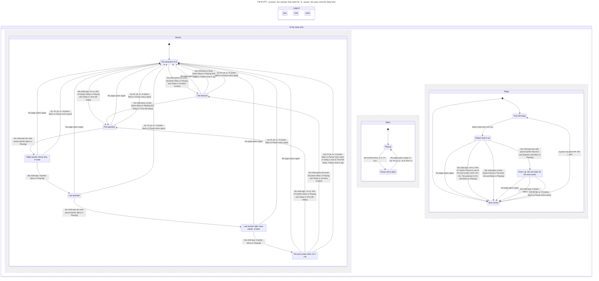

# নিরাপদে থাকি: statechart

The game was rewritten on 2026-11-05 (design: `ai_docs/game-dev/rewrites/nirapode-thaki.md`). The model has three parts, so each chart stays readable. The run on the old code is in `before-fix/` (with the old spec itself); the three runs on the rewritten code are `after-fix/`, `after-fix-pace/` and `after-fix-gates/`. **Every rule holds.**

| Spec | What it covers | Mirrors | TLC |
|---|---|---|---|
| `NirapodeThaki.tla` / `.cfg`, view `view.ts` | the screens (postcard, level list, the round, the end screen), the answer that waits for ➜, the player's pause, coming back from away, a key held through an answer, the daily limit and the rest screen | `tools/nirapode-thaki/lib/session.ts`, `components/game.tsx` (`begin`, `pick`, `onward`, `useGamePlayer`), `shared/kids-kit.tsx` (`useKidsSession`) | 236 states, 1,006 steps |
| `NirapodeThakiPace.tla` / `.cfg` | how many pictures the next question shows: the streak that adds a picture, and that it crosses the end of a round | `lib/play.ts` (`nextPace`, `choiceCount`), `components/game.tsx` (`begin`, `finishRound` pass `roundRef.current.pace`) | 74 states, 111 steps |
| `NirapodeThakiGates.tla` / `.cfg`, view `view-gates.ts` | who has the phone, the share gate on the title, the rest screen's gate | `components/game.tsx` (`<ParentGate key={gateKey}>`, the outside-tap listener), `shared/kids-kit.tsx` | 96 states, 536 steps |

Nothing in the game runs on a timer any more: a right answer shows why and waits for the child's ➜. So the old model's pending timer is gone, and "nothing moves under the menu" is now "➜ does nothing under the menu".

## Rules (plain words), all holding after the fix
- **RestOnlyAtBreak:** the rest screen comes only between rounds. If the limit passes on the last answer, the rest waits for the end screen.
- **NoNewRoundPastLimit:** past today's limit, খেলো, আবার খেলো and a level from the list show the rest screen, not a round. A reload past the limit opens on the rest screen.
- **EveryFinishCounts:** the last right tap saves the stars and checks the limit in that same tap, whatever the hand does next.
- **NothingMovesUnderTheMenu:** ➜ is ignored while the pause menu is open.
- **ChoiceFreezesPlay:** the level list opens only from the title or the end screen, so no question waits under it.
- **SceneTileKeepsRound (bug 2):** no tap on a scene picture can throw a round away: there are no scene tiles in play at all.
- **ResultNeedsFreshPress:** Enter or Space held through an answer or the end screen never moves on or starts the next round.
- **PaceSurvivesTheRound** and **FiveRightAddsAChoice (gap 1):** the pace is kept when a new round starts, so five first-tap rights in a row (even across the end of a scene) add a fourth picture.
- **GateNeedsAnAdult, GateShutOutsideTheTitle, RestGateOnlyOnTheRestScreen, OnlyParentsGiveMoreTime:** only a grown-up opens a gate; the share gate lives on the title only and shuts at its one action, the next touch elsewhere, a round's start or 20 s.
- **Gone:** **SilentWhenMuted** (the site has no voice, so there is nothing left to mute) and **AnswersArePictures** (now a node test: every choice has a picture and no two share one). **ParentGate** (the old bug 3) is a page property, checked live below.

**Mutation checks (scratch copies):** putting back the old behaviours breaks the rules at once. Letting the level list open over a question breaks **ChoiceFreezesPlay** in 2 steps and **SceneTileKeepsRound** in 3. Letting ➜ run under the menu breaks **NothingMovesUnderTheMenu** in 4. Resetting the streak at the end of a round breaks **PaceSurvivesTheRound** in 3.

## The bugs, and how each was fixed
All three bugs were replayed live on the old code on 2026-11-04 (see `before-fix/` and the paragraph at the end). After the rewrite:

| # | Bug (the reader's sentence) | Fix | Node test | Live check after the fix (Orca, own tab, Pixel 9, `localhost:3100` so its storage is private) |
|---|---|---|---|---|
| 1 | **SilentWhenMuted:** "The sound was off, and when I picked the right answer the phone still read the rule out loud." | No voice anywhere (site rule): the game has no `speak`, `SpeakButton` or `speechSynthesis`. Every cue is a picture, a ring, a wobble or a sound effect. | `nirapode-thaki.test.ts` › no voice anywhere | `speechSynthesis.speak` wrapped, a whole round played: **0 calls**. |
| 2 | **SceneTileKeepsRound:** "I was on the third road question. I tapped the road picture below, which was already lit, and I was back on question one." | The scene tiles are gone from play. The level list is its own choice screen and opens only from the title or the end screen. | `session.test.ts` › bug 2 | In play: **0** level cards or `aria-pressed` buttons inside the game. |
| 3 | **ParentGate:** "Under the game there were more pictures, I tapped one, and I was on a grown-ups' page." | `GamePage kids`: the page, rails, grid, header and footer link only to ছোটদের খেলাঘর tools. The share gate sits on the title only. | `nirapode-thaki.test.ts` › the page is the shared player with the kids' frame | 71 links on the page, **0** to `/tools`, `/`, `/amar-chhotobela` or any grown-ups' page; the only others are `#main` and kids' tools. |
| gap 1 | **FiveRightAddsAChoice:** "I got every question right in a row and it never gave me a harder one." | The pace is kept from round to round (`createRound(id, seed, pace)`). | `levels.test.ts` › the run carries into the next round | Level ২ (মেলা), five first-tap rights: round one showed 3,3,3,3,3 pictures; আবার খেলো opened with **4**, `pace.offset` = 1. |
| gap 2 | Scene tiles under the game during play | Removed. | `nirapode-thaki.test.ts` | as bug 2 |
| gap 3 | Questions need reading | The scene holds the situation, a "?" bubble floats over the child, every choice is a picture alone, and the safe one lands in the bubble. One small line is for a parent. | `levels.test.ts` › every question | Screenshots `.shots/nirapode-thaki-q1.png`, `-miss.png`. |
| — | **EveryFinishCounts** (shared pattern) | `pick()` records the stars and calls `atBreak()` in the tap that answers the last question. | `session.test.ts` › every finish counts | Five rights, then `ektukhani-levels-nirapode-thaki` = `{"1":3}` before ➜ was tapped. |
| — | **NoNewRoundPastLimit** (shared pattern) | `begin()` asks `kids.atBreak()` first. | `session.test.ts` › bug 4 | Time set past the limit in my private tab: খেলো → the rest screen, round counter unchanged (1). |
| — | **Pause on blur / first tap back is not a move** (shared patterns) | `onPause` freezes; the swallow arms while a question is open; চালিয়ে যাও clears it. | `session.test.ts` › pause freezes the game | Blur → menu (১ ২ ৩ ·  চালিয়ে যাও · নতুন করে শুরু · শব্দ · ধীরে খেলো), game `inert`; resume → the next tap counts. |
| — | **Result keys need a fresh press / Enter goes to the game** (shared patterns) | Keys at `window`; `freshNext`/`freshKey` ignore repeats and keydowns from before the answer. | `session.test.ts` › result keys need a fresh press | Key `1` picked; a repeating Enter did nothing; a fresh Enter moved on; P opened the menu. |

## The chart (after the fix)


## Regenerate
```sh
D=ai_docs/statecharts/nirapode-thaki
scripts/statechart.sh $D/NirapodeThaki.tla --view $D/view.ts --out $D/after-fix
scripts/statechart.sh $D/NirapodeThakiPace.tla --out $D/after-fix-pace
scripts/statechart.sh $D/NirapodeThakiGates.tla --view $D/view-gates.ts --out $D/after-fix-gates
rm $D/after-fix*/tlc.out
```
Each `--out` folder must be new or empty.

---

## The bugs as replayed on the old code (2026-11-04)
I replayed every bug live in my own Orca tab (Pixel 9, 412×923) at http://127.0.0.1:3100/nirapode-thaki between 10:08 and 10:09 +06, using `.click()`. The Orca browser has no Bangla voice, so in my tab only I replaced `SpeechSynthesisUtterance` and `speechSynthesis` with a recorder holding one `bn-BD` voice, and I counted `OscillatorNode.start` calls.

### 1. SilentWhenMuted: shared (`shared/kids-kit.tsx` `speak()`)
- **The player's sentence:** "The sound was off, and when I picked the right answer the phone still read the rule out loud."
- **Path:** turn sound off → pick the safe one.
- **Live, 10:08:09:** after the toggle ("শব্দ বন্ধ", `ektukhani-sound` = `0`), I made one wrong pick and then the safe one. That gave 0 oscillator starts and 1 speech call: "আগে ডানে তাকাই" with sound = 0. I turned sound back on afterwards.
- **Fix:** in `speak()`, return when `!soundOn()`, and cancel speech when the switch turns off. This is the same fix as গুনে দেখি.

### 2. SceneTileKeepsRound: game
- **The player's sentence:** "I was on the third road question. I tapped the road picture below, which was already lit, and I was back on question one."
- **Path:** answer a question (or miss one) → tap the current scene's tile.
- **Live, 10:08:19:** I answered two questions (রাস্তা পার ৩/৫). The রাস্তা পার tile (`aria-pressed="true"`, 119×112) sits 72 px below the game board. One tap gave রাস্তা পার ১/৫ and `#s=rasta`.
- **Fix:** make the current scene's tile do nothing while a round is in progress. Better, hide the tiles while playing, as the idle screen already shows them.

### 3. ParentGate: shared (`shared/site-shell.tsx` PageFrame)
- **The player's sentence:** "Under the game there were more pictures, I tapped one, and I was on a grown-ups' page."
- **Live, 10:08:38:** the page has 21 links and none is behind a gate. The related cards start 2,560 px below the game: `/amar-chhotobela` (adult), `/gune-dekhi`, `/hat-dhui`, `/abc-bazar` and `/tools`, plus the header with search, the crumbs and the footer. The same tap on সাত টুকরো opened `/amar-chhotobela` directly.
- **Fix:** use a kids' `PageFrame` with no adult links in the child's view.

### Rules that hold, checked live
- **LinkOpensItsScene, 10:08:38:** `#s=chula` opened "চুলা আর গরম জিনিস ১/৫", and `#s=junk` fell back to "রাস্তা পার ১/৫".
- **NoNetwork and NoChildData:** over a whole set, with `fetch`, XHR and `sendBeacon` wrapped, there were 0 calls and 0 new resources. The only write was `ektukhani-levels-nirapode-thaki` = `{"1":1}`.

## Quality-bar gaps (judged in Orca, 10:08–10:09)
1. **The ease never steps up:** three first-tap misses in a row did cut the next question to 2 choices (3,3,3,2,3 over the set). But `missRun` and `rightRun` reset every round, and a set has five questions, so "five right in a row → 4 choices" can't happen until a sixth question.
2. **Scene tiles under the game during play** invite a stray restart (bug 2) and make the page long. The related cards sit 2,560 px down.
3. **Reading:** each question is text, and the 🔈 button appears only with a Bangla voice. The parent note says a parent reads aloud for ages 6–7. Without a voice, nothing on screen carries the question.
4. **End screen:** "আবার খেলো" and "শেষ" are equal (164×60) ✓, but they are words only and under the 72 px target for ages 6–8.
5. **Speech ignores mute** (bug 1).
6. **Good, keep it:** no harm pictures; "আরেকবার ভাবো" plus a hint; the safe answer glows after two misses; one line of why; the done screen lists the five rules and an off-screen task; confetti only after all six scenes; parent facts with sources.

Screenshots: `.shots/nirapode-thaki-first.png` (the first screen, রাস্তা পার), `.shots/nirapode-thaki-done.png` (the done screen).

