# নদী পার: statechart

## After the rewrite (`after-fix/`)
The spec `NodiPar.tla` now mirrors the rewritten game:
- `components/river-game.tsx` (begin, endStory, load, pause, resume, openList, closeList, finishRun, again, steerWater, the key, pointer, blur, focus, visibility and hashchange handlers);
- `lib/session.ts`, the pure phase machine the component runs (`start`, `storyDone`, `pause`, `resume`, `away`, `back`, `finish`, `again`, `choiceOk`, `reset`, `pick`, `cheerMayPlay`, `canHop`, `moving`, `loopStep`);
- `lib/progress.ts` (your own unlock: `afterClear`, `playable`) and `lib/step.hot.ts` (the crossing).

It runs twice:
- **Full check** (`Full = TRUE`: three rivers, a hidden tab, a finger in its 40 ms tap-or-swipe window, Space held through the end, the sound switch): TLC reached 6,026 states (`after-fix/report-full.md`).
- **Chart run** (`Full = FALSE`, as committed): 427 states; the chart has 35 states and 106 arrows (`after-fix/report.md`, `after-fix/chart.mmd`).

**All 18 rules hold in both runs, and so do NoDeadlock and the StarsNeverDrop property.** A mutation check put old behaviours back into copies of the spec; each broke the rule it should:
- a blur that doesn't pause: PausedWhenBlurred and WaterComesBack;
- a friend's link that leaves the crossing running: ShownRiverIsTheOneCrossed and SavedUnderTheRiverCrossed;
- a play-again that keeps the old card's cheer: CheerOnlyOnTheCard;
- a pause that leaves the water on: WaterOnlyWhileCrossing and NoProgressWhileAway;
- a friend's clear that opens the rivers below it: OpenRiversAreEarned.

| Rule | In plain words | Before | After |
|---|---|---|---|
| PausedWhenHidden | Hiding the tab mid-crossing pauses it. | holds | holds |
| PausedWhenBlurred | Clicking into another window mid-crossing pauses it. | **broke** | holds |
| NoProgressWhileAway | The river and its clock only run while you're on the page. | holds (since 6775639) | holds |
| WaterOnlyWhileCrossing, NoWaterOffTheRiver | The water plays only in a live crossing with sound on, never on the title, the story or the card. | **broke** | holds |
| WaterComesBack | A live crossing with sound on has water, after a pause or sound off and on too. | holds | holds |
| ChoiceFreezesPlay | With সব নদী open, the river doesn't run on. | **broke** | holds |
| CheerOnlyOnTheCard | The win sound and confetti play only on their own card. | **broke** | holds |
| ShownRiverIsTheOneCrossed | The page names the river you're actually crossing. | **broke** | holds |
| SavedUnderTheRiverCrossed | Stars and best time are saved under the river crossed. | **broke** | holds |
| CardNeedsAFreshPress (was a property) | A Space held through the last hop never takes the card's choice. | **broke** | holds |
| NoDoubleResult (new) | A crossing ends once: stars, bell and confetti happen once. | n/a | holds |
| InputReleasedWhenAway (new) | A finger in the tap-or-swipe window never outlives the live crossing (blur, hide, pause, list, the end). | n/a | holds |
| FirstTapOnlyResumes (new) | The tap that brings you back resumes; it never hops. | n/a | holds |
| OpenRiversAreEarned (new) | Every river below your unlock is one you cleared yourself; a friend's far-ahead clear opens nothing. | n/a | holds |
| StoryOnlyOnce (new) | The story shows on the first run only. | n/a | holds |
| StarsNeverDrop (property) | Cleared rivers stay cleared. | n/a | holds |
| NoDeadlock | Every state has a way out. | holds | holds |

Each bug path is also a node test (`tests/session.test.ts`: "bug 1" to "bug 5") and was replayed live in Orca after the fix:

| Bug | Test | Live replay after the fix (Orca, Pixel 9 emulation) |
|---|---|---|
| 1. friend's link mid-crossing | `bug 1 · ShownRiverIsTheOneCrossed + SavedUnderTheRiverCrossed` | A crossing of river 2 running; the link for river 5 arrives: the run is dropped (`run null`), the title of river 5 shows with the friend's banner, `ektukhani-levels-nodi-par`, the unlock and both bests are unchanged. |
| 2. held Space | `bug 2 · CardNeedsAFreshPress` | Space held through the last hop of river 5 (auto-repeat every 33 ms): the card appeared at +251 ms and was still up 3.26 s later, no new crossing (before: gone after 454 ms). |
| 3. confetti in the next crossing | `bug 3 · CheerOnlyOnTheCard` | আবার খেলো at +0.8 s on a 3-star card: no confetti canvas and no oscillator start in the window where the cheer used to fire. |
| 4. blur and the click back | `bug 4 · PausedWhenBlurred + WaterOnlyWhileCrossing` | Water loop 1 → blur: the player's menu opens, `t` held at 1.07 s for 2.3 s, water off; চালিয়ে যাও resumes, the water loop is replaced, the boy didn't hop (`hops` 0). |
| 5. list open, clock running | `bug 5 · LevelPickerFreezesPlay` | Crossing at t 0.35 s, the river badge opened সব নদী: phase `paused`, `t` still 0.35 s after 2.5 s, water off (before: 1.83 s → 4.33 s with the list open). |

```mermaid
---
title: "Nodi Par after the rewrite: the crossing, the list, the window and a link"
---
stateDiagram-v2
  state "Legend" as legend {
    lg0: wait
    lg1: play
    lg2: held
    lg3: done
  }
  class lg0 blue
  class lg1 teal
  class lg2 yellow
  class lg3 blue
  state "Game Title (ল#2494;ফ দ#2494;ও)" as s0 {
    state "Window You're on the page" as s1 {
      s2: Link No friend's link
      s3: Link Friend's river
      s4: Link Friend's link, another river picked
    }
    state "Window Another window has focus" as s5 {
      s6: Link No friend's link
      s7: Link Friend's river
      s8: Link Friend's link, another river picked
    }
  }
  state "Game Crossing (water sound on)" as s9 {
    state "Window You're on the page" as s10 {
      s11: Link Friend's river
      s12: Link No friend's link
      s13: Link Friend's link, another river picked
    }
  }
  state "Game The story (first run)" as s14 {
    state "Window You're on the page" as s15 {
      s16: Link No friend's link
    }
    state "Window Another window has focus" as s17 {
      s18: Link No friend's link
    }
  }
  state "Game সব নদ#2496; open" as s19 {
    state "Window You're on the page" as s20 {
      s21: Link No friend's link
      s22: Link Friend's river
      s23: Link Friend's link, another river picked
    }
    state "Window Another window has focus" as s24 {
      s25: Link No friend's link
      s26: Link Friend's river
      s27: Link Friend's link, another river picked
    }
  }
  state "Game Card shows: across, bell rings" as s28 {
    state "Window You're on the page" as s29 {
      s30: Link Friend's river
      s31: Link No friend's link
      s32: Link Friend's link, another river picked
    }
    state "Window Another window has focus" as s33 {
      s34: Link Friend's river
      s35: Link No friend's link
      s36: Link Friend's link, another river picked
    }
  }
  state "Game Paused" as s37 {
    state "Window Another window has focus" as s38 {
      s39: Link Friend's river
      s40: Link No friend's link
      s41: Link Friend's link, another river picked
    }
    state "Window You're on the page" as s42 {
      s43: Link Friend's river
      s44: Link No friend's link
      s45: Link Friend's link, another river picked
    }
  }
  state "Game সব নদ#2496; open, crossing paused" as s46 {
    state "Window You're on the page" as s47 {
      s48: Link Friend's river
      s49: Link No friend's link
      s50: Link Friend's link, another river picked
    }
    state "Window Another window has focus" as s51 {
      s52: Link Friend's river
      s53: Link No friend's link
      s54: Link Friend's link, another river picked
    }
  }
  [*] --> s2
  [*] --> s3
  s2 --> s3: a friend's link opens
  s2 --> s16: you press ল#2494;ফ দ#2494;ও
  s2 --> s6: you click into another window
  s2 --> s21: you open সব নদ#2496;
  s3 --> s11: you press ল#2494;ফ দ#2494;ও
  s3 --> s7: you click into another window
  s3 --> s22: you open সব নদ#2496;
  s11 --> s3: you press নত#2497;ন কর#2503; শ#2497;র#2497;
  s11 --> s30: you reach the far ghat
  s11 --> s39: you click into another window
  s11 --> s43: you press P or #9208;
  s11 --> s48: you open সব নদ#2496;
  s16 --> s2: you press নত#2497;ন কর#2503; শ#2497;র#2497;
  s16 --> s3: a friend's link opens
  s16 --> s12: you finish the story
  s16 --> s18: you click into another window
  s6 --> s2: you come back to the window
  s6 --> s7: a friend's link opens
  s7 --> s3: you come back to the window
  s21 --> s2: you close সব নদ#2496; or you pick a river or you press নত#2497;ন কর#2503; শ#2497;র#2497;
  s21 --> s3: a friend's link opens
  s21 --> s25: you click into another window
  s22 --> s3: you close সব নদ#2496; or you pick a river or you press নত#2497;ন কর#2503; শ#2497;র#2497;
  s22 --> s26: you click into another window
  s22 --> s4: you pick a river
  s30 --> s34: you click into another window
  s30 --> s22: you open সব নদ#2496;
  s30 --> s11: you press আব#2494;র খ#2503;ল#2507;
  s30 --> s3: you press নত#2497;ন কর#2503; শ#2497;র#2497;
  s39 --> s11: you tap the river while paused
  s39 --> s43: you come back to the window
  s43 --> s3: you press নত#2497;ন কর#2503; শ#2497;র#2497;
  s43 --> s11: you press চ#2494;ল#2495;য#2492;#2503; য#2494;ও or you tap the river while paused
  s43 --> s39: you click into another window
  s43 --> s48: you open সব নদ#2496;
  s48 --> s3: you pick a river or you press নত#2497;ন কর#2503; শ#2497;র#2497;
  s48 --> s11: you close সব নদ#2496;
  s48 --> s4: you pick a river
  s48 --> s52: you click into another window
  s12 --> s31: you reach the far ghat
  s12 --> s40: you click into another window
  s12 --> s44: you press P or #9208;
  s12 --> s49: you open সব নদ#2496;
  s12 --> s2: you press নত#2497;ন কর#2503; শ#2497;র#2497;
  s12 --> s3: a friend's link opens
  s18 --> s16: you come back to the window
  s18 --> s7: a friend's link opens
  s25 --> s7: a friend's link opens
  s25 --> s21: you come back to the window
  s26 --> s22: you come back to the window
  s4 --> s13: you press ল#2494;ফ দ#2494;ও
  s4 --> s8: you click into another window
  s4 --> s23: you open সব নদ#2496;
  s34 --> s30: you come back to the window
  s31 --> s35: you click into another window
  s31 --> s21: you open সব নদ#2496;
  s31 --> s12: you press আব#2494;র খ#2503;ল#2507;
  s31 --> s2: you press নত#2497;ন কর#2503; শ#2497;র#2497;
  s31 --> s3: a friend's link opens
  s22 --> s30: you close সব নদ#2496;
  s40 --> s12: you tap the river while paused
  s40 --> s44: you come back to the window
  s40 --> s7: a friend's link opens
  s52 --> s48: you come back to the window
  s44 --> s12: you press চ#2494;ল#2495;য#2492;#2503; য#2494;ও or you tap the river while paused
  s44 --> s40: you click into another window
  s44 --> s49: you open সব নদ#2496;
  s44 --> s2: you press নত#2497;ন কর#2503; শ#2497;র#2497;
  s44 --> s3: a friend's link opens
  s49 --> s12: you close সব নদ#2496;
  s49 --> s2: you pick a river or you press নত#2497;ন কর#2503; শ#2497;র#2497;
  s49 --> s3: a friend's link opens
  s49 --> s53: you click into another window
  s13 --> s4: you press নত#2497;ন কর#2503; শ#2497;র#2497;
  s13 --> s32: you reach the far ghat
  s13 --> s41: you click into another window
  s13 --> s45: you press P or #9208;
  s13 --> s50: you open সব নদ#2496;
  s8 --> s4: you come back to the window
  s2 --> s12: you press ল#2494;ফ দ#2494;ও
  s23 --> s3: you pick a river
  s23 --> s4: you close সব নদ#2496; or you pick a river or you press নত#2497;ন কর#2503; শ#2497;র#2497;
  s23 --> s27: you click into another window
  s35 --> s31: you come back to the window
  s35 --> s7: a friend's link opens
  s21 --> s31: you close সব নদ#2496;
  s32 --> s36: you click into another window
  s32 --> s23: you open সব নদ#2496;
  s32 --> s13: you press আব#2494;র খ#2503;ল#2507;
  s32 --> s4: you press নত#2497;ন কর#2503; শ#2497;র#2497;
  s53 --> s49: you come back to the window
  s53 --> s7: a friend's link opens
  s41 --> s13: you tap the river while paused
  s41 --> s45: you come back to the window
  s45 --> s4: you press নত#2497;ন কর#2503; শ#2497;র#2497;
  s45 --> s13: you press চ#2494;ল#2495;য#2492;#2503; য#2494;ও or you tap the river while paused
  s45 --> s41: you click into another window
  s45 --> s50: you open সব নদ#2496;
  s50 --> s3: you pick a river
  s50 --> s4: you pick a river or you press নত#2497;ন কর#2503; শ#2497;র#2497;
  s50 --> s13: you close সব নদ#2496;
  s50 --> s54: you click into another window
  s27 --> s23: you come back to the window
  s36 --> s32: you come back to the window
  s23 --> s32: you close সব নদ#2496;
  s54 --> s50: you come back to the window
  class s2 blue
  class s3 blue
  class s4 blue
  class s6 blue
  class s7 blue
  class s8 blue
  class s11 teal
  class s12 teal
  class s13 teal
  class s16 blue
  class s18 blue
  class s30 blue
  class s31 blue
  class s32 blue
  class s34 blue
  class s35 blue
  class s36 blue
  class s39 yellow
  class s40 yellow
  class s41 yellow
  class s43 yellow
  class s44 yellow
  class s45 yellow
  class s48 yellow
  class s49 yellow
  class s50 yellow
  class s52 yellow
  class s53 yellow
  class s54 yellow
```



Regenerate (a fresh `--out` each time; delete `tlc*.out`):
```sh
scripts/statechart.sh ai_docs/statecharts/nodi-par/NodiPar.tla --view ai_docs/statecharts/nodi-par/view.ts --out ai_docs/statecharts/nodi-par/<new-folder>
```
For the full check, copy the spec and cfg to a scratch folder and set `CONSTANT Full = TRUE`.

---

# Before the rewrite (kept for the record)

Spec: `NodiPar.tla` / `NodiPar.cfg` / `view.ts`. They mirror `tools/nodi-par/components/river-game.tsx`, `shared/game-kit.ts` (`useGameLoop`) and `shared/game-sound.ts` (`loop()`). Output: `before-fix/report.md` and `before-fix/chart.mmd`. TLC reached 360 states, and the chart draws 36 states and 137 arrows.

The page is **not** in the shared game player. Commit 6775639 landed during this run: `useGameLoop` now freezes on blur, and the model mirrors that. Rivers 1 and 2 in the model stand for "your river" and "a friend's river".

## Systems modelled
- **Play phase:** the ready card → crossing → paused (খেলা থেমে আছে) → across, card shows. Splashes and respawns are inside `stepRun` and not modelled.
- **Which river:** the `level` the page shows and saves under, against `runLevel`, the river `run.current` was built from. A friend's link (`hashchange` → `readFriend`) can change one without the other.
- **Pause and focus:** the tab is visible or hidden, and the window is focused or blurred. Pause comes from থামাও, P, Esc, a tab hide or the stage scrolling out of view (folded into YouPause).
- **Time:** `useGameLoop` with the blur/hide freeze, and the `finish()` cheer timeout (`260·(stars+1)` ms, never cleared).
- **Sound:** the water (`wind`) loop and `soundChanged`.
- **Choices:** the সব নদী drawer, `pickRiver` (the list or পরের নদী), আবার খেলো (`restart()` after the 450 ms guard).
- **Keys:** Space held through the last hop (its auto-repeat reaches the page until a blur or hide).
- **Saved progress:** whether the last `finish()` saved under the river actually crossed (`misSaved`). `useLevels.record` keeps the higher, unit-tested in shared.

## Rules in plain words
| Rule | Says | Result |
|---|---|---|
| PausedWhenHidden | Hide the tab mid-crossing and it's paused when you come back. | holds |
| PausedWhenBlurred | Click into another window mid-crossing and it's paused when you come back. | **breaks** |
| NoProgressWhileAway (property) | The river only moves while you're on the page. | holds (since 6775639) |
| WaterOnlyWhileCrossing | The water sound plays only while you cross on screen, focused, with sound on. | **breaks** |
| WaterComesBack | Crossing, visible, sound on → the water plays. | holds |
| LevelPickerFreezesPlay | With the river list open, the river doesn't run on. | **breaks** |
| CheerOnlyOnTheCard | The win sound and confetti only fire on the card. | **breaks** |
| ShownRiverIsTheOneCrossed | The page names the river you're actually crossing. | **breaks** |
| SavedUnderTheRiverCrossed | Stars and best time are saved under the river you crossed. | **breaks** |
| CardNeedsAFreshPress (property) | The card stays until a fresh press, never because of a key held from before. | **breaks** |

## Bugs
### 1. SavedUnderTheRiverCrossed + ShownRiverIsTheOneCrossed (a friend's link mid-crossing): game-specific
- **The player's version:** "Rafi sent me his river-5 link while I was crossing river 1. The page jumped to river 5, I finished my easy river, and it gave me 3 stars on river 5 and said I beat Rafi by 18.8 seconds."
- **Path:** start → a friend's link opens in this tab → reach the far ghat (3 steps).
- **Why:** `readFriend` runs `setLevel(shared.level)` but keeps `phase` at "playing", so `run.current` keeps crossing the old river. `finish()` records under `level` (`levels.record(level, …)`, `useBest(`${TOOL}-${level}`)`) and builds the card from `level`. `useLevels`' unlock rule then opens every river below 5.
- **Live replay (Orca):** saved before: `levels {"1":3}`, best-1 12, best-5 none. Started river 1, then set `location.hash = s=40595&t=200&l=5&a=0&p=0&n=Rafi`. The label became "নদী ৫ · ওপারে খালার বাড়ি" while the run stayed on river 1 (4 lanes). Crossed in ১.২ সে. The card said **"নদী ৫ পার, ওপারে খালার বাড়ি"** and "Rafi-এর চেয়ে ১৮.৮ সেকেন্ড আগে পৌঁছালে!". Saved after: **`levels {"1":3,"5":3}`, best-5 12** (★ ০ → ৬/৯০, rivers 2–6 open).
- **Fix:** in `readFriend`, if a run is in progress, end it (stopWater, `run.current = null`, ready card), the same as `pickRiver`. Better still, have `finish()` take the level from `played.river.level`, not `level`. Also add a node test: a friend's level arrives mid-run, and the run's result keys to its own river.

### 2. CardNeedsAFreshPress (held Space skips the card): shared pattern
- **The player's version:** "I held Space on the last hop. The card flashed for half a second and a new crossing started."
- **Path:** start → hold Space for the last hop → reach the ghat → Space repeats on the card (4 steps).
- **Why:** the crossing branch ignores `event.repeat`, but the card branch (`phase === "over"` → `restart()`) doesn't check it. Only the 450 ms guard stands in the way, until the 600 ms focus moves to পরের নদী.
- **Live replay (Orca):** Space auto-repeat every 33 ms from row 1. Across in ১.২ সে, and the card showed "নদী ১ পার…". **The card was gone after 454 ms**: phase playing, row 1, a new crossing at t 0.03 s.
- **Fix:** accept card keys only from a keydown that arrives after the card appears, with `!e.repeat` (the rewrite prompt's "Result keys need a fresh press").

### 3. CheerOnlyOnTheCard (confetti on the next crossing): shared pattern
- **The player's version:** "I pressed আবার খেলো straight away and the fanfare and confetti went off in the middle of my next crossing."
- **Path:** start → reach the ghat → আবার খেলো (3 steps).
- **Why:** `finish()` calls `window.setTimeout(… sfx.win(); confetti() …, 260·(stars+1))` and keeps no id. `start()` and `pickRiver` don't clear it. The 1.8 s `setSettling(false)` timer isn't cleared either.
- **Live replay (Orca):** a 3-star, new-record crossing in ১.২ সে. Space at +512 ms → playing. **win + confetti at +997 / +999 ms, phase playing, row 1** (`AudioParam` 1047 Hz and the fixed confetti canvas, both instrumented).
- **Fix:** keep the timeout ids, and clear them in `start`, `pickRiver`, `readFriend` and on unmount.

### 4. PausedWhenBlurred + WaterOnlyWhileCrossing: shared
- **The player's version:** "I clicked my other window. The river froze but the water kept rushing. When I clicked back on the game, the boy jumped forward at once."
- **Path:** start → click into another window (2 steps).
- **Why:** there's no blur listener, so `useGameLoop` freezes the river but `phase` stays "playing" and the water loop keeps going. On focus play resumes, and the click that brings you back is a pointerdown + pointerup on the stage, which runs `input(UP)` and hops.
- **Live replay (Orca; frame rate doesn't matter here, the loop is frozen anyway):** crossing at t 5.52 s, row 0, water loops 1 → blur 2.5 s: **t 5.52 s, water loops 1** → click back on the river: **row 0 → 1**, a hop.
- **Fix:** shared. Move to `GamePage` / `useGamePlayer`. The menu opens on blur, `pause()` stops the water, and the click lands on চালিয়ে যাও.

### 5. LevelPickerFreezesPlay: shared
- **The player's version:** "I opened সব নদী to see my stars and the clock kept running against my time star."
- **Path:** start → open the list (2 steps).
- **Live replay (Orca):** list opened at t 0.35 s → +1.5 s t 1.83 → +4 s **t 4.33 s**, water on. Picking a river from the list does reset the run cleanly (`pickRiver`).
- **Fix:** shared. The river list belongs in the player's pause menu, or opening it pauses.

### How the replays were run
All five ran in **Orca** (pages `b2a5ccad…` and a second tab for bug 2). The run was read through the React fiber (`run.current`). The phase came from `.np-stage[data-phase]`. Water loops were counted through `AudioBufferSourceNode.prototype.start/stop` (`loop = true`), the cheer through `AudioParam.setValueAtTime(1047)` and a `MutationObserver` for the confetti canvas. A small in-page pilot hopped forward only when the landing held through the hop. Note that Orca cuts rAF to about 2 fps after any window `blur` event. That doesn't affect bug 4, because the loop is frozen on blur by design now.

## Quality-bar gaps (river 1 several times in Orca, Pixel 9)
1. **The start action is a plain শুরু করো button on a dark card** over the river. It should be the game's own art, for example the kid's first hop off the ghat. A tap anywhere does start it.
2. **Text above the play area:** the kicker, a two-line H1 and the river line put the stage at y≈235. A friend's banner pushes it further (and stays up on other rivers).
3. **No real pause menu and no pause on blur.** The inline pause card has চালিয়ে যাও and নদীর শুরু থেকে only. It's not in the shared player, so it has no কীভাবে খেলবে, শব্দ or ধীরে খেলো there.
4. **Labels over the play area during play:** "ছপাৎ!", "+১ আম", "কিনারায়!", "ভোঁ!", "স্রোত টেনে নিল!" pop mid-river, and the "ঢং! ঘাটের ঘণ্টা বাজল।" ribbon sits centre-screen at the end.
5. **No danger at the edges.** Drifting towards the screen edge on a raft has no edge cue until you're swept. The কচুরিপানা dip warning is the only early signal.
6. **No story beat:** a world game (a school kid crossing to নানুবাড়ি, খালার বাড়ি…) with only place names. There's no 2–4 panel intro and no named finale river at 10, 20 or 30.
7. **River 1 gives 3 stars in 1.2 s** (two lanes, one mango). The first win is quick, as it should be, but the top rating is nearly free.
8. **Sound is good** (hop variants by surface, splash, the ghat bell, the ferry horn, the water loop that follows the current). There's no world tune.
9. **The end screen is good:** real time, mangoes and splashes, the near line ("আরেকটা তারা: ৭.৬ সেকেন্ড আগে পৌঁছাও…"), পরের নদী as primary, and a personal card with the friend's time as their claim. But see bugs 1 and 2.

Screenshots: `.shots/nodi-par-first-screen.png` (the ready card over river 1), `.shots/nodi-par-over.png` (the far ghat, the bell ribbon, the friend banner still up).

## Regenerate
```sh
scripts/statechart.sh ai_docs/statecharts/nodi-par/NodiPar.tla --view ai_docs/statecharts/nodi-par/view.ts --out ai_docs/statecharts/nodi-par/<new-folder>
rm ai_docs/statecharts/nodi-par/<new-folder>/tlc*.out
```
